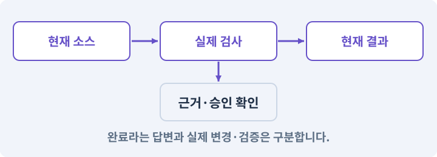

# 100. 두 버전이 같은 게임인지 비교하기

**목표:** 같아야 할 결과와 달라도 되는 부분을 구분합니다.

**시작 상태:** 2D·3D 의규칙·지도·저장

## 한눈에 보는 기능의 흐름

같은 규칙 입력 → 같은 시드 → 데이터 결과 대조 → 물리·화면 별도 검사



**경계:** 화면 픽셀 차이와 규칙 오류를 혼동하지 않기

그림은 실제 게임 실행 결과가 아닙니다. 값·규칙과 예제를 필요한 때 펼쳐 읽고 현재 단계의 메시지를 한 번씩 보냅니다.

## 1. 지금 상태 확인하기

첫 메시지를 보내 현재 준비 상태를 확인합니다. AI가 읽어 온 실제 프로젝트가 맞는지 보고, 없는 준비나 다른 상태가 있으면 먼저 알려 주세요. 아직 기능을 만들지 않는 단계입니다.

### AI에게 보낼 요구와 이유

#### 01. 작업 대상부터 확인

**“두 버전이 같은 게임인지 비교하기” 작업을 시작하기 전에 현재 상태를 읽기 전용으로 확인해 줘.**

왜 이렇게 요청하나요? AI가 다른 프로젝트나 오래된 예제를 보고 작업할 수 있습니다. 실제 경로·파일·현재 기능을 읽게 하면 지금 이어서 작업할 대상을 먼저 맞출 수 있습니다.

#### 02. 작업 대상부터 확인

**필요한 시작 상태는 2D·3D 의규칙·지도·저장야.**

왜 이렇게 요청하나요? AI가 다른 프로젝트나 오래된 예제를 보고 작업할 수 있습니다. 실제 경로·파일·현재 기능을 읽게 하면 지금 이어서 작업할 대상을 먼저 맞출 수 있습니다.

#### 03. 실제 사용 중인 구현 재사용

**실제 프로젝트와 작업 기록을 읽고 이것이 준비되어 있는지, 이미 같은 기능이 있는지 확인해 줘.**

왜 이렇게 요청하나요? 이름이 비슷한 새 클래스를 또 만들면 기존 화면은 여전히 옛 코드를 사용할 수 있습니다. 실제 호출되는 진입점을 찾아 연결해야 두 구현이 충돌하거나 수정이 반영되지 않는 문제를 막습니다.

#### 04. 현재 상태와 다음 확인 지점 구분

**이번 기능이 연결될 실제 파일·화면·도구와 보존할 기존 동작을 짧게 정리해 줘.**

왜 이렇게 요청하나요? 이미 준비된 기능과 아직 확인하지 못한 기능을 섞으면 불필요한 재설치나 성급한 완료 판정이 생깁니다. 현재 대상과 남은 준비를 나눠 가장 작은 다음 작업을 선택하게 합니다.

#### 05. 조사 단계에서 변경하지 않기

**아직 새 구현·설치·유료 호출·파일 변경은 하지 마.**

왜 이렇게 요청하나요? 현재 상태를 알아보기만 할 때 파일 변경이나 결제가 시작되면 검토 전의 환경이 바뀝니다. 준비 확인과 실제 구현을 나눠 되돌리기 어려운 작업이 먼저 실행되지 않게 합니다.

#### 06. 막힌 준비를 먼저 해결

**준비가 다르면 부족한 항목과 다음에 필요한 작업을 알려 줘.**

왜 이렇게 요청하나요? 빠진 파일·권한·패키지를 있다고 가정하면 다음 구현이 엉뚱한 대상을 만들게 됩니다. 무엇이 없고 무엇을 먼저 해야 하는지 분리하면 불필요한 재작업을 줄일 수 있습니다.

<details>
<summary>보낼 원문 전체 — 설명은 복사되지 않습니다</summary>

```text
“두 버전이 같은 게임인지 비교하기” 작업을 시작하기 전에 현재 상태를 읽기 전용으로 확인해 줘.
필요한 시작 상태는 2D·3D 의규칙·지도·저장야. 실제 프로젝트와 작업 기록을 읽고 이것이 준비되어 있는지, 이미 같은 기능이 있는지 확인해 줘.
이번 기능이 연결될 실제 파일·화면·도구와 보존할 기존 동작을 짧게 정리해 줘. 아직 새 구현·설치·유료 호출·파일 변경은 하지 마. 준비가 다르면 부족한 항목과 다음에 필요한 작업을 알려 줘.
```

</details>

**기대 결과:** 규칙·논리 지도·실제 이동의 별도 검사표

### 직접 확인하기

1. AI가 읽은 실제 프로젝트 또는 도구 경로를 확인합니다.
2. 필수 준비가 없다면 문제 해결 요청을 보내고, 준비됐을 때 다음으로 갑니다.

## 2. 필요한 기능 만들기

준비가 확인되면 아래 요청을 보냅니다. AI가 파일·설정·실행을 맡습니다. 변경 범위나 비용 승인이 나오면 내용을 읽고 결정하세요.

### AI에게 보낼 요구와 이유

#### 01. 작업 대상부터 확인

**현재 프로젝트의 실제 파일과 이미 결정한 규칙을 먼저 확인해 줘.**

왜 이렇게 요청하나요? AI가 다른 프로젝트나 오래된 예제를 보고 작업할 수 있습니다. 실제 경로·파일·현재 기능을 읽게 하면 지금 이어서 작업할 대상을 먼저 맞출 수 있습니다.

#### 02. 실제 사용 중인 코드에 연결

**이름이 다른 기존 구현이 있으면 새로 중복 제작하지 말고 그 구현에 연결해 줘.**

왜 이렇게 요청하나요? 예제와 이름이 다르더라도 현재 씬과 입력에서 호출하는 구현이 작업 대상입니다. 같은 기능을 새로 만들기보다 기존 진입점을 확인해 수정이 실제 게임에 반영되고 중복 실행되지 않게 합니다.

#### 03. 관찰 가능한 기준으로 확인

**2D/3D 동등성 검사를 구현해 줘.**

왜 이렇게 요청하나요? 구현 완료라는 설명을 실제 결과로 바꾸기 위한 조건입니다. 요청에 나온 대상과 경계 상황을 확인해 정상 결과뿐 아니라 실패를 어떻게 구분했는지도 남깁니다.

#### 04. 설정과 실제 사용 결과 연결

**Core의 피해/성장/아이템/스킬/퀘스트는 동일 fixture로 정확한 값을 비교해 줘.**

왜 이렇게 요청하나요? 데이터에 수치를 넣어도 사용 조건·UI·실제 전투가 그 값을 읽지 않으면 기능이 완성되지 않습니다. 선택 전후의 계산과 저장을 함께 확인합니다.

#### 05. 무작위 결과를 재현 가능하게

**논리 맵은 generatorVersion/config/seed와 정렬된 Layout 으로 비교해 줘.**

왜 이렇게 요청하나요? 실패한 맵이나 전리품 결과를 다시 만들 수 있어야 원인을 고칠 수 있습니다. 생성 버전·설정·시드를 함께 기록하고 지형·장식·보상 난수를 분리해 작은 변경의 파급을 줄입니다.

#### 06. 같은 규칙과 허용 가능한 표현 차이

**물리 이동은 명시한 허용 오차·도달·벽 관통 여부로 검사하고 픽셀/프레임 완전 일치를 요구하지 마.**

왜 이렇게 요청하나요? 2D와 3D의 물리·카메라는 다르므로 매 프레임 좌표나 픽셀이 같을 필요는 없습니다. 같은 목적지 도달·장애물 차단·규칙 결과를 명시한 오차 안에서 비교합니다.

#### 07. 종류와 실제 소유 물건 구분

**영구 item instanceId를 맵 시드로 재생성하지 마.**

왜 이렇게 요청하나요? 같은 종류의 검 두 자루도 옵션과 소유 위치는 별개입니다. 정의 데이터와 개별 아이템을 나누면 한 물건을 수정했을 때 다른 물건과 원본 규격까지 바뀌지 않습니다.

#### 08. 미확인을 완료와 분리

**각 검사의 실제 실행 프로젝트·모드·기기·결과를 남기고 한쪽만 실행했으면 다른 쪽은 NOT RUN으로 남겨 줘.**

왜 이렇게 요청하나요? 만들어진 것, 검사에 실패한 것, 아직 확인하지 못한 것을 나눠야 다음 작업을 정확히 고를 수 있습니다. 실행할 조건이 없는 기능을 성공으로 기록하면 뒤에서 원인을 찾기 어려워집니다.

#### 09. 아래 항목을 완료 조건으로 사용

**적용할 세부 규칙:**

왜 이렇게 요청하나요? 요구사항의 목록은 AI에게 참고 설명을 주는 것이 아니라 완료를 판단할 기준을 정합니다. 구현 뒤 각 항목을 실제 입력과 결과에 대응시켜 빠진 조건을 찾습니다.

#### 10. 사용 성공과 자원 소비 묶기

**• 구분: 피해·스킬·장비 / 같은 결과의 기준: 같은 입력에 같은 정수 피해, 자원, 쿨다운, 틱 수**

왜 이렇게 요청하나요? 실패한 사용에서 자원이 줄거나 연타로 여러 번 차감되면 표시와 실제 행동이 어긋납니다. 사용 조건·비용·대기시간을 함께 처리하고 실패 시 바뀌지 않아야 할 값을 확인합니다.

#### 11. 설정과 실제 사용 결과 연결

**• 구분: 성장·퀘스트 / 같은 결과의 기준: 같은 XP/레벨/포인트/보상 지급 횟수**

왜 이렇게 요청하나요? 데이터에 수치를 넣어도 사용 조건·UI·실제 전투가 그 값을 읽지 않으면 기능이 완성되지 않습니다. 선택 전후의 계산과 저장을 함께 확인합니다.

#### 12. 무작위 결과를 재현 가능하게

**• 구분: 논리 맵 / 같은 결과의 기준: 같은 버전·설정·시드의 방/통로/역할/연결 해시**

왜 이렇게 요청하나요? 실패한 맵이나 전리품 결과를 다시 만들 수 있어야 원인을 고칠 수 있습니다. 생성 버전·설정·시드를 함께 기록하고 지형·장식·보상 난수를 분리해 작은 변경의 파급을 줄입니다.

#### 13. 구현할 결과와 조건 고정

**• 구분: 실제 이동 / 같은 결과의 기준: 같은 목적지에 도달, 벽 관통 없음, 지정한 위치 오차 이내**

왜 이렇게 요청하나요? “구분: 실제 이동 / 같은 결과의 기준: 같은 목적지에 도달, 벽 관통 없음, 지정한 위치 오차 이내”를 명시하면 AI가 무엇을 구현하거나 검사해야 하는지 범위를 좁힐 수 있습니다. 같아야 할 결과와 달라도 되는 부분을 구분합니다. 이 결과를 확인할 때 이 조건이 실제로 반영됐는지 함께 봅니다.

#### 14. 피할 수 있는 정보와 실제 판정 일치

**• 구분: 렌더링 / 같은 결과의 기준: 같은 외형을 강제하지 않고 적 역할·위험 범위·아이템 등급을 구분**

왜 이렇게 요청하나요? 표시한 위험 범위·시점과 실제 피해가 다르면 플레이어는 올바르게 반응해도 손해를 봅니다. 예고·판정·효과가 같은 규칙을 사용하게 해 공격을 학습할 수 있게 합니다.

#### 15. 종류와 실제 소유 물건 구분

**• 구분: 저장 / 같은 결과의 기준: 같은 instanceId·옵션·슬롯·퀘스트·스킬 상태 보존**

왜 이렇게 요청하나요? 같은 종류의 검 두 자루도 옵션과 소유 위치는 별개입니다. 정의 데이터와 개별 아이템을 나누면 한 물건을 수정했을 때 다른 물건과 원본 규격까지 바뀌지 않습니다.

#### 16. 전투 수치를 한 규칙으로 계산

**기본 비교 fixture는 레벨1 공격력12, 방어0 대상에12피해, 방어20 대상에10피해다.**

왜 이렇게 요청하나요? 표시와 실제 피해 계산이 다르면 장비·레벨·스킬 효과를 믿을 수 없습니다. 경계값과 사망·회복 조건을 명확히 정하고 숫자와 체력바를 함께 비교합니다.

#### 17. 구현할 결과와 조건 고정

**XP40은레벨2, 누적105는레벨3이다.**

왜 이렇게 요청하나요? “XP40은레벨2, 누적105는레벨3이다”를 명시하면 AI가 무엇을 구현하거나 검사해야 하는지 범위를 좁힐 수 있습니다. 같아야 할 결과와 달라도 되는 부분을 구분합니다. 이 결과를 확인할 때 이 조건이 실제로 반영됐는지 함께 봅니다.

#### 18. 장착 결과를 원본에서 재계산

**기본검+4 장착16/해제12와 회전 공격8틱을 포함한다.**

왜 이렇게 요청하나요? 현재 능력치에 보너스를 계속 더하고 빼면 중복 이벤트나 저장 복원에서 오차가 쌓일 수 있습니다. 기본값과 현재 장착 상태에서 다시 계산해야 해제 후 원래 수치로 돌아옵니다.

#### 19. 요청과 실제 권한을 구분

**경로 비교는 이동 시간의 미세한 차이를 허용하지만 맵을 가로지르는 벽 관통이나 목적지 실패를 허용하지 않는다.**

왜 이렇게 요청하나요? 역할 프롬프트에 “이 파일만 수정”이라고 적는 것만으로 경로가 제한되지는 않습니다. 프로그램이 허용 경로와 요청 범위를 검사해 원본·비밀 파일·다른 담당 파일을 보호합니다.

#### 20. 관찰 가능한 기준으로 확인

**기준 오차는 테스트에 명시하고 실패 후 몰래 넓히지 않는다.**

왜 이렇게 요청하나요? 구현 완료라는 설명을 실제 결과로 바꾸기 위한 조건입니다. 요청에 나온 대상과 경계 상황을 확인해 정상 결과뿐 아니라 실패를 어떻게 구분했는지도 남깁니다.

#### 21. 구현과 실행은 AI에게 맡기기

**코드·설정·파일 생성·실행은 네가 맡고, 필요한 화면과 결과를 보여 줘.**

왜 이렇게 요청하나요? 설명이나 코드 조각만 받으면 실제 파일 생성·연결·실행이 빠질 수 있습니다. AI가 개발 작업까지 수행하고, 사람은 요구·승인·결과 판단을 맡도록 역할을 분명히 합니다.

#### 22. 막힌 준비를 먼저 해결

**수행하지 못한 작업과 필요한 승인·도구 연결은 구분해서 알려 줘.**

왜 이렇게 요청하나요? 빠진 파일·권한·패키지를 있다고 가정하면 다음 구현이 엉뚱한 대상을 만들게 됩니다. 무엇이 없고 무엇을 먼저 해야 하는지 분리하면 불필요한 재작업을 줄일 수 있습니다.

<details>
<summary>보낼 원문 전체 — 설명은 복사되지 않습니다</summary>

```text
현재 프로젝트의 실제 파일과 이미 결정한 규칙을 먼저 확인해 줘. 이름이 다른 기존 구현이 있으면 새로 중복 제작하지 말고 그 구현에 연결해 줘.

2D/3D 동등성 검사를 구현해 줘.
Core의 피해/성장/아이템/스킬/퀘스트는 동일 fixture로 정확한 값을 비교해 줘.
논리 맵은 generatorVersion/config/seed와 정렬된 Layout 으로 비교해 줘.
물리 이동은 명시한 허용 오차·도달·벽 관통 여부로 검사하고 픽셀/프레임 완전 일치를 요구하지 마.
영구 item instanceId를 맵 시드로 재생성하지 마.
각 검사의 실제 실행 프로젝트·모드·기기·결과를 남기고 한쪽만 실행했으면 다른 쪽은 NOT RUN으로 남겨 줘.

적용할 세부 규칙:
• 구분: 피해·스킬·장비 / 같은 결과의 기준: 같은 입력에 같은 정수 피해, 자원, 쿨다운, 틱 수
• 구분: 성장·퀘스트 / 같은 결과의 기준: 같은 XP/레벨/포인트/보상 지급 횟수
• 구분: 논리 맵 / 같은 결과의 기준: 같은 버전·설정·시드의 방/통로/역할/연결 해시
• 구분: 실제 이동 / 같은 결과의 기준: 같은 목적지에 도달, 벽 관통 없음, 지정한 위치 오차 이내
• 구분: 렌더링 / 같은 결과의 기준: 같은 외형을 강제하지 않고 적 역할·위험 범위·아이템 등급을 구분
• 구분: 저장 / 같은 결과의 기준: 같은 instanceId·옵션·슬롯·퀘스트·스킬 상태 보존

기본 비교 fixture는 레벨1 공격력12, 방어0 대상에12피해, 방어20 대상에10피해다. XP40은레벨2, 누적105는레벨3이다. 기본검+4 장착16/해제12와 회전 공격8틱을 포함한다.

경로 비교는 이동 시간의 미세한 차이를 허용하지만 맵을 가로지르는 벽 관통이나 목적지 실패를 허용하지 않는다. 기준 오차는 테스트에 명시하고 실패 후 몰래 넓히지 않는다.

코드·설정·파일 생성·실행은 네가 맡고, 필요한 화면과 결과를 보여 줘. 수행하지 못한 작업과 필요한 승인·도구 연결은 구분해서 알려 줘.
```

</details>

**기대 결과:** 확인할 결과: 규칙 일치와 공간 차이를 구분함. AI가 이 상태를 확인할 실제 화면과 변경 내용을 준비합니다. 아직 실행하지 못한 부분은 따로 표시합니다.

### 직접 확인하기

1. 제안서만 반환됐다면 “설명으로 끝내지 말고 승인한 범위의 실제 작업을 수행해 줘”라고 보냅니다.
2. 코드나 설정을 직접 고치라는 안내가 나오면 “작성과 실행은 네가 맡아 줘”라고 요청합니다.

## 3. 결과를 직접 확인하기

먼저 확인 요청을 보내 AI가 검사와 화면을 준비하게 하세요. 그다음 아래 동작을 하나씩 확인합니다.

### AI에게 보낼 요구와 이유

#### 01. 검사할 입력과 관찰 지점 준비

**방금 구현한 기능의 자동 검사와 확인 화면을 준비해 줘.**

왜 이렇게 요청하나요? 정상 예 하나만 보면 실패 조건을 놓치기 쉽습니다. 정상·경계·반례를 실제 입력으로 준비하고 사람이 볼 화면도 맞춰 확인 범위를 분명하게 합니다.

#### 02. 결과를 재확인할 근거 남기기

**정상 동작과 아래 실패 조건을 실제로 검사하고 대상·실행 수·결과를 보여 줘.**

왜 이렇게 요청하나요? “잘 됩니다”라는 요약만으로는 어떤 입력과 버전을 검사했는지 알 수 없습니다. 대상·실행 수·실패 내용·파일을 함께 남겨 같은 조건으로 다시 확인할 수 있게 합니다.

#### 03. 관찰 가능한 기준으로 확인

**정확값과 의미적 검사가 구분되어 있다.**

왜 이렇게 요청하나요? 구현 완료라는 설명을 실제 결과로 바꾸기 위한 조건입니다. 요청에 나온 대상과 경계 상황을 확인해 정상 결과뿐 아니라 실패를 어떻게 구분했는지도 남깁니다.

#### 04. 관찰 가능한 기준으로 확인

**같은 수치·진행·논리 지형을 확인한다.**

왜 이렇게 요청하나요? 구현 완료라는 설명을 실제 결과로 바꾸기 위한 조건입니다. 요청에 나온 대상과 경계 상황을 확인해 정상 결과뿐 아니라 실패를 어떻게 구분했는지도 남깁니다.

#### 05. 관찰 가능한 기준으로 확인

**물리·화면 차이를 숨기지 않고 실제 검증 범위를 기록한다.**

왜 이렇게 요청하나요? 구현 완료라는 설명을 실제 결과로 바꾸기 위한 조건입니다. 요청에 나온 대상과 경계 상황을 확인해 정상 결과뿐 아니라 실패를 어떻게 구분했는지도 남깁니다.

#### 06. 사람 검사의 시작점 준비

**내가 조작해야 하는 부분은 실행할 화면과 시작 상태를 준비해 줘.**

왜 이렇게 요청하나요? 같은 기능이라도 시작 상태가 다르면 관찰 결과가 달라집니다. AI가 실행 화면과 재현 위치를 먼저 준비해야 사람이 이동·공격·소리·조작감을 같은 조건에서 확인할 수 있습니다.

#### 07. 사람이 실제로 본 것만 기록

**연결되지 않은 휴대폰의 터치나 사람이 보지 않은 재미·소리 품질을 대신 확인했다고 하지 마.**

왜 이렇게 요청하나요? AI가 준비한 검사와 사람이 직접 플레이하거나 들은 결과는 다른 근거입니다. 관찰하지 않은 조작감·소리·실기기 결과를 임의로 완료 처리하지 않게 합니다.

#### 08. 실제로 실행한 검사만 인정

**테스트 0개와 예전 소스 결과는 현재 성공으로 쓰지 마.**

왜 이렇게 요청하나요? 실행된 검사가 없거나 같은 결과를 중복 집계한 경우는 기능을 확인한 것이 아닙니다. 실행 수와 개별 결과를 함께 확인해야 형식적인 성공 표시를 걸러낼 수 있습니다.

<details>
<summary>보낼 원문 전체 — 설명은 복사되지 않습니다</summary>

```text
방금 구현한 기능의 자동 검사와 확인 화면을 준비해 줘. 정상 동작과 아래 실패 조건을 실제로 검사하고 대상·실행 수·결과를 보여 줘.

정확값과 의미적 검사가 구분되어 있다. 같은 수치·진행·논리 지형을 확인한다. 물리·화면 차이를 숨기지 않고 실제 검증 범위를 기록한다.

내가 조작해야 하는 부분은 실행할 화면과 시작 상태를 준비해 줘. 연결되지 않은 휴대폰의 터치나 사람이 보지 않은 재미·소리 품질을 대신 확인했다고 하지 마. 테스트 0개와 예전 소스 결과는 현재 성공으로 쓰지 마.
```

</details>

**기대 결과:** 규칙 일치와 공간 차이를 구분함

### 직접 확인하기

1. 같은 공격과 아이템 결과를 비교합니다.
2. 같은 시드에서 방 연결을 확인합니다.
3. 화면 픽셀이 다르다고 규칙 실패로 보지 않는지 확인합니다.

## 4. 결과를 남기고 마무리하기

실제로 본 결과를 아래 메모에 적고 AI에 전달합니다. 결과 저장 요청으로 현재 상태를 남긴 뒤 다음 페이지로 갑니다.

### AI에게 보낼 요구와 이유

#### 01. 결과를 재확인할 근거 남기기

**지금 작업한 “두 버전이 같은 게임인지 비교하기”의 실제 결과를 정리해 줘.**

왜 이렇게 요청하나요? “잘 됩니다”라는 요약만으로는 어떤 입력과 버전을 검사했는지 알 수 없습니다. 대상·실행 수·실패 내용·파일을 함께 남겨 같은 조건으로 다시 확인할 수 있게 합니다.

#### 02. 다음 작업이 읽을 인수인계

**변경한 기능·파일·현재 후보와 실제 실행한 검사, 남은 문제를 기능 이름으로 기록해 줘.**

왜 이렇게 요청하나요? 새 AI 세션은 이전 대화 전체를 알고 있다고 보장할 수 없습니다. 현재 후보·파일 위치·실행한 검사·남은 일을 남겨야 같은 작업을 반복하지 않고 이어갈 수 있습니다.

#### 03. 사람이 실제로 본 것만 기록

**자동 검사 결과와 내가 직접 확인한 결과를 구분하고, 내 관찰이 아직 없으면 미확인으로 남겨 줘.**

왜 이렇게 요청하나요? AI가 준비한 검사와 사람이 직접 플레이하거나 들은 결과는 다른 근거입니다. 관찰하지 않은 조작감·소리·실기기 결과를 임의로 완료 처리하지 않게 합니다.

#### 04. 다음 작업이 읽을 인수인계

**재시작하거나 다음 작업에서 읽을 기록의 실제 위치를 알려 줘.**

왜 이렇게 요청하나요? 새 AI 세션은 이전 대화 전체를 알고 있다고 보장할 수 없습니다. 현재 후보·파일 위치·실행한 검사·남은 일을 남겨야 같은 작업을 반복하지 않고 이어갈 수 있습니다.

#### 05. 미확인을 완료와 분리

**아직 확인하지 않은 결과를 완료로 채우지 마.**

왜 이렇게 요청하나요? 만들어진 것, 검사에 실패한 것, 아직 확인하지 못한 것을 나눠야 다음 작업을 정확히 고를 수 있습니다. 실행할 조건이 없는 기능을 성공으로 기록하면 뒤에서 원인을 찾기 어려워집니다.

<details>
<summary>보낼 원문 전체 — 설명은 복사되지 않습니다</summary>

```text
지금 작업한 “두 버전이 같은 게임인지 비교하기”의 실제 결과를 정리해 줘. 변경한 기능·파일·현재 후보와 실제 실행한 검사, 남은 문제를 기능 이름으로 기록해 줘.
자동 검사 결과와 내가 직접 확인한 결과를 구분하고, 내 관찰이 아직 없으면 미확인으로 남겨 줘. 재시작하거나 다음 작업에서 읽을 기록의 실제 위치를 알려 줘. 아직 확인하지 않은 결과를 완료로 채우지 마.
```

</details>

**기대 결과:** 현재 상태·검사 결과·남은 문제·다음에 읽을 기록을 확인할 수 있습니다.

### 직접 확인하기

1. 자동 검사와 내 관찰 결과가 섞이지 않았는지 봅니다.
2. 문제가 남았다면 해결 요청을 보내고 같은 동작을 다시 확인합니다.

## 이 작업에서 사용할 값과 규칙 전체

설계 시작값이며 측정된 성능·게임 성공 결과가 아닙니다. 구현은 AI가 수행합니다.

| 구분 | 같은 결과의 기준 |
|---|---|
| 피해·스킬·장비 | 같은 입력에 같은 정수 피해, 자원, 쿨다운, 틱 수 |
| 성장·퀘스트 | 같은 XP/레벨/포인트/보상 지급 횟수 |
| 논리 맵 | 같은 버전·설정·시드의 방/통로/역할/연결 해시 |
| 실제 이동 | 같은 목적지에 도달, 벽 관통 없음, 지정한 위치 오차 이내 |
| 렌더링 | 같은 외형을 강제하지 않고 적 역할·위험 범위·아이템 등급을 구분 |
| 저장 | 같은 instanceId·옵션·슬롯·퀘스트·스킬 상태 보존 |

기본 비교 fixture는 레벨1 공격력12, 방어0 대상에12피해, 방어20 대상에10피해다. XP40은레벨2, 누적105는레벨3이다. 기본검+4 장착16/해제12와 회전 공격8틱을 포함한다.

경로 비교는 이동 시간의 미세한 차이를 허용하지만 맵을 가로지르는 벽 관통이나 목적지 실패를 허용하지 않는다. 기준 오차는 테스트에 명시하고 실패 후 몰래 넓히지 않는다.

## 문제가 있으면

### AI에게 보낼 요구와 이유

#### 01. 구현할 결과와 조건 고정

**모든 결과를 하나의 점수로 합치지 마.**

왜 이렇게 요청하나요? “모든 결과를 하나의 점수로 합치지 마”를 명시하면 AI가 무엇을 구현하거나 검사해야 하는지 범위를 좁힐 수 있습니다. 같아야 할 결과와 달라도 되는 부분을 구분합니다. 이 결과를 확인할 때 이 조건이 실제로 반영됐는지 함께 봅니다.

#### 02. 어댑터·인터페이스·의존성 분리의 적용 조건

**처음 달라지는 공통 입력과 어댑터 출력을 찾아 줘.**

왜 이렇게 요청하나요? 인터페이스는 기능에 요구하는 약속이고 어댑터는 서로 다른 구현을 그 약속에 맞춰 연결하는 구성요소입니다. 의존성 주입은 사용할 구현을 외부에서 지정하는 방식입니다. 모든 작은 함수를 인터페이스로 만들 필요는 없습니다. 실제 교체·검사 경계에 사용합니다.

#### 03. 원인 하나를 좁혀 수정

**새 기능을 추가하지 말고 현재 오류와 실제 로그를 먼저 읽어 줘.**

왜 이렇게 요청하나요? 오류 수정 중 새 기능까지 넣으면 어떤 변경이 문제를 해결하거나 악화했는지 알기 어렵습니다. 원래 재현을 보존하고 작은 변경 뒤 같은 입력과 주변 정상 동작을 다시 확인합니다.

#### 04. 원인 하나를 좁혀 수정

**최소 수정 뒤 같은 재현과 관련 정상 동작을 다시 검사해 줘.**

왜 이렇게 요청하나요? 오류 수정 중 새 기능까지 넣으면 어떤 변경이 문제를 해결하거나 악화했는지 알기 어렵습니다. 원래 재현을 보존하고 작은 변경 뒤 같은 입력과 주변 정상 동작을 다시 확인합니다.

#### 05. 실패도 재현 자료로 보존

**실패 기록은 지우지 마.**

왜 이렇게 요청하나요? 실패한 입력과 로그가 있어야 같은 문제가 다시 생겼을 때 비교할 수 있습니다. 성공 기록으로 덮어쓰지 않고 전후 자료를 남기면 무엇을 고쳤는지 확인할 수 있습니다.

<details>
<summary>보낼 원문 전체 — 설명은 복사되지 않습니다</summary>

```text
모든 결과를 하나의 점수로 합치지 마. 처음 달라지는 공통 입력과 어댑터 출력을 찾아 줘.
새 기능을 추가하지 말고 현재 오류와 실제 로그를 먼저 읽어 줘. 최소 수정 뒤 같은 재현과 관련 정상 동작을 다시 검사해 줘. 실패 기록은 지우지 마.
```

</details>

## 새 세션에서 이어가기

### AI에게 보낼 요구와 이유

#### 01. 이어서 할 작업 식별

**“두 버전이 같은 게임인지 비교하기” 작업을 이어가고 싶어.**

왜 이렇게 요청하나요? 이름으로 재개할 작업을 찾고, 뒤에 이어지는 요청으로 실제 파일·진행 중 작업·기록을 다시 읽게 합니다. 제목만 보고 이전 상태를 기억한다고 가정하지 않습니다.

#### 02. 조회는 상태를 바꾸지 않게

**실제 프로젝트와 내 도구의 작업 기록을 읽고 어디까지 구현·검사됐는지 확인해 줘.**

왜 이렇게 요청하나요? 진행 상황을 물을 때 새 구현이나 유료 호출이 시작되면 단순 확인이 실행 명령이 되어 버립니다. 저장된 근거를 읽어 완료·진행·승인 대기·미검증을 나누게 합니다.

#### 03. 재개 전 중복 작업 방지

**진행 중인 프로세스·승인·미저장 변경을 확인한 뒤 남은 가장 작은 작업부터 안내해 줘.**

왜 이렇게 요청하나요? 대화가 끊겨도 외부 작업은 끝났거나 아직 실행 중일 수 있습니다. 프로세스·승인·미저장 상태를 먼저 읽어 같은 생성·빌드·결제를 두 번 시작하지 않도록 합니다.

#### 04. 되돌아갈 원본 남기기

**기존 성공과 실패 기록은 보존해 줘.**

왜 이렇게 요청하나요? 새 구현이 실패해도 이전 게임과 저장을 복원할 수 있어야 합니다. 현재 내용을 먼저 조사하고 별도 후보에서 작업하면 실험이 유일한 정상본을 망가뜨리는 일을 피할 수 있습니다.

<details>
<summary>보낼 원문 전체 — 설명은 복사되지 않습니다</summary>

```text
“두 버전이 같은 게임인지 비교하기” 작업을 이어가고 싶어. 실제 프로젝트와 내 도구의 작업 기록을 읽고 어디까지 구현·검사됐는지 확인해 줘. 진행 중인 프로세스·승인·미저장 변경을 확인한 뒤 남은 가장 작은 작업부터 안내해 줘. 기존 성공과 실패 기록은 보존해 줘.
```

</details>

## 왜 이렇게 만드는가

두 화면이 비슷하다고 같은 게임 규칙이 보장되는 것은 아니다. 반대로 캐릭터의 한 프레임 위치가 다르다고 규칙이 틀렸다는 뜻도 아니다. 순수 규칙은 정확한 값으로, 물리 이동은 허용 오차와 도달 여부로, 화면은 사람이 의미를 확인하는 방식으로 비교한다.

같은 랜덤 시드는 논리 지형 재현에 사용한다. 운영체제·물리 엔진·렌더링까지 완전히 동일한 프레임을 보장한다는 뜻이 아니다. 소유 아이템 UUID는 영구 정체성이므로 단순히 맵 시드만으로 생성하지 않는다.

## 공식 참고

