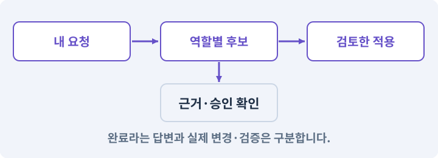

# 105. 내 개발 도구를 빈 폴더에서 시작하기

**목표:** 내가 만든 작은 도구를 대화로 실행합니다.

**시작 상태:** AI와 작업할 수 있는 로컬 환경

## 한눈에 보는 기능의 흐름

빈 별도 폴더 → 작은 실행 진입점 → 기능·경로 응답 → 아직 없는 기능 표시



**경계:** 완성 하네스를 먼저 복사하지 않기

그림은 실제 게임 실행 결과가 아닙니다. 값·규칙과 예제를 필요한 때 펼쳐 읽고 현재 단계의 메시지를 한 번씩 보냅니다.

## 1. 지금 상태 확인하기

첫 메시지를 보내 현재 준비 상태를 확인합니다. AI가 읽어 온 실제 프로젝트가 맞는지 보고, 없는 준비나 다른 상태가 있으면 먼저 알려 주세요. 아직 기능을 만들지 않는 단계입니다.

### AI에게 보낼 요구와 이유

#### 01. 구현할 결과와 조건 고정

**게임 프로젝트와 별도로 내 개발 도구를 시작하려고 해.**

왜 이렇게 요청하나요? “게임 프로젝트와 별도로 내 개발 도구를 시작하려고 해”를 명시하면 AI가 무엇을 구현하거나 검사해야 하는지 범위를 좁힐 수 있습니다. 내가 만든 작은 도구를 대화로 실행합니다. 이 결과를 확인할 때 이 조건이 실제로 반영됐는지 함께 봅니다.

#### 02. 작업 대상부터 확인

**로컬에서 파일·프로세스를 실제로 다룰 수 있는지, MyGameHarness라는 새 폴더를 만들 안전한 위치와 런타임 설치 상태를 읽기 전용으로 확인해 줘.**

왜 이렇게 요청하나요? AI가 다른 프로젝트나 오래된 예제를 보고 작업할 수 있습니다. 실제 경로·파일·현재 기능을 읽게 하면 지금 이어서 작업할 대상을 먼저 맞출 수 있습니다.

#### 03. 구현할 결과와 조건 고정

**아직 폴더나 코드를 만들지 말고 기존 게임·기존 도구와 충돌하지 않는 위치를 알려 줘.**

왜 이렇게 요청하나요? “아직 폴더나 코드를 만들지 말고 기존 게임·기존 도구와 충돌하지 않는 위치를 알려 줘”를 명시하면 AI가 무엇을 구현하거나 검사해야 하는지 범위를 좁힐 수 있습니다. 내가 만든 작은 도구를 대화로 실행합니다. 이 결과를 확인할 때 이 조건이 실제로 반영됐는지 함께 봅니다.

#### 04. 새 도구 설치의 승인 범위

**설치가 필요하면 공식 출처와 승인할 내용을 먼저 설명해 줘.**

왜 이렇게 요청하나요? 이미 있는 프로그램을 다시 설치하지 않도록 먼저 조사합니다. 필요한 설치만 출처·버전·설치 위치를 보여 준 뒤 수행하게 하여 환경 변경을 통제합니다.

<details>
<summary>보낼 원문 전체 — 설명은 복사되지 않습니다</summary>

```text
게임 프로젝트와 별도로 내 개발 도구를 시작하려고 해. 로컬에서 파일·프로세스를 실제로 다룰 수 있는지, MyGameHarness라는 새 폴더를 만들 안전한 위치와 런타임 설치 상태를 읽기 전용으로 확인해 줘.
아직 폴더나 코드를 만들지 말고 기존 게임·기존 도구와 충돌하지 않는 위치를 알려 줘. 설치가 필요하면 공식 출처와 승인할 내용을 먼저 설명해 줘.
```

</details>

**기대 결과:** 게임과 구분되는 새 도구 경로

### 직접 확인하기

1. AI가 읽은 실제 프로젝트 또는 도구 경로를 확인합니다.
2. 필수 준비가 없다면 문제 해결 요청을 보내고, 준비됐을 때 다음으로 갑니다.

## 2. 필요한 기능 만들기

준비가 확인되면 아래 요청을 보냅니다. AI가 파일·설정·실행을 맡습니다. 변경 범위나 비용 승인이 나오면 내용을 읽고 결정하세요.

### AI에게 보낼 요구와 이유

#### 01. 구현할 결과와 조건 고정

**게임과 별도의 빈 MyGameHarness 폴더에서 내 개발 도구를 만들어 줘.**

왜 이렇게 요청하나요? “게임과 별도의 빈 MyGameHarness 폴더에서 내 개발 도구를 만들어 줘”를 명시하면 AI가 무엇을 구현하거나 검사해야 하는지 범위를 좁힐 수 있습니다. 내가 만든 작은 도구를 대화로 실행합니다. 이 결과를 확인할 때 이 조건이 실제로 반영됐는지 함께 봅니다.

#### 02. 관찰 가능한 기준으로 확인

**현재 로컬 쓰기·프로세스 실행 권한과 필요한 런타임 설치를 확인하고 설치가 필요하면 먼저 승인받아 줘.**

왜 이렇게 요청하나요? 구현 완료라는 설명을 실제 결과로 바꾸기 위한 조건입니다. 요청에 나온 대상과 경계 상황을 확인해 정상 결과뿐 아니라 실패를 어떻게 구분했는지도 남깁니다.

#### 03. 파일 경로·절대 경로·상대 경로의 적용 조건

**첫 기능은 도구 이름·실제 작업 경로·현재 가능한 기능·아직 없는 기능을 반환하는 실행 진입점과 상태 안내뿐이야.**

왜 이렇게 요청하나요? 경로는 파일의 위치를 가리키는 주소입니다. 절대 경로는 기준 위치까지 포함하고, 상대 경로는 현재 폴더를 기준으로 해석합니다. 파일명 검사는 보안 샌드박스가 아닙니다. 심볼릭 링크·외부 코드 실행 등의 별도 위험도 있습니다.

#### 04. 구현할 결과와 조건 고정

**전체 완성 하네스를 복사하지 마.**

왜 이렇게 요청하나요? “전체 완성 하네스를 복사하지 마”를 명시하면 AI가 무엇을 구현하거나 검사해야 하는지 범위를 좁힐 수 있습니다. 내가 만든 작은 도구를 대화로 실행합니다. 이 결과를 확인할 때 이 조건이 실제로 반영됐는지 함께 봅니다.

#### 05. 설정과 실제 사용 결과 연결

**내가 “내 개발 도구를 실행해 줘”라고 말하면 실제 작성본을 실행하는 harness-build 스킬을 만들어 줘.**

왜 이렇게 요청하나요? 데이터에 수치를 넣어도 사용 조건·UI·실제 전투가 그 값을 읽지 않으면 기능이 완성되지 않습니다. 선택 전후의 계산과 저장을 함께 확인합니다.

#### 06. 설정과 실제 사용 결과 연결

**스킬은 도구의 실제 절대 경로를 기록하고, 프로그램이 없으면 없다고 알려야 해.**

왜 이렇게 요청하나요? 데이터에 수치를 넣어도 사용 조건·UI·실제 전투가 그 값을 읽지 않으면 기능이 완성되지 않습니다. 선택 전후의 계산과 저장을 함께 확인합니다.

#### 07. 관찰 가능한 기준으로 확인

**빈 폴더에서 필요한 패키지·파일·테스트를 생성하고 첫 실행·잘못된 위치·없는 상태를 실제로 검사해 줘.**

왜 이렇게 요청하나요? 구현 완료라는 설명을 실제 결과로 바꾸기 위한 조건입니다. 요청에 나온 대상과 경계 상황을 확인해 정상 결과뿐 아니라 실패를 어떻게 구분했는지도 남깁니다.

#### 08. 구현할 결과와 조건 고정

**코드와 명령은 네가 작성하고 실행해 줘.**

왜 이렇게 요청하나요? “코드와 명령은 네가 작성하고 실행해 줘”를 명시하면 AI가 무엇을 구현하거나 검사해야 하는지 범위를 좁힐 수 있습니다. 내가 만든 작은 도구를 대화로 실행합니다. 이 결과를 확인할 때 이 조건이 실제로 반영됐는지 함께 봅니다.

#### 09. 구현할 결과와 조건 고정

**입력→실행→결과가 어디로 이어지는지 정상 예와 오류 예로 설명해 줘.**

왜 이렇게 요청하나요? “입력→실행→결과가 어디로 이어지는지 정상 예와 오류 예로 설명해 줘”를 명시하면 AI가 무엇을 구현하거나 검사해야 하는지 범위를 좁힐 수 있습니다. 내가 만든 작은 도구를 대화로 실행합니다. 이 결과를 확인할 때 이 조건이 실제로 반영됐는지 함께 봅니다.

#### 10. 훅을 이벤트 보조 장치로 사용

**게임 파일 수정·모델 유료 호출·훅 자동 실행은 아직 하지 마.**

왜 이렇게 요청하나요? 실행 전과 실행 후 훅은 할 수 있는 일이 다릅니다. 상태 안내·검증 무효화·중복 방지와 같은 연결을 맡기되 훅 실행 자체를 테스트 성공이나 무제한 실행 권한으로 보지 않습니다.

#### 11. 설정과 실제 사용 결과 연결

**현재 작성한 MyGameHarness를 확장하고 필요한 파일·테스트·스킬 연결을 직접 만들어 실행해 줘.**

왜 이렇게 요청하나요? 데이터에 수치를 넣어도 사용 조건·UI·실제 전투가 그 값을 읽지 않으면 기능이 완성되지 않습니다. 선택 전후의 계산과 저장을 함께 확인합니다.

#### 12. 아래 항목을 완료 조건으로 사용

**정상 예와 실패 예를 실제로 보여 주고, 기존 기능이 유지되는지 확인해 줘.**

왜 이렇게 요청하나요? 요구사항의 목록은 AI에게 참고 설명을 주는 것이 아니라 완료를 판단할 기준을 정합니다. 구현 뒤 각 항목을 실제 입력과 결과에 대응시켜 빠진 조건을 찾습니다.

<details>
<summary>보낼 원문 전체 — 설명은 복사되지 않습니다</summary>

```text
게임과 별도의 빈 MyGameHarness 폴더에서 내 개발 도구를 만들어 줘. 현재 로컬 쓰기·프로세스 실행 권한과 필요한 런타임 설치를 확인하고 설치가 필요하면 먼저 승인받아 줘.
첫 기능은 도구 이름·실제 작업 경로·현재 가능한 기능·아직 없는 기능을 반환하는 실행 진입점과 상태 안내뿐이야. 전체 완성 하네스를 복사하지 마.
내가 “내 개발 도구를 실행해 줘”라고 말하면 실제 작성본을 실행하는 harness-build 스킬을 만들어 줘. 스킬은 도구의 실제 절대 경로를 기록하고, 프로그램이 없으면 없다고 알려야 해.
빈 폴더에서 필요한 패키지·파일·테스트를 생성하고 첫 실행·잘못된 위치·없는 상태를 실제로 검사해 줘. 코드와 명령은 네가 작성하고 실행해 줘.
입력→실행→결과가 어디로 이어지는지 정상 예와 오류 예로 설명해 줘. 게임 파일 수정·모델 유료 호출·훅 자동 실행은 아직 하지 마.

현재 작성한 MyGameHarness를 확장하고 필요한 파일·테스트·스킬 연결을 직접 만들어 실행해 줘. 정상 예와 실패 예를 실제로 보여 주고, 기존 기능이 유지되는지 확인해 줘.
```

</details>

**기대 결과:** 확인할 결과: 첫 실행기와 제작 스킬이 실제로 연결됨. AI가 이 상태를 확인할 실제 화면과 변경 내용을 준비합니다. 아직 실행하지 못한 부분은 따로 표시합니다.

### 직접 확인하기

1. 제안서만 반환됐다면 “설명으로 끝내지 말고 승인한 범위의 실제 작업을 수행해 줘”라고 보냅니다.
2. 코드나 설정을 직접 고치라는 안내가 나오면 “작성과 실행은 네가 맡아 줘”라고 요청합니다.

## 3. 결과를 직접 확인하기

먼저 확인 요청을 보내 AI가 검사와 화면을 준비하게 하세요. 그다음 아래 동작을 하나씩 확인합니다.

### AI에게 보낼 요구와 이유

#### 01. 검사할 입력과 관찰 지점 준비

**현재 구현한 “내 개발 도구를 빈 폴더에서 시작하기”의 자동 검사와 도구 결과 화면을 준비해 줘.**

왜 이렇게 요청하나요? 정상 예 하나만 보면 실패 조건을 놓치기 쉽습니다. 정상·경계·반례를 실제 입력으로 준비하고 사람이 볼 화면도 맞춰 확인 범위를 분명하게 합니다.

#### 02. 결과를 재확인할 근거 남기기

**정상 동작과 아래 실패 조건을 실제로 검사하고 대상·실행 수·결과를 보여 줘.**

왜 이렇게 요청하나요? “잘 됩니다”라는 요약만으로는 어떤 입력과 버전을 검사했는지 알 수 없습니다. 대상·실행 수·실패 내용·파일을 함께 남겨 같은 조건으로 다시 확인할 수 있게 합니다.

#### 03. 구현할 결과와 조건 고정

**첫 실행이 도구 이름과 아직 연결되지 않은 기능을 구분한다.**

왜 이렇게 요청하나요? “첫 실행이 도구 이름과 아직 연결되지 않은 기능을 구분한다”를 명시하면 AI가 무엇을 구현하거나 검사해야 하는지 범위를 좁힐 수 있습니다. 내가 만든 작은 도구를 대화로 실행합니다. 이 결과를 확인할 때 이 조건이 실제로 반영됐는지 함께 봅니다.

#### 04. 구현할 결과와 조건 고정

**비어 있는 폴더에서 필요한 파일이 실제 생성된다.**

왜 이렇게 요청하나요? “비어 있는 폴더에서 필요한 파일이 실제 생성된다”를 명시하면 AI가 무엇을 구현하거나 검사해야 하는지 범위를 좁힐 수 있습니다. 내가 만든 작은 도구를 대화로 실행합니다. 이 결과를 확인할 때 이 조건이 실제로 반영됐는지 함께 봅니다.

#### 05. 구현할 결과와 조건 고정

**잘못된 실행 위치의 실패를 AI가 격리 사본에서 재현·수정한다.**

왜 이렇게 요청하나요? “잘못된 실행 위치의 실패를 AI가 격리 사본에서 재현·수정한다”를 명시하면 AI가 무엇을 구현하거나 검사해야 하는지 범위를 좁힐 수 있습니다. 내가 만든 작은 도구를 대화로 실행합니다. 이 결과를 확인할 때 이 조건이 실제로 반영됐는지 함께 봅니다.

#### 06. 구현할 결과와 조건 고정

**기존 게임의 파일 해시가 바뀌지 않는다.**

왜 이렇게 요청하나요? “기존 게임의 파일 해시가 바뀌지 않는다”를 명시하면 AI가 무엇을 구현하거나 검사해야 하는지 범위를 좁힐 수 있습니다. 내가 만든 작은 도구를 대화로 실행합니다. 이 결과를 확인할 때 이 조건이 실제로 반영됐는지 함께 봅니다.

#### 07. 사람 검사의 시작점 준비

**내가 조작해야 하는 부분은 실행할 화면과 시작 상태를 준비해 줘.**

왜 이렇게 요청하나요? 같은 기능이라도 시작 상태가 다르면 관찰 결과가 달라집니다. AI가 실행 화면과 재현 위치를 먼저 준비해야 사람이 이동·공격·소리·조작감을 같은 조건에서 확인할 수 있습니다.

#### 08. 사람이 실제로 본 것만 기록

**연결되지 않은 기기의 검사나 사람이 보지 않은 재미·소리 품질을 대신 확인했다고 하지 마.**

왜 이렇게 요청하나요? AI가 준비한 검사와 사람이 직접 플레이하거나 들은 결과는 다른 근거입니다. 관찰하지 않은 조작감·소리·실기기 결과를 임의로 완료 처리하지 않게 합니다.

#### 09. 실제로 실행한 검사만 인정

**테스트 0개와 예전 소스 결과는 현재 성공으로 쓰지 마.**

왜 이렇게 요청하나요? 실행된 검사가 없거나 같은 결과를 중복 집계한 경우는 기능을 확인한 것이 아닙니다. 실행 수와 개별 결과를 함께 확인해야 형식적인 성공 표시를 걸러낼 수 있습니다.

<details>
<summary>보낼 원문 전체 — 설명은 복사되지 않습니다</summary>

```text
현재 구현한 “내 개발 도구를 빈 폴더에서 시작하기”의 자동 검사와 도구 결과 화면을 준비해 줘. 정상 동작과 아래 실패 조건을 실제로 검사하고 대상·실행 수·결과를 보여 줘.

첫 실행이 도구 이름과 아직 연결되지 않은 기능을 구분한다.

 비어 있는 폴더에서 필요한 파일이 실제 생성된다.

 잘못된 실행 위치의 실패를 AI가 격리 사본에서 재현·수정한다.

 기존 게임의 파일 해시가 바뀌지 않는다.

내가 조작해야 하는 부분은 실행할 화면과 시작 상태를 준비해 줘. 연결되지 않은 기기의 검사나 사람이 보지 않은 재미·소리 품질을 대신 확인했다고 하지 마. 테스트 0개와 예전 소스 결과는 현재 성공으로 쓰지 마.
```

</details>

**기대 결과:** 직접 만든 첫 기능이 실제 실행되고, 아직 없는 모델 호출·Unity 통합은 미구현으로 보입니다.

### 직접 확인하기

1. “내 개발 도구를 실행해서 할 수 있는 일을 보여 줘”라고 보냅니다.
2. 실제 실행 결과와 아직 없는 기능을 구분해 봅니다.
3. 기존 게임 파일이 바뀌지 않았는지 AI의 비교 결과를 확인합니다.

## 4. 결과를 남기고 마무리하기

실제로 본 결과를 아래 메모에 적고 AI에 전달합니다. 결과 저장 요청으로 현재 상태를 남긴 뒤 다음 페이지로 갑니다.

### AI에게 보낼 요구와 이유

#### 01. 결과를 재확인할 근거 남기기

**지금 작업한 “내 개발 도구를 빈 폴더에서 시작하기”의 실제 결과를 정리해 줘.**

왜 이렇게 요청하나요? “잘 됩니다”라는 요약만으로는 어떤 입력과 버전을 검사했는지 알 수 없습니다. 대상·실행 수·실패 내용·파일을 함께 남겨 같은 조건으로 다시 확인할 수 있게 합니다.

#### 02. 다음 작업이 읽을 인수인계

**변경한 기능·파일·현재 후보와 실제 실행한 검사, 남은 문제를 기능 이름으로 기록해 줘.**

왜 이렇게 요청하나요? 새 AI 세션은 이전 대화 전체를 알고 있다고 보장할 수 없습니다. 현재 후보·파일 위치·실행한 검사·남은 일을 남겨야 같은 작업을 반복하지 않고 이어갈 수 있습니다.

#### 03. 사람이 실제로 본 것만 기록

**자동 검사 결과와 내가 직접 확인한 결과를 구분하고, 내 관찰이 아직 없으면 미확인으로 남겨 줘.**

왜 이렇게 요청하나요? AI가 준비한 검사와 사람이 직접 플레이하거나 들은 결과는 다른 근거입니다. 관찰하지 않은 조작감·소리·실기기 결과를 임의로 완료 처리하지 않게 합니다.

#### 04. 다음 작업이 읽을 인수인계

**재시작하거나 다음 작업에서 읽을 기록의 실제 위치를 알려 줘.**

왜 이렇게 요청하나요? 새 AI 세션은 이전 대화 전체를 알고 있다고 보장할 수 없습니다. 현재 후보·파일 위치·실행한 검사·남은 일을 남겨야 같은 작업을 반복하지 않고 이어갈 수 있습니다.

#### 05. 미확인을 완료와 분리

**아직 확인하지 않은 결과를 완료로 채우지 마.**

왜 이렇게 요청하나요? 만들어진 것, 검사에 실패한 것, 아직 확인하지 못한 것을 나눠야 다음 작업을 정확히 고를 수 있습니다. 실행할 조건이 없는 기능을 성공으로 기록하면 뒤에서 원인을 찾기 어려워집니다.

<details>
<summary>보낼 원문 전체 — 설명은 복사되지 않습니다</summary>

```text
지금 작업한 “내 개발 도구를 빈 폴더에서 시작하기”의 실제 결과를 정리해 줘. 변경한 기능·파일·현재 후보와 실제 실행한 검사, 남은 문제를 기능 이름으로 기록해 줘.
자동 검사 결과와 내가 직접 확인한 결과를 구분하고, 내 관찰이 아직 없으면 미확인으로 남겨 줘. 재시작하거나 다음 작업에서 읽을 기록의 실제 위치를 알려 줘. 아직 확인하지 않은 결과를 완료로 채우지 마.
```

</details>

**기대 결과:** 현재 상태·검사 결과·남은 문제·다음에 읽을 기록을 확인할 수 있습니다.

### 직접 확인하기

1. 자동 검사와 내 관찰 결과가 섞이지 않았는지 봅니다.
2. 문제가 남았다면 해결 요청을 보내고 같은 동작을 다시 확인합니다.

## 구체적인 예로 이해하기

### 내 도구와 게임을 분리하기

하네스는 게임을 개발할 때 사용하는 도구이지 APK 안에서 실행되는 적 AI가 아닙니다. 두 폴더를 분리해야 실험이 원본 게임을 건드리지 않습니다.

**시작 상태:** 빈 MyGameHarness 폴더만 만들 준비가 되었습니다.

**직접 해 볼 동작:** AI에게 도구 이름·현재 경로·구현된 기능·없는 기능을 반환하는 최소 진입점만 만들게 합니다.

**보여야 하는 결과:** 직접 만든 첫 기능이 실제 실행되고, 아직 없는 모델 호출·Unity 통합은 미구현으로 보입니다.

**이렇게 되면 아직 안 됩니다:** 완성 참고 구현을 통째로 복사하고 처음부터 만든 것으로 간주합니다.

**생각해 보기:** 첫 실행이 됐다면 게임 기능을 자동 개발할 준비가 끝났나요?

<details><summary>해설 보기</summary>

아니요. 입력·역할·권한·검토·적용·검사를 차례로 붙일 출발점입니다. 현재 가능한 기능만 보고합니다.

</details>

## 문제가 있으면

### AI에게 보낼 요구와 이유

#### 01. 구현할 결과와 조건 고정

**완성 도구를 통째로 복사하지 말고 첫 실행과 상태 안내만 만들어 줘.**

왜 이렇게 요청하나요? “완성 도구를 통째로 복사하지 말고 첫 실행과 상태 안내만 만들어 줘”를 명시하면 AI가 무엇을 구현하거나 검사해야 하는지 범위를 좁힐 수 있습니다. 내가 만든 작은 도구를 대화로 실행합니다. 이 결과를 확인할 때 이 조건이 실제로 반영됐는지 함께 봅니다.

#### 02. 구현할 결과와 조건 고정

**실제로 생성하고 실행한 경로를 보여 줘.**

왜 이렇게 요청하나요? “실제로 생성하고 실행한 경로를 보여 줘”를 명시하면 AI가 무엇을 구현하거나 검사해야 하는지 범위를 좁힐 수 있습니다. 내가 만든 작은 도구를 대화로 실행합니다. 이 결과를 확인할 때 이 조건이 실제로 반영됐는지 함께 봅니다.

#### 03. 원인 하나를 좁혀 수정

**새 기능을 추가하지 말고 현재 오류와 실제 로그를 먼저 읽어 줘.**

왜 이렇게 요청하나요? 오류 수정 중 새 기능까지 넣으면 어떤 변경이 문제를 해결하거나 악화했는지 알기 어렵습니다. 원래 재현을 보존하고 작은 변경 뒤 같은 입력과 주변 정상 동작을 다시 확인합니다.

#### 04. 원인 하나를 좁혀 수정

**최소 수정 뒤 같은 재현과 관련 정상 동작을 다시 검사해 줘.**

왜 이렇게 요청하나요? 오류 수정 중 새 기능까지 넣으면 어떤 변경이 문제를 해결하거나 악화했는지 알기 어렵습니다. 원래 재현을 보존하고 작은 변경 뒤 같은 입력과 주변 정상 동작을 다시 확인합니다.

#### 05. 실패도 재현 자료로 보존

**실패 기록은 지우지 마.**

왜 이렇게 요청하나요? 실패한 입력과 로그가 있어야 같은 문제가 다시 생겼을 때 비교할 수 있습니다. 성공 기록으로 덮어쓰지 않고 전후 자료를 남기면 무엇을 고쳤는지 확인할 수 있습니다.

<details>
<summary>보낼 원문 전체 — 설명은 복사되지 않습니다</summary>

```text
완성 도구를 통째로 복사하지 말고 첫 실행과 상태 안내만 만들어 줘. 실제로 생성하고 실행한 경로를 보여 줘.
새 기능을 추가하지 말고 현재 오류와 실제 로그를 먼저 읽어 줘. 최소 수정 뒤 같은 재현과 관련 정상 동작을 다시 검사해 줘. 실패 기록은 지우지 마.
```

</details>

## 새 세션에서 이어가기

### AI에게 보낼 요구와 이유

#### 01. 이어서 할 작업 식별

**“내 개발 도구를 빈 폴더에서 시작하기” 작업을 이어가고 싶어.**

왜 이렇게 요청하나요? 이름으로 재개할 작업을 찾고, 뒤에 이어지는 요청으로 실제 파일·진행 중 작업·기록을 다시 읽게 합니다. 제목만 보고 이전 상태를 기억한다고 가정하지 않습니다.

#### 02. 조회는 상태를 바꾸지 않게

**실제 프로젝트와 내 도구의 작업 기록을 읽고 어디까지 구현·검사됐는지 확인해 줘.**

왜 이렇게 요청하나요? 진행 상황을 물을 때 새 구현이나 유료 호출이 시작되면 단순 확인이 실행 명령이 되어 버립니다. 저장된 근거를 읽어 완료·진행·승인 대기·미검증을 나누게 합니다.

#### 03. 재개 전 중복 작업 방지

**진행 중인 프로세스·승인·미저장 변경을 확인한 뒤 남은 가장 작은 작업부터 안내해 줘.**

왜 이렇게 요청하나요? 대화가 끊겨도 외부 작업은 끝났거나 아직 실행 중일 수 있습니다. 프로세스·승인·미저장 상태를 먼저 읽어 같은 생성·빌드·결제를 두 번 시작하지 않도록 합니다.

#### 04. 되돌아갈 원본 남기기

**기존 성공과 실패 기록은 보존해 줘.**

왜 이렇게 요청하나요? 새 구현이 실패해도 이전 게임과 저장을 복원할 수 있어야 합니다. 현재 내용을 먼저 조사하고 별도 후보에서 작업하면 실험이 유일한 정상본을 망가뜨리는 일을 피할 수 있습니다.

<details>
<summary>보낼 원문 전체 — 설명은 복사되지 않습니다</summary>

```text
“내 개발 도구를 빈 폴더에서 시작하기” 작업을 이어가고 싶어. 실제 프로젝트와 내 도구의 작업 기록을 읽고 어디까지 구현·검사됐는지 확인해 줘. 진행 중인 프로세스·승인·미저장 변경을 확인한 뒤 남은 가장 작은 작업부터 안내해 줘. 기존 성공과 실패 기록은 보존해 줘.
```

</details>

## 왜 이렇게 만드는가

대화 속 요청만으로는 파일과 실행 상태가 남지 않습니다. 작은 프로그램은 요청을 받아 실제 작업을 수행하고 결과를 보관합니다. 스킬은 그 프로그램을 AI가 언제 어떻게 사용할지 알려 주는 설명서입니다. 둘은 같은 것이 아닙니다.

## 공식 참고

- [Claude Code · Skills](https://code.claude.com/docs/en/skills)
