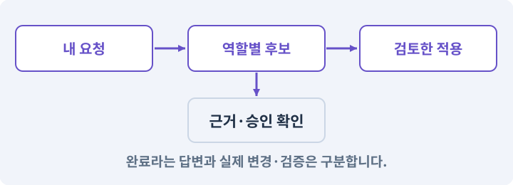

# 107. 원본을 보호하고 허용 경로 정하기

**목표:** 허용하지 않은 파일 변경을 거부합니다.

**시작 상태:** 상태 저장과 내용 지문

## 한눈에 보는 기능의 흐름

역할 요청 → 허용 경로 검사 → 새 후보에 복사 → 원본 해시 비교



**경계:** 상위 폴더·원본으로 쓰는 요청 거부

그림은 실제 게임 실행 결과가 아닙니다. 값·규칙과 예제를 필요한 때 펼쳐 읽고 현재 단계의 메시지를 한 번씩 보냅니다.

## 1. 지금 상태 확인하기

첫 메시지를 보내 현재 준비 상태를 확인합니다. AI가 읽어 온 실제 프로젝트가 맞는지 보고, 없는 준비나 다른 상태가 있으면 먼저 알려 주세요. 아직 기능을 만들지 않는 단계입니다.

### AI에게 보낼 요구와 이유

#### 01. 작업 대상부터 확인

**“원본을 보호하고 허용 경로 정하기” 작업을 시작하기 전에 현재 상태를 읽기 전용으로 확인해 줘.**

왜 이렇게 요청하나요? AI가 다른 프로젝트나 오래된 예제를 보고 작업할 수 있습니다. 실제 경로·파일·현재 기능을 읽게 하면 지금 이어서 작업할 대상을 먼저 맞출 수 있습니다.

#### 02. 작업 대상부터 확인

**필요한 시작 상태는 상태 저장과 내용 지문야.**

왜 이렇게 요청하나요? AI가 다른 프로젝트나 오래된 예제를 보고 작업할 수 있습니다. 실제 경로·파일·현재 기능을 읽게 하면 지금 이어서 작업할 대상을 먼저 맞출 수 있습니다.

#### 03. 실제 사용 중인 구현 재사용

**실제 프로젝트와 작업 기록을 읽고 이것이 준비되어 있는지, 이미 같은 기능이 있는지 확인해 줘.**

왜 이렇게 요청하나요? 이름이 비슷한 새 클래스를 또 만들면 기존 화면은 여전히 옛 코드를 사용할 수 있습니다. 실제 호출되는 진입점을 찾아 연결해야 두 구현이 충돌하거나 수정이 반영되지 않는 문제를 막습니다.

#### 04. 현재 상태와 다음 확인 지점 구분

**이번 기능이 연결될 실제 파일·화면·도구와 보존할 기존 동작을 짧게 정리해 줘.**

왜 이렇게 요청하나요? 이미 준비된 기능과 아직 확인하지 못한 기능을 섞으면 불필요한 재설치나 성급한 완료 판정이 생깁니다. 현재 대상과 남은 준비를 나눠 가장 작은 다음 작업을 선택하게 합니다.

#### 05. 조사 단계에서 변경하지 않기

**아직 새 구현·설치·유료 호출·파일 변경은 하지 마.**

왜 이렇게 요청하나요? 현재 상태를 알아보기만 할 때 파일 변경이나 결제가 시작되면 검토 전의 환경이 바뀝니다. 준비 확인과 실제 구현을 나눠 되돌리기 어려운 작업이 먼저 실행되지 않게 합니다.

#### 06. 막힌 준비를 먼저 해결

**준비가 다르면 부족한 항목과 다음에 필요한 작업을 알려 줘.**

왜 이렇게 요청하나요? 빠진 파일·권한·패키지를 있다고 가정하면 다음 구현이 엉뚱한 대상을 만들게 됩니다. 무엇이 없고 무엇을 먼저 해야 하는지 분리하면 불필요한 재작업을 줄일 수 있습니다.

<details>
<summary>보낼 원문 전체 — 설명은 복사되지 않습니다</summary>

```text
“원본을 보호하고 허용 경로 정하기” 작업을 시작하기 전에 현재 상태를 읽기 전용으로 확인해 줘.
필요한 시작 상태는 상태 저장과 내용 지문야. 실제 프로젝트와 작업 기록을 읽고 이것이 준비되어 있는지, 이미 같은 기능이 있는지 확인해 줘.
이번 기능이 연결될 실제 파일·화면·도구와 보존할 기존 동작을 짧게 정리해 줘. 아직 새 구현·설치·유료 호출·파일 변경은 하지 마. 준비가 다르면 부족한 항목과 다음에 필요한 작업을 알려 줘.
```

</details>

**기대 결과:** 허용할 경로와 차단할 경로의 예

### 직접 확인하기

1. AI가 읽은 실제 프로젝트 또는 도구 경로를 확인합니다.
2. 필수 준비가 없다면 문제 해결 요청을 보내고, 준비됐을 때 다음으로 갑니다.

## 2. 필요한 기능 만들기

준비가 확인되면 아래 요청을 보냅니다. AI가 파일·설정·실행을 맡습니다. 변경 범위나 비용 승인이 나오면 내용을 읽고 결정하세요.

### AI에게 보낼 요구와 이유

#### 01. 구현할 결과와 조건 고정

**내 하네스에 파일 경계를 만들어 줘.**

왜 이렇게 요청하나요? “내 하네스에 파일 경계를 만들어 줘”를 명시하면 AI가 무엇을 구현하거나 검사해야 하는지 범위를 좁힐 수 있습니다. 허용하지 않은 파일 변경을 거부합니다. 이 결과를 확인할 때 이 조건이 실제로 반영됐는지 함께 봅니다.

#### 02. 기존 결과를 보호

**읽을 원본, 작업 입력 사본, 새 후보, 실행 기록을 서로 겹치지 않는 경로로 관리해 줘.**

왜 이렇게 요청하나요? 새 작업이 이미 정상인 기능이나 자산까지 바꾸면 원인을 추적하기 어렵습니다. 유지할 대상을 명시해 변경 전후를 비교하고 원치 않은 영향을 찾습니다.

#### 03. 요청과 실제 권한을 구분

**입력 경로의 절대경로·상위 이동·심볼릭 링크·Windows junction 등 실제 연결 대상을 검사해 허용한 루트 밖 접근을 거부해 줘.**

왜 이렇게 요청하나요? 역할 프롬프트에 “이 파일만 수정”이라고 적는 것만으로 경로가 제한되지는 않습니다. 프로그램이 허용 경로와 요청 범위를 검사해 원본·비밀 파일·다른 담당 파일을 보호합니다.

#### 04. 관찰 가능한 기준으로 확인

**단순 문자열 접두어 비교로 권한을 판단하지 마.**

왜 이렇게 요청하나요? 구현 완료라는 설명을 실제 결과로 바꾸기 위한 조건입니다. 요청에 나온 대상과 경계 상황을 확인해 정상 결과뿐 아니라 실패를 어떻게 구분했는지도 남깁니다.

#### 05. 관찰 가능한 기준으로 확인

**운영체제에서 확인할 수 없는 경로는 안전하게 중단해 줘.**

왜 이렇게 요청하나요? 구현 완료라는 설명을 실제 결과로 바꾸기 위한 조건입니다. 요청에 나온 대상과 경계 상황을 확인해 정상 결과뿐 아니라 실패를 어떻게 구분했는지도 남깁니다.

#### 06. 자산 참조의 정체성 보존

**쓰기 후보는 지정된 텍스트 파일만 허용하고 비밀 파일·.git·Library·실행 기록·.unity/.prefab/.meta·바이너리에는 역할 변경안을 직접 적용하지 마.**

왜 이렇게 요청하나요? Unity는 자산을 파일 이름만으로 식별하지 않습니다. 메타 정보가 바뀌면 같은 이름의 파일이 있어도 참조가 끊길 수 있어 파일과 식별자를 함께 관리해야 합니다.

#### 07. 구현할 결과와 조건 고정

**Unity 자산 변경은 나중에 Editor 연결로 처리할 수 있게 분리해 줘.**

왜 이렇게 요청하나요? “Unity 자산 변경은 나중에 Editor 연결로 처리할 수 있게 분리해 줘”를 명시하면 AI가 무엇을 구현하거나 검사해야 하는지 범위를 좁힐 수 있습니다. 허용하지 않은 파일 변경을 거부합니다. 이 결과를 확인할 때 이 조건이 실제로 반영됐는지 함께 봅니다.

#### 08. 관찰 가능한 기준으로 확인

**원본 지문을 확인하고 새 후보를 만든 뒤에도 원본은 바뀌지 않아야 해.**

왜 이렇게 요청하나요? 구현 완료라는 설명을 실제 결과로 바꾸기 위한 조건입니다. 요청에 나온 대상과 경계 상황을 확인해 정상 결과뿐 아니라 실패를 어떻게 구분했는지도 남깁니다.

#### 09. 구현할 결과와 조건 고정

**허용되지 않은 경로를 격리 환경에서 시험해 줘.**

왜 이렇게 요청하나요? “허용되지 않은 경로를 격리 환경에서 시험해 줘”를 명시하면 AI가 무엇을 구현하거나 검사해야 하는지 범위를 좁힐 수 있습니다. 허용하지 않은 파일 변경을 거부합니다. 이 결과를 확인할 때 이 조건이 실제로 반영됐는지 함께 봅니다.

#### 10. 훅을 이벤트 보조 장치로 사용

**도구 실행 전 훅은 현재 작업의 허용 경로를 알리는 보조 장치로 만들어 줘.**

왜 이렇게 요청하나요? 실행 전과 실행 후 훅은 할 수 있는 일이 다릅니다. 상태 안내·검증 무효화·중복 방지와 같은 연결을 맡기되 훅 실행 자체를 테스트 성공이나 무제한 실행 권한으로 보지 않습니다.

#### 11. 훅을 이벤트 보조 장치로 사용

**훅이나 역할 프롬프트를 운영체제 샌드박스라고 주장하지 마.**

왜 이렇게 요청하나요? 실행 전과 실행 후 훅은 할 수 있는 일이 다릅니다. 상태 안내·검증 무효화·중복 방지와 같은 연결을 맡기되 훅 실행 자체를 테스트 성공이나 무제한 실행 권한으로 보지 않습니다.

#### 12. 설정과 실제 사용 결과 연결

**현재 작성한 MyGameHarness를 확장하고 필요한 파일·테스트·스킬 연결을 직접 만들어 실행해 줘.**

왜 이렇게 요청하나요? 데이터에 수치를 넣어도 사용 조건·UI·실제 전투가 그 값을 읽지 않으면 기능이 완성되지 않습니다. 선택 전후의 계산과 저장을 함께 확인합니다.

#### 13. 아래 항목을 완료 조건으로 사용

**정상 예와 실패 예를 실제로 보여 주고, 기존 기능이 유지되는지 확인해 줘.**

왜 이렇게 요청하나요? 요구사항의 목록은 AI에게 참고 설명을 주는 것이 아니라 완료를 판단할 기준을 정합니다. 구현 뒤 각 항목을 실제 입력과 결과에 대응시켜 빠진 조건을 찾습니다.

<details>
<summary>보낼 원문 전체 — 설명은 복사되지 않습니다</summary>

```text
내 하네스에 파일 경계를 만들어 줘. 읽을 원본, 작업 입력 사본, 새 후보, 실행 기록을 서로 겹치지 않는 경로로 관리해 줘.
입력 경로의 절대경로·상위 이동·심볼릭 링크·Windows junction 등 실제 연결 대상을 검사해 허용한 루트 밖 접근을 거부해 줘. 단순 문자열 접두어 비교로 권한을 판단하지 마. 운영체제에서 확인할 수 없는 경로는 안전하게 중단해 줘.
쓰기 후보는 지정된 텍스트 파일만 허용하고 비밀 파일·.git·Library·실행 기록·.unity/.prefab/.meta·바이너리에는 역할 변경안을 직접 적용하지 마. Unity 자산 변경은 나중에 Editor 연결로 처리할 수 있게 분리해 줘.
원본 지문을 확인하고 새 후보를 만든 뒤에도 원본은 바뀌지 않아야 해. 허용되지 않은 경로를 격리 환경에서 시험해 줘.
도구 실행 전 훅은 현재 작업의 허용 경로를 알리는 보조 장치로 만들어 줘. 훅이나 역할 프롬프트를 운영체제 샌드박스라고 주장하지 마.

현재 작성한 MyGameHarness를 확장하고 필요한 파일·테스트·스킬 연결을 직접 만들어 실행해 줘. 정상 예와 실패 예를 실제로 보여 주고, 기존 기능이 유지되는지 확인해 줘.
```

</details>

**기대 결과:** 확인할 결과: 정상 후보 작성은 허용하고 경계 밖 쓰기는 거부함. AI가 이 상태를 확인할 실제 화면과 변경 내용을 준비합니다. 아직 실행하지 못한 부분은 따로 표시합니다.

### 직접 확인하기

1. 제안서만 반환됐다면 “설명으로 끝내지 말고 승인한 범위의 실제 작업을 수행해 줘”라고 보냅니다.
2. 코드나 설정을 직접 고치라는 안내가 나오면 “작성과 실행은 네가 맡아 줘”라고 요청합니다.

## 3. 결과를 직접 확인하기

먼저 확인 요청을 보내 AI가 검사와 화면을 준비하게 하세요. 그다음 아래 동작을 하나씩 확인합니다.

### AI에게 보낼 요구와 이유

#### 01. 검사할 입력과 관찰 지점 준비

**현재 구현한 “원본을 보호하고 허용 경로 정하기”의 자동 검사와 도구 결과 화면을 준비해 줘.**

왜 이렇게 요청하나요? 정상 예 하나만 보면 실패 조건을 놓치기 쉽습니다. 정상·경계·반례를 실제 입력으로 준비하고 사람이 볼 화면도 맞춰 확인 범위를 분명하게 합니다.

#### 02. 결과를 재확인할 근거 남기기

**정상 동작과 아래 실패 조건을 실제로 검사하고 대상·실행 수·결과를 보여 줘.**

왜 이렇게 요청하나요? “잘 됩니다”라는 요약만으로는 어떤 입력과 버전을 검사했는지 알 수 없습니다. 대상·실행 수·실패 내용·파일을 함께 남겨 같은 조건으로 다시 확인할 수 있게 합니다.

#### 03. 기존 결과를 보호

**원본 안을 후보 경로로 지정하면 거부된다.**

왜 이렇게 요청하나요? 새 작업이 이미 정상인 기능이나 자산까지 바꾸면 원인을 추적하기 어렵습니다. 유지할 대상을 명시해 변경 전후를 비교하고 원치 않은 영향을 찾습니다.

#### 04. 구현할 결과와 조건 고정

**허용 밖 파일 쓰기가 사전에 차단된다.**

왜 이렇게 요청하나요? “허용 밖 파일 쓰기가 사전에 차단된다”를 명시하면 AI가 무엇을 구현하거나 검사해야 하는지 범위를 좁힐 수 있습니다. 허용하지 않은 파일 변경을 거부합니다. 이 결과를 확인할 때 이 조건이 실제로 반영됐는지 함께 봅니다.

#### 05. 기존 결과를 보호

**이미 존재하는 후보를 지우고 덮어쓰지 않는다.**

왜 이렇게 요청하나요? 새 작업이 이미 정상인 기능이나 자산까지 바꾸면 원인을 추적하기 어렵습니다. 유지할 대상을 명시해 변경 전후를 비교하고 원치 않은 영향을 찾습니다.

#### 06. 훅을 이벤트 보조 장치로 사용

**훅 오류나 도구 이름 변경을 정상 보호 상태로 표시하지 않는다.**

왜 이렇게 요청하나요? 실행 전과 실행 후 훅은 할 수 있는 일이 다릅니다. 상태 안내·검증 무효화·중복 방지와 같은 연결을 맡기되 훅 실행 자체를 테스트 성공이나 무제한 실행 권한으로 보지 않습니다.

#### 07. 사람 검사의 시작점 준비

**내가 조작해야 하는 부분은 실행할 화면과 시작 상태를 준비해 줘.**

왜 이렇게 요청하나요? 같은 기능이라도 시작 상태가 다르면 관찰 결과가 달라집니다. AI가 실행 화면과 재현 위치를 먼저 준비해야 사람이 이동·공격·소리·조작감을 같은 조건에서 확인할 수 있습니다.

#### 08. 사람이 실제로 본 것만 기록

**연결되지 않은 기기의 검사나 사람이 보지 않은 재미·소리 품질을 대신 확인했다고 하지 마.**

왜 이렇게 요청하나요? AI가 준비한 검사와 사람이 직접 플레이하거나 들은 결과는 다른 근거입니다. 관찰하지 않은 조작감·소리·실기기 결과를 임의로 완료 처리하지 않게 합니다.

#### 09. 실제로 실행한 검사만 인정

**테스트 0개와 예전 소스 결과는 현재 성공으로 쓰지 마.**

왜 이렇게 요청하나요? 실행된 검사가 없거나 같은 결과를 중복 집계한 경우는 기능을 확인한 것이 아닙니다. 실행 수와 개별 결과를 함께 확인해야 형식적인 성공 표시를 걸러낼 수 있습니다.

<details>
<summary>보낼 원문 전체 — 설명은 복사되지 않습니다</summary>

```text
현재 구현한 “원본을 보호하고 허용 경로 정하기”의 자동 검사와 도구 결과 화면을 준비해 줘. 정상 동작과 아래 실패 조건을 실제로 검사하고 대상·실행 수·결과를 보여 줘.

원본 안을 후보 경로로 지정하면 거부된다.

 허용 밖 파일 쓰기가 사전에 차단된다.

 이미 존재하는 후보를 지우고 덮어쓰지 않는다.

 훅 오류나 도구 이름 변경을 정상 보호 상태로 표시하지 않는다.

내가 조작해야 하는 부분은 실행할 화면과 시작 상태를 준비해 줘. 연결되지 않은 기기의 검사나 사람이 보지 않은 재미·소리 품질을 대신 확인했다고 하지 마. 테스트 0개와 예전 소스 결과는 현재 성공으로 쓰지 마.
```

</details>

**기대 결과:** 허용된 파일만 복사되고 위험한 요청은 이유와 함께 거부됩니다. 원본 파일 해시는 변하지 않습니다.

### 직접 확인하기

1. 정상 파일을 새 후보에 복사하는 결과를 봅니다.
2. “상위 폴더나 원본에 쓰려는 요청을 격리 사본에서 시험해 줘”라고 보냅니다.
3. AI가 보여 준 원본 해시가 그대로인지 확인합니다.

## 4. 결과를 남기고 마무리하기

실제로 본 결과를 아래 메모에 적고 AI에 전달합니다. 결과 저장 요청으로 현재 상태를 남긴 뒤 다음 페이지로 갑니다.

### AI에게 보낼 요구와 이유

#### 01. 결과를 재확인할 근거 남기기

**지금 작업한 “원본을 보호하고 허용 경로 정하기”의 실제 결과를 정리해 줘.**

왜 이렇게 요청하나요? “잘 됩니다”라는 요약만으로는 어떤 입력과 버전을 검사했는지 알 수 없습니다. 대상·실행 수·실패 내용·파일을 함께 남겨 같은 조건으로 다시 확인할 수 있게 합니다.

#### 02. 다음 작업이 읽을 인수인계

**변경한 기능·파일·현재 후보와 실제 실행한 검사, 남은 문제를 기능 이름으로 기록해 줘.**

왜 이렇게 요청하나요? 새 AI 세션은 이전 대화 전체를 알고 있다고 보장할 수 없습니다. 현재 후보·파일 위치·실행한 검사·남은 일을 남겨야 같은 작업을 반복하지 않고 이어갈 수 있습니다.

#### 03. 사람이 실제로 본 것만 기록

**자동 검사 결과와 내가 직접 확인한 결과를 구분하고, 내 관찰이 아직 없으면 미확인으로 남겨 줘.**

왜 이렇게 요청하나요? AI가 준비한 검사와 사람이 직접 플레이하거나 들은 결과는 다른 근거입니다. 관찰하지 않은 조작감·소리·실기기 결과를 임의로 완료 처리하지 않게 합니다.

#### 04. 다음 작업이 읽을 인수인계

**재시작하거나 다음 작업에서 읽을 기록의 실제 위치를 알려 줘.**

왜 이렇게 요청하나요? 새 AI 세션은 이전 대화 전체를 알고 있다고 보장할 수 없습니다. 현재 후보·파일 위치·실행한 검사·남은 일을 남겨야 같은 작업을 반복하지 않고 이어갈 수 있습니다.

#### 05. 미확인을 완료와 분리

**아직 확인하지 않은 결과를 완료로 채우지 마.**

왜 이렇게 요청하나요? 만들어진 것, 검사에 실패한 것, 아직 확인하지 못한 것을 나눠야 다음 작업을 정확히 고를 수 있습니다. 실행할 조건이 없는 기능을 성공으로 기록하면 뒤에서 원인을 찾기 어려워집니다.

<details>
<summary>보낼 원문 전체 — 설명은 복사되지 않습니다</summary>

```text
지금 작업한 “원본을 보호하고 허용 경로 정하기”의 실제 결과를 정리해 줘. 변경한 기능·파일·현재 후보와 실제 실행한 검사, 남은 문제를 기능 이름으로 기록해 줘.
자동 검사 결과와 내가 직접 확인한 결과를 구분하고, 내 관찰이 아직 없으면 미확인으로 남겨 줘. 재시작하거나 다음 작업에서 읽을 기록의 실제 위치를 알려 줘. 아직 확인하지 않은 결과를 완료로 채우지 마.
```

</details>

**기대 결과:** 현재 상태·검사 결과·남은 문제·다음에 읽을 기록을 확인할 수 있습니다.

### 직접 확인하기

1. 자동 검사와 내 관찰 결과가 섞이지 않았는지 봅니다.
2. 문제가 남았다면 해결 요청을 보내고 같은 동작을 다시 확인합니다.

## 구체적인 예로 이해하기

### 허용한 폴더 밖으로 나가는 경로

문자열의 시작 글자만 검사하면 ../ 또는 링크를 통해 다른 위치에 접근할 수 있습니다. 실제 해석된 경로와 원본 보존이 중요합니다.

**시작 상태:** 읽을 원본과 새 후보 폴더가 따로 정해져 있습니다.

**직접 해 볼 동작:** 정상 파일과 범위 밖 경로, 심볼릭 링크, 기존 후보 덮어쓰기 요청을 AI가 시험하게 합니다.

**보여야 하는 결과:** 허용된 파일만 복사되고 위험한 요청은 이유와 함께 거부됩니다. 원본 파일 해시는 변하지 않습니다.

**이렇게 되면 아직 안 됩니다:** 권한 실패를 해결한다며 상위 폴더 전체를 허용합니다.

**생각해 보기:** 폴더 복사를 했으니 보안 샌드박스가 생겼나요?

<details><summary>해설 보기</summary>

아닙니다. 이 도구를 통한 실수를 줄이는 경계입니다. 실행할 코드는 별도 승인과 필요한 운영체제 격리를 고려해야 합니다.

</details>

## 문제가 있으면

### AI에게 보낼 요구와 이유

#### 01. 시간·방향과 물리 이동 일치

**문자열 앞부분만 비교하지 말고 정규화한 경로와 실제 연결 대상을 검사해 줘.**

왜 이렇게 요청하나요? 입력 방향의 길이와 프레임 간격을 그대로 이동량에 섞으면 대각선이나 기기 속도에 따라 이동이 달라집니다. 정해진 속도·시간 기준과 물리 이동 경로를 사용해 비교 가능한 움직임을 만듭니다.

#### 02. 훅을 이벤트 보조 장치로 사용

**훅을 운영체제 샌드박스라고 설명하지 마.**

왜 이렇게 요청하나요? 실행 전과 실행 후 훅은 할 수 있는 일이 다릅니다. 상태 안내·검증 무효화·중복 방지와 같은 연결을 맡기되 훅 실행 자체를 테스트 성공이나 무제한 실행 권한으로 보지 않습니다.

#### 03. 원인 하나를 좁혀 수정

**새 기능을 추가하지 말고 현재 오류와 실제 로그를 먼저 읽어 줘.**

왜 이렇게 요청하나요? 오류 수정 중 새 기능까지 넣으면 어떤 변경이 문제를 해결하거나 악화했는지 알기 어렵습니다. 원래 재현을 보존하고 작은 변경 뒤 같은 입력과 주변 정상 동작을 다시 확인합니다.

#### 04. 원인 하나를 좁혀 수정

**최소 수정 뒤 같은 재현과 관련 정상 동작을 다시 검사해 줘.**

왜 이렇게 요청하나요? 오류 수정 중 새 기능까지 넣으면 어떤 변경이 문제를 해결하거나 악화했는지 알기 어렵습니다. 원래 재현을 보존하고 작은 변경 뒤 같은 입력과 주변 정상 동작을 다시 확인합니다.

#### 05. 실패도 재현 자료로 보존

**실패 기록은 지우지 마.**

왜 이렇게 요청하나요? 실패한 입력과 로그가 있어야 같은 문제가 다시 생겼을 때 비교할 수 있습니다. 성공 기록으로 덮어쓰지 않고 전후 자료를 남기면 무엇을 고쳤는지 확인할 수 있습니다.

<details>
<summary>보낼 원문 전체 — 설명은 복사되지 않습니다</summary>

```text
문자열 앞부분만 비교하지 말고 정규화한 경로와 실제 연결 대상을 검사해 줘. 훅을 운영체제 샌드박스라고 설명하지 마.
새 기능을 추가하지 말고 현재 오류와 실제 로그를 먼저 읽어 줘. 최소 수정 뒤 같은 재현과 관련 정상 동작을 다시 검사해 줘. 실패 기록은 지우지 마.
```

</details>

## 새 세션에서 이어가기

### AI에게 보낼 요구와 이유

#### 01. 이어서 할 작업 식별

**“원본을 보호하고 허용 경로 정하기” 작업을 이어가고 싶어.**

왜 이렇게 요청하나요? 이름으로 재개할 작업을 찾고, 뒤에 이어지는 요청으로 실제 파일·진행 중 작업·기록을 다시 읽게 합니다. 제목만 보고 이전 상태를 기억한다고 가정하지 않습니다.

#### 02. 조회는 상태를 바꾸지 않게

**실제 프로젝트와 내 도구의 작업 기록을 읽고 어디까지 구현·검사됐는지 확인해 줘.**

왜 이렇게 요청하나요? 진행 상황을 물을 때 새 구현이나 유료 호출이 시작되면 단순 확인이 실행 명령이 되어 버립니다. 저장된 근거를 읽어 완료·진행·승인 대기·미검증을 나누게 합니다.

#### 03. 재개 전 중복 작업 방지

**진행 중인 프로세스·승인·미저장 변경을 확인한 뒤 남은 가장 작은 작업부터 안내해 줘.**

왜 이렇게 요청하나요? 대화가 끊겨도 외부 작업은 끝났거나 아직 실행 중일 수 있습니다. 프로세스·승인·미저장 상태를 먼저 읽어 같은 생성·빌드·결제를 두 번 시작하지 않도록 합니다.

#### 04. 되돌아갈 원본 남기기

**기존 성공과 실패 기록은 보존해 줘.**

왜 이렇게 요청하나요? 새 구현이 실패해도 이전 게임과 저장을 복원할 수 있어야 합니다. 현재 내용을 먼저 조사하고 별도 후보에서 작업하면 실험이 유일한 정상본을 망가뜨리는 일을 피할 수 있습니다.

<details>
<summary>보낼 원문 전체 — 설명은 복사되지 않습니다</summary>

```text
“원본을 보호하고 허용 경로 정하기” 작업을 이어가고 싶어. 실제 프로젝트와 내 도구의 작업 기록을 읽고 어디까지 구현·검사됐는지 확인해 줘. 진행 중인 프로세스·승인·미저장 변경을 확인한 뒤 남은 가장 작은 작업부터 안내해 줘. 기존 성공과 실패 기록은 보존해 줘.
```

</details>

## 왜 이렇게 만드는가

“이 폴더만 고쳐 줘”라는 문장과 프로그램이 잘못된 경로를 거부하는 것은 다릅니다. 여기서는 실제 검사기를 만들고, 원본을 건드리지 않는 사본에서 그 경계를 시험합니다.

## 공식 참고

- [Claude Code · Hooks](https://code.claude.com/docs/en/hooks)
