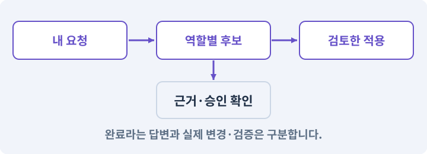

# 108. 기획·구현·QA·검토 역할 만들기

**목표:** 각 역할의 책임과 수정 범위를 구분합니다.

**시작 상태:** 원본 보호와 작업 기록

## 한눈에 보는 기능의 흐름

기획 → 구현 → QA → 독립 검토



**경계:** 검토 담당은 코드 쓰기 권한을 갖지 않기

그림은 실제 게임 실행 결과가 아닙니다. 값·규칙과 예제를 필요한 때 펼쳐 읽고 현재 단계의 메시지를 한 번씩 보냅니다.

## 1. 지금 상태 확인하기

첫 메시지를 보내 현재 준비 상태를 확인합니다. AI가 읽어 온 실제 프로젝트가 맞는지 보고, 없는 준비나 다른 상태가 있으면 먼저 알려 주세요. 아직 기능을 만들지 않는 단계입니다.

### AI에게 보낼 요구와 이유

#### 01. 작업 대상부터 확인

**“기획·구현·QA·검토 역할 만들기” 작업을 시작하기 전에 현재 상태를 읽기 전용으로 확인해 줘.**

왜 이렇게 요청하나요? AI가 다른 프로젝트나 오래된 예제를 보고 작업할 수 있습니다. 실제 경로·파일·현재 기능을 읽게 하면 지금 이어서 작업할 대상을 먼저 맞출 수 있습니다.

#### 02. 작업 대상부터 확인

**필요한 시작 상태는 원본 보호와 작업 기록야.**

왜 이렇게 요청하나요? AI가 다른 프로젝트나 오래된 예제를 보고 작업할 수 있습니다. 실제 경로·파일·현재 기능을 읽게 하면 지금 이어서 작업할 대상을 먼저 맞출 수 있습니다.

#### 03. 실제 사용 중인 구현 재사용

**실제 프로젝트와 작업 기록을 읽고 이것이 준비되어 있는지, 이미 같은 기능이 있는지 확인해 줘.**

왜 이렇게 요청하나요? 이름이 비슷한 새 클래스를 또 만들면 기존 화면은 여전히 옛 코드를 사용할 수 있습니다. 실제 호출되는 진입점을 찾아 연결해야 두 구현이 충돌하거나 수정이 반영되지 않는 문제를 막습니다.

#### 04. 현재 상태와 다음 확인 지점 구분

**이번 기능이 연결될 실제 파일·화면·도구와 보존할 기존 동작을 짧게 정리해 줘.**

왜 이렇게 요청하나요? 이미 준비된 기능과 아직 확인하지 못한 기능을 섞으면 불필요한 재설치나 성급한 완료 판정이 생깁니다. 현재 대상과 남은 준비를 나눠 가장 작은 다음 작업을 선택하게 합니다.

#### 05. 조사 단계에서 변경하지 않기

**아직 새 구현·설치·유료 호출·파일 변경은 하지 마.**

왜 이렇게 요청하나요? 현재 상태를 알아보기만 할 때 파일 변경이나 결제가 시작되면 검토 전의 환경이 바뀝니다. 준비 확인과 실제 구현을 나눠 되돌리기 어려운 작업이 먼저 실행되지 않게 합니다.

#### 06. 막힌 준비를 먼저 해결

**준비가 다르면 부족한 항목과 다음에 필요한 작업을 알려 줘.**

왜 이렇게 요청하나요? 빠진 파일·권한·패키지를 있다고 가정하면 다음 구현이 엉뚱한 대상을 만들게 됩니다. 무엇이 없고 무엇을 먼저 해야 하는지 분리하면 불필요한 재작업을 줄일 수 있습니다.

<details>
<summary>보낼 원문 전체 — 설명은 복사되지 않습니다</summary>

```text
“기획·구현·QA·검토 역할 만들기” 작업을 시작하기 전에 현재 상태를 읽기 전용으로 확인해 줘.
필요한 시작 상태는 원본 보호와 작업 기록야. 실제 프로젝트와 작업 기록을 읽고 이것이 준비되어 있는지, 이미 같은 기능이 있는지 확인해 줘.
이번 기능이 연결될 실제 파일·화면·도구와 보존할 기존 동작을 짧게 정리해 줘. 아직 새 구현·설치·유료 호출·파일 변경은 하지 마. 준비가 다르면 부족한 항목과 다음에 필요한 작업을 알려 줘.
```

</details>

**기대 결과:** 역할 네 개와 각각의 허용 업무

### 직접 확인하기

1. AI가 읽은 실제 프로젝트 또는 도구 경로를 확인합니다.
2. 필수 준비가 없다면 문제 해결 요청을 보내고, 준비됐을 때 다음으로 갑니다.

## 2. 필요한 기능 만들기

준비가 확인되면 아래 요청을 보냅니다. AI가 파일·설정·실행을 맡습니다. 변경 범위나 비용 승인이 나오면 내용을 읽고 결정하세요.

### AI에게 보낼 요구와 이유

#### 01. 구현과 판정의 책임 나누기

**내 하네스에 기획·구현·QA·독립 검토 네 역할을 등록해 줘.**

왜 이렇게 요청하나요? 구현자가 자신의 설명만으로 완료를 결정하면 놓친 가정을 그대로 통과시킬 수 있습니다. 원래 요구·실제 변경·테스트를 다른 관점에서 검토하고 쓰기 권한을 나눕니다.

#### 02. 파일 소유권·읽기 범위·쓰기 범위의 적용 조건

**역할마다 임무, 필수 입력, 결과 형태, 읽기 범위, 쓰기 범위, 하지 않을 일을 데이터로 정의해 줘.**

왜 이렇게 요청하나요? 파일 소유권은 이번 작업에서 누가 어느 파일을 수정할 책임과 권한이 있는지 정한 규칙입니다. 읽기 허용과 쓰기 허용은 별도로 관리합니다. 권한 설명 프롬프트만으로 운영체제의 실제 접근을 완전히 차단한 것은 아닙니다.

#### 03. 관찰 가능한 기준으로 확인

**기획은 기능의 규칙과 검사 예를, 구현은 생산 코드 변경안을, QA는 별도 테스트를, 검토는 요구·변경안·테스트를 대조한 문제 목록을 제출하게 해 줘.**

왜 이렇게 요청하나요? 구현 완료라는 설명을 실제 결과로 바꾸기 위한 조건입니다. 요청에 나온 대상과 경계 상황을 확인해 정상 결과뿐 아니라 실패를 어떻게 구분했는지도 남깁니다.

#### 04. QA·비평·독립 검토의 적용 조건

**검토자는 파일 수정 권한이 없어야 해.**

왜 이렇게 요청하나요? QA는 결함을 재현·검사하고, 비평·검토는 원래 요구와 실제 결과 사이의 문제를 평가합니다. 구현자가 자기 설명만 검토하는 것보다 입력과 권한을 분리하는 것이 중요합니다. 같은 모델의 별도 세션이라는 이유만으로 자동 독립성이 보장되지 않습니다.

#### 05. 공유 Editor의 작업 순서 보장

**같은 작은 실행에 대해 하나의 소유자가 잠금을 갖게 하고 획득·작업 시작·결과·실패·해제를 사건 기록에 남겨 줘.**

왜 이렇게 요청하나요? 씬 수정·Play·빌드가 같은 Editor에서 겹치면 서로의 상태를 바꿀 수 있습니다. 하나의 실행 창구와 잠금으로 순서를 만들되 사용자의 외부 편집까지 자동 차단한다고 가정하지 않습니다.

#### 06. 공유 Editor의 작업 순서 보장

**남은 잠금을 무조건 삭제하지 말고 실제 프로세스와 소유자를 확인해 줘.**

왜 이렇게 요청하나요? 씬 수정·Play·빌드가 같은 Editor에서 겹치면 서로의 상태를 바꿀 수 있습니다. 하나의 실행 창구와 잠금으로 순서를 만들되 사용자의 외부 편집까지 자동 차단한다고 가정하지 않습니다.

#### 07. 같은 요청의 반복 처리 정의

**구현자의 테스트 무단 수정, 검토자의 코드 변경, 중복 실행을 거부하는 검사를 만들어 줘.**

왜 이렇게 요청하나요? 클릭 연타·재연결·중복 이벤트는 개발과 플레이 중 모두 발생할 수 있습니다. 반복돼도 한 번 처리해야 하는 결과와 매번 새로 처리할 결과를 나눠 데이터가 누적되지 않게 합니다.

#### 08. 구현할 결과와 조건 고정

**아직 역할 수를 늘리거나 유료 모델을 호출하지 마.**

왜 이렇게 요청하나요? “아직 역할 수를 늘리거나 유료 모델을 호출하지 마”를 명시하면 AI가 무엇을 구현하거나 검사해야 하는지 범위를 좁힐 수 있습니다. 각 역할의 책임과 수정 범위를 구분합니다. 이 결과를 확인할 때 이 조건이 실제로 반영됐는지 함께 봅니다.

#### 09. 설정과 실제 사용 결과 연결

**현재 작성한 MyGameHarness를 확장하고 필요한 파일·테스트·스킬 연결을 직접 만들어 실행해 줘.**

왜 이렇게 요청하나요? 데이터에 수치를 넣어도 사용 조건·UI·실제 전투가 그 값을 읽지 않으면 기능이 완성되지 않습니다. 선택 전후의 계산과 저장을 함께 확인합니다.

#### 10. 아래 항목을 완료 조건으로 사용

**정상 예와 실패 예를 실제로 보여 주고, 기존 기능이 유지되는지 확인해 줘.**

왜 이렇게 요청하나요? 요구사항의 목록은 AI에게 참고 설명을 주는 것이 아니라 완료를 판단할 기준을 정합니다. 구현 뒤 각 항목을 실제 입력과 결과에 대응시켜 빠진 조건을 찾습니다.

<details>
<summary>보낼 원문 전체 — 설명은 복사되지 않습니다</summary>

```text
내 하네스에 기획·구현·QA·독립 검토 네 역할을 등록해 줘. 역할마다 임무, 필수 입력, 결과 형태, 읽기 범위, 쓰기 범위, 하지 않을 일을 데이터로 정의해 줘.
기획은 기능의 규칙과 검사 예를, 구현은 생산 코드 변경안을, QA는 별도 테스트를, 검토는 요구·변경안·테스트를 대조한 문제 목록을 제출하게 해 줘. 검토자는 파일 수정 권한이 없어야 해.
같은 작은 실행에 대해 하나의 소유자가 잠금을 갖게 하고 획득·작업 시작·결과·실패·해제를 사건 기록에 남겨 줘. 남은 잠금을 무조건 삭제하지 말고 실제 프로세스와 소유자를 확인해 줘.
구현자의 테스트 무단 수정, 검토자의 코드 변경, 중복 실행을 거부하는 검사를 만들어 줘. 아직 역할 수를 늘리거나 유료 모델을 호출하지 마.

현재 작성한 MyGameHarness를 확장하고 필요한 파일·테스트·스킬 연결을 직접 만들어 실행해 줘. 정상 예와 실패 예를 실제로 보여 주고, 기존 기능이 유지되는지 확인해 줘.
```

</details>

**기대 결과:** 확인할 결과: 역할 권한과 실행 잠금이 실제로 적용됨. AI가 이 상태를 확인할 실제 화면과 변경 내용을 준비합니다. 아직 실행하지 못한 부분은 따로 표시합니다.

### 직접 확인하기

1. 제안서만 반환됐다면 “설명으로 끝내지 말고 승인한 범위의 실제 작업을 수행해 줘”라고 보냅니다.
2. 코드나 설정을 직접 고치라는 안내가 나오면 “작성과 실행은 네가 맡아 줘”라고 요청합니다.

## 3. 결과를 직접 확인하기

먼저 확인 요청을 보내 AI가 검사와 화면을 준비하게 하세요. 그다음 아래 동작을 하나씩 확인합니다.

### AI에게 보낼 요구와 이유

#### 01. 검사할 입력과 관찰 지점 준비

**현재 구현한 “기획·구현·QA·검토 역할 만들기”의 자동 검사와 도구 결과 화면을 준비해 줘.**

왜 이렇게 요청하나요? 정상 예 하나만 보면 실패 조건을 놓치기 쉽습니다. 정상·경계·반례를 실제 입력으로 준비하고 사람이 볼 화면도 맞춰 확인 범위를 분명하게 합니다.

#### 02. 결과를 재확인할 근거 남기기

**정상 동작과 아래 실패 조건을 실제로 검사하고 대상·실행 수·결과를 보여 줘.**

왜 이렇게 요청하나요? “잘 됩니다”라는 요약만으로는 어떤 입력과 버전을 검사했는지 알 수 없습니다. 대상·실행 수·실패 내용·파일을 함께 남겨 같은 조건으로 다시 확인할 수 있게 합니다.

#### 03. 구현할 결과와 조건 고정

**비평 역할에 코드 쓰기 권한이 없다.**

왜 이렇게 요청하나요? “비평 역할에 코드 쓰기 권한이 없다”를 명시하면 AI가 무엇을 구현하거나 검사해야 하는지 범위를 좁힐 수 있습니다. 각 역할의 책임과 수정 범위를 구분합니다. 이 결과를 확인할 때 이 조건이 실제로 반영됐는지 함께 봅니다.

#### 04. 관찰 가능한 기준으로 확인

**구현 역할이 QA 테스트를 고치는 제안을 거부한다.**

왜 이렇게 요청하나요? 구현 완료라는 설명을 실제 결과로 바꾸기 위한 조건입니다. 요청에 나온 대상과 경계 상황을 확인해 정상 결과뿐 아니라 실패를 어떻게 구분했는지도 남깁니다.

#### 05. 같은 요청의 반복 처리 정의

**동일 작업이 두 번 시작되지 않는다.**

왜 이렇게 요청하나요? 클릭 연타·재연결·중복 이벤트는 개발과 플레이 중 모두 발생할 수 있습니다. 반복돼도 한 번 처리해야 하는 결과와 매번 새로 처리할 결과를 나눠 데이터가 누적되지 않게 합니다.

#### 06. 기존 결과를 보호

**중단 사건과 재개 사건을 구분해 보존한다.**

왜 이렇게 요청하나요? 새 작업이 이미 정상인 기능이나 자산까지 바꾸면 원인을 추적하기 어렵습니다. 유지할 대상을 명시해 변경 전후를 비교하고 원치 않은 영향을 찾습니다.

#### 07. 사람 검사의 시작점 준비

**내가 조작해야 하는 부분은 실행할 화면과 시작 상태를 준비해 줘.**

왜 이렇게 요청하나요? 같은 기능이라도 시작 상태가 다르면 관찰 결과가 달라집니다. AI가 실행 화면과 재현 위치를 먼저 준비해야 사람이 이동·공격·소리·조작감을 같은 조건에서 확인할 수 있습니다.

#### 08. 사람이 실제로 본 것만 기록

**연결되지 않은 기기의 검사나 사람이 보지 않은 재미·소리 품질을 대신 확인했다고 하지 마.**

왜 이렇게 요청하나요? AI가 준비한 검사와 사람이 직접 플레이하거나 들은 결과는 다른 근거입니다. 관찰하지 않은 조작감·소리·실기기 결과를 임의로 완료 처리하지 않게 합니다.

#### 09. 실제로 실행한 검사만 인정

**테스트 0개와 예전 소스 결과는 현재 성공으로 쓰지 마.**

왜 이렇게 요청하나요? 실행된 검사가 없거나 같은 결과를 중복 집계한 경우는 기능을 확인한 것이 아닙니다. 실행 수와 개별 결과를 함께 확인해야 형식적인 성공 표시를 걸러낼 수 있습니다.

<details>
<summary>보낼 원문 전체 — 설명은 복사되지 않습니다</summary>

```text
현재 구현한 “기획·구현·QA·검토 역할 만들기”의 자동 검사와 도구 결과 화면을 준비해 줘. 정상 동작과 아래 실패 조건을 실제로 검사하고 대상·실행 수·결과를 보여 줘.

비평 역할에 코드 쓰기 권한이 없다.

 구현 역할이 QA 테스트를 고치는 제안을 거부한다.

 동일 작업이 두 번 시작되지 않는다.

 중단 사건과 재개 사건을 구분해 보존한다.

내가 조작해야 하는 부분은 실행할 화면과 시작 상태를 준비해 줘. 연결되지 않은 기기의 검사나 사람이 보지 않은 재미·소리 품질을 대신 확인했다고 하지 마. 테스트 0개와 예전 소스 결과는 현재 성공으로 쓰지 마.
```

</details>

**기대 결과:** 계획이 아닌 실행기가 실제 경로를 검사해 거부합니다. 정상 범위 변경안만 다음 단계로 갑니다.

### 직접 확인하기

1. 작은 기능에서 네 역할이 넘겨줄 결과를 읽습니다.
2. “검토자가 코드를 수정하는 응답을 거부하는지 시험해 줘”라고 보냅니다.
3. 겹치는 두 실행을 허용하지 않고 기록하는지 봅니다.

## 4. 결과를 남기고 마무리하기

실제로 본 결과를 아래 메모에 적고 AI에 전달합니다. 결과 저장 요청으로 현재 상태를 남긴 뒤 다음 페이지로 갑니다.

### AI에게 보낼 요구와 이유

#### 01. 결과를 재확인할 근거 남기기

**지금 작업한 “기획·구현·QA·검토 역할 만들기”의 실제 결과를 정리해 줘.**

왜 이렇게 요청하나요? “잘 됩니다”라는 요약만으로는 어떤 입력과 버전을 검사했는지 알 수 없습니다. 대상·실행 수·실패 내용·파일을 함께 남겨 같은 조건으로 다시 확인할 수 있게 합니다.

#### 02. 다음 작업이 읽을 인수인계

**변경한 기능·파일·현재 후보와 실제 실행한 검사, 남은 문제를 기능 이름으로 기록해 줘.**

왜 이렇게 요청하나요? 새 AI 세션은 이전 대화 전체를 알고 있다고 보장할 수 없습니다. 현재 후보·파일 위치·실행한 검사·남은 일을 남겨야 같은 작업을 반복하지 않고 이어갈 수 있습니다.

#### 03. 사람이 실제로 본 것만 기록

**자동 검사 결과와 내가 직접 확인한 결과를 구분하고, 내 관찰이 아직 없으면 미확인으로 남겨 줘.**

왜 이렇게 요청하나요? AI가 준비한 검사와 사람이 직접 플레이하거나 들은 결과는 다른 근거입니다. 관찰하지 않은 조작감·소리·실기기 결과를 임의로 완료 처리하지 않게 합니다.

#### 04. 다음 작업이 읽을 인수인계

**재시작하거나 다음 작업에서 읽을 기록의 실제 위치를 알려 줘.**

왜 이렇게 요청하나요? 새 AI 세션은 이전 대화 전체를 알고 있다고 보장할 수 없습니다. 현재 후보·파일 위치·실행한 검사·남은 일을 남겨야 같은 작업을 반복하지 않고 이어갈 수 있습니다.

#### 05. 미확인을 완료와 분리

**아직 확인하지 않은 결과를 완료로 채우지 마.**

왜 이렇게 요청하나요? 만들어진 것, 검사에 실패한 것, 아직 확인하지 못한 것을 나눠야 다음 작업을 정확히 고를 수 있습니다. 실행할 조건이 없는 기능을 성공으로 기록하면 뒤에서 원인을 찾기 어려워집니다.

<details>
<summary>보낼 원문 전체 — 설명은 복사되지 않습니다</summary>

```text
지금 작업한 “기획·구현·QA·검토 역할 만들기”의 실제 결과를 정리해 줘. 변경한 기능·파일·현재 후보와 실제 실행한 검사, 남은 문제를 기능 이름으로 기록해 줘.
자동 검사 결과와 내가 직접 확인한 결과를 구분하고, 내 관찰이 아직 없으면 미확인으로 남겨 줘. 재시작하거나 다음 작업에서 읽을 기록의 실제 위치를 알려 줘. 아직 확인하지 않은 결과를 완료로 채우지 마.
```

</details>

**기대 결과:** 현재 상태·검사 결과·남은 문제·다음에 읽을 기록을 확인할 수 있습니다.

### 직접 확인하기

1. 자동 검사와 내 관찰 결과가 섞이지 않았는지 봅니다.
2. 문제가 남았다면 해결 요청을 보내고 같은 동작을 다시 확인합니다.

## 구체적인 예로 이해하기

### 역할 이름보다 중요한 수정 범위

같은 모델이라도 역할마다 입력과 쓰기 범위를 다르게 줍니다. 프롬프트의 자기소개가 권한 검사를 대신하지 않습니다.

**시작 상태:** 기획·구현·QA·검토 네 역할을 등록합니다.

**직접 해 볼 동작:** 구현 역할이 테스트를 약하게 바꾸거나 검토 역할이 코드를 수정하는 변경안을 내도록 모의 입력을 줍니다.

**보여야 하는 결과:** 계획이 아닌 실행기가 실제 경로를 검사해 거부합니다. 정상 범위 변경안만 다음 단계로 갑니다.

**이렇게 되면 아직 안 됩니다:** “나는 검토자니까 읽기 전용”이라는 문장만 믿습니다.

**생각해 보기:** 나중에 Unity 통합 역할을 쓴다면 이름만 작업표에 적어도 될까요?

<details><summary>해설 보기</summary>

안 됩니다. 먼저 역할 등록, 입력·출력 범위, 금지 행동, 별도 검토자를 정의하고 검증해야 합니다.

</details>

## 문제가 있으면

### AI에게 보낼 요구와 이유

#### 01. 관찰 가능한 기준으로 확인

**역할 이름만 붙이지 말고 프로그램이 응답의 경로를 검사하게 해 줘.**

왜 이렇게 요청하나요? 구현 완료라는 설명을 실제 결과로 바꾸기 위한 조건입니다. 요청에 나온 대상과 경계 상황을 확인해 정상 결과뿐 아니라 실패를 어떻게 구분했는지도 남깁니다.

#### 02. 공유 Editor의 작업 순서 보장

**잠금이 남았다면 살아 있는 실행인지 먼저 확인해 줘.**

왜 이렇게 요청하나요? 씬 수정·Play·빌드가 같은 Editor에서 겹치면 서로의 상태를 바꿀 수 있습니다. 하나의 실행 창구와 잠금으로 순서를 만들되 사용자의 외부 편집까지 자동 차단한다고 가정하지 않습니다.

#### 03. 원인 하나를 좁혀 수정

**새 기능을 추가하지 말고 현재 오류와 실제 로그를 먼저 읽어 줘.**

왜 이렇게 요청하나요? 오류 수정 중 새 기능까지 넣으면 어떤 변경이 문제를 해결하거나 악화했는지 알기 어렵습니다. 원래 재현을 보존하고 작은 변경 뒤 같은 입력과 주변 정상 동작을 다시 확인합니다.

#### 04. 원인 하나를 좁혀 수정

**최소 수정 뒤 같은 재현과 관련 정상 동작을 다시 검사해 줘.**

왜 이렇게 요청하나요? 오류 수정 중 새 기능까지 넣으면 어떤 변경이 문제를 해결하거나 악화했는지 알기 어렵습니다. 원래 재현을 보존하고 작은 변경 뒤 같은 입력과 주변 정상 동작을 다시 확인합니다.

#### 05. 실패도 재현 자료로 보존

**실패 기록은 지우지 마.**

왜 이렇게 요청하나요? 실패한 입력과 로그가 있어야 같은 문제가 다시 생겼을 때 비교할 수 있습니다. 성공 기록으로 덮어쓰지 않고 전후 자료를 남기면 무엇을 고쳤는지 확인할 수 있습니다.

<details>
<summary>보낼 원문 전체 — 설명은 복사되지 않습니다</summary>

```text
역할 이름만 붙이지 말고 프로그램이 응답의 경로를 검사하게 해 줘. 잠금이 남았다면 살아 있는 실행인지 먼저 확인해 줘.
새 기능을 추가하지 말고 현재 오류와 실제 로그를 먼저 읽어 줘. 최소 수정 뒤 같은 재현과 관련 정상 동작을 다시 검사해 줘. 실패 기록은 지우지 마.
```

</details>

## 새 세션에서 이어가기

### AI에게 보낼 요구와 이유

#### 01. 이어서 할 작업 식별

**“기획·구현·QA·검토 역할 만들기” 작업을 이어가고 싶어.**

왜 이렇게 요청하나요? 이름으로 재개할 작업을 찾고, 뒤에 이어지는 요청으로 실제 파일·진행 중 작업·기록을 다시 읽게 합니다. 제목만 보고 이전 상태를 기억한다고 가정하지 않습니다.

#### 02. 조회는 상태를 바꾸지 않게

**실제 프로젝트와 내 도구의 작업 기록을 읽고 어디까지 구현·검사됐는지 확인해 줘.**

왜 이렇게 요청하나요? 진행 상황을 물을 때 새 구현이나 유료 호출이 시작되면 단순 확인이 실행 명령이 되어 버립니다. 저장된 근거를 읽어 완료·진행·승인 대기·미검증을 나누게 합니다.

#### 03. 재개 전 중복 작업 방지

**진행 중인 프로세스·승인·미저장 변경을 확인한 뒤 남은 가장 작은 작업부터 안내해 줘.**

왜 이렇게 요청하나요? 대화가 끊겨도 외부 작업은 끝났거나 아직 실행 중일 수 있습니다. 프로세스·승인·미저장 상태를 먼저 읽어 같은 생성·빌드·결제를 두 번 시작하지 않도록 합니다.

#### 04. 되돌아갈 원본 남기기

**기존 성공과 실패 기록은 보존해 줘.**

왜 이렇게 요청하나요? 새 구현이 실패해도 이전 게임과 저장을 복원할 수 있어야 합니다. 현재 내용을 먼저 조사하고 별도 후보에서 작업하면 실험이 유일한 정상본을 망가뜨리는 일을 피할 수 있습니다.

<details>
<summary>보낼 원문 전체 — 설명은 복사되지 않습니다</summary>

```text
“기획·구현·QA·검토 역할 만들기” 작업을 이어가고 싶어. 실제 프로젝트와 내 도구의 작업 기록을 읽고 어디까지 구현·검사됐는지 확인해 줘. 진행 중인 프로세스·승인·미저장 변경을 확인한 뒤 남은 가장 작은 작업부터 안내해 줘. 기존 성공과 실패 기록은 보존해 줘.
```

</details>

## 왜 이렇게 만드는가

역할은 이름이 다른 대화창이 아니라 책임과 권한의 묶음이다. 첫 실습에는 기획·구현·QA·비평 네 역할만 사용한다. 구현과 테스트 파일의 소유권을 나누고 비평 역할은 변경안을 직접 고치지 못하게 한다.

작업 중단 후 다시 실행했을 때 같은 작업이 두 번 진행되지 않게 잠금을 둔다. 잠금 파일을 지우면 언제나 해결된다고 보지 않는다. 실제 소유 프로세스가 살아 있는지 확인한 뒤 복구해야 한다. 사건 기록은 삭제 대신 새 사건을 덧붙이는 방식으로 남긴다.

## 공식 참고

- [Claude Code · Skills](https://code.claude.com/docs/en/skills)
