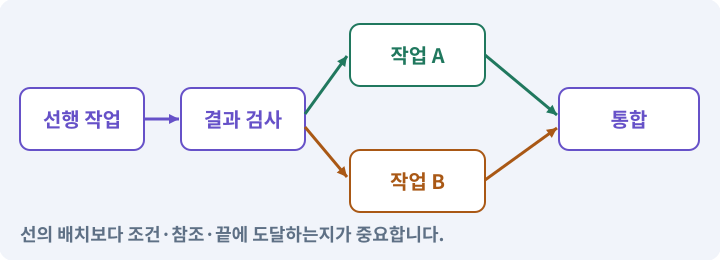

# 109. 요청을 검사 가능한 작업표로 바꾸기

**목표:** 실행 전에 잘못된 계획을 발견합니다.

**시작 상태:** 등록된 네 역할과 권한

## 한눈에 보는 기능의 흐름

작업 목록 → 역할·권한 검사 → 선행 관계 검사 → 실행 순서 확정



**경계:** 빈 완료 조건·없는 역할·순환을 실행 전 거부

그림은 실제 게임 실행 결과가 아닙니다. 값·규칙과 예제를 필요한 때 펼쳐 읽고 현재 단계의 메시지를 한 번씩 보냅니다.

## 1. 지금 상태 확인하기

첫 메시지를 보내 현재 준비 상태를 확인합니다. AI가 읽어 온 실제 프로젝트가 맞는지 보고, 없는 준비나 다른 상태가 있으면 먼저 알려 주세요. 아직 기능을 만들지 않는 단계입니다.

### AI에게 보낼 요구와 이유

#### 01. 작업 대상부터 확인

**“요청을 검사 가능한 작업표로 바꾸기” 작업을 시작하기 전에 현재 상태를 읽기 전용으로 확인해 줘.**

왜 이렇게 요청하나요? AI가 다른 프로젝트나 오래된 예제를 보고 작업할 수 있습니다. 실제 경로·파일·현재 기능을 읽게 하면 지금 이어서 작업할 대상을 먼저 맞출 수 있습니다.

#### 02. 작업 대상부터 확인

**필요한 시작 상태는 등록된 네 역할과 권한야.**

왜 이렇게 요청하나요? AI가 다른 프로젝트나 오래된 예제를 보고 작업할 수 있습니다. 실제 경로·파일·현재 기능을 읽게 하면 지금 이어서 작업할 대상을 먼저 맞출 수 있습니다.

#### 03. 실제 사용 중인 구현 재사용

**실제 프로젝트와 작업 기록을 읽고 이것이 준비되어 있는지, 이미 같은 기능이 있는지 확인해 줘.**

왜 이렇게 요청하나요? 이름이 비슷한 새 클래스를 또 만들면 기존 화면은 여전히 옛 코드를 사용할 수 있습니다. 실제 호출되는 진입점을 찾아 연결해야 두 구현이 충돌하거나 수정이 반영되지 않는 문제를 막습니다.

#### 04. 현재 상태와 다음 확인 지점 구분

**이번 기능이 연결될 실제 파일·화면·도구와 보존할 기존 동작을 짧게 정리해 줘.**

왜 이렇게 요청하나요? 이미 준비된 기능과 아직 확인하지 못한 기능을 섞으면 불필요한 재설치나 성급한 완료 판정이 생깁니다. 현재 대상과 남은 준비를 나눠 가장 작은 다음 작업을 선택하게 합니다.

#### 05. 조사 단계에서 변경하지 않기

**아직 새 구현·설치·유료 호출·파일 변경은 하지 마.**

왜 이렇게 요청하나요? 현재 상태를 알아보기만 할 때 파일 변경이나 결제가 시작되면 검토 전의 환경이 바뀝니다. 준비 확인과 실제 구현을 나눠 되돌리기 어려운 작업이 먼저 실행되지 않게 합니다.

#### 06. 막힌 준비를 먼저 해결

**준비가 다르면 부족한 항목과 다음에 필요한 작업을 알려 줘.**

왜 이렇게 요청하나요? 빠진 파일·권한·패키지를 있다고 가정하면 다음 구현이 엉뚱한 대상을 만들게 됩니다. 무엇이 없고 무엇을 먼저 해야 하는지 분리하면 불필요한 재작업을 줄일 수 있습니다.

<details>
<summary>보낼 원문 전체 — 설명은 복사되지 않습니다</summary>

```text
“요청을 검사 가능한 작업표로 바꾸기” 작업을 시작하기 전에 현재 상태를 읽기 전용으로 확인해 줘.
필요한 시작 상태는 등록된 네 역할과 권한야. 실제 프로젝트와 작업 기록을 읽고 이것이 준비되어 있는지, 이미 같은 기능이 있는지 확인해 줘.
이번 기능이 연결될 실제 파일·화면·도구와 보존할 기존 동작을 짧게 정리해 줘. 아직 새 구현·설치·유료 호출·파일 변경은 하지 마. 준비가 다르면 부족한 항목과 다음에 필요한 작업을 알려 줘.
```

</details>

**기대 결과:** 작업표의 항목과 실행 순서

### 직접 확인하기

1. AI가 읽은 실제 프로젝트 또는 도구 경로를 확인합니다.
2. 필수 준비가 없다면 문제 해결 요청을 보내고, 준비됐을 때 다음으로 갑니다.

## 2. 필요한 기능 만들기

준비가 확인되면 아래 요청을 보냅니다. AI가 파일·설정·실행을 맡습니다. 변경 범위나 비용 승인이 나오면 내용을 읽고 결정하세요.

### AI에게 보낼 요구와 이유

#### 01. 자연어 요구를 실행 전 계약으로 만들기

**역할 작업표 검증기를 만들어 줘.**

왜 이렇게 요청하나요? “기능을 추가해 줘”만으로는 수정 범위와 끝나는 조건이 넓어질 수 있습니다. 포함·제외·담당·의존성·완료 기준을 정하고 검토한 계획만 실행하게 합니다.

#### 02. 종류와 실제 소유 물건 구분

**각 작업은 고유 ID, 담당 역할, 요구, 읽을 파일, 좁혀진 쓰기 경로, 선행 작업, 내용이 있는 완료 조건을 갖게 해 줘.**

왜 이렇게 요청하나요? 같은 종류의 검 두 자루도 옵션과 소유 위치는 별개입니다. 정의 데이터와 개별 아이템을 나누면 한 물건을 수정했을 때 다른 물건과 원본 규격까지 바뀌지 않습니다.

#### 03. 연결도 자체의 오류 찾기

**등록되지 않은 역할·중복 ID·없는 선행 작업·자기 의존·순환·공백 완료 조건·권한 밖 경로를 실행 전에 거부해 줘.**

왜 이렇게 요청하나요? 선이 연결되어 보이더라도 없는 대상·순환·도달 불가 종점이 있으면 실행이 멈춥니다. 연결 규칙과 종료 조건을 검사해 시작부터 끝까지 실제 경로가 존재하게 합니다.

#### 04. 구현할 결과와 조건 고정

**작업이 요청한 권한이 역할의 권한을 넓힐 수 없어야 해.**

왜 이렇게 요청하나요? “작업이 요청한 권한이 역할의 권한을 넓힐 수 없어야 해”를 명시하면 AI가 무엇을 구현하거나 검사해야 하는지 범위를 좁힐 수 있습니다. 실행 전에 잘못된 계획을 발견합니다. 이 결과를 확인할 때 이 조건이 실제로 반영됐는지 함께 봅니다.

#### 05. 구현할 결과와 조건 고정

**같은 파일을 수정하는 두 작업은 의존 순서가 있거나 한 담당자가 소유해야 해.**

왜 이렇게 요청하나요? “같은 파일을 수정하는 두 작업은 의존 순서가 있거나 한 담당자가 소유해야 해”를 명시하면 AI가 무엇을 구현하거나 검사해야 하는지 범위를 좁힐 수 있습니다. 실행 전에 잘못된 계획을 발견합니다. 이 결과를 확인할 때 이 조건이 실제로 반영됐는지 함께 봅니다.

#### 06. 구현할 결과와 조건 고정

**실행 가능한 순서를 안정적으로 계산하고 순서를 정한 이유를 보여 줘.**

왜 이렇게 요청하나요? “실행 가능한 순서를 안정적으로 계산하고 순서를 정한 이유를 보여 줘”를 명시하면 AI가 무엇을 구현하거나 검사해야 하는지 범위를 좁힐 수 있습니다. 실행 전에 잘못된 계획을 발견합니다. 이 결과를 확인할 때 이 조건이 실제로 반영됐는지 함께 봅니다.

#### 07. 관찰 가능한 기준으로 확인

**정상 계획 하나와 각 오류 계획을 네가 생성해 실제로 검사해 줘.**

왜 이렇게 요청하나요? 구현 완료라는 설명을 실제 결과로 바꾸기 위한 조건입니다. 요청에 나온 대상과 경계 상황을 확인해 정상 결과뿐 아니라 실패를 어떻게 구분했는지도 남깁니다.

#### 08. 기계가 읽을 값의 형식 검사

**내가 JSON을 만들게 하지 마.**

왜 이렇게 요청하나요? 문자열이 JSON으로 읽힌다고 업무 규칙까지 올바른 것은 아닙니다. 필드·타입·범위·참조를 검사해 잘못된 값이 실제 코드·저장·편집기로 들어오지 않게 합니다.

#### 09. 구현할 결과와 조건 고정

**아직 자연어 계획 생성이나 모델 호출은 추가하지 마.**

왜 이렇게 요청하나요? “아직 자연어 계획 생성이나 모델 호출은 추가하지 마”를 명시하면 AI가 무엇을 구현하거나 검사해야 하는지 범위를 좁힐 수 있습니다. 실행 전에 잘못된 계획을 발견합니다. 이 결과를 확인할 때 이 조건이 실제로 반영됐는지 함께 봅니다.

#### 10. 설정과 실제 사용 결과 연결

**현재 작성한 MyGameHarness를 확장하고 필요한 파일·테스트·스킬 연결을 직접 만들어 실행해 줘.**

왜 이렇게 요청하나요? 데이터에 수치를 넣어도 사용 조건·UI·실제 전투가 그 값을 읽지 않으면 기능이 완성되지 않습니다. 선택 전후의 계산과 저장을 함께 확인합니다.

#### 11. 아래 항목을 완료 조건으로 사용

**정상 예와 실패 예를 실제로 보여 주고, 기존 기능이 유지되는지 확인해 줘.**

왜 이렇게 요청하나요? 요구사항의 목록은 AI에게 참고 설명을 주는 것이 아니라 완료를 판단할 기준을 정합니다. 구현 뒤 각 항목을 실제 입력과 결과에 대응시켜 빠진 조건을 찾습니다.

<details>
<summary>보낼 원문 전체 — 설명은 복사되지 않습니다</summary>

```text
역할 작업표 검증기를 만들어 줘. 각 작업은 고유 ID, 담당 역할, 요구, 읽을 파일, 좁혀진 쓰기 경로, 선행 작업, 내용이 있는 완료 조건을 갖게 해 줘.
등록되지 않은 역할·중복 ID·없는 선행 작업·자기 의존·순환·공백 완료 조건·권한 밖 경로를 실행 전에 거부해 줘. 작업이 요청한 권한이 역할의 권한을 넓힐 수 없어야 해.
같은 파일을 수정하는 두 작업은 의존 순서가 있거나 한 담당자가 소유해야 해. 실행 가능한 순서를 안정적으로 계산하고 순서를 정한 이유를 보여 줘.
정상 계획 하나와 각 오류 계획을 네가 생성해 실제로 검사해 줘. 내가 JSON을 만들게 하지 마. 아직 자연어 계획 생성이나 모델 호출은 추가하지 마.

현재 작성한 MyGameHarness를 확장하고 필요한 파일·테스트·스킬 연결을 직접 만들어 실행해 줘. 정상 예와 실패 예를 실제로 보여 주고, 기존 기능이 유지되는지 확인해 줘.
```

</details>

**기대 결과:** 확인할 결과: 정상 계획만 실행 순서로 정리됨. AI가 이 상태를 확인할 실제 화면과 변경 내용을 준비합니다. 아직 실행하지 못한 부분은 따로 표시합니다.

### 직접 확인하기

1. 제안서만 반환됐다면 “설명으로 끝내지 말고 승인한 범위의 실제 작업을 수행해 줘”라고 보냅니다.
2. 코드나 설정을 직접 고치라는 안내가 나오면 “작성과 실행은 네가 맡아 줘”라고 요청합니다.

## 3. 결과를 직접 확인하기

먼저 확인 요청을 보내 AI가 검사와 화면을 준비하게 하세요. 그다음 아래 동작을 하나씩 확인합니다.

### AI에게 보낼 요구와 이유

#### 01. 자연어 요구를 실행 전 계약으로 만들기

**현재 구현한 “요청을 검사 가능한 작업표로 바꾸기”의 자동 검사와 도구 결과 화면을 준비해 줘.**

왜 이렇게 요청하나요? “기능을 추가해 줘”만으로는 수정 범위와 끝나는 조건이 넓어질 수 있습니다. 포함·제외·담당·의존성·완료 기준을 정하고 검토한 계획만 실행하게 합니다.

#### 02. 결과를 재확인할 근거 남기기

**정상 동작과 아래 실패 조건을 실제로 검사하고 대상·실행 수·결과를 보여 줘.**

왜 이렇게 요청하나요? “잘 됩니다”라는 요약만으로는 어떤 입력과 버전을 검사했는지 알 수 없습니다. 대상·실행 수·실패 내용·파일을 함께 남겨 같은 조건으로 다시 확인할 수 있게 합니다.

#### 03. 연결도 자체의 오류 찾기

**순환 계획은 실행 전 실패한다.**

왜 이렇게 요청하나요? 선이 연결되어 보이더라도 없는 대상·순환·도달 불가 종점이 있으면 실행이 멈춥니다. 연결 규칙과 종료 조건을 검사해 시작부터 끝까지 실제 경로가 존재하게 합니다.

#### 04. 실패를 숨기지 않기

**필수 검토나 검사를 삭제하면 거부된다.**

왜 이렇게 요청하나요? 검사 조건을 약하게 만들면 결함이 남아 있어도 통과 표시가 나올 수 있습니다. 구현을 고친 뒤 원래 기준으로 다시 검사해야 실제 문제가 해결됐는지 알 수 있습니다.

#### 05. 파일 소유권·읽기 범위·쓰기 범위의 적용 조건

**수정 범위는 역할 권한보다 넓어질 수 없다.**

왜 이렇게 요청하나요? 파일 소유권은 이번 작업에서 누가 어느 파일을 수정할 책임과 권한이 있는지 정한 규칙입니다. 읽기 허용과 쓰기 허용은 별도로 관리합니다. 권한 설명 프롬프트만으로 운영체제의 실제 접근을 완전히 차단한 것은 아닙니다.

#### 06. 구현할 결과와 조건 고정

**계획 변경은 새 버전으로 남는다.**

왜 이렇게 요청하나요? “계획 변경은 새 버전으로 남는다”를 명시하면 AI가 무엇을 구현하거나 검사해야 하는지 범위를 좁힐 수 있습니다. 실행 전에 잘못된 계획을 발견합니다. 이 결과를 확인할 때 이 조건이 실제로 반영됐는지 함께 봅니다.

#### 07. 사람 검사의 시작점 준비

**내가 조작해야 하는 부분은 실행할 화면과 시작 상태를 준비해 줘.**

왜 이렇게 요청하나요? 같은 기능이라도 시작 상태가 다르면 관찰 결과가 달라집니다. AI가 실행 화면과 재현 위치를 먼저 준비해야 사람이 이동·공격·소리·조작감을 같은 조건에서 확인할 수 있습니다.

#### 08. 사람이 실제로 본 것만 기록

**연결되지 않은 기기의 검사나 사람이 보지 않은 재미·소리 품질을 대신 확인했다고 하지 마.**

왜 이렇게 요청하나요? AI가 준비한 검사와 사람이 직접 플레이하거나 들은 결과는 다른 근거입니다. 관찰하지 않은 조작감·소리·실기기 결과를 임의로 완료 처리하지 않게 합니다.

#### 09. 실제로 실행한 검사만 인정

**테스트 0개와 예전 소스 결과는 현재 성공으로 쓰지 마.**

왜 이렇게 요청하나요? 실행된 검사가 없거나 같은 결과를 중복 집계한 경우는 기능을 확인한 것이 아닙니다. 실행 수와 개별 결과를 함께 확인해야 형식적인 성공 표시를 걸러낼 수 있습니다.

<details>
<summary>보낼 원문 전체 — 설명은 복사되지 않습니다</summary>

```text
현재 구현한 “요청을 검사 가능한 작업표로 바꾸기”의 자동 검사와 도구 결과 화면을 준비해 줘. 정상 동작과 아래 실패 조건을 실제로 검사하고 대상·실행 수·결과를 보여 줘.

순환 계획은 실행 전 실패한다.

 필수 검토나 검사를 삭제하면 거부된다.

 수정 범위는 역할 권한보다 넓어질 수 없다.

 계획 변경은 새 버전으로 남는다.

내가 조작해야 하는 부분은 실행할 화면과 시작 상태를 준비해 줘. 연결되지 않은 기기의 검사나 사람이 보지 않은 재미·소리 품질을 대신 확인했다고 하지 마. 테스트 0개와 예전 소스 결과는 현재 성공으로 쓰지 마.
```

</details>

**기대 결과:** 두 번째는 동시에 쓰지 않습니다. 기록된 소유자와 실행 상태를 확인한 뒤 안전하게 잠금 해제를 판단합니다.

### 직접 확인하기

1. 정상 계획에서 누가 먼저 일하는지 설명을 읽습니다.
2. 빈 완료 조건과 없는 역할을 거부하는지 봅니다.
3. 순환하는 의존 관계를 AI가 만들어 거부하는지 확인합니다.

## 4. 결과를 남기고 마무리하기

실제로 본 결과를 아래 메모에 적고 AI에 전달합니다. 결과 저장 요청으로 현재 상태를 남긴 뒤 다음 페이지로 갑니다.

### AI에게 보낼 요구와 이유

#### 01. 결과를 재확인할 근거 남기기

**지금 작업한 “요청을 검사 가능한 작업표로 바꾸기”의 실제 결과를 정리해 줘.**

왜 이렇게 요청하나요? “잘 됩니다”라는 요약만으로는 어떤 입력과 버전을 검사했는지 알 수 없습니다. 대상·실행 수·실패 내용·파일을 함께 남겨 같은 조건으로 다시 확인할 수 있게 합니다.

#### 02. 다음 작업이 읽을 인수인계

**변경한 기능·파일·현재 후보와 실제 실행한 검사, 남은 문제를 기능 이름으로 기록해 줘.**

왜 이렇게 요청하나요? 새 AI 세션은 이전 대화 전체를 알고 있다고 보장할 수 없습니다. 현재 후보·파일 위치·실행한 검사·남은 일을 남겨야 같은 작업을 반복하지 않고 이어갈 수 있습니다.

#### 03. 사람이 실제로 본 것만 기록

**자동 검사 결과와 내가 직접 확인한 결과를 구분하고, 내 관찰이 아직 없으면 미확인으로 남겨 줘.**

왜 이렇게 요청하나요? AI가 준비한 검사와 사람이 직접 플레이하거나 들은 결과는 다른 근거입니다. 관찰하지 않은 조작감·소리·실기기 결과를 임의로 완료 처리하지 않게 합니다.

#### 04. 다음 작업이 읽을 인수인계

**재시작하거나 다음 작업에서 읽을 기록의 실제 위치를 알려 줘.**

왜 이렇게 요청하나요? 새 AI 세션은 이전 대화 전체를 알고 있다고 보장할 수 없습니다. 현재 후보·파일 위치·실행한 검사·남은 일을 남겨야 같은 작업을 반복하지 않고 이어갈 수 있습니다.

#### 05. 미확인을 완료와 분리

**아직 확인하지 않은 결과를 완료로 채우지 마.**

왜 이렇게 요청하나요? 만들어진 것, 검사에 실패한 것, 아직 확인하지 못한 것을 나눠야 다음 작업을 정확히 고를 수 있습니다. 실행할 조건이 없는 기능을 성공으로 기록하면 뒤에서 원인을 찾기 어려워집니다.

<details>
<summary>보낼 원문 전체 — 설명은 복사되지 않습니다</summary>

```text
지금 작업한 “요청을 검사 가능한 작업표로 바꾸기”의 실제 결과를 정리해 줘. 변경한 기능·파일·현재 후보와 실제 실행한 검사, 남은 문제를 기능 이름으로 기록해 줘.
자동 검사 결과와 내가 직접 확인한 결과를 구분하고, 내 관찰이 아직 없으면 미확인으로 남겨 줘. 재시작하거나 다음 작업에서 읽을 기록의 실제 위치를 알려 줘. 아직 확인하지 않은 결과를 완료로 채우지 마.
```

</details>

**기대 결과:** 현재 상태·검사 결과·남은 문제·다음에 읽을 기록을 확인할 수 있습니다.

### 직접 확인하기

1. 자동 검사와 내 관찰 결과가 섞이지 않았는지 봅니다.
2. 문제가 남았다면 해결 요청을 보내고 같은 동작을 다시 확인합니다.

## 구체적인 예로 이해하기

### 동시에 실행하면 안 되는 일

작업 의존성과 공유 자원 잠금은 서로 보완합니다. 순서를 맞춰도 다른 세션이 같은 Editor를 바꾸면 충돌할 수 있습니다.

**시작 상태:** 하나의 작업이 Unity 연결을 사용 중입니다.

**직접 해 볼 동작:** 두 번째 동일 자원 작업을 요청하고 첫 작업을 실패·중단시키는 상황을 시험합니다.

**보여야 하는 결과:** 두 번째는 동시에 쓰지 않습니다. 기록된 소유자와 실행 상태를 확인한 뒤 안전하게 잠금 해제를 판단합니다.

**이렇게 되면 아직 안 됩니다:** 잠금 파일이 오래됐다는 이유만으로 살아 있는 작업의 잠금을 지웁니다.

**생각해 보기:** 이 잠금이 사용자의 모든 직접 편집까지 막나요?

<details><summary>해설 보기</summary>

아니요. 협력하는 하네스 작업 사이의 장치입니다. 사람이 Editor를 조작할 때도 작업 중임을 알고 조율해야 합니다.

</details>

## 문제가 있으면

### AI에게 보낼 요구와 이유

#### 01. 작업표·완료 조건·계획의 적용 조건

**없는 선행 작업이나 공백뿐인 완료 조건을 허용하지 마.**

왜 이렇게 요청하나요? 작업표는 목표·담당·입력·출력·선행 작업·완료 조건을 명시한 실행 계약입니다. 기획 AI가 초안을 만들 수 있지만 허용 경로·예산·실행 승인까지 마음대로 정하게 하지 않습니다. 계획이 JSON이라는 이유로 타당하거나 승인된 것은 아닙니다.

#### 02. 구현할 결과와 조건 고정

**같은 파일을 쓰는 작업은 순서를 명시하거나 한 담당자로 좁혀 줘.**

왜 이렇게 요청하나요? “같은 파일을 쓰는 작업은 순서를 명시하거나 한 담당자로 좁혀 줘”를 명시하면 AI가 무엇을 구현하거나 검사해야 하는지 범위를 좁힐 수 있습니다. 실행 전에 잘못된 계획을 발견합니다. 이 결과를 확인할 때 이 조건이 실제로 반영됐는지 함께 봅니다.

#### 03. 원인 하나를 좁혀 수정

**새 기능을 추가하지 말고 현재 오류와 실제 로그를 먼저 읽어 줘.**

왜 이렇게 요청하나요? 오류 수정 중 새 기능까지 넣으면 어떤 변경이 문제를 해결하거나 악화했는지 알기 어렵습니다. 원래 재현을 보존하고 작은 변경 뒤 같은 입력과 주변 정상 동작을 다시 확인합니다.

#### 04. 원인 하나를 좁혀 수정

**최소 수정 뒤 같은 재현과 관련 정상 동작을 다시 검사해 줘.**

왜 이렇게 요청하나요? 오류 수정 중 새 기능까지 넣으면 어떤 변경이 문제를 해결하거나 악화했는지 알기 어렵습니다. 원래 재현을 보존하고 작은 변경 뒤 같은 입력과 주변 정상 동작을 다시 확인합니다.

#### 05. 실패도 재현 자료로 보존

**실패 기록은 지우지 마.**

왜 이렇게 요청하나요? 실패한 입력과 로그가 있어야 같은 문제가 다시 생겼을 때 비교할 수 있습니다. 성공 기록으로 덮어쓰지 않고 전후 자료를 남기면 무엇을 고쳤는지 확인할 수 있습니다.

<details>
<summary>보낼 원문 전체 — 설명은 복사되지 않습니다</summary>

```text
없는 선행 작업이나 공백뿐인 완료 조건을 허용하지 마. 같은 파일을 쓰는 작업은 순서를 명시하거나 한 담당자로 좁혀 줘.
새 기능을 추가하지 말고 현재 오류와 실제 로그를 먼저 읽어 줘. 최소 수정 뒤 같은 재현과 관련 정상 동작을 다시 검사해 줘. 실패 기록은 지우지 마.
```

</details>

## 새 세션에서 이어가기

### AI에게 보낼 요구와 이유

#### 01. 이어서 할 작업 식별

**“요청을 검사 가능한 작업표로 바꾸기” 작업을 이어가고 싶어.**

왜 이렇게 요청하나요? 이름으로 재개할 작업을 찾고, 뒤에 이어지는 요청으로 실제 파일·진행 중 작업·기록을 다시 읽게 합니다. 제목만 보고 이전 상태를 기억한다고 가정하지 않습니다.

#### 02. 조회는 상태를 바꾸지 않게

**실제 프로젝트와 내 도구의 작업 기록을 읽고 어디까지 구현·검사됐는지 확인해 줘.**

왜 이렇게 요청하나요? 진행 상황을 물을 때 새 구현이나 유료 호출이 시작되면 단순 확인이 실행 명령이 되어 버립니다. 저장된 근거를 읽어 완료·진행·승인 대기·미검증을 나누게 합니다.

#### 03. 재개 전 중복 작업 방지

**진행 중인 프로세스·승인·미저장 변경을 확인한 뒤 남은 가장 작은 작업부터 안내해 줘.**

왜 이렇게 요청하나요? 대화가 끊겨도 외부 작업은 끝났거나 아직 실행 중일 수 있습니다. 프로세스·승인·미저장 상태를 먼저 읽어 같은 생성·빌드·결제를 두 번 시작하지 않도록 합니다.

#### 04. 되돌아갈 원본 남기기

**기존 성공과 실패 기록은 보존해 줘.**

왜 이렇게 요청하나요? 새 구현이 실패해도 이전 게임과 저장을 복원할 수 있어야 합니다. 현재 내용을 먼저 조사하고 별도 후보에서 작업하면 실험이 유일한 정상본을 망가뜨리는 일을 피할 수 있습니다.

<details>
<summary>보낼 원문 전체 — 설명은 복사되지 않습니다</summary>

```text
“요청을 검사 가능한 작업표로 바꾸기” 작업을 이어가고 싶어. 실제 프로젝트와 내 도구의 작업 기록을 읽고 어디까지 구현·검사됐는지 확인해 줘. 진행 중인 프로세스·승인·미저장 변경을 확인한 뒤 남은 가장 작은 작업부터 안내해 줘. 기존 성공과 실패 기록은 보존해 줘.
```

</details>

## 왜 이렇게 만드는가

계획은 작업의 순서와 완료 조건을 가진 데이터다. 예쁜 표가 있어도 서로 기다리는 순환 의존 관계나 같은 파일을 동시에 수정하는 작업이 있으면 실행할 수 없다. 계획을 제안하는 AI와 그것을 검사하는 프로그램은 분리한다.

사용자는 JSON을 작성하지 않는다. “검토가 끝나기 전에는 게임에 적용하지 마”처럼 규칙을 말하면 AI가 계획으로 표현하고, 잘못된 계획이 실제로 거부되는지 보여 준다.

## 공식 참고

