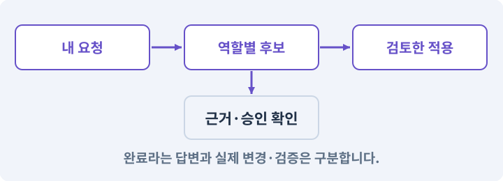

# 123. 기존 게임의 실제 파일 찾아 연결하기

**목표:** 예제가 아닌 내 게임 코드에 작업을 맡깁니다.

**시작 상태:** 완주되는 2D 게임과 내 하네스

## 한눈에 보는 기능의 흐름

실제 호출 코드 → 파일 별칭 연결 → 해시·근거 확인 → 역할 입력 생성



**경계:** 이름만 같은 미사용 예제를 고치지 않기

그림은 실제 게임 실행 결과가 아닙니다. 값·규칙과 예제를 필요한 때 펼쳐 읽고 현재 단계의 메시지를 한 번씩 보냅니다.

## 1. 지금 상태 확인하기

첫 메시지를 보내 현재 준비 상태를 확인합니다. AI가 읽어 온 실제 프로젝트가 맞는지 보고, 없는 준비나 다른 상태가 있으면 먼저 알려 주세요. 아직 기능을 만들지 않는 단계입니다.

### AI에게 보낼 요구와 이유

#### 01. 작업 대상부터 확인

**“기존 게임의 실제 파일 찾아 연결하기” 작업을 시작하기 전에 현재 상태를 읽기 전용으로 확인해 줘.**

왜 이렇게 요청하나요? AI가 다른 프로젝트나 오래된 예제를 보고 작업할 수 있습니다. 실제 경로·파일·현재 기능을 읽게 하면 지금 이어서 작업할 대상을 먼저 맞출 수 있습니다.

#### 02. 작업 대상부터 확인

**필요한 시작 상태는 완주되는 2D 게임과 내 하네스야.**

왜 이렇게 요청하나요? AI가 다른 프로젝트나 오래된 예제를 보고 작업할 수 있습니다. 실제 경로·파일·현재 기능을 읽게 하면 지금 이어서 작업할 대상을 먼저 맞출 수 있습니다.

#### 03. 실제 사용 중인 구현 재사용

**실제 프로젝트와 작업 기록을 읽고 이것이 준비되어 있는지, 이미 같은 기능이 있는지 확인해 줘.**

왜 이렇게 요청하나요? 이름이 비슷한 새 클래스를 또 만들면 기존 화면은 여전히 옛 코드를 사용할 수 있습니다. 실제 호출되는 진입점을 찾아 연결해야 두 구현이 충돌하거나 수정이 반영되지 않는 문제를 막습니다.

#### 04. 현재 상태와 다음 확인 지점 구분

**이번 기능이 연결될 실제 파일·화면·도구와 보존할 기존 동작을 짧게 정리해 줘.**

왜 이렇게 요청하나요? 이미 준비된 기능과 아직 확인하지 못한 기능을 섞으면 불필요한 재설치나 성급한 완료 판정이 생깁니다. 현재 대상과 남은 준비를 나눠 가장 작은 다음 작업을 선택하게 합니다.

#### 05. 조사 단계에서 변경하지 않기

**아직 새 구현·설치·유료 호출·파일 변경은 하지 마.**

왜 이렇게 요청하나요? 현재 상태를 알아보기만 할 때 파일 변경이나 결제가 시작되면 검토 전의 환경이 바뀝니다. 준비 확인과 실제 구현을 나눠 되돌리기 어려운 작업이 먼저 실행되지 않게 합니다.

#### 06. 막힌 준비를 먼저 해결

**준비가 다르면 부족한 항목과 다음에 필요한 작업을 알려 줘.**

왜 이렇게 요청하나요? 빠진 파일·권한·패키지를 있다고 가정하면 다음 구현이 엉뚱한 대상을 만들게 됩니다. 무엇이 없고 무엇을 먼저 해야 하는지 분리하면 불필요한 재작업을 줄일 수 있습니다.

<details>
<summary>보낼 원문 전체 — 설명은 복사되지 않습니다</summary>

```text
“기존 게임의 실제 파일 찾아 연결하기” 작업을 시작하기 전에 현재 상태를 읽기 전용으로 확인해 줘.
필요한 시작 상태는 완주되는 2D 게임과 내 하네스야. 실제 프로젝트와 작업 기록을 읽고 이것이 준비되어 있는지, 이미 같은 기능이 있는지 확인해 줘.
이번 기능이 연결될 실제 파일·화면·도구와 보존할 기존 동작을 짧게 정리해 줘. 아직 새 구현·설치·유료 호출·파일 변경은 하지 마. 준비가 다르면 부족한 항목과 다음에 필요한 작업을 알려 줘.
```

</details>

**기대 결과:** 실제 파일과 선택 이유가 있는 연결표

### 직접 확인하기

1. AI가 읽은 실제 프로젝트 또는 도구 경로를 확인합니다.
2. 필수 준비가 없다면 문제 해결 요청을 보내고, 준비됐을 때 다음으로 갑니다.

## 2. 필요한 기능 만들기

준비가 확인되면 아래 요청을 보냅니다. AI가 파일·설정·실행을 맡습니다. 변경 범위나 비용 승인이 나오면 내용을 읽고 결정하세요.

### AI에게 보낼 요구와 이유

#### 01. 논리 지형과 플레이 가능한 지형 검사

**내가 실제로 사용하는 AshfallRPG2D를 읽고 하네스에 연결할 파일 지도를 만들어 줘.**

왜 이렇게 요청하나요? 방이 보기 좋게 놓였어도 통로가 끊기거나 출구가 막히면 완주할 수 없습니다. 연결성과 스폰·몸체 이동을 검사하고 실패한 생성은 재현 정보와 함께 복구합니다.

#### 02. 종료 이후의 상태까지 확인

**아이템 정의·인스턴스·드롭 이름표·상호작용·입력·설정·저장·테스트의 실제 진입점을 조사해 줘.**

왜 이렇게 요청하나요? 현재 화면에서 맞는 값도 저장하거나 다시 구성할 때 빠질 수 있습니다. 실제 종료·불러오기 전후에 ID·옵션·장착·진행을 비교해야 유지되는 범위를 확인할 수 있습니다.

#### 03. 스크립트와 실제 씬 연결

**파일명만으로 고르지 말고 씬 컴포넌트와 호출자·공개 메서드·참조 관계를 확인해 줘.**

왜 이렇게 요청하나요? 코드 파일을 만들어도 씬의 오브젝트에 붙지 않거나 참조가 비어 있으면 플레이에 반영되지 않습니다. 실제 사용하는 프리팹과 컴포넌트까지 연결해 동작을 확인하게 합니다.

#### 04. 구현할 결과와 조건 고정

**관계없는 예제와 사용하지 않는 코드는 제외해 줘.**

왜 이렇게 요청하나요? “관계없는 예제와 사용하지 않는 코드는 제외해 줘”를 명시하면 AI가 무엇을 구현하거나 검사해야 하는지 범위를 좁힐 수 있습니다. 예제가 아닌 내 게임 코드에 작업을 맡깁니다. 이 결과를 확인할 때 이 조건이 실제로 반영됐는지 함께 봅니다.

#### 05. 관찰 가능한 기준으로 확인

**기능 이름을 실제 경로·기준 지문·확인할 선언·선택 이유에 연결하는 도구를 구현해 줘.**

왜 이렇게 요청하나요? 구현 완료라는 설명을 실제 결과로 바꾸기 위한 조건입니다. 요청에 나온 대상과 경계 상황을 확인해 정상 결과뿐 아니라 실패를 어떻게 구분했는지도 남깁니다.

#### 06. 기존 결과를 보호

**경로 누락·선언 변경·범위 밖 출력·서로 다른 원본을 거부해 줘.**

왜 이렇게 요청하나요? 새 작업이 이미 정상인 기능이나 자산까지 바꾸면 원인을 추적하기 어렵습니다. 유지할 대상을 명시해 변경 전후를 비교하고 원치 않은 영향을 찾습니다.

#### 07. 자연어 요구를 실행 전 계약으로 만들기

**연결 파일과 작업표는 네가 만들고 검증해 줘.**

왜 이렇게 요청하나요? “기능을 추가해 줘”만으로는 수정 범위와 끝나는 조건이 넓어질 수 있습니다. 포함·제외·담당·의존성·완료 기준을 정하고 검토한 계획만 실행하게 합니다.

#### 08. 기계가 읽을 값의 형식 검사

**내가 경로나 JSON을 직접 작성하게 하지 마.**

왜 이렇게 요청하나요? 문자열이 JSON으로 읽힌다고 업무 규칙까지 올바른 것은 아닙니다. 필드·타입·범위·참조를 검사해 잘못된 값이 실제 코드·저장·편집기로 들어오지 않게 합니다.

#### 09. 구현할 결과와 조건 고정

**아직 게임 기능을 바꾸지는 마.**

왜 이렇게 요청하나요? “아직 게임 기능을 바꾸지는 마”를 명시하면 AI가 무엇을 구현하거나 검사해야 하는지 범위를 좁힐 수 있습니다. 예제가 아닌 내 게임 코드에 작업을 맡깁니다. 이 결과를 확인할 때 이 조건이 실제로 반영됐는지 함께 봅니다.

#### 10. 설정과 실제 사용 결과 연결

**현재 작성한 MyGameHarness를 확장하고 필요한 파일·테스트·스킬 연결을 직접 만들어 실행해 줘.**

왜 이렇게 요청하나요? 데이터에 수치를 넣어도 사용 조건·UI·실제 전투가 그 값을 읽지 않으면 기능이 완성되지 않습니다. 선택 전후의 계산과 저장을 함께 확인합니다.

#### 11. 아래 항목을 완료 조건으로 사용

**정상 예와 실패 예를 실제로 보여 주고, 기존 기능이 유지되는지 확인해 줘.**

왜 이렇게 요청하나요? 요구사항의 목록은 AI에게 참고 설명을 주는 것이 아니라 완료를 판단할 기준을 정합니다. 구현 뒤 각 항목을 실제 입력과 결과에 대응시켜 빠진 조건을 찾습니다.

<details>
<summary>보낼 원문 전체 — 설명은 복사되지 않습니다</summary>

```text
내가 실제로 사용하는 AshfallRPG2D를 읽고 하네스에 연결할 파일 지도를 만들어 줘. 아이템 정의·인스턴스·드롭 이름표·상호작용·입력·설정·저장·테스트의 실제 진입점을 조사해 줘.
파일명만으로 고르지 말고 씬 컴포넌트와 호출자·공개 메서드·참조 관계를 확인해 줘. 관계없는 예제와 사용하지 않는 코드는 제외해 줘.
기능 이름을 실제 경로·기준 지문·확인할 선언·선택 이유에 연결하는 도구를 구현해 줘. 경로 누락·선언 변경·범위 밖 출력·서로 다른 원본을 거부해 줘.
연결 파일과 작업표는 네가 만들고 검증해 줘. 내가 경로나 JSON을 직접 작성하게 하지 마. 아직 게임 기능을 바꾸지는 마.

현재 작성한 MyGameHarness를 확장하고 필요한 파일·테스트·스킬 연결을 직접 만들어 실행해 줘. 정상 예와 실패 예를 실제로 보여 주고, 기존 기능이 유지되는지 확인해 줘.
```

</details>

**기대 결과:** 확인할 결과: 실제 실행되는 코드와 허용 범위가 연결됨. AI가 이 상태를 확인할 실제 화면과 변경 내용을 준비합니다. 아직 실행하지 못한 부분은 따로 표시합니다.

### 직접 확인하기

1. 제안서만 반환됐다면 “설명으로 끝내지 말고 승인한 범위의 실제 작업을 수행해 줘”라고 보냅니다.
2. 코드나 설정을 직접 고치라는 안내가 나오면 “작성과 실행은 네가 맡아 줘”라고 요청합니다.

## 3. 결과를 직접 확인하기

먼저 확인 요청을 보내 AI가 검사와 화면을 준비하게 하세요. 그다음 아래 동작을 하나씩 확인합니다.

### AI에게 보낼 요구와 이유

#### 01. 예시 이름이 아니라 실제 코드에 연결

**현재 구현한 “기존 게임의 실제 파일 찾아 연결하기”의 자동 검사와 도구 결과 화면을 준비해 줘.**

왜 이렇게 요청하나요? 수강생 프로젝트의 파일 이름은 예제와 다를 수 있습니다. 실제 호출되는 코드와 참조를 찾아 역할 입력에 연결해야 쓰이지 않는 파일을 고치고 완료라고 보고하는 일을 막습니다.

#### 02. 결과를 재확인할 근거 남기기

**정상 동작과 아래 실패 조건을 실제로 검사하고 대상·실행 수·결과를 보여 줘.**

왜 이렇게 요청하나요? “잘 됩니다”라는 요약만으로는 어떤 입력과 버전을 검사했는지 알 수 없습니다. 대상·실행 수·실패 내용·파일을 함께 남겨 같은 조건으로 다시 확인할 수 있게 합니다.

#### 03. Play 모드·편집 모드·런타임의 적용 조건

**예제 클래스가 실제 런타임으로 오인되지 않는다.**

왜 이렇게 요청하나요? 편집 모드는 제작 상태이고 Play 모드는 게임 로직을 실행해 보는 상태입니다. 런타임은 게임이 실제로 실행되는 시간과 환경을 뜻합니다. Play에서 보인 상태만 보고 저장·재개방까지 통과했다고 기록하지 않습니다.

#### 04. 구현할 결과와 조건 고정

**누락 경로를 자동 생성해 조사 성공을 꾸미지 않는다.**

왜 이렇게 요청하나요? “누락 경로를 자동 생성해 조사 성공을 꾸미지 않는다”를 명시하면 AI가 무엇을 구현하거나 검사해야 하는지 범위를 좁힐 수 있습니다. 예제가 아닌 내 게임 코드에 작업을 맡깁니다. 이 결과를 확인할 때 이 조건이 실제로 반영됐는지 함께 봅니다.

#### 05. 예시 이름이 아니라 실제 코드에 연결

**원본 변경 뒤 오래된 바인딩은 거부된다.**

왜 이렇게 요청하나요? 수강생 프로젝트의 파일 이름은 예제와 다를 수 있습니다. 실제 호출되는 코드와 참조를 찾아 역할 입력에 연결해야 쓰이지 않는 파일을 고치고 완료라고 보고하는 일을 막습니다.

#### 06. 기계가 읽을 값의 형식 검사

**사용자에게 JSON 값 수정을 요구하지 않는다.**

왜 이렇게 요청하나요? 문자열이 JSON으로 읽힌다고 업무 규칙까지 올바른 것은 아닙니다. 필드·타입·범위·참조를 검사해 잘못된 값이 실제 코드·저장·편집기로 들어오지 않게 합니다.

#### 07. 사람 검사의 시작점 준비

**내가 조작해야 하는 부분은 실행할 화면과 시작 상태를 준비해 줘.**

왜 이렇게 요청하나요? 같은 기능이라도 시작 상태가 다르면 관찰 결과가 달라집니다. AI가 실행 화면과 재현 위치를 먼저 준비해야 사람이 이동·공격·소리·조작감을 같은 조건에서 확인할 수 있습니다.

#### 08. 사람이 실제로 본 것만 기록

**연결되지 않은 기기의 검사나 사람이 보지 않은 재미·소리 품질을 대신 확인했다고 하지 마.**

왜 이렇게 요청하나요? AI가 준비한 검사와 사람이 직접 플레이하거나 들은 결과는 다른 근거입니다. 관찰하지 않은 조작감·소리·실기기 결과를 임의로 완료 처리하지 않게 합니다.

#### 09. 실제로 실행한 검사만 인정

**테스트 0개와 예전 소스 결과는 현재 성공으로 쓰지 마.**

왜 이렇게 요청하나요? 실행된 검사가 없거나 같은 결과를 중복 집계한 경우는 기능을 확인한 것이 아닙니다. 실행 수와 개별 결과를 함께 확인해야 형식적인 성공 표시를 걸러낼 수 있습니다.

<details>
<summary>보낼 원문 전체 — 설명은 복사되지 않습니다</summary>

```text
현재 구현한 “기존 게임의 실제 파일 찾아 연결하기”의 자동 검사와 도구 결과 화면을 준비해 줘. 정상 동작과 아래 실패 조건을 실제로 검사하고 대상·실행 수·결과를 보여 줘.

예제 클래스가 실제 런타임으로 오인되지 않는다.

 누락 경로를 자동 생성해 조사 성공을 꾸미지 않는다.

 원본 변경 뒤 오래된 바인딩은 거부된다.

 사용자에게 JSON 값 수정을 요구하지 않는다.

내가 조작해야 하는 부분은 실행할 화면과 시작 상태를 준비해 줘. 연결되지 않은 기기의 검사나 사람이 보지 않은 재미·소리 품질을 대신 확인했다고 하지 마. 테스트 0개와 예전 소스 결과는 현재 성공으로 쓰지 마.
```

</details>

**기대 결과:** 작업표의 입력이 실제 실행 코드이고, 파일이 달라지면 재검토가 필요하다는 사실을 확인합니다.

### 직접 확인하기

1. 각 기능이 연결된 실제 파일을 설명으로 확인합니다.
2. 사용하지 않는 예제 코드가 제외됐는지 봅니다.
3. 기준 파일이 바뀌면 다시 조사하도록 되어 있는지 확인합니다.

## 4. 결과를 남기고 마무리하기

실제로 본 결과를 아래 메모에 적고 AI에 전달합니다. 결과 저장 요청으로 현재 상태를 남긴 뒤 다음 페이지로 갑니다.

### AI에게 보낼 요구와 이유

#### 01. 결과를 재확인할 근거 남기기

**지금 작업한 “기존 게임의 실제 파일 찾아 연결하기”의 실제 결과를 정리해 줘.**

왜 이렇게 요청하나요? “잘 됩니다”라는 요약만으로는 어떤 입력과 버전을 검사했는지 알 수 없습니다. 대상·실행 수·실패 내용·파일을 함께 남겨 같은 조건으로 다시 확인할 수 있게 합니다.

#### 02. 다음 작업이 읽을 인수인계

**변경한 기능·파일·현재 후보와 실제 실행한 검사, 남은 문제를 기능 이름으로 기록해 줘.**

왜 이렇게 요청하나요? 새 AI 세션은 이전 대화 전체를 알고 있다고 보장할 수 없습니다. 현재 후보·파일 위치·실행한 검사·남은 일을 남겨야 같은 작업을 반복하지 않고 이어갈 수 있습니다.

#### 03. 사람이 실제로 본 것만 기록

**자동 검사 결과와 내가 직접 확인한 결과를 구분하고, 내 관찰이 아직 없으면 미확인으로 남겨 줘.**

왜 이렇게 요청하나요? AI가 준비한 검사와 사람이 직접 플레이하거나 들은 결과는 다른 근거입니다. 관찰하지 않은 조작감·소리·실기기 결과를 임의로 완료 처리하지 않게 합니다.

#### 04. 다음 작업이 읽을 인수인계

**재시작하거나 다음 작업에서 읽을 기록의 실제 위치를 알려 줘.**

왜 이렇게 요청하나요? 새 AI 세션은 이전 대화 전체를 알고 있다고 보장할 수 없습니다. 현재 후보·파일 위치·실행한 검사·남은 일을 남겨야 같은 작업을 반복하지 않고 이어갈 수 있습니다.

#### 05. 미확인을 완료와 분리

**아직 확인하지 않은 결과를 완료로 채우지 마.**

왜 이렇게 요청하나요? 만들어진 것, 검사에 실패한 것, 아직 확인하지 못한 것을 나눠야 다음 작업을 정확히 고를 수 있습니다. 실행할 조건이 없는 기능을 성공으로 기록하면 뒤에서 원인을 찾기 어려워집니다.

<details>
<summary>보낼 원문 전체 — 설명은 복사되지 않습니다</summary>

```text
지금 작업한 “기존 게임의 실제 파일 찾아 연결하기”의 실제 결과를 정리해 줘. 변경한 기능·파일·현재 후보와 실제 실행한 검사, 남은 문제를 기능 이름으로 기록해 줘.
자동 검사 결과와 내가 직접 확인한 결과를 구분하고, 내 관찰이 아직 없으면 미확인으로 남겨 줘. 재시작하거나 다음 작업에서 읽을 기록의 실제 위치를 알려 줘. 아직 확인하지 않은 결과를 완료로 채우지 마.
```

</details>

**기대 결과:** 현재 상태·검사 결과·남은 문제·다음에 읽을 기록을 확인할 수 있습니다.

### 직접 확인하기

1. 자동 검사와 내 관찰 결과가 섞이지 않았는지 봅니다.
2. 문제가 남았다면 해결 요청을 보내고 같은 동작을 다시 확인합니다.

## 구체적인 예로 이해하기

### 예시 이름 대신 실제 게임 코드 찾기

수강생마다 AI가 만든 클래스명은 다를 수 있습니다. 실제 씬에서 사용되는 코드와 호출 관계를 찾아 연결합니다.

**시작 상태:** 같은 이름의 예제 Player와 실제 게임 Player가 함께 있습니다.

**직접 해 볼 동작:** 실제 씬의 컴포넌트와 호출자를 조사해 파일 별칭을 연결하고 해시·선택 근거를 기록합니다.

**보여야 하는 결과:** 작업표의 입력이 실제 실행 코드이고, 파일이 달라지면 재검토가 필요하다는 사실을 확인합니다.

**이렇게 되면 아직 안 됩니다:** 파일 이름만 맞춰 사용되지 않는 예제를 수정합니다.

**생각해 보기:** 파일 연결 도구가 경로를 검증하면 게임 의미도 이해한 건가요?

<details><summary>해설 보기</summary>

아닙니다. 도구는 경로·해시 같은 계약을 확인합니다. 실제 실행 주체를 조사하는 과정은 별도로 필요합니다.

</details>

## 문제가 있으면

### AI에게 보낼 요구와 이유

#### 01. 구현할 결과와 조건 고정

**비슷한 파일명만으로 연결하지 마.**

왜 이렇게 요청하나요? “비슷한 파일명만으로 연결하지 마”를 명시하면 AI가 무엇을 구현하거나 검사해야 하는지 범위를 좁힐 수 있습니다. 예제가 아닌 내 게임 코드에 작업을 맡깁니다. 이 결과를 확인할 때 이 조건이 실제로 반영됐는지 함께 봅니다.

#### 02. 미확인을 완료와 분리

**참조하는 씬과 호출 경로를 확인하고 없는 파일은 만들어 붙이지 말고 미확인으로 남겨 줘.**

왜 이렇게 요청하나요? 만들어진 것, 검사에 실패한 것, 아직 확인하지 못한 것을 나눠야 다음 작업을 정확히 고를 수 있습니다. 실행할 조건이 없는 기능을 성공으로 기록하면 뒤에서 원인을 찾기 어려워집니다.

#### 03. 원인 하나를 좁혀 수정

**새 기능을 추가하지 말고 현재 오류와 실제 로그를 먼저 읽어 줘.**

왜 이렇게 요청하나요? 오류 수정 중 새 기능까지 넣으면 어떤 변경이 문제를 해결하거나 악화했는지 알기 어렵습니다. 원래 재현을 보존하고 작은 변경 뒤 같은 입력과 주변 정상 동작을 다시 확인합니다.

#### 04. 원인 하나를 좁혀 수정

**최소 수정 뒤 같은 재현과 관련 정상 동작을 다시 검사해 줘.**

왜 이렇게 요청하나요? 오류 수정 중 새 기능까지 넣으면 어떤 변경이 문제를 해결하거나 악화했는지 알기 어렵습니다. 원래 재현을 보존하고 작은 변경 뒤 같은 입력과 주변 정상 동작을 다시 확인합니다.

#### 05. 실패도 재현 자료로 보존

**실패 기록은 지우지 마.**

왜 이렇게 요청하나요? 실패한 입력과 로그가 있어야 같은 문제가 다시 생겼을 때 비교할 수 있습니다. 성공 기록으로 덮어쓰지 않고 전후 자료를 남기면 무엇을 고쳤는지 확인할 수 있습니다.

<details>
<summary>보낼 원문 전체 — 설명은 복사되지 않습니다</summary>

```text
비슷한 파일명만으로 연결하지 마. 참조하는 씬과 호출 경로를 확인하고 없는 파일은 만들어 붙이지 말고 미확인으로 남겨 줘.
새 기능을 추가하지 말고 현재 오류와 실제 로그를 먼저 읽어 줘. 최소 수정 뒤 같은 재현과 관련 정상 동작을 다시 검사해 줘. 실패 기록은 지우지 마.
```

</details>

## 새 세션에서 이어가기

### AI에게 보낼 요구와 이유

#### 01. 이어서 할 작업 식별

**“기존 게임의 실제 파일 찾아 연결하기” 작업을 이어가고 싶어.**

왜 이렇게 요청하나요? 이름으로 재개할 작업을 찾고, 뒤에 이어지는 요청으로 실제 파일·진행 중 작업·기록을 다시 읽게 합니다. 제목만 보고 이전 상태를 기억한다고 가정하지 않습니다.

#### 02. 조회는 상태를 바꾸지 않게

**실제 프로젝트와 내 도구의 작업 기록을 읽고 어디까지 구현·검사됐는지 확인해 줘.**

왜 이렇게 요청하나요? 진행 상황을 물을 때 새 구현이나 유료 호출이 시작되면 단순 확인이 실행 명령이 되어 버립니다. 저장된 근거를 읽어 완료·진행·승인 대기·미검증을 나누게 합니다.

#### 03. 재개 전 중복 작업 방지

**진행 중인 프로세스·승인·미저장 변경을 확인한 뒤 남은 가장 작은 작업부터 안내해 줘.**

왜 이렇게 요청하나요? 대화가 끊겨도 외부 작업은 끝났거나 아직 실행 중일 수 있습니다. 프로세스·승인·미저장 상태를 먼저 읽어 같은 생성·빌드·결제를 두 번 시작하지 않도록 합니다.

#### 04. 되돌아갈 원본 남기기

**기존 성공과 실패 기록은 보존해 줘.**

왜 이렇게 요청하나요? 새 구현이 실패해도 이전 게임과 저장을 복원할 수 있어야 합니다. 현재 내용을 먼저 조사하고 별도 후보에서 작업하면 실험이 유일한 정상본을 망가뜨리는 일을 피할 수 있습니다.

<details>
<summary>보낼 원문 전체 — 설명은 복사되지 않습니다</summary>

```text
“기존 게임의 실제 파일 찾아 연결하기” 작업을 이어가고 싶어. 실제 프로젝트와 내 도구의 작업 기록을 읽고 어디까지 구현·검사됐는지 확인해 줘. 진행 중인 프로세스·승인·미저장 변경을 확인한 뒤 남은 가장 작은 작업부터 안내해 줘. 기존 성공과 실패 기록은 보존해 줘.
```

</details>

## 왜 이렇게 만드는가

AI가 만든 사용자 프로젝트는 클래스명이 서로 다를 수 있다. 파일명 검색만으로 “인벤토리”를 정하지 말고 실제 씬 참조와 호출 관계를 확인한다. 예제 파일과 게임에서 실행되는 파일을 구분해야 한다.

AI가 바인딩 파일을 작성하고 검증한다. 사용자는 “이 게임의 가방과 드롭 표시를 연결해 줘”라고 요청한다. 자동 조사가 애매하면 AI가 실제 후보의 차이를 보여 주고 필요한 판단만 묻는다. 빈 경로를 가짜 파일로 채우지 않는다.

## 공식 참고

