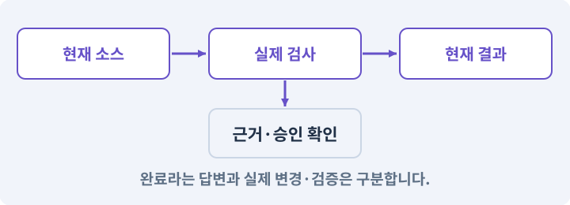

# 127. 내 반복 업무에 맞게 도구 개조하기

**목표:** 새 역할·검사·스킬을 내 요구로 추가합니다.

**시작 상태:** 동작하는 하네스와 검사기 확장 경로

## 한눈에 보는 기능의 흐름

반복 업무 선택 → 새 역할·검사·스킬 → 정상·실패 입력 → 기존 기능 보존



**경계:** 교재 예제를 그대로 실행하는 것과 개조를 구분

그림은 실제 게임 실행 결과가 아닙니다. 값·규칙과 예제를 필요한 때 펼쳐 읽고 현재 단계의 메시지를 한 번씩 보냅니다.

## 1. 지금 상태 확인하기

첫 메시지를 보내 현재 준비 상태를 확인합니다. AI가 읽어 온 실제 프로젝트가 맞는지 보고, 없는 준비나 다른 상태가 있으면 먼저 알려 주세요. 아직 기능을 만들지 않는 단계입니다.

### AI에게 보낼 요구와 이유

#### 01. 작업 대상부터 확인

**“내 반복 업무에 맞게 도구 개조하기” 작업을 시작하기 전에 현재 상태를 읽기 전용으로 확인해 줘.**

왜 이렇게 요청하나요? AI가 다른 프로젝트나 오래된 예제를 보고 작업할 수 있습니다. 실제 경로·파일·현재 기능을 읽게 하면 지금 이어서 작업할 대상을 먼저 맞출 수 있습니다.

#### 02. 작업 대상부터 확인

**필요한 시작 상태는 동작하는 하네스와 검사기 확장 경로야.**

왜 이렇게 요청하나요? AI가 다른 프로젝트나 오래된 예제를 보고 작업할 수 있습니다. 실제 경로·파일·현재 기능을 읽게 하면 지금 이어서 작업할 대상을 먼저 맞출 수 있습니다.

#### 03. 실제 사용 중인 구현 재사용

**실제 프로젝트와 작업 기록을 읽고 이것이 준비되어 있는지, 이미 같은 기능이 있는지 확인해 줘.**

왜 이렇게 요청하나요? 이름이 비슷한 새 클래스를 또 만들면 기존 화면은 여전히 옛 코드를 사용할 수 있습니다. 실제 호출되는 진입점을 찾아 연결해야 두 구현이 충돌하거나 수정이 반영되지 않는 문제를 막습니다.

#### 04. 현재 상태와 다음 확인 지점 구분

**이번 기능이 연결될 실제 파일·화면·도구와 보존할 기존 동작을 짧게 정리해 줘.**

왜 이렇게 요청하나요? 이미 준비된 기능과 아직 확인하지 못한 기능을 섞으면 불필요한 재설치나 성급한 완료 판정이 생깁니다. 현재 대상과 남은 준비를 나눠 가장 작은 다음 작업을 선택하게 합니다.

#### 05. 조사 단계에서 변경하지 않기

**아직 새 구현·설치·유료 호출·파일 변경은 하지 마.**

왜 이렇게 요청하나요? 현재 상태를 알아보기만 할 때 파일 변경이나 결제가 시작되면 검토 전의 환경이 바뀝니다. 준비 확인과 실제 구현을 나눠 되돌리기 어려운 작업이 먼저 실행되지 않게 합니다.

#### 06. 막힌 준비를 먼저 해결

**준비가 다르면 부족한 항목과 다음에 필요한 작업을 알려 줘.**

왜 이렇게 요청하나요? 빠진 파일·권한·패키지를 있다고 가정하면 다음 구현이 엉뚱한 대상을 만들게 됩니다. 무엇이 없고 무엇을 먼저 해야 하는지 분리하면 불필요한 재작업을 줄일 수 있습니다.

<details>
<summary>보낼 원문 전체 — 설명은 복사되지 않습니다</summary>

```text
“내 반복 업무에 맞게 도구 개조하기” 작업을 시작하기 전에 현재 상태를 읽기 전용으로 확인해 줘.
필요한 시작 상태는 동작하는 하네스와 검사기 확장 경로야. 실제 프로젝트와 작업 기록을 읽고 이것이 준비되어 있는지, 이미 같은 기능이 있는지 확인해 줘.
이번 기능이 연결될 실제 파일·화면·도구와 보존할 기존 동작을 짧게 정리해 줘. 아직 새 구현·설치·유료 호출·파일 변경은 하지 마. 준비가 다르면 부족한 항목과 다음에 필요한 작업을 알려 줘.
```

</details>

**기대 결과:** 새 업무와 재사용 구조를 구분한 설명

### 직접 확인하기

1. AI가 읽은 실제 프로젝트 또는 도구 경로를 확인합니다.
2. 필수 준비가 없다면 문제 해결 요청을 보내고, 준비됐을 때 다음으로 갑니다.

## 2. 필요한 기능 만들기

준비가 확인되면 아래 요청을 보냅니다. AI가 파일·설정·실행을 맡습니다. 변경 범위나 비용 승인이 나오면 내용을 읽고 결정하세요.

### AI에게 보낼 요구와 이유

#### 01. 예제를 자기 작업에 맞게 개조

**내 반복 업무를 처리하도록 하네스를 개조해 줘.**

왜 이렇게 요청하나요? 완성 예제를 실행하는 것과 새로운 업무를 처리할 수 있는 것은 다릅니다. 입력·권한·출력·실패 사례를 가진 작은 역할이나 검사기를 추가해 하네스의 확장 지점을 확인합니다.

#### 02. 관찰 가능한 기준으로 확인

**이번 요청은 퀘스트 정의의 ID·선행 참조·보상 키 검사야.**

왜 이렇게 요청하나요? 구현 완료라는 설명을 실제 결과로 바꾸기 위한 조건입니다. 요청에 나온 대상과 경계 상황을 확인해 정상 결과뿐 아니라 실패를 어떻게 구분했는지도 남깁니다.

#### 03. 연결도 자체의 오류 찾기

**입력은 실제 퀘스트 카탈로그, 결과는 문제가 있는 항목과 원인, 완료 조건은 정상 데이터 통과와 중복·순환·없는 참조의 거부로 정해 줘.**

왜 이렇게 요청하나요? 선이 연결되어 보이더라도 없는 대상·순환·도달 불가 종점이 있으면 실행이 멈춥니다. 연결 규칙과 종료 조건을 검사해 시작부터 끝까지 실제 경로가 존재하게 합니다.

#### 04. 같은 요청의 반복 처리 정의

**기존 규칙상 허용된 반복 퀘스트와 잘못된 보상 중복을 구분해 줘.**

왜 이렇게 요청하나요? 클릭 연타·재연결·중복 이벤트는 개발과 플레이 중 모두 발생할 수 있습니다. 반복돼도 한 번 처리해야 하는 결과와 매번 새로 처리할 결과를 나눠 데이터가 누적되지 않게 합니다.

#### 05. 예제를 자기 작업에 맞게 개조

**필요한 콘텐츠 검수 역할·검사기·game-verify 연결만 추가하고 새 하네스를 별도로 만들지 마.**

왜 이렇게 요청하나요? 완성 예제를 실행하는 것과 새로운 업무를 처리할 수 있는 것은 다릅니다. 입력·권한·출력·실패 사례를 가진 작은 역할이나 검사기를 추가해 하네스의 확장 지점을 확인합니다.

#### 06. 관찰 가능한 기준으로 확인

**기존 아이템 검사·작업 기록·후보·증거 구조를 재사용해 줘.**

왜 이렇게 요청하나요? 구현 완료라는 설명을 실제 결과로 바꾸기 위한 조건입니다. 요청에 나온 대상과 경계 상황을 확인해 정상 결과뿐 아니라 실패를 어떻게 구분했는지도 남깁니다.

#### 07. 구현할 결과와 조건 고정

**정상과 오류 사본을 실제 실행하고 어느 코드와 등록 설정을 바꾸었는지 입력→판단→결과의 흐름으로 설명해 줘.**

왜 이렇게 요청하나요? “정상과 오류 사본을 실제 실행하고 어느 코드와 등록 설정을 바꾸었는지 입력→판단→결과의 흐름으로 설명해 줘”를 명시하면 AI가 무엇을 구현하거나 검사해야 하는지 범위를 좁힐 수 있습니다. 새 역할·검사·스킬을 내 요구로 추가합니다. 이 결과를 확인할 때 이 조건이 실제로 반영됐는지 함께 봅니다.

#### 08. 기존 결과를 보호

**기존 게임 기능은 유지해 줘.**

왜 이렇게 요청하나요? 새 작업이 이미 정상인 기능이나 자산까지 바꾸면 원인을 추적하기 어렵습니다. 유지할 대상을 명시해 변경 전후를 비교하고 원치 않은 영향을 찾습니다.

#### 09. 설정과 실제 사용 결과 연결

**현재 작성한 MyGameHarness를 확장하고 필요한 파일·테스트·스킬 연결을 직접 만들어 실행해 줘.**

왜 이렇게 요청하나요? 데이터에 수치를 넣어도 사용 조건·UI·실제 전투가 그 값을 읽지 않으면 기능이 완성되지 않습니다. 선택 전후의 계산과 저장을 함께 확인합니다.

#### 10. 아래 항목을 완료 조건으로 사용

**정상 예와 실패 예를 실제로 보여 주고, 기존 기능이 유지되는지 확인해 줘.**

왜 이렇게 요청하나요? 요구사항의 목록은 AI에게 참고 설명을 주는 것이 아니라 완료를 판단할 기준을 정합니다. 구현 뒤 각 항목을 실제 입력과 결과에 대응시켜 빠진 조건을 찾습니다.

<details>
<summary>보낼 원문 전체 — 설명은 복사되지 않습니다</summary>

```text
내 반복 업무를 처리하도록 하네스를 개조해 줘. 이번 요청은 퀘스트 정의의 ID·선행 참조·보상 키 검사야.
입력은 실제 퀘스트 카탈로그, 결과는 문제가 있는 항목과 원인, 완료 조건은 정상 데이터 통과와 중복·순환·없는 참조의 거부로 정해 줘. 기존 규칙상 허용된 반복 퀘스트와 잘못된 보상 중복을 구분해 줘.
필요한 콘텐츠 검수 역할·검사기·game-verify 연결만 추가하고 새 하네스를 별도로 만들지 마. 기존 아이템 검사·작업 기록·후보·증거 구조를 재사용해 줘.
정상과 오류 사본을 실제 실행하고 어느 코드와 등록 설정을 바꾸었는지 입력→판단→결과의 흐름으로 설명해 줘. 기존 게임 기능은 유지해 줘.

현재 작성한 MyGameHarness를 확장하고 필요한 파일·테스트·스킬 연결을 직접 만들어 실행해 줘. 정상 예와 실패 예를 실제로 보여 주고, 기존 기능이 유지되는지 확인해 줘.
```

</details>

**기대 결과:** 확인할 결과: 새 업무가 기존 구조에 연결되고 오류를 찾음. AI가 이 상태를 확인할 실제 화면과 변경 내용을 준비합니다. 아직 실행하지 못한 부분은 따로 표시합니다.

### 직접 확인하기

1. 제안서만 반환됐다면 “설명으로 끝내지 말고 승인한 범위의 실제 작업을 수행해 줘”라고 보냅니다.
2. 코드나 설정을 직접 고치라는 안내가 나오면 “작성과 실행은 네가 맡아 줘”라고 요청합니다.

## 3. 결과를 직접 확인하기

먼저 확인 요청을 보내 AI가 검사와 화면을 준비하게 하세요. 그다음 아래 동작을 하나씩 확인합니다.

### AI에게 보낼 요구와 이유

#### 01. 예제를 자기 작업에 맞게 개조

**현재 구현한 “내 반복 업무에 맞게 도구 개조하기”의 자동 검사와 도구 결과 화면을 준비해 줘.**

왜 이렇게 요청하나요? 완성 예제를 실행하는 것과 새로운 업무를 처리할 수 있는 것은 다릅니다. 입력·권한·출력·실패 사례를 가진 작은 역할이나 검사기를 추가해 하네스의 확장 지점을 확인합니다.

#### 02. 결과를 재확인할 근거 남기기

**정상 동작과 아래 실패 조건을 실제로 검사하고 대상·실행 수·결과를 보여 줘.**

왜 이렇게 요청하나요? “잘 됩니다”라는 요약만으로는 어떤 입력과 버전을 검사했는지 알 수 없습니다. 대상·실행 수·실패 내용·파일을 함께 남겨 같은 조건으로 다시 확인할 수 있게 합니다.

#### 03. 상호작용·NPC·퀘스트의 적용 조건

**없는 퀘스트 참조를 실패로 찾는다.**

왜 이렇게 요청하나요? 상호작용은 근처 객체와 대화·문 열기·줍기 등의 행동을 하는 기능입니다. NPC는 플레이어가 아닌 캐릭터, 퀘스트는 목표와 진행·보상 규칙을 가진 작업입니다. NPC의 말풍선을 봤다고 보상 지급이 완료된 것은 아닙니다. 데이터 상태와 저장을 확인합니다.

#### 04. 검증 게이트·필수 검사의 적용 조건

**새 기능이 기존 게이트를 무력화하지 않는다.**

왜 이렇게 요청하나요? 게이트는 다음 단계로 넘어가기 위해 충족해야 하는 실제 검사 조건입니다. 컴파일·테스트·로그·시각·사람 확인 등 목적에 따라 다른 게이트를 둡니다. 게임 AI가 스스로 “완료”라고 쓴 문장은 게이트 통과가 아닙니다.

#### 05. 개발 작업을 자연어 요청으로 수행

**코드나 설정 작성 없이 대화로 개조된다.**

왜 이렇게 요청하나요? 새 규칙의 요구와 예외를 사람이 설명하면 실제 코드·설정·테스트 작성은 AI가 수행해야 합니다. 학생에게 구현 파일을 직접 편집하도록 넘기지 않는지 확인합니다.

#### 06. 구현할 결과와 조건 고정

**범위 밖 기능은 자동 추가하지 않는다.**

왜 이렇게 요청하나요? “범위 밖 기능은 자동 추가하지 않는다”를 명시하면 AI가 무엇을 구현하거나 검사해야 하는지 범위를 좁힐 수 있습니다. 새 역할·검사·스킬을 내 요구로 추가합니다. 이 결과를 확인할 때 이 조건이 실제로 반영됐는지 함께 봅니다.

#### 07. 사람 검사의 시작점 준비

**내가 조작해야 하는 부분은 실행할 화면과 시작 상태를 준비해 줘.**

왜 이렇게 요청하나요? 같은 기능이라도 시작 상태가 다르면 관찰 결과가 달라집니다. AI가 실행 화면과 재현 위치를 먼저 준비해야 사람이 이동·공격·소리·조작감을 같은 조건에서 확인할 수 있습니다.

#### 08. 사람이 실제로 본 것만 기록

**연결되지 않은 기기의 검사나 사람이 보지 않은 재미·소리 품질을 대신 확인했다고 하지 마.**

왜 이렇게 요청하나요? AI가 준비한 검사와 사람이 직접 플레이하거나 들은 결과는 다른 근거입니다. 관찰하지 않은 조작감·소리·실기기 결과를 임의로 완료 처리하지 않게 합니다.

#### 09. 실제로 실행한 검사만 인정

**테스트 0개와 예전 소스 결과는 현재 성공으로 쓰지 마.**

왜 이렇게 요청하나요? 실행된 검사가 없거나 같은 결과를 중복 집계한 경우는 기능을 확인한 것이 아닙니다. 실행 수와 개별 결과를 함께 확인해야 형식적인 성공 표시를 걸러낼 수 있습니다.

<details>
<summary>보낼 원문 전체 — 설명은 복사되지 않습니다</summary>

```text
현재 구현한 “내 반복 업무에 맞게 도구 개조하기”의 자동 검사와 도구 결과 화면을 준비해 줘. 정상 동작과 아래 실패 조건을 실제로 검사하고 대상·실행 수·결과를 보여 줘.

없는 퀘스트 참조를 실패로 찾는다.

 새 기능이 기존 게이트를 무력화하지 않는다.

 코드나 설정 작성 없이 대화로 개조된다.

 범위 밖 기능은 자동 추가하지 않는다.

내가 조작해야 하는 부분은 실행할 화면과 시작 상태를 준비해 줘. 연결되지 않은 기기의 검사나 사람이 보지 않은 재미·소리 품질을 대신 확인했다고 하지 마. 테스트 0개와 예전 소스 결과는 현재 성공으로 쓰지 마.
```

</details>

**기대 결과:** 실행·기록·승인 경로는 재사용하고 퀘스트 규칙만 새로 검증합니다.

### 직접 확인하기

1. 새 검수 요청을 자연어로 보냅니다.
2. 정상 데이터와 중복 보상 키 사례를 비교합니다.
3. 다른 검사와 게임 기능이 유지되는지 봅니다.

## 4. 결과를 남기고 마무리하기

실제로 본 결과를 아래 메모에 적고 AI에 전달합니다. 결과 저장 요청으로 현재 상태를 남긴 뒤 다음 페이지로 갑니다.

### AI에게 보낼 요구와 이유

#### 01. 결과를 재확인할 근거 남기기

**지금 작업한 “내 반복 업무에 맞게 도구 개조하기”의 실제 결과를 정리해 줘.**

왜 이렇게 요청하나요? “잘 됩니다”라는 요약만으로는 어떤 입력과 버전을 검사했는지 알 수 없습니다. 대상·실행 수·실패 내용·파일을 함께 남겨 같은 조건으로 다시 확인할 수 있게 합니다.

#### 02. 다음 작업이 읽을 인수인계

**변경한 기능·파일·현재 후보와 실제 실행한 검사, 남은 문제를 기능 이름으로 기록해 줘.**

왜 이렇게 요청하나요? 새 AI 세션은 이전 대화 전체를 알고 있다고 보장할 수 없습니다. 현재 후보·파일 위치·실행한 검사·남은 일을 남겨야 같은 작업을 반복하지 않고 이어갈 수 있습니다.

#### 03. 사람이 실제로 본 것만 기록

**자동 검사 결과와 내가 직접 확인한 결과를 구분하고, 내 관찰이 아직 없으면 미확인으로 남겨 줘.**

왜 이렇게 요청하나요? AI가 준비한 검사와 사람이 직접 플레이하거나 들은 결과는 다른 근거입니다. 관찰하지 않은 조작감·소리·실기기 결과를 임의로 완료 처리하지 않게 합니다.

#### 04. 다음 작업이 읽을 인수인계

**재시작하거나 다음 작업에서 읽을 기록의 실제 위치를 알려 줘.**

왜 이렇게 요청하나요? 새 AI 세션은 이전 대화 전체를 알고 있다고 보장할 수 없습니다. 현재 후보·파일 위치·실행한 검사·남은 일을 남겨야 같은 작업을 반복하지 않고 이어갈 수 있습니다.

#### 05. 미확인을 완료와 분리

**아직 확인하지 않은 결과를 완료로 채우지 마.**

왜 이렇게 요청하나요? 만들어진 것, 검사에 실패한 것, 아직 확인하지 못한 것을 나눠야 다음 작업을 정확히 고를 수 있습니다. 실행할 조건이 없는 기능을 성공으로 기록하면 뒤에서 원인을 찾기 어려워집니다.

<details>
<summary>보낼 원문 전체 — 설명은 복사되지 않습니다</summary>

```text
지금 작업한 “내 반복 업무에 맞게 도구 개조하기”의 실제 결과를 정리해 줘. 변경한 기능·파일·현재 후보와 실제 실행한 검사, 남은 문제를 기능 이름으로 기록해 줘.
자동 검사 결과와 내가 직접 확인한 결과를 구분하고, 내 관찰이 아직 없으면 미확인으로 남겨 줘. 재시작하거나 다음 작업에서 읽을 기록의 실제 위치를 알려 줘. 아직 확인하지 않은 결과를 완료로 채우지 마.
```

</details>

**기대 결과:** 현재 상태·검사 결과·남은 문제·다음에 읽을 기록을 확인할 수 있습니다.

### 직접 확인하기

1. 자동 검사와 내 관찰 결과가 섞이지 않았는지 봅니다.
2. 문제가 남았다면 해결 요청을 보내고 같은 동작을 다시 확인합니다.

## 구체적인 예로 이해하기

### 퀘스트 검사기로 개조하기

같은 실행 틀이라도 업무별 입력과 규칙은 바뀝니다. 하네스 자체와 도메인 검사기를 나누면 재사용할 수 있습니다.

**시작 상태:** 아이템 검사 경로를 동작시킨 하네스가 있습니다.

**직접 해 볼 동작:** 퀘스트 ID·연결 대상·보상 키를 검사하는 새 규칙을 요청하고 잘못된 데이터를 넣어 봅니다.

**보여야 하는 결과:** 실행·기록·승인 경로는 재사용하고 퀘스트 규칙만 새로 검증합니다.

**이렇게 되면 아직 안 됩니다:** 모든 코드를 복제해 비슷하지만 서로 다른 두 하네스로 만듭니다.

**생각해 보기:** 퀘스트가 무한 반복 가능한지 검사하려면 ID 중복 검사만으로 충분한가요?

<details><summary>해설 보기</summary>

아니요. 그래프의 도달성·종료 조건·허용된 반복 횟수 같은 도메인 규칙이 추가로 필요합니다.

</details>

## 문제가 있으면

### AI에게 보낼 요구와 이유

#### 01. 구현할 결과와 조건 고정

**새 하네스를 별도로 만들지 마.**

왜 이렇게 요청하나요? “새 하네스를 별도로 만들지 마”를 명시하면 AI가 무엇을 구현하거나 검사해야 하는지 범위를 좁힐 수 있습니다. 새 역할·검사·스킬을 내 요구로 추가합니다. 이 결과를 확인할 때 이 조건이 실제로 반영됐는지 함께 봅니다.

#### 02. 예제를 자기 작업에 맞게 개조

**역할·입력·검사 등록에서 바꿀 부분만 찾아 추가하고 기존 작업을 다시 확인해 줘.**

왜 이렇게 요청하나요? 완성 예제를 실행하는 것과 새로운 업무를 처리할 수 있는 것은 다릅니다. 입력·권한·출력·실패 사례를 가진 작은 역할이나 검사기를 추가해 하네스의 확장 지점을 확인합니다.

#### 03. 원인 하나를 좁혀 수정

**새 기능을 추가하지 말고 현재 오류와 실제 로그를 먼저 읽어 줘.**

왜 이렇게 요청하나요? 오류 수정 중 새 기능까지 넣으면 어떤 변경이 문제를 해결하거나 악화했는지 알기 어렵습니다. 원래 재현을 보존하고 작은 변경 뒤 같은 입력과 주변 정상 동작을 다시 확인합니다.

#### 04. 원인 하나를 좁혀 수정

**최소 수정 뒤 같은 재현과 관련 정상 동작을 다시 검사해 줘.**

왜 이렇게 요청하나요? 오류 수정 중 새 기능까지 넣으면 어떤 변경이 문제를 해결하거나 악화했는지 알기 어렵습니다. 원래 재현을 보존하고 작은 변경 뒤 같은 입력과 주변 정상 동작을 다시 확인합니다.

#### 05. 실패도 재현 자료로 보존

**실패 기록은 지우지 마.**

왜 이렇게 요청하나요? 실패한 입력과 로그가 있어야 같은 문제가 다시 생겼을 때 비교할 수 있습니다. 성공 기록으로 덮어쓰지 않고 전후 자료를 남기면 무엇을 고쳤는지 확인할 수 있습니다.

<details>
<summary>보낼 원문 전체 — 설명은 복사되지 않습니다</summary>

```text
새 하네스를 별도로 만들지 마. 역할·입력·검사 등록에서 바꿀 부분만 찾아 추가하고 기존 작업을 다시 확인해 줘.
새 기능을 추가하지 말고 현재 오류와 실제 로그를 먼저 읽어 줘. 최소 수정 뒤 같은 재현과 관련 정상 동작을 다시 검사해 줘. 실패 기록은 지우지 마.
```

</details>

## 새 세션에서 이어가기

### AI에게 보낼 요구와 이유

#### 01. 이어서 할 작업 식별

**“내 반복 업무에 맞게 도구 개조하기” 작업을 이어가고 싶어.**

왜 이렇게 요청하나요? 이름으로 재개할 작업을 찾고, 뒤에 이어지는 요청으로 실제 파일·진행 중 작업·기록을 다시 읽게 합니다. 제목만 보고 이전 상태를 기억한다고 가정하지 않습니다.

#### 02. 조회는 상태를 바꾸지 않게

**실제 프로젝트와 내 도구의 작업 기록을 읽고 어디까지 구현·검사됐는지 확인해 줘.**

왜 이렇게 요청하나요? 진행 상황을 물을 때 새 구현이나 유료 호출이 시작되면 단순 확인이 실행 명령이 되어 버립니다. 저장된 근거를 읽어 완료·진행·승인 대기·미검증을 나누게 합니다.

#### 03. 재개 전 중복 작업 방지

**진행 중인 프로세스·승인·미저장 변경을 확인한 뒤 남은 가장 작은 작업부터 안내해 줘.**

왜 이렇게 요청하나요? 대화가 끊겨도 외부 작업은 끝났거나 아직 실행 중일 수 있습니다. 프로세스·승인·미저장 상태를 먼저 읽어 같은 생성·빌드·결제를 두 번 시작하지 않도록 합니다.

#### 04. 되돌아갈 원본 남기기

**기존 성공과 실패 기록은 보존해 줘.**

왜 이렇게 요청하나요? 새 구현이 실패해도 이전 게임과 저장을 복원할 수 있어야 합니다. 현재 내용을 먼저 조사하고 별도 후보에서 작업하면 실험이 유일한 정상본을 망가뜨리는 일을 피할 수 있습니다.

<details>
<summary>보낼 원문 전체 — 설명은 복사되지 않습니다</summary>

```text
“내 반복 업무에 맞게 도구 개조하기” 작업을 이어가고 싶어. 실제 프로젝트와 내 도구의 작업 기록을 읽고 어디까지 구현·검사됐는지 확인해 줘. 진행 중인 프로세스·승인·미저장 변경을 확인한 뒤 남은 가장 작은 작업부터 안내해 줘. 기존 성공과 실패 기록은 보존해 줘.
```

</details>

## 왜 이렇게 만드는가

자기 하네스를 만들 수 있다는 것은 특정 Python 함수를 암기했다는 뜻이 아니다. 새 작업의 입력·책임·권한·결과·검사를 말로 정의하고, AI가 만든 연결이 그 요구를 만족하는지 확인할 수 있다는 뜻이다.

실습 예는 퀘스트 데이터 검수다. 퀘스트 ID 중복, 존재하지 않는 선행 퀘스트, 보상 키 충돌을 검사하고 결과를 대시보드에 연결한다. 처음부터 실행기 전체를 다시 만들지 않고 필요한 도메인 검사와 스킬만 바꾼다.

## 공식 참고

