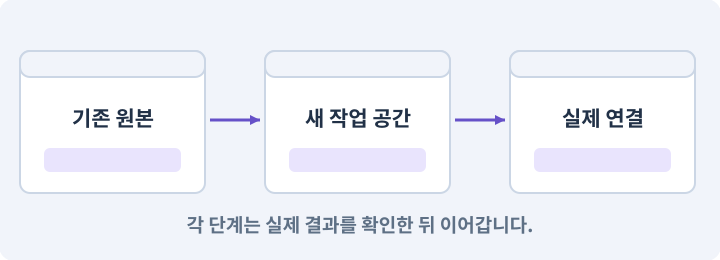

# 129. 기존 2D 게임에서 확장팩 시작하기

**목표:** 기존 게임을 지키며 새 기능을 붙일 준비를 합니다.

**시작 상태:** 완주된 2D 게임과 직접 만든 하네스

## 한눈에 보는 기능의 흐름

기존 2D 완주 → 원본·저장 보존 → 확장 범위 → 실기기 미검증 표시



**경계:** 아직 실패한 기준선 위에 기능을 쌓지 않기

그림은 실제 게임 실행 결과가 아닙니다. 값·규칙과 예제를 필요한 때 펼쳐 읽고 현재 단계의 메시지를 한 번씩 보냅니다.

## 1. 지금 상태 확인하기

첫 메시지를 보내 현재 준비 상태를 확인합니다. AI가 읽어 온 실제 프로젝트가 맞는지 보고, 없는 준비나 다른 상태가 있으면 먼저 알려 주세요. 아직 기능을 만들지 않는 단계입니다.

### AI에게 보낼 요구와 이유

#### 01. 작업 대상부터 확인

**“기존 2D 게임에서 확장팩 시작하기” 작업을 시작하기 전에 현재 상태를 읽기 전용으로 확인해 줘.**

왜 이렇게 요청하나요? AI가 다른 프로젝트나 오래된 예제를 보고 작업할 수 있습니다. 실제 경로·파일·현재 기능을 읽게 하면 지금 이어서 작업할 대상을 먼저 맞출 수 있습니다.

#### 02. 작업 대상부터 확인

**필요한 시작 상태는 완주된 2D 게임과 직접 만든 하네스야.**

왜 이렇게 요청하나요? AI가 다른 프로젝트나 오래된 예제를 보고 작업할 수 있습니다. 실제 경로·파일·현재 기능을 읽게 하면 지금 이어서 작업할 대상을 먼저 맞출 수 있습니다.

#### 03. 실제 사용 중인 구현 재사용

**실제 프로젝트와 작업 기록을 읽고 이것이 준비되어 있는지, 이미 같은 기능이 있는지 확인해 줘.**

왜 이렇게 요청하나요? 이름이 비슷한 새 클래스를 또 만들면 기존 화면은 여전히 옛 코드를 사용할 수 있습니다. 실제 호출되는 진입점을 찾아 연결해야 두 구현이 충돌하거나 수정이 반영되지 않는 문제를 막습니다.

#### 04. 현재 상태와 다음 확인 지점 구분

**이번 기능이 연결될 실제 파일·화면·도구와 보존할 기존 동작을 짧게 정리해 줘.**

왜 이렇게 요청하나요? 이미 준비된 기능과 아직 확인하지 못한 기능을 섞으면 불필요한 재설치나 성급한 완료 판정이 생깁니다. 현재 대상과 남은 준비를 나눠 가장 작은 다음 작업을 선택하게 합니다.

#### 05. 조사 단계에서 변경하지 않기

**아직 새 구현·설치·유료 호출·파일 변경은 하지 마.**

왜 이렇게 요청하나요? 현재 상태를 알아보기만 할 때 파일 변경이나 결제가 시작되면 검토 전의 환경이 바뀝니다. 준비 확인과 실제 구현을 나눠 되돌리기 어려운 작업이 먼저 실행되지 않게 합니다.

#### 06. 막힌 준비를 먼저 해결

**준비가 다르면 부족한 항목과 다음에 필요한 작업을 알려 줘.**

왜 이렇게 요청하나요? 빠진 파일·권한·패키지를 있다고 가정하면 다음 구현이 엉뚱한 대상을 만들게 됩니다. 무엇이 없고 무엇을 먼저 해야 하는지 분리하면 불필요한 재작업을 줄일 수 있습니다.

<details>
<summary>보낼 원문 전체 — 설명은 복사되지 않습니다</summary>

```text
“기존 2D 게임에서 확장팩 시작하기” 작업을 시작하기 전에 현재 상태를 읽기 전용으로 확인해 줘.
필요한 시작 상태는 완주된 2D 게임과 직접 만든 하네스야. 실제 프로젝트와 작업 기록을 읽고 이것이 준비되어 있는지, 이미 같은 기능이 있는지 확인해 줘.
이번 기능이 연결될 실제 파일·화면·도구와 보존할 기존 동작을 짧게 정리해 줘. 아직 새 구현·설치·유료 호출·파일 변경은 하지 마. 준비가 다르면 부족한 항목과 다음에 필요한 작업을 알려 줘.
```

</details>

**기대 결과:** 원본·작업 후보·실행기의 실제 경로

### 직접 확인하기

1. AI가 읽은 실제 프로젝트 또는 도구 경로를 확인합니다.
2. 필수 준비가 없다면 문제 해결 요청을 보내고, 준비됐을 때 다음으로 갑니다.

## 2. 요청한 작업 진행하기

준비가 확인되면 아래 요청을 보냅니다. AI가 파일·설정·실행을 맡습니다. 변경 범위나 비용 승인이 나오면 내용을 읽고 결정하세요.

### AI에게 보낼 요구와 이유

#### 01. 기준선 조사와 기능 변경 분리

**내가 만든 하네스와 현재 게임 후보를 읽기 전용으로 조사해 줘. 이 요청에서는 구현 역할 실행·변경안 적용·Unity 통합을 시작하지 마.**

왜 이렇게 요청하나요? 기존 게임이 정상인지 확인하기 전에 구현을 시작하면 원래 결함과 새 결함이 섞입니다. 현재는 읽기와 기존 검사만 수행하고 변경은 다음 작업으로 나눕니다.

#### 02. 예시 파일명이 아닌 실행 주체 조사

**기존 2D 프로젝트와 실제 하네스의 연결 기록을 읽고, 작업 실행·증거 검사를 담당하는 실제 파일을 찾아 줘.**

왜 이렇게 요청하나요? 직접 만든 하네스는 파일명이 다를 수 있습니다. 특정 예제 이름을 강요하지 않고 연결 기록과 호출 관계로 실제 구현을 찾아야 합니다.

#### 03. 기존 결과를 보호

**게임이나 하네스를 수정하지 말고 확장팩 기준선을 조사해 줘.**

왜 이렇게 요청하나요? 새 작업이 이미 정상인 기능이나 자산까지 바꾸면 원인을 추적하기 어렵습니다. 유지할 대상을 명시해 변경 전후를 비교하고 원치 않은 영향을 찾습니다.

#### 04. 종료 이후의 상태까지 확인

**각 시스템의 실제 경로, 공개 진입점, 호출자, 저장 필드, 대응 검사를 정리해 줘.**

왜 이렇게 요청하나요? 현재 화면에서 맞는 값도 저장하거나 다시 구성할 때 빠질 수 있습니다. 실제 종료·불러오기 전후에 ID·옵션·장착·진행을 비교해야 유지되는 범위를 확인할 수 있습니다.

#### 05. 구현할 결과와 조건 고정

**서로 이름만 비슷한 예제 코드와 실제 씬에서 실행되는 코드를 구분해 줘.**

왜 이렇게 요청하나요? “서로 이름만 비슷한 예제 코드와 실제 씬에서 실행되는 코드를 구분해 줘”를 명시하면 AI가 무엇을 구현하거나 검사해야 하는지 범위를 좁힐 수 있습니다. 기존 게임을 지키며 새 기능을 붙일 준비를 합니다. 이 결과를 확인할 때 이 조건이 실제로 반영됐는지 함께 봅니다.

#### 06. 인증 정보 노출 방지

**기존 저장 사본·Editor 버전·패키지·빌드 해시를 기록하고 비밀키는 읽거나 전송하지 마.**

왜 이렇게 요청하나요? 인증 정보가 프롬프트·로그·저장소에 남으면 다른 사람이 재사용할 수 있습니다. 로그인은 공식 경로에서 처리하고, AI에는 키 자체가 아니라 연결 성공 여부만 확인시킵니다.

#### 07. 회귀·기준선·수정 전후 비교의 적용 조건

**이번 목표는 기준선 조사다.**

왜 이렇게 요청하나요? 회귀는 변경으로 이전에 정상인 기능이 다시 깨지는 현상입니다. 기준선은 비교할 정상 소스·설정·자료·검사 조건을 기록한 상태입니다. 기준선은 Git 커밋 하나만으로 기기·저장·다운로드 팩까지 고정되지 않습니다.

#### 08. 환경 변화 줄이기

**새 기능 구현, 엔진 업그레이드, 3D 전환, 자동 Git 정리는 하지 마.**

왜 이렇게 요청하나요? 기능을 만드는 중 엔진·패키지 버전까지 바뀌면 오류 원인이 섞입니다. 시작 버전을 고정하고 변경은 따로 판단해야 AI가 같은 API와 설정을 기준으로 작업할 수 있습니다.

#### 09. 아래 항목을 완료 조건으로 사용

**이 기능의 규칙:**

왜 이렇게 요청하나요? 요구사항의 목록은 AI에게 참고 설명을 주는 것이 아니라 완료를 판단할 기준을 정합니다. 구현 뒤 각 항목을 실제 입력과 결과에 대응시켜 빠진 조건을 찾습니다.

#### 10. 기존 완성 게임에서 확장

**이번 작업은 기존 게임에 기능을 추가하는 작업이며 새 프로젝트를 다시 만드는 일이 아니다.**

왜 이렇게 요청하나요? 이미 동작하는 이동·전투·아이템·저장을 보존한 채 필요한 부분만 확장합니다. 새 예제 게임을 만들어 기존 프로젝트의 결함이나 연결을 피하지 않도록 합니다.

#### 11. 구현할 결과와 조건 고정

**이미 플레이 가능한 AshfallRPG2D에 《봉인된 대장간》 확장팩을 붙인다.**

왜 이렇게 요청하나요? “이미 플레이 가능한 AshfallRPG2D에 《봉인된 대장간》 확장팩을 붙인다”를 명시하면 AI가 무엇을 구현하거나 검사해야 하는지 범위를 좁힐 수 있습니다. 기존 게임을 지키며 새 기능을 붙일 준비를 합니다. 이 결과를 확인할 때 이 조건이 실제로 반영됐는지 함께 봅니다.

#### 12. 상태 효과의 발생 원인과 수명 구분

**사소한 전리품 표시 개선에서 출발해 상태이상, 분해·제작, 소켓, 탐험 보상, 동료, 새 보스를 하나의 게임 순환으로 연결한다.**

왜 이렇게 요청하나요? 지속 피해가 직접 공격용 효과를 다시 발생시키면 연쇄 피해나 무한 발동이 생길 수 있습니다. 피해 출처·적용 시간·중첩·해제 조건을 구분해 전투 조합이 의도한 횟수로 작동하게 합니다.

#### 13. 성장을 한 번씩 정확히 반영

**직업과 레벨 상한은 늘리지 않는다.**

왜 이렇게 요청하나요? 처치 이벤트가 반복되거나 큰 경험치로 여러 단계를 넘으면 성장 수치가 빠지거나 중복될 수 있습니다. 증가·해금·상한을 한 흐름으로 처리하고 경계값을 검사합니다.

#### 14. 구현할 결과와 조건 고정

**사용자마다 AI가 만든 클래스명과 폴더가 다르다.**

왜 이렇게 요청하나요? “사용자마다 AI가 만든 클래스명과 폴더가 다르다”를 명시하면 AI가 무엇을 구현하거나 검사해야 하는지 범위를 좁힐 수 있습니다. 기존 게임을 지키며 새 기능을 붙일 준비를 합니다. 이 결과를 확인할 때 이 조건이 실제로 반영됐는지 함께 봅니다.

#### 15. 실제 이동 진입점 추적

**예시 클래스 이름을 그대로 가정하지 말고 실제 이동을 실행하는 컴포넌트와 호출 관계를 찾아야 한다.**

왜 이렇게 요청하나요? 이름이 비슷한 예제가 있어도 실제 씬에서 실행되지 않을 수 있습니다. 컴포넌트와 호출 관계를 통해 현재 게임을 움직이는 코드를 찾아야 수정이 적용됩니다.

#### 16. 구현할 결과와 조건 고정

**하네스 코드의 존재는 게임과 연결되었다는 뜻이 아니다.**

왜 이렇게 요청하나요? “하네스 코드의 존재는 게임과 연결되었다는 뜻이 아니다”를 명시하면 AI가 무엇을 구현하거나 검사해야 하는지 범위를 좁힐 수 있습니다. 기존 게임을 지키며 새 기능을 붙일 준비를 합니다. 이 결과를 확인할 때 이 조건이 실제로 반영됐는지 함께 봅니다.

#### 17. 작업 대상부터 확인

**이 작업은 읽기 전용 조사와 기존 검증만 수행한다.**

왜 이렇게 요청하나요? AI가 다른 프로젝트나 오래된 예제를 보고 작업할 수 있습니다. 실제 경로·파일·현재 기능을 읽게 하면 지금 이어서 작업할 대상을 먼저 맞출 수 있습니다.

#### 18. 기존 결과를 보호

**유일한 원본에서 대규모 리팩터링을 시작하지 않는다.**

왜 이렇게 요청하나요? 새 작업이 이미 정상인 기능이나 자산까지 바꾸면 원인을 추적하기 어렵습니다. 유지할 대상을 명시해 변경 전후를 비교하고 원치 않은 영향을 찾습니다.

#### 19. 회귀·기준선·수정 전후 비교의 적용 조건

**baseline은 이전에 잘되던 상태를 설명하는 기록이다.**

왜 이렇게 요청하나요? 회귀는 변경으로 이전에 정상인 기능이 다시 깨지는 현상입니다. 기준선은 비교할 정상 소스·설정·자료·검사 조건을 기록한 상태입니다. 기준선은 Git 커밋 하나만으로 기기·저장·다운로드 팩까지 고정되지 않습니다.

#### 20. 환경 변화 줄이기

**Git 커밋만으로 APK·저장·패키지 버전까지 고정되지는 않는다.**

왜 이렇게 요청하나요? 기능을 만드는 중 엔진·패키지 버전까지 바뀌면 오류 원인이 섞입니다. 시작 버전을 고정하고 변경은 따로 판단해야 AI가 같은 API와 설정을 기준으로 작업할 수 있습니다.

#### 21. 되돌아갈 원본 남기기

**Editor 패치, package lock, build hash, 테스트 저장 사본과 원본 보존 위치를 함께 기록한다.**

왜 이렇게 요청하나요? 새 구현이 실패해도 이전 게임과 저장을 복원할 수 있어야 합니다. 현재 내용을 먼저 조사하고 별도 후보에서 작업하면 실험이 유일한 정상본을 망가뜨리는 일을 피할 수 있습니다.

#### 22. 종료 이후의 상태까지 확인

**실제 저장에는 개인정보가 들어갈 수 있으므로 역할 입력에는 익명화한 별도 fixture만 준다.**

왜 이렇게 요청하나요? 현재 화면에서 맞는 값도 저장하거나 다시 구성할 때 빠질 수 있습니다. 실제 종료·불러오기 전후에 ID·옵션·장착·진행을 비교해야 유지되는 범위를 확인할 수 있습니다.

#### 23. 구현과 실행은 AI에게 맡기기

**코드·설정·파일 생성·실행은 네가 맡고, 필요한 화면과 결과를 보여 줘.**

왜 이렇게 요청하나요? 설명이나 코드 조각만 받으면 실제 파일 생성·연결·실행이 빠질 수 있습니다. AI가 개발 작업까지 수행하고, 사람은 요구·승인·결과 판단을 맡도록 역할을 분명히 합니다.

#### 24. 막힌 준비를 먼저 해결

**수행하지 못한 작업과 필요한 승인·도구 연결은 구분해서 알려 줘.**

왜 이렇게 요청하나요? 빠진 파일·권한·패키지를 있다고 가정하면 다음 구현이 엉뚱한 대상을 만들게 됩니다. 무엇이 없고 무엇을 먼저 해야 하는지 분리하면 불필요한 재작업을 줄일 수 있습니다.

<details>
<summary>보낼 원문 전체 — 설명은 복사되지 않습니다</summary>

```text
내가 만든 하네스와 현재 게임 후보를 읽기 전용으로 조사해 줘. 이 요청에서는 구현 역할 실행·변경안 적용·Unity 통합을 시작하지 마.

기존 2D 프로젝트와 실제 하네스의 연결 기록을 읽고, 작업 실행·증거 검사를 담당하는 실제 파일을 찾아 줘.
게임이나 하네스를 수정하지 말고 확장팩 기준선을 조사해 줘.
각 시스템의 실제 경로, 공개 진입점, 호출자, 저장 필드, 대응 검사를 정리해 줘.
서로 이름만 비슷한 예제 코드와 실제 씬에서 실행되는 코드를 구분해 줘.
기존 저장 사본·Editor 버전·패키지·빌드 해시를 기록하고 비밀키는 읽거나 전송하지 마.
이번 목표는 기준선 조사다. 새 기능 구현, 엔진 업그레이드, 3D 전환, 자동 Git 정리는 하지 마.

이 기능의 규칙:
이번 작업은 기존 게임에 기능을 추가하는 작업이며 새 프로젝트를 다시 만드는 일이 아니다. 이미 플레이 가능한 AshfallRPG2D에 《봉인된 대장간》 확장팩을 붙인다. 사소한 전리품 표시 개선에서 출발해 상태이상, 분해·제작, 소켓, 탐험 보상, 동료, 새 보스를 하나의 게임 순환으로 연결한다. 직업과 레벨 상한은 늘리지 않는다.

사용자마다 AI가 만든 클래스명과 폴더가 다르다. 예시 클래스 이름을 그대로 가정하지 말고 실제 이동을 실행하는 컴포넌트와 호출 관계를 찾아야 한다. 하네스 코드의 존재는 게임과 연결되었다는 뜻이 아니다. 이 작업은 읽기 전용 조사와 기존 검증만 수행한다. 유일한 원본에서 대규모 리팩터링을 시작하지 않는다.

baseline은 이전에 잘되던 상태를 설명하는 기록이다. Git 커밋만으로 APK·저장·패키지 버전까지 고정되지는 않는다. Editor 패치, package lock, build hash, 테스트 저장 사본과 원본 보존 위치를 함께 기록한다. 실제 저장에는 개인정보가 들어갈 수 있으므로 역할 입력에는 익명화한 별도 fixture만 준다.

코드·설정·파일 생성·실행은 네가 맡고, 필요한 화면과 결과를 보여 줘. 수행하지 못한 작업과 필요한 승인·도구 연결은 구분해서 알려 줘.
```

</details>

**기대 결과:** 확인할 결과: 확장 전 기준과 원본 보존을 확인함. AI가 이 상태를 확인할 실제 화면과 변경 내용을 준비합니다. 아직 실행하지 못한 부분은 따로 표시합니다.

### 직접 확인하기

1. 제안서만 반환됐다면 “설명으로 끝내지 말고 승인한 범위의 실제 작업을 수행해 줘”라고 보냅니다.
2. 코드나 설정을 직접 고치라는 안내가 나오면 “작성과 실행은 네가 맡아 줘”라고 요청합니다.

## 3. 결과를 직접 확인하기

먼저 확인 요청을 보내 AI가 검사와 화면을 준비하게 하세요. 그다음 아래 동작을 하나씩 확인합니다.

### AI에게 보낼 요구와 이유

#### 01. 검사할 입력과 관찰 지점 준비

**방금 구현한 기능의 자동 검사와 확인 화면을 준비해 줘.**

왜 이렇게 요청하나요? 정상 예 하나만 보면 실패 조건을 놓치기 쉽습니다. 정상·경계·반례를 실제 입력으로 준비하고 사람이 볼 화면도 맞춰 확인 범위를 분명하게 합니다.

#### 02. 결과를 재확인할 근거 남기기

**정상 동작과 아래 실패 조건을 실제로 검사하고 대상·실행 수·결과를 보여 줘.**

왜 이렇게 요청하나요? “잘 됩니다”라는 요약만으로는 어떤 입력과 버전을 검사했는지 알 수 없습니다. 대상·실행 수·실패 내용·파일을 함께 남겨 같은 조건으로 다시 확인할 수 있게 합니다.

#### 03. 성장을 한 번씩 정확히 반영

**기존 가방 24칸·장비 3슬롯·레벨 1~10·9노드 트리·기본 3스킬의 규격이 기록되어 있다.**

왜 이렇게 요청하나요? 처치 이벤트가 반복되거나 큰 경험치로 여러 단계를 넘으면 성장 수치가 빠지거나 중복될 수 있습니다. 증가·해금·상한을 한 흐름으로 처리하고 경계값을 검사합니다.

#### 04. 실제로 실행한 검사만 인정

**수정 전 실제 테스트 수와 실행 대상이 남아 있고, 0개 실행은 성공으로 적지 않았다.**

왜 이렇게 요청하나요? 실행된 검사가 없거나 같은 결과를 중복 집계한 경우는 기능을 확인한 것이 아닙니다. 실행 수와 개별 결과를 함께 확인해야 형식적인 성공 표시를 걸러낼 수 있습니다.

#### 05. 기존 결과를 보호

**원본·run·후보·증거 폴더가 서로 분리되어 있다.**

왜 이렇게 요청하나요? 새 작업이 이미 정상인 기능이나 자산까지 바꾸면 원인을 추적하기 어렵습니다. 유지할 대상을 명시해 변경 전후를 비교하고 원치 않은 영향을 찾습니다.

#### 06. 관찰 가능한 기준으로 확인

**Android 미검증이 Windows 성공에 합쳐지지 않았다.**

왜 이렇게 요청하나요? 구현 완료라는 설명을 실제 결과로 바꾸기 위한 조건입니다. 요청에 나온 대상과 경계 상황을 확인해 정상 결과뿐 아니라 실패를 어떻게 구분했는지도 남깁니다.

#### 07. 사람 검사의 시작점 준비

**내가 조작해야 하는 부분은 실행할 화면과 시작 상태를 준비해 줘.**

왜 이렇게 요청하나요? 같은 기능이라도 시작 상태가 다르면 관찰 결과가 달라집니다. AI가 실행 화면과 재현 위치를 먼저 준비해야 사람이 이동·공격·소리·조작감을 같은 조건에서 확인할 수 있습니다.

#### 08. 사람이 실제로 본 것만 기록

**연결되지 않은 휴대폰의 터치나 사람이 보지 않은 재미·소리 품질을 대신 확인했다고 하지 마.**

왜 이렇게 요청하나요? AI가 준비한 검사와 사람이 직접 플레이하거나 들은 결과는 다른 근거입니다. 관찰하지 않은 조작감·소리·실기기 결과를 임의로 완료 처리하지 않게 합니다.

#### 09. 실제로 실행한 검사만 인정

**테스트 0개와 예전 소스 결과는 현재 성공으로 쓰지 마.**

왜 이렇게 요청하나요? 실행된 검사가 없거나 같은 결과를 중복 집계한 경우는 기능을 확인한 것이 아닙니다. 실행 수와 개별 결과를 함께 확인해야 형식적인 성공 표시를 걸러낼 수 있습니다.

<details>
<summary>보낼 원문 전체 — 설명은 복사되지 않습니다</summary>

```text
방금 구현한 기능의 자동 검사와 확인 화면을 준비해 줘. 정상 동작과 아래 실패 조건을 실제로 검사하고 대상·실행 수·결과를 보여 줘.

기존 가방 24칸·장비 3슬롯·레벨 1~10·9노드 트리·기본 3스킬의 규격이 기록되어 있다.

 수정 전 실제 테스트 수와 실행 대상이 남아 있고, 0개 실행은 성공으로 적지 않았다.

 원본·run·후보·증거 폴더가 서로 분리되어 있다.

 Android 미검증이 Windows 성공에 합쳐지지 않았다.

내가 조작해야 하는 부분은 실행할 화면과 시작 상태를 준비해 줘. 연결되지 않은 휴대폰의 터치나 사람이 보지 않은 재미·소리 품질을 대신 확인했다고 하지 마. 테스트 0개와 예전 소스 결과는 현재 성공으로 쓰지 마.
```

</details>

**기대 결과:** 확장 전 기준과 원본 보존을 확인함

### 직접 확인하기

1. 기존 마을→전투→장착→저장 흐름을 다시 봅니다.
2. 어느 버전을 보존하는지 확인합니다.
3. Android 미검사가 별도 남아 있는지 봅니다.

## 4. 결과를 남기고 마무리하기

실제로 본 결과를 아래 메모에 적고 AI에 전달합니다. 결과 저장 요청으로 현재 상태를 남긴 뒤 다음 페이지로 갑니다.

### AI에게 보낼 요구와 이유

#### 01. 결과를 재확인할 근거 남기기

**지금 작업한 “기존 2D 게임에서 확장팩 시작하기”의 실제 결과를 정리해 줘.**

왜 이렇게 요청하나요? “잘 됩니다”라는 요약만으로는 어떤 입력과 버전을 검사했는지 알 수 없습니다. 대상·실행 수·실패 내용·파일을 함께 남겨 같은 조건으로 다시 확인할 수 있게 합니다.

#### 02. 다음 작업이 읽을 인수인계

**변경한 기능·파일·현재 후보와 실제 실행한 검사, 남은 문제를 기능 이름으로 기록해 줘.**

왜 이렇게 요청하나요? 새 AI 세션은 이전 대화 전체를 알고 있다고 보장할 수 없습니다. 현재 후보·파일 위치·실행한 검사·남은 일을 남겨야 같은 작업을 반복하지 않고 이어갈 수 있습니다.

#### 03. 사람이 실제로 본 것만 기록

**자동 검사 결과와 내가 직접 확인한 결과를 구분하고, 내 관찰이 아직 없으면 미확인으로 남겨 줘.**

왜 이렇게 요청하나요? AI가 준비한 검사와 사람이 직접 플레이하거나 들은 결과는 다른 근거입니다. 관찰하지 않은 조작감·소리·실기기 결과를 임의로 완료 처리하지 않게 합니다.

#### 04. 다음 작업이 읽을 인수인계

**재시작하거나 다음 작업에서 읽을 기록의 실제 위치를 알려 줘.**

왜 이렇게 요청하나요? 새 AI 세션은 이전 대화 전체를 알고 있다고 보장할 수 없습니다. 현재 후보·파일 위치·실행한 검사·남은 일을 남겨야 같은 작업을 반복하지 않고 이어갈 수 있습니다.

#### 05. 미확인을 완료와 분리

**아직 확인하지 않은 결과를 완료로 채우지 마.**

왜 이렇게 요청하나요? 만들어진 것, 검사에 실패한 것, 아직 확인하지 못한 것을 나눠야 다음 작업을 정확히 고를 수 있습니다. 실행할 조건이 없는 기능을 성공으로 기록하면 뒤에서 원인을 찾기 어려워집니다.

<details>
<summary>보낼 원문 전체 — 설명은 복사되지 않습니다</summary>

```text
지금 작업한 “기존 2D 게임에서 확장팩 시작하기”의 실제 결과를 정리해 줘. 변경한 기능·파일·현재 후보와 실제 실행한 검사, 남은 문제를 기능 이름으로 기록해 줘.
자동 검사 결과와 내가 직접 확인한 결과를 구분하고, 내 관찰이 아직 없으면 미확인으로 남겨 줘. 재시작하거나 다음 작업에서 읽을 기록의 실제 위치를 알려 줘. 아직 확인하지 않은 결과를 완료로 채우지 마.
```

</details>

**기대 결과:** 현재 상태·검사 결과·남은 문제·다음에 읽을 기록을 확인할 수 있습니다.

### 직접 확인하기

1. 자동 검사와 내 관찰 결과가 섞이지 않았는지 봅니다.
2. 문제가 남았다면 해결 요청을 보내고 같은 동작을 다시 확인합니다.

## 문제가 있으면

### AI에게 보낼 요구와 이유

#### 01. 구현할 결과와 조건 고정

**기존 결함을 새 기능으로 덮지 마.**

왜 이렇게 요청하나요? “기존 결함을 새 기능으로 덮지 마”를 명시하면 AI가 무엇을 구현하거나 검사해야 하는지 범위를 좁힐 수 있습니다. 기존 게임을 지키며 새 기능을 붙일 준비를 합니다. 이 결과를 확인할 때 이 조건이 실제로 반영됐는지 함께 봅니다.

#### 02. 구현할 결과와 조건 고정

**실제 씬에서 실행되는 코드와 참고 예제를 먼저 구분해 줘.**

왜 이렇게 요청하나요? “실제 씬에서 실행되는 코드와 참고 예제를 먼저 구분해 줘”를 명시하면 AI가 무엇을 구현하거나 검사해야 하는지 범위를 좁힐 수 있습니다. 기존 게임을 지키며 새 기능을 붙일 준비를 합니다. 이 결과를 확인할 때 이 조건이 실제로 반영됐는지 함께 봅니다.

#### 03. 원인 하나를 좁혀 수정

**새 기능을 추가하지 말고 현재 오류와 실제 로그를 먼저 읽어 줘.**

왜 이렇게 요청하나요? 오류 수정 중 새 기능까지 넣으면 어떤 변경이 문제를 해결하거나 악화했는지 알기 어렵습니다. 원래 재현을 보존하고 작은 변경 뒤 같은 입력과 주변 정상 동작을 다시 확인합니다.

#### 04. 원인 하나를 좁혀 수정

**최소 수정 뒤 같은 재현과 관련 정상 동작을 다시 검사해 줘.**

왜 이렇게 요청하나요? 오류 수정 중 새 기능까지 넣으면 어떤 변경이 문제를 해결하거나 악화했는지 알기 어렵습니다. 원래 재현을 보존하고 작은 변경 뒤 같은 입력과 주변 정상 동작을 다시 확인합니다.

#### 05. 실패도 재현 자료로 보존

**실패 기록은 지우지 마.**

왜 이렇게 요청하나요? 실패한 입력과 로그가 있어야 같은 문제가 다시 생겼을 때 비교할 수 있습니다. 성공 기록으로 덮어쓰지 않고 전후 자료를 남기면 무엇을 고쳤는지 확인할 수 있습니다.

<details>
<summary>보낼 원문 전체 — 설명은 복사되지 않습니다</summary>

```text
기존 결함을 새 기능으로 덮지 마. 실제 씬에서 실행되는 코드와 참고 예제를 먼저 구분해 줘.
새 기능을 추가하지 말고 현재 오류와 실제 로그를 먼저 읽어 줘. 최소 수정 뒤 같은 재현과 관련 정상 동작을 다시 검사해 줘. 실패 기록은 지우지 마.
```

</details>

## 새 세션에서 이어가기

### AI에게 보낼 요구와 이유

#### 01. 이어서 할 작업 식별

**“기존 2D 게임에서 확장팩 시작하기” 작업을 이어가고 싶어.**

왜 이렇게 요청하나요? 이름으로 재개할 작업을 찾고, 뒤에 이어지는 요청으로 실제 파일·진행 중 작업·기록을 다시 읽게 합니다. 제목만 보고 이전 상태를 기억한다고 가정하지 않습니다.

#### 02. 조회는 상태를 바꾸지 않게

**실제 프로젝트와 내 도구의 작업 기록을 읽고 어디까지 구현·검사됐는지 확인해 줘.**

왜 이렇게 요청하나요? 진행 상황을 물을 때 새 구현이나 유료 호출이 시작되면 단순 확인이 실행 명령이 되어 버립니다. 저장된 근거를 읽어 완료·진행·승인 대기·미검증을 나누게 합니다.

#### 03. 재개 전 중복 작업 방지

**진행 중인 프로세스·승인·미저장 변경을 확인한 뒤 남은 가장 작은 작업부터 안내해 줘.**

왜 이렇게 요청하나요? 대화가 끊겨도 외부 작업은 끝났거나 아직 실행 중일 수 있습니다. 프로세스·승인·미저장 상태를 먼저 읽어 같은 생성·빌드·결제를 두 번 시작하지 않도록 합니다.

#### 04. 되돌아갈 원본 남기기

**기존 성공과 실패 기록은 보존해 줘.**

왜 이렇게 요청하나요? 새 구현이 실패해도 이전 게임과 저장을 복원할 수 있어야 합니다. 현재 내용을 먼저 조사하고 별도 후보에서 작업하면 실험이 유일한 정상본을 망가뜨리는 일을 피할 수 있습니다.

<details>
<summary>보낼 원문 전체 — 설명은 복사되지 않습니다</summary>

```text
“기존 2D 게임에서 확장팩 시작하기” 작업을 이어가고 싶어. 실제 프로젝트와 내 도구의 작업 기록을 읽고 어디까지 구현·검사됐는지 확인해 줘. 진행 중인 프로세스·승인·미저장 변경을 확인한 뒤 남은 가장 작은 작업부터 안내해 줘. 기존 성공과 실패 기록은 보존해 줘.
```

</details>

## 왜 이렇게 만드는가

사용자마다 AI가 만든 클래스명과 폴더가 다르다. 예시 클래스 이름을 그대로 가정하지 말고 실제 이동을 실행하는 컴포넌트와 호출 관계를 찾아야 한다. 하네스 코드의 존재는 게임과 연결되었다는 뜻이 아니다. 이 작업은 읽기 전용 조사와 기존 검증만 수행한다. 유일한 원본에서 대규모 리팩터링을 시작하지 않는다.

baseline은 이전에 잘되던 상태를 설명하는 기록이다. Git 커밋만으로 APK·저장·패키지 버전까지 고정되지는 않는다. Editor 패치, package lock, build hash, 테스트 저장 사본과 원본 보존 위치를 함께 기록한다. 실제 저장에는 개인정보가 들어갈 수 있으므로 역할 입력에는 익명화한 별도 fixture만 준다.

## 공식 참고

