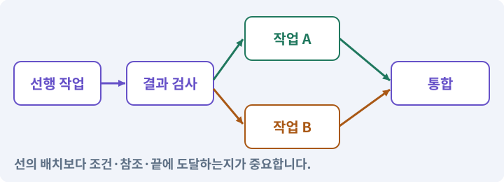

# 130. 첫 확장 작업을 하네스에 연결하기

**목표:** 실제 파일을 사용한 역할 계획을 얻습니다.

**시작 상태:** 기존 2D 게임의 확인된 기준

## 한눈에 보는 기능의 흐름

실제 게임 파일 → 역할별 계획 → 검사·권한 확인 → 실행 준비



**경계:** 없는 파일을 가짜 예제로 채우지 않기

그림은 실제 게임 실행 결과가 아닙니다. 값·규칙과 예제를 필요한 때 펼쳐 읽고 현재 단계의 메시지를 한 번씩 보냅니다.

## 1. 지금 상태 확인하기

첫 메시지를 보내 현재 준비 상태를 확인합니다. AI가 읽어 온 실제 프로젝트가 맞는지 보고, 없는 준비나 다른 상태가 있으면 먼저 알려 주세요. 아직 기능을 만들지 않는 단계입니다.

### AI에게 보낼 요구와 이유

#### 01. 작업 대상부터 확인

**“첫 확장 작업을 하네스에 연결하기” 작업을 시작하기 전에 현재 상태를 읽기 전용으로 확인해 줘.**

왜 이렇게 요청하나요? AI가 다른 프로젝트나 오래된 예제를 보고 작업할 수 있습니다. 실제 경로·파일·현재 기능을 읽게 하면 지금 이어서 작업할 대상을 먼저 맞출 수 있습니다.

#### 02. 작업 대상부터 확인

**필요한 시작 상태는 기존 2D 게임의 확인된 기준야.**

왜 이렇게 요청하나요? AI가 다른 프로젝트나 오래된 예제를 보고 작업할 수 있습니다. 실제 경로·파일·현재 기능을 읽게 하면 지금 이어서 작업할 대상을 먼저 맞출 수 있습니다.

#### 03. 실제 사용 중인 구현 재사용

**실제 프로젝트와 작업 기록을 읽고 이것이 준비되어 있는지, 이미 같은 기능이 있는지 확인해 줘.**

왜 이렇게 요청하나요? 이름이 비슷한 새 클래스를 또 만들면 기존 화면은 여전히 옛 코드를 사용할 수 있습니다. 실제 호출되는 진입점을 찾아 연결해야 두 구현이 충돌하거나 수정이 반영되지 않는 문제를 막습니다.

#### 04. 현재 상태와 다음 확인 지점 구분

**이번 기능이 연결될 실제 파일·화면·도구와 보존할 기존 동작을 짧게 정리해 줘.**

왜 이렇게 요청하나요? 이미 준비된 기능과 아직 확인하지 못한 기능을 섞으면 불필요한 재설치나 성급한 완료 판정이 생깁니다. 현재 대상과 남은 준비를 나눠 가장 작은 다음 작업을 선택하게 합니다.

#### 05. 조사 단계에서 변경하지 않기

**아직 새 구현·설치·유료 호출·파일 변경은 하지 마.**

왜 이렇게 요청하나요? 현재 상태를 알아보기만 할 때 파일 변경이나 결제가 시작되면 검토 전의 환경이 바뀝니다. 준비 확인과 실제 구현을 나눠 되돌리기 어려운 작업이 먼저 실행되지 않게 합니다.

#### 06. 막힌 준비를 먼저 해결

**준비가 다르면 부족한 항목과 다음에 필요한 작업을 알려 줘.**

왜 이렇게 요청하나요? 빠진 파일·권한·패키지를 있다고 가정하면 다음 구현이 엉뚱한 대상을 만들게 됩니다. 무엇이 없고 무엇을 먼저 해야 하는지 분리하면 불필요한 재작업을 줄일 수 있습니다.

<details>
<summary>보낼 원문 전체 — 설명은 복사되지 않습니다</summary>

```text
“첫 확장 작업을 하네스에 연결하기” 작업을 시작하기 전에 현재 상태를 읽기 전용으로 확인해 줘.
필요한 시작 상태는 기존 2D 게임의 확인된 기준야. 실제 프로젝트와 작업 기록을 읽고 이것이 준비되어 있는지, 이미 같은 기능이 있는지 확인해 줘.
이번 기능이 연결될 실제 파일·화면·도구와 보존할 기존 동작을 짧게 정리해 줘. 아직 새 구현·설치·유료 호출·파일 변경은 하지 마. 준비가 다르면 부족한 항목과 다음에 필요한 작업을 알려 줘.
```

</details>

**기대 결과:** 실제 파일에 연결된 첫 기능 계획

### 직접 확인하기

1. AI가 읽은 실제 프로젝트 또는 도구 경로를 확인합니다.
2. 필수 준비가 없다면 문제 해결 요청을 보내고, 준비됐을 때 다음으로 갑니다.

## 2. 필요한 기능 만들기

준비가 확인되면 아래 요청을 보냅니다. AI가 파일·설정·실행을 맡습니다. 변경 범위나 비용 승인이 나오면 내용을 읽고 결정하세요.

### AI에게 보낼 요구와 이유

#### 01. 계획·바인딩 단계에서는 실행 보류

**내 하네스에서 사용할 전리품 필터 작업표와 권한 설정을 준비해 줘. 아직 역할 실행·후보 적용·Unity 통합 명령은 호출하지 마.**

왜 이렇게 요청하나요? 입력·출력·검사 명령을 실제 프로젝트에 맞추는 단계입니다. 준비가 끝나기 전에 구현이나 통합을 시작해 잘못된 파일을 바꾸지 않게 합니다.

#### 02. 없는 참고 파일에 의존하지 않는 작업표

**이번에는 전리품 필터만 계획해 줘. 실제 드롭 모델·이름표·설정·입력 파일을 조사해 작업표를 만들고, 이미 같은 목적의 작업표가 있다면 내용을 대조해 재사용해 줘.**

왜 이렇게 요청하나요? 아이템 모델과 이름표의 실제 경로는 프로젝트마다 다를 수 있습니다. 조사한 파일로 작업표를 만들거나 내용을 확인한 기존 작업표를 재사용해야 존재하지 않는 경로를 따라가며 엉뚱한 코드를 생성하지 않습니다.

#### 03. 요청과 실제 권한을 구분

**read_files의 각 파일을 직접 확인하고 anchor와 의미를 기록해 줘.**

왜 이렇게 요청하나요? 역할 프롬프트에 “이 파일만 수정”이라고 적는 것만으로 경로가 제한되지는 않습니다. 프로그램이 허용 경로와 요청 범위를 검사해 원본·비밀 파일·다른 담당 파일을 보호합니다.

#### 04. 구현할 결과와 조건 고정

**없는 심볼을 만들어 맞추지 마.**

왜 이렇게 요청하나요? “없는 심볼을 만들어 맞추지 마”를 명시하면 AI가 무엇을 구현하거나 검사해야 하는지 범위를 좁힐 수 있습니다. 실제 파일을 사용한 역할 계획을 얻습니다. 이 결과를 확인할 때 이 조건이 실제로 반영됐는지 함께 봅니다.

#### 05. 에이전트·서브에이전트·역할의 적용 조건

**role 권한을 자동으로 넓히지 말고 꼭 필요한 파일만 요청해 줘.**

왜 이렇게 요청하나요? 에이전트는 모델이 작업 상태를 보며 도구를 사용하고 결과를 받아 다음 행동을 선택하는 실행 주체입니다. 역할은 책임·입력·권한을 나눈 계약이며 서브에이전트는 별도로 위임한 작업 주체입니다. 여러 역할이 같은 파일을 동시에 고치면 협업이 아니라 충돌이 될 수 있습니다.

#### 06. 설치된 도구에 맞추기

**설정은 새 run 전에 검토하며, 실제 Claude 선택·사용량 조건·도움말을 확인해 줘.**

왜 이렇게 요청하나요? 버전마다 명령과 인자가 다를 수 있습니다. 기억에 의존해 명령을 조합하지 않고 현재 설치본의 도움말·패키지·실제 호출 결과를 기준으로 연결하게 합니다.

#### 07. Play 모드·편집 모드·런타임의 적용 조건

**Unity 통합과 EditMode/PlayMode 결과 수집 경로를 연결하되 아직 호출하지 마.**

왜 이렇게 요청하나요? 편집 모드는 제작 상태이고 Play 모드는 게임 로직을 실행해 보는 상태입니다. 런타임은 게임이 실제로 실행되는 시간과 환경을 뜻합니다. Play에서 보인 상태만 보고 저장·재개방까지 통과했다고 기록하지 않습니다.

#### 08. 직접 만든 하네스의 실제 능력 확인

**현재 내 하네스에서 실제 구현·검증된 기능만 사용하고, 병렬 실행이나 자동 기획의 지원 여부는 등록 명령과 실행 결과로 확인해 줘.**

왜 이렇게 요청하나요? 앞에서 계획 생성기를 만들었다면 사용할 수 있고 아직 없는 병렬 실행은 사용할 수 없습니다. 오래된 기본 예제 설명 대신 현재 작성본의 실제 지원 기능을 기준으로 합니다.

#### 09. 아래 항목을 완료 조건으로 사용

**이 기능의 규칙:**

왜 이렇게 요청하나요? 요구사항의 목록은 AI에게 참고 설명을 주는 것이 아니라 완료를 판단할 기준을 정합니다. 구현 뒤 각 항목을 실제 입력과 결과에 대응시켜 빠진 조건을 찾습니다.

#### 10. 예시 이름이 아니라 실제 코드에 연결

**바인딩은 역할이 읽을 파일과 수정할 파일을 실제 프로젝트 경로로 연결하는 일이다.**

왜 이렇게 요청하나요? 수강생 프로젝트의 파일 이름은 예제와 다를 수 있습니다. 실제 호출되는 코드와 참조를 찾아 역할 입력에 연결해야 쓰이지 않는 파일을 고치고 완료라고 보고하는 일을 막습니다.

#### 11. 관찰 가능한 기준으로 확인

**이번 묶음의 workbook.py는 @loot_model 같은 별칭을 실제 파일로 치환하고, 원본 해시·입력 anchor·쓰기 범위·선행 작업을 검사한다.**

왜 이렇게 요청하나요? 구현 완료라는 설명을 실제 결과로 바꾸기 위한 조건입니다. 요청에 나온 대상과 경계 상황을 확인해 정상 결과뿐 아니라 실패를 어떻게 구분했는지도 남깁니다.

#### 12. 구현할 결과와 조건 고정

**자동으로 C# 의미를 이해하거나 Unity를 실행하는 도구는 아니다.**

왜 이렇게 요청하나요? “자동으로 C# 의미를 이해하거나 Unity를 실행하는 도구는 아니다”를 명시하면 AI가 무엇을 구현하거나 검사해야 하는지 범위를 좁힐 수 있습니다. 실제 파일을 사용한 역할 계획을 얻습니다. 이 결과를 확인할 때 이 조건이 실제로 반영됐는지 함께 봅니다.

#### 13. 요청과 실제 권한을 구분

**기존 하네스는 작업이 선언한 read_files만 역할에 제공한다.**

왜 이렇게 요청하나요? 역할 프롬프트에 “이 파일만 수정”이라고 적는 것만으로 경로가 제한되지는 않습니다. 프로그램이 허용 경로와 요청 범위를 검사해 원본·비밀 파일·다른 담당 파일을 보호합니다.

#### 14. 구현할 결과와 조건 고정

**앞 역할이 만든 문서를 뒤 역할이 자동으로 다 보는 것은 아니다.**

왜 이렇게 요청하나요? “앞 역할이 만든 문서를 뒤 역할이 자동으로 다 보는 것은 아니다”를 명시하면 AI가 무엇을 구현하거나 검사해야 하는지 범위를 좁힐 수 있습니다. 실제 파일을 사용한 역할 계획을 얻습니다. 이 결과를 확인할 때 이 조건이 실제로 반영됐는지 함께 봅니다.

#### 15. 요청과 실제 권한을 구분

**depends_on과 read_files를 모두 연결해야 한다.**

왜 이렇게 요청하나요? 역할 프롬프트에 “이 파일만 수정”이라고 적는 것만으로 경로가 제한되지는 않습니다. 프로그램이 허용 경로와 요청 범위를 검사해 원본·비밀 파일·다른 담당 파일을 보호합니다.

#### 16. 관찰 가능한 기준으로 확인

**critic에는 명세, 실제 기존 인터페이스, 구현·테스트·통합 도구의 전체 변경을 전달한다.**

왜 이렇게 요청하나요? 구현 완료라는 설명을 실제 결과로 바꾸기 위한 조건입니다. 요청에 나온 대상과 경계 상황을 확인해 정상 결과뿐 아니라 실패를 어떻게 구분했는지도 남깁니다.

#### 17. 기존 결과를 보호

**config는 실행 뒤 불변이다.**

왜 이렇게 요청하나요? 새 작업이 이미 정상인 기능이나 자산까지 바꾸면 원인을 추적하기 어렵습니다. 유지할 대상을 명시해 변경 전후를 비교하고 원치 않은 영향을 찾습니다.

#### 18. 검증 게이트·필수 검사의 적용 조건

**미연결 게이트를 없애서 완료 상태를 만들지 말고, 실행 전에 실제 명령과 결과 위치를 연결한다.**

왜 이렇게 요청하나요? 게이트는 다음 단계로 넘어가기 위해 충족해야 하는 실제 검사 조건입니다. 컴파일·테스트·로그·시각·사람 확인 등 목적에 따라 다른 게이트를 둡니다. 게임 AI가 스스로 “완료”라고 쓴 문장은 게이트 통과가 아닙니다.

#### 19. 터미널과 Editor가 같은 대상을 보게

**Unity CLI/Pipeline은 설치된 도움말로 확인한다.**

왜 이렇게 요청하나요? 여러 Unity 프로젝트나 실행 파일이 있으면 명령이 다른 Editor로 전달될 수 있습니다. 실행 파일·연결된 프로젝트·씬의 실제 응답을 대조해 올바른 작업 대상을 고정합니다.

#### 20. 관찰 가능한 기준으로 확인

**별도 Editor 배치 테스트를 쓰면 같은 후보 프로젝트를 열린 Editor와 동시에 사용하지 않는다.**

왜 이렇게 요청하나요? 구현 완료라는 설명을 실제 결과로 바꾸기 위한 조건입니다. 요청에 나온 대상과 경계 상황을 확인해 정상 결과뿐 아니라 실패를 어떻게 구분했는지도 남깁니다.

#### 21. 공유 Editor의 작업 순서 보장

**두 경로 중 하나를 정해 동일한 협력 잠금 경로를 사용한다.**

왜 이렇게 요청하나요? 씬 수정·Play·빌드가 같은 Editor에서 겹치면 서로의 상태를 바꿀 수 있습니다. 하나의 실행 창구와 잠금으로 순서를 만들되 사용자의 외부 편집까지 자동 차단한다고 가정하지 않습니다.

#### 22. 구현과 실행은 AI에게 맡기기

**코드·설정·파일 생성·실행은 네가 맡고, 필요한 화면과 결과를 보여 줘.**

왜 이렇게 요청하나요? 설명이나 코드 조각만 받으면 실제 파일 생성·연결·실행이 빠질 수 있습니다. AI가 개발 작업까지 수행하고, 사람은 요구·승인·결과 판단을 맡도록 역할을 분명히 합니다.

#### 23. 막힌 준비를 먼저 해결

**수행하지 못한 작업과 필요한 승인·도구 연결은 구분해서 알려 줘.**

왜 이렇게 요청하나요? 빠진 파일·권한·패키지를 있다고 가정하면 다음 구현이 엉뚱한 대상을 만들게 됩니다. 무엇이 없고 무엇을 먼저 해야 하는지 분리하면 불필요한 재작업을 줄일 수 있습니다.

#### 24. 확장 역할을 먼저 준비

**필요한 역할이 아직 등록되지 않았다면 역할·입력·출력 범위와 검토자를 먼저 제안하고, 승인한 좁은 계약으로 등록·검증한 뒤 작업표에 연결해 줘.**

왜 이렇게 요청하나요? 아트·UI·레벨 역할이 항상 존재하는 것은 아닙니다. 작업표에 이름만 넣지 않고 실제 등록과 권한 검사를 먼저 수행해야 기능 확장에서 막히지 않습니다.

<details>
<summary>보낼 원문 전체 — 설명은 복사되지 않습니다</summary>

```text
내 하네스에서 사용할 전리품 필터 작업표와 권한 설정을 준비해 줘. 아직 역할 실행·후보 적용·Unity 통합 명령은 호출하지 마.

이번에는 전리품 필터만 계획해 줘. 실제 드롭 모델·이름표·설정·입력 파일을 조사해 작업표를 만들고, 이미 같은 목적의 작업표가 있다면 내용을 대조해 재사용해 줘.
read_files의 각 파일을 직접 확인하고 anchor와 의미를 기록해 줘. 없는 심볼을 만들어 맞추지 마.
role 권한을 자동으로 넓히지 말고 꼭 필요한 파일만 요청해 줘.
설정은 새 run 전에 검토하며, 실제 Claude 선택·사용량 조건·도움말을 확인해 줘.
Unity 통합과 EditMode/PlayMode 결과 수집 경로를 연결하되 아직 호출하지 마.
현재 내 하네스에서 실제 구현·검증된 기능만 사용하고, 병렬 실행이나 자동 기획의 지원 여부는 등록 명령과 실행 결과로 확인해 줘.

이 기능의 규칙:
바인딩은 역할이 읽을 파일과 수정할 파일을 실제 프로젝트 경로로 연결하는 일이다. 이번 묶음의 workbook.py는 @loot_model 같은 별칭을 실제 파일로 치환하고, 원본 해시·입력 anchor·쓰기 범위·선행 작업을 검사한다. 자동으로 C# 의미를 이해하거나 Unity를 실행하는 도구는 아니다.

기존 하네스는 작업이 선언한 read_files만 역할에 제공한다. 앞 역할이 만든 문서를 뒤 역할이 자동으로 다 보는 것은 아니다. depends_on과 read_files를 모두 연결해야 한다. critic에는 명세, 실제 기존 인터페이스, 구현·테스트·통합 도구의 전체 변경을 전달한다.

config는 실행 뒤 불변이다. 미연결 게이트를 없애서 완료 상태를 만들지 말고, 실행 전에 실제 명령과 결과 위치를 연결한다. Unity CLI/Pipeline은 설치된 도움말로 확인한다. 별도 Editor 배치 테스트를 쓰면 같은 후보 프로젝트를 열린 Editor와 동시에 사용하지 않는다. 두 경로 중 하나를 정해 동일한 협력 잠금 경로를 사용한다.

코드·설정·파일 생성·실행은 네가 맡고, 필요한 화면과 결과를 보여 줘. 수행하지 못한 작업과 필요한 승인·도구 연결은 구분해서 알려 줘.

필요한 역할이 아직 등록되지 않았다면 역할·입력·출력 범위와 검토자를 먼저 제안하고, 승인한 좁은 계약으로 등록·검증한 뒤 작업표에 연결해 줘.
```

</details>

**기대 결과:** 확인할 결과: 검증 가능한 첫 확장 작업을 확인함. AI가 이 상태를 확인할 실제 화면과 변경 내용을 준비합니다. 아직 실행하지 못한 부분은 따로 표시합니다.

### 직접 확인하기

1. 제안서만 반환됐다면 “설명으로 끝내지 말고 승인한 범위의 실제 작업을 수행해 줘”라고 보냅니다.
2. 코드나 설정을 직접 고치라는 안내가 나오면 “작성과 실행은 네가 맡아 줘”라고 요청합니다.

## 3. 결과를 직접 확인하기

먼저 확인 요청을 보내 AI가 검사와 화면을 준비하게 하세요. 그다음 아래 동작을 하나씩 확인합니다.

### AI에게 보낼 요구와 이유

#### 01. 검사할 입력과 관찰 지점 준비

**방금 구현한 기능의 자동 검사와 확인 화면을 준비해 줘.**

왜 이렇게 요청하나요? 정상 예 하나만 보면 실패 조건을 놓치기 쉽습니다. 정상·경계·반례를 실제 입력으로 준비하고 사람이 볼 화면도 맞춰 확인 범위를 분명하게 합니다.

#### 02. 결과를 재확인할 근거 남기기

**정상 동작과 아래 실패 조건을 실제로 검사하고 대상·실행 수·결과를 보여 줘.**

왜 이렇게 요청하나요? “잘 됩니다”라는 요약만으로는 어떤 입력과 버전을 검사했는지 알 수 없습니다. 대상·실행 수·실패 내용·파일을 함께 남겨 같은 조건으로 다시 확인할 수 있게 합니다.

#### 03. Canvas·RectTransform·앵커의 적용 조건

**존재하지 않는 입력 파일·잘못된 anchor·역할 밖 경로를 넣으면 bind가 거부한다.**

왜 이렇게 요청하나요? Canvas는 UGUI를 그리는 공간입니다. RectTransform은 사각 UI의 위치·크기를 다루고, 앵커는 부모의 어느 부분을 기준으로 배치할지 정합니다. UI의 Pivot과 앵커는 같은 값이 아닙니다. Pivot은 사각형 자체의 기준점이고 앵커는 부모 기준입니다.

#### 04. 구현할 결과와 조건 고정

**기존 출력 파일을 읽기 입력에서 빼면 거부한다.**

왜 이렇게 요청하나요? “기존 출력 파일을 읽기 입력에서 빼면 거부한다”를 명시하면 AI가 무엇을 구현하거나 검사해야 하는지 범위를 좁힐 수 있습니다. 실제 파일을 사용한 역할 계획을 얻습니다. 이 결과를 확인할 때 이 조건이 실제로 반영됐는지 함께 봅니다.

#### 05. 의존성·DAG·위상 정렬의 적용 조건

**새로운 출력에 의존하지만 depends_on이 없으면 거부한다.**

왜 이렇게 요청하나요? 의존성은 어떤 작업이 다른 결과를 먼저 필요로 하는 관계입니다. DAG는 순환이 없는 방향 그래프이고, 위상 정렬은 그 관계를 지키는 실행 순서를 만드는 방법입니다. 의존 관계가 없다고 무조건 병렬 실행해도 되는 것은 아닙니다. 파일·Editor 소유권도 확인합니다.

#### 06. 증거·검사 상태·미실행의 적용 조건

**필수 게이트가 미연결이면 gate_readiness에 남고 BOUND_NOT_RUN을 게임 PASS 로 해석하지 않는다.**

왜 이렇게 요청하나요? 증거는 어떤 대상에 어떤 검사를 실제 실행했는지 확인할 수 있는 자료입니다. PASS·FAIL·BLOCKED·NOT RUN은 성공·실패·조건 부족·미실행을 구분합니다. 스크린샷 하나는 멀티터치·저장 복구·전투 재미를 모두 입증하지 못합니다.

#### 07. 사람 검사의 시작점 준비

**내가 조작해야 하는 부분은 실행할 화면과 시작 상태를 준비해 줘.**

왜 이렇게 요청하나요? 같은 기능이라도 시작 상태가 다르면 관찰 결과가 달라집니다. AI가 실행 화면과 재현 위치를 먼저 준비해야 사람이 이동·공격·소리·조작감을 같은 조건에서 확인할 수 있습니다.

#### 08. 사람이 실제로 본 것만 기록

**연결되지 않은 휴대폰의 터치나 사람이 보지 않은 재미·소리 품질을 대신 확인했다고 하지 마.**

왜 이렇게 요청하나요? AI가 준비한 검사와 사람이 직접 플레이하거나 들은 결과는 다른 근거입니다. 관찰하지 않은 조작감·소리·실기기 결과를 임의로 완료 처리하지 않게 합니다.

#### 09. 실제로 실행한 검사만 인정

**테스트 0개와 예전 소스 결과는 현재 성공으로 쓰지 마.**

왜 이렇게 요청하나요? 실행된 검사가 없거나 같은 결과를 중복 집계한 경우는 기능을 확인한 것이 아닙니다. 실행 수와 개별 결과를 함께 확인해야 형식적인 성공 표시를 걸러낼 수 있습니다.

<details>
<summary>보낼 원문 전체 — 설명은 복사되지 않습니다</summary>

```text
방금 구현한 기능의 자동 검사와 확인 화면을 준비해 줘. 정상 동작과 아래 실패 조건을 실제로 검사하고 대상·실행 수·결과를 보여 줘.

존재하지 않는 입력 파일·잘못된 anchor·역할 밖 경로를 넣으면 bind가 거부한다.

 기존 출력 파일을 읽기 입력에서 빼면 거부한다.

 새로운 출력에 의존하지만 depends_on이 없으면 거부한다.

 필수 게이트가 미연결이면 gate_readiness에 남고 BOUND_NOT_RUN을 게임 PASS 로 해석하지 않는다.

내가 조작해야 하는 부분은 실행할 화면과 시작 상태를 준비해 줘. 연결되지 않은 휴대폰의 터치나 사람이 보지 않은 재미·소리 품질을 대신 확인했다고 하지 마. 테스트 0개와 예전 소스 결과는 현재 성공으로 쓰지 마.
```

</details>

**기대 결과:** 검증 가능한 첫 확장 작업을 확인함

### 직접 확인하기

1. 기획·구현·QA·검토의 담당을 봅니다.
2. 없는 경로가 가짜 파일로 채워지지 않았는지 확인합니다.
3. 필수 검사와 승인 전 범위를 확인합니다.

## 4. 결과를 남기고 마무리하기

실제로 본 결과를 아래 메모에 적고 AI에 전달합니다. 결과 저장 요청으로 현재 상태를 남긴 뒤 다음 페이지로 갑니다.

### AI에게 보낼 요구와 이유

#### 01. 결과를 재확인할 근거 남기기

**지금 작업한 “첫 확장 작업을 하네스에 연결하기”의 실제 결과를 정리해 줘.**

왜 이렇게 요청하나요? “잘 됩니다”라는 요약만으로는 어떤 입력과 버전을 검사했는지 알 수 없습니다. 대상·실행 수·실패 내용·파일을 함께 남겨 같은 조건으로 다시 확인할 수 있게 합니다.

#### 02. 다음 작업이 읽을 인수인계

**변경한 기능·파일·현재 후보와 실제 실행한 검사, 남은 문제를 기능 이름으로 기록해 줘.**

왜 이렇게 요청하나요? 새 AI 세션은 이전 대화 전체를 알고 있다고 보장할 수 없습니다. 현재 후보·파일 위치·실행한 검사·남은 일을 남겨야 같은 작업을 반복하지 않고 이어갈 수 있습니다.

#### 03. 사람이 실제로 본 것만 기록

**자동 검사 결과와 내가 직접 확인한 결과를 구분하고, 내 관찰이 아직 없으면 미확인으로 남겨 줘.**

왜 이렇게 요청하나요? AI가 준비한 검사와 사람이 직접 플레이하거나 들은 결과는 다른 근거입니다. 관찰하지 않은 조작감·소리·실기기 결과를 임의로 완료 처리하지 않게 합니다.

#### 04. 다음 작업이 읽을 인수인계

**재시작하거나 다음 작업에서 읽을 기록의 실제 위치를 알려 줘.**

왜 이렇게 요청하나요? 새 AI 세션은 이전 대화 전체를 알고 있다고 보장할 수 없습니다. 현재 후보·파일 위치·실행한 검사·남은 일을 남겨야 같은 작업을 반복하지 않고 이어갈 수 있습니다.

#### 05. 미확인을 완료와 분리

**아직 확인하지 않은 결과를 완료로 채우지 마.**

왜 이렇게 요청하나요? 만들어진 것, 검사에 실패한 것, 아직 확인하지 못한 것을 나눠야 다음 작업을 정확히 고를 수 있습니다. 실행할 조건이 없는 기능을 성공으로 기록하면 뒤에서 원인을 찾기 어려워집니다.

<details>
<summary>보낼 원문 전체 — 설명은 복사되지 않습니다</summary>

```text
지금 작업한 “첫 확장 작업을 하네스에 연결하기”의 실제 결과를 정리해 줘. 변경한 기능·파일·현재 후보와 실제 실행한 검사, 남은 문제를 기능 이름으로 기록해 줘.
자동 검사 결과와 내가 직접 확인한 결과를 구분하고, 내 관찰이 아직 없으면 미확인으로 남겨 줘. 재시작하거나 다음 작업에서 읽을 기록의 실제 위치를 알려 줘. 아직 확인하지 않은 결과를 완료로 채우지 마.
```

</details>

**기대 결과:** 현재 상태·검사 결과·남은 문제·다음에 읽을 기록을 확인할 수 있습니다.

### 직접 확인하기

1. 자동 검사와 내 관찰 결과가 섞이지 않았는지 봅니다.
2. 문제가 남았다면 해결 요청을 보내고 같은 동작을 다시 확인합니다.

## 문제가 있으면

### AI에게 보낼 요구와 이유

#### 01. 관찰 가능한 기준으로 확인

**연결 성공 표시만 보지 말고 실제 입력 지문·출력 충돌·의존성을 검사해 줘.**

왜 이렇게 요청하나요? 구현 완료라는 설명을 실제 결과로 바꾸기 위한 조건입니다. 요청에 나온 대상과 경계 상황을 확인해 정상 결과뿐 아니라 실패를 어떻게 구분했는지도 남깁니다.

#### 02. 기존 결과를 보호

**원본 변경 후 오래된 연결은 거부해 줘.**

왜 이렇게 요청하나요? 새 작업이 이미 정상인 기능이나 자산까지 바꾸면 원인을 추적하기 어렵습니다. 유지할 대상을 명시해 변경 전후를 비교하고 원치 않은 영향을 찾습니다.

#### 03. 원인 하나를 좁혀 수정

**새 기능을 추가하지 말고 현재 오류와 실제 로그를 먼저 읽어 줘.**

왜 이렇게 요청하나요? 오류 수정 중 새 기능까지 넣으면 어떤 변경이 문제를 해결하거나 악화했는지 알기 어렵습니다. 원래 재현을 보존하고 작은 변경 뒤 같은 입력과 주변 정상 동작을 다시 확인합니다.

#### 04. 원인 하나를 좁혀 수정

**최소 수정 뒤 같은 재현과 관련 정상 동작을 다시 검사해 줘.**

왜 이렇게 요청하나요? 오류 수정 중 새 기능까지 넣으면 어떤 변경이 문제를 해결하거나 악화했는지 알기 어렵습니다. 원래 재현을 보존하고 작은 변경 뒤 같은 입력과 주변 정상 동작을 다시 확인합니다.

#### 05. 실패도 재현 자료로 보존

**실패 기록은 지우지 마.**

왜 이렇게 요청하나요? 실패한 입력과 로그가 있어야 같은 문제가 다시 생겼을 때 비교할 수 있습니다. 성공 기록으로 덮어쓰지 않고 전후 자료를 남기면 무엇을 고쳤는지 확인할 수 있습니다.

<details>
<summary>보낼 원문 전체 — 설명은 복사되지 않습니다</summary>

```text
연결 성공 표시만 보지 말고 실제 입력 지문·출력 충돌·의존성을 검사해 줘. 원본 변경 후 오래된 연결은 거부해 줘.
새 기능을 추가하지 말고 현재 오류와 실제 로그를 먼저 읽어 줘. 최소 수정 뒤 같은 재현과 관련 정상 동작을 다시 검사해 줘. 실패 기록은 지우지 마.
```

</details>

## 새 세션에서 이어가기

### AI에게 보낼 요구와 이유

#### 01. 이어서 할 작업 식별

**“첫 확장 작업을 하네스에 연결하기” 작업을 이어가고 싶어.**

왜 이렇게 요청하나요? 이름으로 재개할 작업을 찾고, 뒤에 이어지는 요청으로 실제 파일·진행 중 작업·기록을 다시 읽게 합니다. 제목만 보고 이전 상태를 기억한다고 가정하지 않습니다.

#### 02. 조회는 상태를 바꾸지 않게

**실제 프로젝트와 내 도구의 작업 기록을 읽고 어디까지 구현·검사됐는지 확인해 줘.**

왜 이렇게 요청하나요? 진행 상황을 물을 때 새 구현이나 유료 호출이 시작되면 단순 확인이 실행 명령이 되어 버립니다. 저장된 근거를 읽어 완료·진행·승인 대기·미검증을 나누게 합니다.

#### 03. 재개 전 중복 작업 방지

**진행 중인 프로세스·승인·미저장 변경을 확인한 뒤 남은 가장 작은 작업부터 안내해 줘.**

왜 이렇게 요청하나요? 대화가 끊겨도 외부 작업은 끝났거나 아직 실행 중일 수 있습니다. 프로세스·승인·미저장 상태를 먼저 읽어 같은 생성·빌드·결제를 두 번 시작하지 않도록 합니다.

#### 04. 되돌아갈 원본 남기기

**기존 성공과 실패 기록은 보존해 줘.**

왜 이렇게 요청하나요? 새 구현이 실패해도 이전 게임과 저장을 복원할 수 있어야 합니다. 현재 내용을 먼저 조사하고 별도 후보에서 작업하면 실험이 유일한 정상본을 망가뜨리는 일을 피할 수 있습니다.

<details>
<summary>보낼 원문 전체 — 설명은 복사되지 않습니다</summary>

```text
“첫 확장 작업을 하네스에 연결하기” 작업을 이어가고 싶어. 실제 프로젝트와 내 도구의 작업 기록을 읽고 어디까지 구현·검사됐는지 확인해 줘. 진행 중인 프로세스·승인·미저장 변경을 확인한 뒤 남은 가장 작은 작업부터 안내해 줘. 기존 성공과 실패 기록은 보존해 줘.
```

</details>

## 왜 이렇게 만드는가

바인딩은 역할이 읽을 파일과 수정할 파일을 실제 프로젝트 경로로 연결하는 일이다. 이번 묶음의 workbook.py는 @loot_model 같은 별칭을 실제 파일로 치환하고, 원본 해시·입력 anchor·쓰기 범위·선행 작업을 검사한다. 자동으로 C# 의미를 이해하거나 Unity를 실행하는 도구는 아니다.

기존 하네스는 작업이 선언한 read_files만 역할에 제공한다. 앞 역할이 만든 문서를 뒤 역할이 자동으로 다 보는 것은 아니다. depends_on과 read_files를 모두 연결해야 한다. critic에는 명세, 실제 기존 인터페이스, 구현·테스트·통합 도구의 전체 변경을 전달한다.

## 공식 참고

- [Claude Code](https://code.claude.com/docs/en/headless)
- [Unity CLI](https://docs.unity.com/en-us/unity-cli/use-unity-cli)
- [Unity Test Framework](https://docs.unity3d.com/Packages/com.unity.test-framework@1.4/manual/reference-command-line.html)
