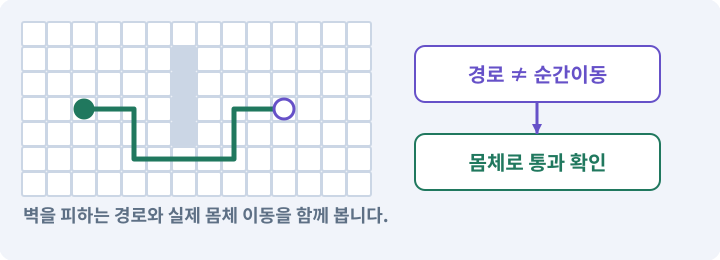

# 135. 벽을 통과하지 않는 회피 만들기

**목표:** 짧게 피하고 정확한 시간만 피해를 막습니다.

**시작 상태:** 상태이상과 단일 이동 모터

## 한눈에 보는 기능의 흐름

회피 입력 → 허용 시간·거리 → 벽까지 이동 → 무적 종료



**경계:** 회피로 얇은 벽을 통과하지 않기

그림은 실제 게임 실행 결과가 아닙니다. 값·규칙과 예제를 필요한 때 펼쳐 읽고 현재 단계의 메시지를 한 번씩 보냅니다.

## 1. 지금 상태 확인하기

첫 메시지를 보내 현재 준비 상태를 확인합니다. AI가 읽어 온 실제 프로젝트가 맞는지 보고, 없는 준비나 다른 상태가 있으면 먼저 알려 주세요. 아직 기능을 만들지 않는 단계입니다.

### AI에게 보낼 요구와 이유

#### 01. 작업 대상부터 확인

**“벽을 통과하지 않는 회피 만들기” 작업을 시작하기 전에 현재 상태를 읽기 전용으로 확인해 줘.**

왜 이렇게 요청하나요? AI가 다른 프로젝트나 오래된 예제를 보고 작업할 수 있습니다. 실제 경로·파일·현재 기능을 읽게 하면 지금 이어서 작업할 대상을 먼저 맞출 수 있습니다.

#### 02. 작업 대상부터 확인

**필요한 시작 상태는 상태이상과 단일 이동 모터야.**

왜 이렇게 요청하나요? AI가 다른 프로젝트나 오래된 예제를 보고 작업할 수 있습니다. 실제 경로·파일·현재 기능을 읽게 하면 지금 이어서 작업할 대상을 먼저 맞출 수 있습니다.

#### 03. 실제 사용 중인 구현 재사용

**실제 프로젝트와 작업 기록을 읽고 이것이 준비되어 있는지, 이미 같은 기능이 있는지 확인해 줘.**

왜 이렇게 요청하나요? 이름이 비슷한 새 클래스를 또 만들면 기존 화면은 여전히 옛 코드를 사용할 수 있습니다. 실제 호출되는 진입점을 찾아 연결해야 두 구현이 충돌하거나 수정이 반영되지 않는 문제를 막습니다.

#### 04. 현재 상태와 다음 확인 지점 구분

**이번 기능이 연결될 실제 파일·화면·도구와 보존할 기존 동작을 짧게 정리해 줘.**

왜 이렇게 요청하나요? 이미 준비된 기능과 아직 확인하지 못한 기능을 섞으면 불필요한 재설치나 성급한 완료 판정이 생깁니다. 현재 대상과 남은 준비를 나눠 가장 작은 다음 작업을 선택하게 합니다.

#### 05. 조사 단계에서 변경하지 않기

**아직 새 구현·설치·유료 호출·파일 변경은 하지 마.**

왜 이렇게 요청하나요? 현재 상태를 알아보기만 할 때 파일 변경이나 결제가 시작되면 검토 전의 환경이 바뀝니다. 준비 확인과 실제 구현을 나눠 되돌리기 어려운 작업이 먼저 실행되지 않게 합니다.

#### 06. 막힌 준비를 먼저 해결

**준비가 다르면 부족한 항목과 다음에 필요한 작업을 알려 줘.**

왜 이렇게 요청하나요? 빠진 파일·권한·패키지를 있다고 가정하면 다음 구현이 엉뚱한 대상을 만들게 됩니다. 무엇이 없고 무엇을 먼저 해야 하는지 분리하면 불필요한 재작업을 줄일 수 있습니다.

<details>
<summary>보낼 원문 전체 — 설명은 복사되지 않습니다</summary>

```text
“벽을 통과하지 않는 회피 만들기” 작업을 시작하기 전에 현재 상태를 읽기 전용으로 확인해 줘.
필요한 시작 상태는 상태이상과 단일 이동 모터야. 실제 프로젝트와 작업 기록을 읽고 이것이 준비되어 있는지, 이미 같은 기능이 있는지 확인해 줘.
이번 기능이 연결될 실제 파일·화면·도구와 보존할 기존 동작을 짧게 정리해 줘. 아직 새 구현·설치·유료 호출·파일 변경은 하지 마. 준비가 다르면 부족한 항목과 다음에 필요한 작업을 알려 줘.
```

</details>

**기대 결과:** 회피 이동과 무적 시간선

### 직접 확인하기

1. AI가 읽은 실제 프로젝트 또는 도구 경로를 확인합니다.
2. 필수 준비가 없다면 문제 해결 요청을 보내고, 준비됐을 때 다음으로 갑니다.

## 2. 필요한 기능 만들기

준비가 확인되면 아래 요청을 보냅니다. AI가 파일·설정·실행을 맡습니다. 변경 범위나 비용 승인이 나오면 내용을 읽고 결정하세요.

### AI에게 보낼 요구와 이유

#### 01. 관찰 가능한 기준으로 확인

**내가 만든 하네스의 실제 경로와 현재 게임 후보를 확인하고 game-feature로 이 작업을 처리해 줘.**

왜 이렇게 요청하나요? 구현 완료라는 설명을 실제 결과로 바꾸기 위한 조건입니다. 요청에 나온 대상과 경계 상황을 확인해 정상 결과뿐 아니라 실패를 어떻게 구분했는지도 남깁니다.

#### 02. 구현과 판정의 책임 나누기

**필요한 담당 역할만 고르고 구현·QA·독립 검토를 분리해 줘.**

왜 이렇게 요청하나요? 구현자가 자신의 설명만으로 완료를 결정하면 놓친 가정을 그대로 통과시킬 수 있습니다. 원래 요구·실제 변경·테스트를 다른 관점에서 검토하고 쓰기 권한을 나눕니다.

#### 03. 작성한 도구를 실제로 사용

**변경안·승인한 후보·Unity 통합·현재 소스 검사를 실제로 연결하고, 참고 완성본으로 우회하지 마.**

왜 이렇게 요청하나요? 참고 완성본으로 몰래 실행하면 현재 만든 하네스의 누락이나 오류가 드러나지 않습니다. 실행 경로를 확인해 지금 개발한 도구가 작업과 검사를 수행하도록 합니다.

#### 04. 이동 모터와 단일 위치 책임의 적용 조건

**기존 2D PlayerMotor를 확장해 회피 대시를 구현해 줘.**

왜 이렇게 요청하나요? 이동 모터는 걷기·클릭 경로·회피·밀려남 요청을 받아 최종 이동을 한 곳에서 처리하는 프로젝트의 구성요소입니다. Unity의 모든 프로젝트에 같은 이름으로 존재하는 기능은 아닙니다. NavMeshAgent·Transform·CharacterController가 동시에 위치를 갱신하게 두지 않습니다.

#### 05. 구현할 결과와 조건 고정

**이동을 담당하는 주체는 늘리지 마.**

왜 이렇게 요청하나요? “이동을 담당하는 주체는 늘리지 마”를 명시하면 AI가 무엇을 구현하거나 검사해야 하는지 범위를 좁힐 수 있습니다. 짧게 피하고 정확한 시간만 피해를 막습니다. 이 결과를 확인할 때 이 조건이 실제로 반영됐는지 함께 봅니다.

#### 06. 사용 성공과 자원 소비 묶기

**최대 2.4/0.18초/쿨다운1.5초, 직접 피해 무적 구간0.04~0.14초를 초기값으로 써 줘.**

왜 이렇게 요청하나요? 실패한 사용에서 자원이 줄거나 연타로 여러 번 차감되면 표시와 실제 행동이 어긋납니다. 사용 조건·비용·대기시간을 함께 처리하고 실패 시 바뀌지 않아야 할 값을 확인합니다.

#### 07. Physics2D와 3D Physics의 적용 조건

**몸체 cast와 실제 Physics2D 충돌을 사용하고 벽·닫힌 문·구덩이를 넘어가지 마.**

왜 이렇게 요청하나요? Physics2D는 2D 몸체와 충돌을 다루는 물리 시스템·조회 API입니다. Physics는 3D 쪽에 사용됩니다. 그림이 2D처럼 보여도 어떤 시스템을 쓰는지는 컴포넌트로 결정됩니다. 렌더링 정렬 순서가 물리 충돌 순서를 결정하지 않습니다.

#### 08. 환경 반응의 반복과 종료 제한

**이미 걸린 DoT와 환경 피해는 무적 처리하지 마.**

왜 이렇게 요청하나요? 한 폭발이 여러 충돌 이벤트를 만들면 피해나 보상이 반복될 수 있습니다. 점화·폭발·정지의 상태와 처리한 대상을 기록해 환경을 이용한 전투가 통제된 결과를 내게 합니다.

#### 09. 상태 기계·FSM의 적용 조건

**dead/paused/UI 입력은 거부해 줘.**

왜 이렇게 요청하나요? 상태 기계는 현재 상태와 사건에 따라 다음 행동을 정하는 구조입니다. 대기·추적·공격 준비·공격·회복·사망처럼 동시에 해서는 안 되는 동작을 명확히 나눕니다. 상태 이름을 enum으로 만든 것만으로 안전한 전이가 보장되지는 않습니다. 모든 종료 경로를 검사합니다.

#### 10. 끊긴 입력과 작업 정리

**Android 에서 이동을 유지하며 회피할 수 있게 하고 취소·포커스 상실 후 입력이 붙어 있지 않게 해 줘.**

왜 이렇게 요청하나요? 앱 전환이나 창 닫기에서는 정상적인 손 떼기 이벤트가 오지 않을 수 있습니다. 중단 시 눌림·예약·임시 효과를 정리해야 복귀 후 멋대로 움직이거나 공격하지 않습니다.

#### 11. 아래 항목을 완료 조건으로 사용

**이 기능의 규칙:**

왜 이렇게 요청하나요? 요구사항의 목록은 AI에게 참고 설명을 주는 것이 아니라 완료를 판단할 기준을 정합니다. 구현 뒤 각 항목을 실제 입력과 결과에 대응시켜 빠진 조건을 찾습니다.

#### 12. 구현할 결과와 조건 고정

**회피는 순간이동이 아니라 짧은 이동 상태다.**

왜 이렇게 요청하나요? “회피는 순간이동이 아니라 짧은 이동 상태다”를 명시하면 AI가 무엇을 구현하거나 검사해야 하는지 범위를 좁힐 수 있습니다. 짧게 피하고 정확한 시간만 피해를 막습니다. 이 결과를 확인할 때 이 조건이 실제로 반영됐는지 함께 봅니다.

#### 13. 사용 성공과 자원 소비 묶기

**초기 목표는 최대 거리 2.4, 지속 0.18초, 쿨다운 1.5초, 시작 후 0.04~0.14초의 직접 공격 회피다.**

왜 이렇게 요청하나요? 실패한 사용에서 자원이 줄거나 연타로 여러 번 차감되면 표시와 실제 행동이 어긋납니다. 사용 조건·비용·대기시간을 함께 처리하고 실패 시 바뀌지 않아야 할 값을 확인합니다.

#### 14. 점이 아니라 몸체가 지나가게 하기

**벽·닫힌 문·구덩이는 통과하지 않는다.**

왜 이렇게 요청하나요? 길의 중심점이 연결돼 있어도 반경이 있는 캐릭터는 모서리나 좁은 문에 걸릴 수 있습니다. 실제 몸체 크기로 통과·차단을 확인해야 길찾기 그림과 플레이 결과가 맞습니다.

#### 15. 기존 결과를 보호

**적의 몸도 기본 충돌 규칙을 유지한다.**

왜 이렇게 요청하나요? 새 작업이 이미 정상인 기능이나 자산까지 바꾸면 원인을 추적하기 어렵습니다. 유지할 대상을 명시해 변경 전후를 비교하고 원치 않은 영향을 찾습니다.

#### 16. 상태 효과의 발생 원인과 수명 구분

**이미 걸린 화상과 환경 피해는 회피로 지워지지 않는다.**

왜 이렇게 요청하나요? 지속 피해가 직접 공격용 효과를 다시 발생시키면 연쇄 피해나 무한 발동이 생길 수 있습니다. 피해 출처·적용 시간·중첩·해제 조건을 구분해 전투 조합이 의도한 횟수로 작동하게 합니다.

#### 17. 시간·방향과 물리 이동 일치

**대각선 방향을 정규화하고 현재 몸체의 2D cast로 이동 여유를 확인한다.**

왜 이렇게 요청하나요? 입력 방향의 길이와 프레임 간격을 그대로 이동량에 섞으면 대각선이나 기기 속도에 따라 이동이 달라집니다. 정해진 속도·시간 기준과 물리 이동 경로를 사용해 비교 가능한 움직임을 만듭니다.

#### 18. 시간·방향과 물리 이동 일치

**Transform을 별도 보간하거나 새로운 Rigidbody2D를 붙이지 않는다.**

왜 이렇게 요청하나요? 입력 방향의 길이와 프레임 간격을 그대로 이동량에 섞으면 대각선이나 기기 속도에 따라 이동이 달라집니다. 정해진 속도·시간 기준과 물리 이동 경로를 사용해 비교 가능한 움직임을 만듭니다.

#### 19. 시간·방향과 물리 이동 일치

**Rigidbody2D.MovePosition은 물리 업데이트와 함께 동작하므로 기존 FixedUpdate 모터에 통합한다.**

왜 이렇게 요청하나요? 입력 방향의 길이와 프레임 간격을 그대로 이동량에 섞으면 대각선이나 기기 속도에 따라 이동이 달라집니다. 정해진 속도·시간 기준과 물리 이동 경로를 사용해 비교 가능한 움직임을 만듭니다.

#### 20. 관찰 가능한 기준으로 확인

**긴 이동과 실제 충돌은 기기에서 검사한다.**

왜 이렇게 요청하나요? 구현 완료라는 설명을 실제 결과로 바꾸기 위한 조건입니다. 요청에 나온 대상과 경계 상황을 확인해 정상 결과뿐 아니라 실패를 어떻게 구분했는지도 남깁니다.

#### 21. 사용 성공과 자원 소비 묶기

**회피가 시작되기 전에 방향·살아 있음·조작 가능·쿨다운을 검증한다.**

왜 이렇게 요청하나요? 실패한 사용에서 자원이 줄거나 연타로 여러 번 차감되면 표시와 실제 행동이 어긋납니다. 사용 조건·비용·대기시간을 함께 처리하고 실패 시 바뀌지 않아야 할 값을 확인합니다.

#### 22. 사용 성공과 자원 소비 묶기

**성공적으로 상태에 진입했을 때만 쿨다운을 소비한다.**

왜 이렇게 요청하나요? 실패한 사용에서 자원이 줄거나 연타로 여러 번 차감되면 표시와 실제 행동이 어긋납니다. 사용 조건·비용·대기시간을 함께 처리하고 실패 시 바뀌지 않아야 할 값을 확인합니다.

#### 23. 구현할 결과와 조건 고정

**시작 후 벽 때문에 짧게 움직인 정상 회피는 소비를 돌려주지 않는다.**

왜 이렇게 요청하나요? “시작 후 벽 때문에 짧게 움직인 정상 회피는 소비를 돌려주지 않는다”를 명시하면 AI가 무엇을 구현하거나 검사해야 하는지 범위를 좁힐 수 있습니다. 짧게 피하고 정확한 시간만 피해를 막습니다. 이 결과를 확인할 때 이 조건이 실제로 반영됐는지 함께 봅니다.

#### 24. 피할 수 있는 정보와 실제 판정 일치

**보스 예고를 읽고 피하는 선택을 만들되 영구 무적 버튼으로 만들지 않는다.**

왜 이렇게 요청하나요? 표시한 위험 범위·시점과 실제 피해가 다르면 플레이어는 올바르게 반응해도 손해를 봅니다. 예고·판정·효과가 같은 규칙을 사용하게 해 공격을 학습할 수 있게 합니다.

#### 25. 구현과 실행은 AI에게 맡기기

**코드·설정·파일 생성·실행은 네가 맡고, 필요한 화면과 결과를 보여 줘.**

왜 이렇게 요청하나요? 설명이나 코드 조각만 받으면 실제 파일 생성·연결·실행이 빠질 수 있습니다. AI가 개발 작업까지 수행하고, 사람은 요구·승인·결과 판단을 맡도록 역할을 분명히 합니다.

#### 26. 막힌 준비를 먼저 해결

**수행하지 못한 작업과 필요한 승인·도구 연결은 구분해서 알려 줘.**

왜 이렇게 요청하나요? 빠진 파일·권한·패키지를 있다고 가정하면 다음 구현이 엉뚱한 대상을 만들게 됩니다. 무엇이 없고 무엇을 먼저 해야 하는지 분리하면 불필요한 재작업을 줄일 수 있습니다.

<details>
<summary>보낼 원문 전체 — 설명은 복사되지 않습니다</summary>

```text
내가 만든 하네스의 실제 경로와 현재 게임 후보를 확인하고 game-feature로 이 작업을 처리해 줘. 필요한 담당 역할만 고르고 구현·QA·독립 검토를 분리해 줘. 변경안·승인한 후보·Unity 통합·현재 소스 검사를 실제로 연결하고, 참고 완성본으로 우회하지 마.

기존 2D PlayerMotor를 확장해 회피 대시를 구현해 줘. 이동을 담당하는 주체는 늘리지 마.
최대 2.4/0.18초/쿨다운1.5초, 직접 피해 무적 구간0.04~0.14초를 초기값으로 써 줘.
몸체 cast와 실제 Physics2D 충돌을 사용하고 벽·닫힌 문·구덩이를 넘어가지 마.
이미 걸린 DoT와 환경 피해는 무적 처리하지 마. dead/paused/UI 입력은 거부해 줘.
Android 에서 이동을 유지하며 회피할 수 있게 하고 취소·포커스 상실 후 입력이 붙어 있지 않게 해 줘.

이 기능의 규칙:
회피는 순간이동이 아니라 짧은 이동 상태다. 초기 목표는 최대 거리 2.4, 지속 0.18초, 쿨다운 1.5초, 시작 후 0.04~0.14초의 직접 공격 회피다. 벽·닫힌 문·구덩이는 통과하지 않는다. 적의 몸도 기본 충돌 규칙을 유지한다. 이미 걸린 화상과 환경 피해는 회피로 지워지지 않는다.

대각선 방향을 정규화하고 현재 몸체의 2D cast로 이동 여유를 확인한다. Transform을 별도 보간하거나 새로운 Rigidbody2D를 붙이지 않는다. Rigidbody2D.MovePosition은 물리 업데이트와 함께 동작하므로 기존 FixedUpdate 모터에 통합한다. 긴 이동과 실제 충돌은 기기에서 검사한다. 

회피가 시작되기 전에 방향·살아 있음·조작 가능·쿨다운을 검증한다. 성공적으로 상태에 진입했을 때만 쿨다운을 소비한다. 시작 후 벽 때문에 짧게 움직인 정상 회피는 소비를 돌려주지 않는다. 보스 예고를 읽고 피하는 선택을 만들되 영구 무적 버튼으로 만들지 않는다.

코드·설정·파일 생성·실행은 네가 맡고, 필요한 화면과 결과를 보여 줘. 수행하지 못한 작업과 필요한 승인·도구 연결은 구분해서 알려 줘.
```

</details>

**기대 결과:** 확인할 결과: 회피 충돌·무적·종료를 확인함. AI가 이 상태를 확인할 실제 화면과 변경 내용을 준비합니다. 아직 실행하지 못한 부분은 따로 표시합니다.

### 직접 확인하기

1. 제안서만 반환됐다면 “설명으로 끝내지 말고 승인한 범위의 실제 작업을 수행해 줘”라고 보냅니다.
2. 코드나 설정을 직접 고치라는 안내가 나오면 “작성과 실행은 네가 맡아 줘”라고 요청합니다.

## 3. 결과를 직접 확인하기

먼저 확인 요청을 보내 AI가 검사와 화면을 준비하게 하세요. 그다음 아래 동작을 하나씩 확인합니다.

### AI에게 보낼 요구와 이유

#### 01. 검사할 입력과 관찰 지점 준비

**방금 구현한 기능의 자동 검사와 확인 화면을 준비해 줘.**

왜 이렇게 요청하나요? 정상 예 하나만 보면 실패 조건을 놓치기 쉽습니다. 정상·경계·반례를 실제 입력으로 준비하고 사람이 볼 화면도 맞춰 확인 범위를 분명하게 합니다.

#### 02. 결과를 재확인할 근거 남기기

**정상 동작과 아래 실패 조건을 실제로 검사하고 대상·실행 수·결과를 보여 줘.**

왜 이렇게 요청하나요? “잘 됩니다”라는 요약만으로는 어떤 입력과 버전을 검사했는지 알 수 없습니다. 대상·실행 수·실패 내용·파일을 함께 남겨 같은 조건으로 다시 확인할 수 있게 합니다.

#### 03. 시간·방향과 물리 이동 일치

**대각선 회피가 가로 회피보다 멀리 이동하지 않는다.**

왜 이렇게 요청하나요? 입력 방향의 길이와 프레임 간격을 그대로 이동량에 섞으면 대각선이나 기기 속도에 따라 이동이 달라집니다. 정해진 속도·시간 기준과 물리 이동 경로를 사용해 비교 가능한 움직임을 만듭니다.

#### 04. 상태 효과의 발생 원인과 수명 구분

**무적 구간 직전·구간 안·구간 끝의 직접 타격 판정이 명세와 같다.**

왜 이렇게 요청하나요? 지속 피해가 직접 공격용 효과를 다시 발생시키면 연쇄 피해나 무한 발동이 생길 수 있습니다. 피해 출처·적용 시간·중첩·해제 조건을 구분해 전투 조합이 의도한 횟수로 작동하게 합니다.

#### 05. 사용 성공과 자원 소비 묶기

**회피 불가 입력은 쿨다운을 소모하지 않고, 벽 앞에서 성공한 짧은 회피는 소모한다.**

왜 이렇게 요청하나요? 실패한 사용에서 자원이 줄거나 연타로 여러 번 차감되면 표시와 실제 행동이 어긋납니다. 사용 조건·비용·대기시간을 함께 처리하고 실패 시 바뀌지 않아야 할 값을 확인합니다.

#### 06. 점이 아니라 몸체가 지나가게 하기

**좁은 문과 얇은 벽의 실제 Collider2D를 관통하지 않는다.**

왜 이렇게 요청하나요? 길의 중심점이 연결돼 있어도 반경이 있는 캐릭터는 모서리나 좁은 문에 걸릴 수 있습니다. 실제 몸체 크기로 통과·차단을 확인해야 길찾기 그림과 플레이 결과가 맞습니다.

#### 07. 사람 검사의 시작점 준비

**내가 조작해야 하는 부분은 실행할 화면과 시작 상태를 준비해 줘.**

왜 이렇게 요청하나요? 같은 기능이라도 시작 상태가 다르면 관찰 결과가 달라집니다. AI가 실행 화면과 재현 위치를 먼저 준비해야 사람이 이동·공격·소리·조작감을 같은 조건에서 확인할 수 있습니다.

#### 08. 사람이 실제로 본 것만 기록

**연결되지 않은 휴대폰의 터치나 사람이 보지 않은 재미·소리 품질을 대신 확인했다고 하지 마.**

왜 이렇게 요청하나요? AI가 준비한 검사와 사람이 직접 플레이하거나 들은 결과는 다른 근거입니다. 관찰하지 않은 조작감·소리·실기기 결과를 임의로 완료 처리하지 않게 합니다.

#### 09. 실제로 실행한 검사만 인정

**테스트 0개와 예전 소스 결과는 현재 성공으로 쓰지 마.**

왜 이렇게 요청하나요? 실행된 검사가 없거나 같은 결과를 중복 집계한 경우는 기능을 확인한 것이 아닙니다. 실행 수와 개별 결과를 함께 확인해야 형식적인 성공 표시를 걸러낼 수 있습니다.

<details>
<summary>보낼 원문 전체 — 설명은 복사되지 않습니다</summary>

```text
방금 구현한 기능의 자동 검사와 확인 화면을 준비해 줘. 정상 동작과 아래 실패 조건을 실제로 검사하고 대상·실행 수·결과를 보여 줘.

대각선 회피가 가로 회피보다 멀리 이동하지 않는다.

 무적 구간 직전·구간 안·구간 끝의 직접 타격 판정이 명세와 같다.

 회피 불가 입력은 쿨다운을 소모하지 않고, 벽 앞에서 성공한 짧은 회피는 소모한다.

 좁은 문과 얇은 벽의 실제 Collider2D를 관통하지 않는다.

내가 조작해야 하는 부분은 실행할 화면과 시작 상태를 준비해 줘. 연결되지 않은 휴대폰의 터치나 사람이 보지 않은 재미·소리 품질을 대신 확인했다고 하지 마. 테스트 0개와 예전 소스 결과는 현재 성공으로 쓰지 마.
```

</details>

**기대 결과:** 회피 충돌·무적·종료를 확인함

### 직접 확인하기

1. 얇은 벽과 모서리를 향해 회피합니다.
2. 일반 타격·화상·환경 피해에서 규칙 차이를 봅니다.
3. 회피 뒤 미끄러짐과 반복 입력을 확인합니다.

## 4. 결과를 남기고 마무리하기

실제로 본 결과를 아래 메모에 적고 AI에 전달합니다. 결과 저장 요청으로 현재 상태를 남긴 뒤 다음 페이지로 갑니다.

### AI에게 보낼 요구와 이유

#### 01. 결과를 재확인할 근거 남기기

**지금 작업한 “벽을 통과하지 않는 회피 만들기”의 실제 결과를 정리해 줘.**

왜 이렇게 요청하나요? “잘 됩니다”라는 요약만으로는 어떤 입력과 버전을 검사했는지 알 수 없습니다. 대상·실행 수·실패 내용·파일을 함께 남겨 같은 조건으로 다시 확인할 수 있게 합니다.

#### 02. 다음 작업이 읽을 인수인계

**변경한 기능·파일·현재 후보와 실제 실행한 검사, 남은 문제를 기능 이름으로 기록해 줘.**

왜 이렇게 요청하나요? 새 AI 세션은 이전 대화 전체를 알고 있다고 보장할 수 없습니다. 현재 후보·파일 위치·실행한 검사·남은 일을 남겨야 같은 작업을 반복하지 않고 이어갈 수 있습니다.

#### 03. 사람이 실제로 본 것만 기록

**자동 검사 결과와 내가 직접 확인한 결과를 구분하고, 내 관찰이 아직 없으면 미확인으로 남겨 줘.**

왜 이렇게 요청하나요? AI가 준비한 검사와 사람이 직접 플레이하거나 들은 결과는 다른 근거입니다. 관찰하지 않은 조작감·소리·실기기 결과를 임의로 완료 처리하지 않게 합니다.

#### 04. 다음 작업이 읽을 인수인계

**재시작하거나 다음 작업에서 읽을 기록의 실제 위치를 알려 줘.**

왜 이렇게 요청하나요? 새 AI 세션은 이전 대화 전체를 알고 있다고 보장할 수 없습니다. 현재 후보·파일 위치·실행한 검사·남은 일을 남겨야 같은 작업을 반복하지 않고 이어갈 수 있습니다.

#### 05. 미확인을 완료와 분리

**아직 확인하지 않은 결과를 완료로 채우지 마.**

왜 이렇게 요청하나요? 만들어진 것, 검사에 실패한 것, 아직 확인하지 못한 것을 나눠야 다음 작업을 정확히 고를 수 있습니다. 실행할 조건이 없는 기능을 성공으로 기록하면 뒤에서 원인을 찾기 어려워집니다.

<details>
<summary>보낼 원문 전체 — 설명은 복사되지 않습니다</summary>

```text
지금 작업한 “벽을 통과하지 않는 회피 만들기”의 실제 결과를 정리해 줘. 변경한 기능·파일·현재 후보와 실제 실행한 검사, 남은 문제를 기능 이름으로 기록해 줘.
자동 검사 결과와 내가 직접 확인한 결과를 구분하고, 내 관찰이 아직 없으면 미확인으로 남겨 줘. 재시작하거나 다음 작업에서 읽을 기록의 실제 위치를 알려 줘. 아직 확인하지 않은 결과를 완료로 채우지 마.
```

</details>

**기대 결과:** 현재 상태·검사 결과·남은 문제·다음에 읽을 기록을 확인할 수 있습니다.

### 직접 확인하기

1. 자동 검사와 내 관찰 결과가 섞이지 않았는지 봅니다.
2. 문제가 남았다면 해결 요청을 보내고 같은 동작을 다시 확인합니다.

## 문제가 있으면

### AI에게 보낼 요구와 이유

#### 01. 구현할 결과와 조건 고정

**충돌을 꺼서 회피하지 마.**

왜 이렇게 요청하나요? “충돌을 꺼서 회피하지 마”를 명시하면 AI가 무엇을 구현하거나 검사해야 하는지 범위를 좁힐 수 있습니다. 짧게 피하고 정확한 시간만 피해를 막습니다. 이 결과를 확인할 때 이 조건이 실제로 반영됐는지 함께 봅니다.

#### 02. 구현할 결과와 조건 고정

**이동 스윕과 피해 종류를 같은 시간 기준으로 기록해 줘.**

왜 이렇게 요청하나요? “이동 스윕과 피해 종류를 같은 시간 기준으로 기록해 줘”를 명시하면 AI가 무엇을 구현하거나 검사해야 하는지 범위를 좁힐 수 있습니다. 짧게 피하고 정확한 시간만 피해를 막습니다. 이 결과를 확인할 때 이 조건이 실제로 반영됐는지 함께 봅니다.

#### 03. 원인 하나를 좁혀 수정

**새 기능을 추가하지 말고 현재 오류와 실제 로그를 먼저 읽어 줘.**

왜 이렇게 요청하나요? 오류 수정 중 새 기능까지 넣으면 어떤 변경이 문제를 해결하거나 악화했는지 알기 어렵습니다. 원래 재현을 보존하고 작은 변경 뒤 같은 입력과 주변 정상 동작을 다시 확인합니다.

#### 04. 원인 하나를 좁혀 수정

**최소 수정 뒤 같은 재현과 관련 정상 동작을 다시 검사해 줘.**

왜 이렇게 요청하나요? 오류 수정 중 새 기능까지 넣으면 어떤 변경이 문제를 해결하거나 악화했는지 알기 어렵습니다. 원래 재현을 보존하고 작은 변경 뒤 같은 입력과 주변 정상 동작을 다시 확인합니다.

#### 05. 실패도 재현 자료로 보존

**실패 기록은 지우지 마.**

왜 이렇게 요청하나요? 실패한 입력과 로그가 있어야 같은 문제가 다시 생겼을 때 비교할 수 있습니다. 성공 기록으로 덮어쓰지 않고 전후 자료를 남기면 무엇을 고쳤는지 확인할 수 있습니다.

<details>
<summary>보낼 원문 전체 — 설명은 복사되지 않습니다</summary>

```text
충돌을 꺼서 회피하지 마. 이동 스윕과 피해 종류를 같은 시간 기준으로 기록해 줘.
새 기능을 추가하지 말고 현재 오류와 실제 로그를 먼저 읽어 줘. 최소 수정 뒤 같은 재현과 관련 정상 동작을 다시 검사해 줘. 실패 기록은 지우지 마.
```

</details>

## 새 세션에서 이어가기

### AI에게 보낼 요구와 이유

#### 01. 이어서 할 작업 식별

**“벽을 통과하지 않는 회피 만들기” 작업을 이어가고 싶어.**

왜 이렇게 요청하나요? 이름으로 재개할 작업을 찾고, 뒤에 이어지는 요청으로 실제 파일·진행 중 작업·기록을 다시 읽게 합니다. 제목만 보고 이전 상태를 기억한다고 가정하지 않습니다.

#### 02. 조회는 상태를 바꾸지 않게

**실제 프로젝트와 내 도구의 작업 기록을 읽고 어디까지 구현·검사됐는지 확인해 줘.**

왜 이렇게 요청하나요? 진행 상황을 물을 때 새 구현이나 유료 호출이 시작되면 단순 확인이 실행 명령이 되어 버립니다. 저장된 근거를 읽어 완료·진행·승인 대기·미검증을 나누게 합니다.

#### 03. 재개 전 중복 작업 방지

**진행 중인 프로세스·승인·미저장 변경을 확인한 뒤 남은 가장 작은 작업부터 안내해 줘.**

왜 이렇게 요청하나요? 대화가 끊겨도 외부 작업은 끝났거나 아직 실행 중일 수 있습니다. 프로세스·승인·미저장 상태를 먼저 읽어 같은 생성·빌드·결제를 두 번 시작하지 않도록 합니다.

#### 04. 되돌아갈 원본 남기기

**기존 성공과 실패 기록은 보존해 줘.**

왜 이렇게 요청하나요? 새 구현이 실패해도 이전 게임과 저장을 복원할 수 있어야 합니다. 현재 내용을 먼저 조사하고 별도 후보에서 작업하면 실험이 유일한 정상본을 망가뜨리는 일을 피할 수 있습니다.

<details>
<summary>보낼 원문 전체 — 설명은 복사되지 않습니다</summary>

```text
“벽을 통과하지 않는 회피 만들기” 작업을 이어가고 싶어. 실제 프로젝트와 내 도구의 작업 기록을 읽고 어디까지 구현·검사됐는지 확인해 줘. 진행 중인 프로세스·승인·미저장 변경을 확인한 뒤 남은 가장 작은 작업부터 안내해 줘. 기존 성공과 실패 기록은 보존해 줘.
```

</details>

## 왜 이렇게 만드는가

회피는 순간이동이 아니라 짧은 이동 상태다. 초기 목표는 최대 거리 2.4, 지속 0.18초, 쿨다운 1.5초, 시작 후 0.04~0.14초의 직접 공격 회피다. 벽·닫힌 문·구덩이는 통과하지 않는다. 적의 몸도 기본 충돌 규칙을 유지한다. 이미 걸린 화상과 환경 피해는 회피로 지워지지 않는다.

대각선 방향을 정규화하고 현재 몸체의 2D cast로 이동 여유를 확인한다. Transform을 별도 보간하거나 새로운 Rigidbody2D를 붙이지 않는다. Rigidbody2D.MovePosition은 물리 업데이트와 함께 동작하므로 기존 FixedUpdate 모터에 통합한다. 긴 이동과 실제 충돌은 기기에서 검사한다. [P04]

## 공식 참고

- [Rigidbody2D.MovePosition](https://docs.unity3d.com/6000.3/Documentation/ScriptReference/Rigidbody2D.MovePosition.html)


## 실제 Unity Editor 화면 참고
공식 예시와 내 프로젝트 실행 결과를 구분하세요. 원본 사진은 온라인 연결이 필요합니다.

- [Input Actions — 입력 묶음·행동·값의 종류 읽기](../editor_references/input-actions.md)
