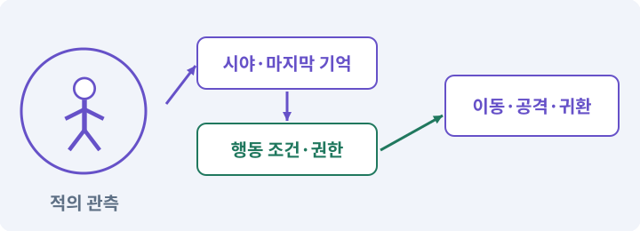

# 136. 방패병과 화염술사 정예 추가하기

**목표:** 정면·측면·거리 선택이 중요해집니다.

**시작 상태:** 기존 세 적과 상태이상

## 한눈에 보는 기능의 흐름

방패병 정면 → 측면 약점 → 화염술사 거리 → 기존 공격권



**경계:** 정예 효과가 죽음 뒤 남지 않기

그림은 실제 게임 실행 결과가 아닙니다. 값·규칙과 예제를 필요한 때 펼쳐 읽고 현재 단계의 메시지를 한 번씩 보냅니다.

## 1. 지금 상태 확인하기

첫 메시지를 보내 현재 준비 상태를 확인합니다. AI가 읽어 온 실제 프로젝트가 맞는지 보고, 없는 준비나 다른 상태가 있으면 먼저 알려 주세요. 아직 기능을 만들지 않는 단계입니다.

### AI에게 보낼 요구와 이유

#### 01. 작업 대상부터 확인

**“방패병과 화염술사 정예 추가하기” 작업을 시작하기 전에 현재 상태를 읽기 전용으로 확인해 줘.**

왜 이렇게 요청하나요? AI가 다른 프로젝트나 오래된 예제를 보고 작업할 수 있습니다. 실제 경로·파일·현재 기능을 읽게 하면 지금 이어서 작업할 대상을 먼저 맞출 수 있습니다.

#### 02. 작업 대상부터 확인

**필요한 시작 상태는 기존 세 적과 상태이상야.**

왜 이렇게 요청하나요? AI가 다른 프로젝트나 오래된 예제를 보고 작업할 수 있습니다. 실제 경로·파일·현재 기능을 읽게 하면 지금 이어서 작업할 대상을 먼저 맞출 수 있습니다.

#### 03. 실제 사용 중인 구현 재사용

**실제 프로젝트와 작업 기록을 읽고 이것이 준비되어 있는지, 이미 같은 기능이 있는지 확인해 줘.**

왜 이렇게 요청하나요? 이름이 비슷한 새 클래스를 또 만들면 기존 화면은 여전히 옛 코드를 사용할 수 있습니다. 실제 호출되는 진입점을 찾아 연결해야 두 구현이 충돌하거나 수정이 반영되지 않는 문제를 막습니다.

#### 04. 현재 상태와 다음 확인 지점 구분

**이번 기능이 연결될 실제 파일·화면·도구와 보존할 기존 동작을 짧게 정리해 줘.**

왜 이렇게 요청하나요? 이미 준비된 기능과 아직 확인하지 못한 기능을 섞으면 불필요한 재설치나 성급한 완료 판정이 생깁니다. 현재 대상과 남은 준비를 나눠 가장 작은 다음 작업을 선택하게 합니다.

#### 05. 조사 단계에서 변경하지 않기

**아직 새 구현·설치·유료 호출·파일 변경은 하지 마.**

왜 이렇게 요청하나요? 현재 상태를 알아보기만 할 때 파일 변경이나 결제가 시작되면 검토 전의 환경이 바뀝니다. 준비 확인과 실제 구현을 나눠 되돌리기 어려운 작업이 먼저 실행되지 않게 합니다.

#### 06. 막힌 준비를 먼저 해결

**준비가 다르면 부족한 항목과 다음에 필요한 작업을 알려 줘.**

왜 이렇게 요청하나요? 빠진 파일·권한·패키지를 있다고 가정하면 다음 구현이 엉뚱한 대상을 만들게 됩니다. 무엇이 없고 무엇을 먼저 해야 하는지 분리하면 불필요한 재작업을 줄일 수 있습니다.

<details>
<summary>보낼 원문 전체 — 설명은 복사되지 않습니다</summary>

```text
“방패병과 화염술사 정예 추가하기” 작업을 시작하기 전에 현재 상태를 읽기 전용으로 확인해 줘.
필요한 시작 상태는 기존 세 적과 상태이상야. 실제 프로젝트와 작업 기록을 읽고 이것이 준비되어 있는지, 이미 같은 기능이 있는지 확인해 줘.
이번 기능이 연결될 실제 파일·화면·도구와 보존할 기존 동작을 짧게 정리해 줘. 아직 새 구현·설치·유료 호출·파일 변경은 하지 마. 준비가 다르면 부족한 항목과 다음에 필요한 작업을 알려 줘.
```

</details>

**기대 결과:** 두 정예의 차이와 공격·방어 규칙

### 직접 확인하기

1. AI가 읽은 실제 프로젝트 또는 도구 경로를 확인합니다.
2. 필수 준비가 없다면 문제 해결 요청을 보내고, 준비됐을 때 다음으로 갑니다.

## 2. 필요한 기능 만들기

준비가 확인되면 아래 요청을 보냅니다. AI가 파일·설정·실행을 맡습니다. 변경 범위나 비용 승인이 나오면 내용을 읽고 결정하세요.

### AI에게 보낼 요구와 이유

#### 01. 관찰 가능한 기준으로 확인

**내가 만든 하네스의 실제 경로와 현재 게임 후보를 확인하고 game-feature로 이 작업을 처리해 줘.**

왜 이렇게 요청하나요? 구현 완료라는 설명을 실제 결과로 바꾸기 위한 조건입니다. 요청에 나온 대상과 경계 상황을 확인해 정상 결과뿐 아니라 실패를 어떻게 구분했는지도 남깁니다.

#### 02. 구현과 판정의 책임 나누기

**필요한 담당 역할만 고르고 구현·QA·독립 검토를 분리해 줘.**

왜 이렇게 요청하나요? 구현자가 자신의 설명만으로 완료를 결정하면 놓친 가정을 그대로 통과시킬 수 있습니다. 원래 요구·실제 변경·테스트를 다른 관점에서 검토하고 쓰기 권한을 나눕니다.

#### 03. 작성한 도구를 실제로 사용

**변경안·승인한 후보·Unity 통합·현재 소스 검사를 실제로 연결하고, 참고 완성본으로 우회하지 마.**

왜 이렇게 요청하나요? 참고 완성본으로 몰래 실행하면 현재 만든 하네스의 누락이나 오류가 드러나지 않습니다. 실행 경로를 확인해 지금 개발한 도구가 작업과 검사를 수행하도록 합니다.

#### 04. 전투 단계 전환을 한 번씩 처리

**기존 적 AI에 방패병과 화염술사 정예 변형을 추가해 줘.**

왜 이렇게 요청하나요? 큰 피해·취소·사망으로 단계를 건너뛰거나 여러 조건이 함께 참이 되면 공격이 겹칠 수 있습니다. 진입·종료·보상을 분리해 끝난 단계의 예약이 남지 않도록 합니다.

#### 05. 적이 아는 정보에 맞춰 행동

**기존 센서·기억·이동·공격 권한을 재사용하고 플레이어 전체 위치를 직접 읽는 치팅 추적은 넣지 마.**

왜 이렇게 요청하나요? 적이 플레이어의 실제 위치를 항상 읽으면 벽 뒤에 숨는 행동에 의미가 없습니다. 감지·기억·추적·귀환을 나눠 실제 관측 정보가 행동을 결정하게 합니다.

#### 06. 상태이상·DoT·중첩의 적용 조건

**방패병은 정면90도 직접 피해50% 감소, 회복 구간과 DoT에는 감소 없음으로 시작해 줘.**

왜 이렇게 요청하나요? 상태이상은 일정 시간 동안 대상에게 적용되는 규칙입니다. DoT는 일정 간격마다 발생하는 지속 피해이며, 중첩은 같은 효과를 여러 번 받았을 때의 결합 방식입니다. 중첩은 항상 단순 더하기가 아닙니다. 최대 수·새로고침·강한 효과 우선 등을 명시합니다.

#### 07. 상태 효과의 발생 원인과 수명 구분

**화염 투사체는 벽과 충돌하고 직접 적중 시 화상을 한 번 적용해 줘.**

왜 이렇게 요청하나요? 지속 피해가 직접 공격용 효과를 다시 발생시키면 연쇄 피해나 무한 발동이 생길 수 있습니다. 피해 출처·적용 시간·중첩·해제 조건을 구분해 전투 조합이 의도한 횟수로 작동하게 합니다.

#### 08. 관찰 가능한 기준으로 확인

**새 상태에서 사망·취소·풀 반환 시 공격 권한을 반드시 반환하고 실제 조합 전투를 검사해 줘.**

왜 이렇게 요청하나요? 구현 완료라는 설명을 실제 결과로 바꾸기 위한 조건입니다. 요청에 나온 대상과 경계 상황을 확인해 정상 결과뿐 아니라 실패를 어떻게 구분했는지도 남깁니다.

#### 09. 아래 항목을 완료 조건으로 사용

**이 기능의 규칙:**

왜 이렇게 요청하나요? 요구사항의 목록은 AI에게 참고 설명을 주는 것이 아니라 완료를 판단할 기준을 정합니다. 구현 뒤 각 항목을 실제 입력과 결과에 대응시켜 빠진 조건을 찾습니다.

#### 10. 전투 단계 전환을 한 번씩 처리

**같은 몬스터의 체력만 늘리는 대신 ‘방패병’과 ‘화염술사’ 두 정예 속성을 만든다.**

왜 이렇게 요청하나요? 큰 피해·취소·사망으로 단계를 건너뛰거나 여러 조건이 함께 참이 되면 공격이 겹칠 수 있습니다. 진입·종료·보상을 분리해 끝난 단계의 예약이 남지 않도록 합니다.

#### 11. 구현할 결과와 조건 고정

**방패병은 정면 90도에서 직접 피해를 절반으로 줄이고, 공격 뒤 회복 구간에는 방어하지 못한다.**

왜 이렇게 요청하나요? “방패병은 정면 90도에서 직접 피해를 절반으로 줄이고, 공격 뒤 회복 구간에는 방어하지 못한다”를 명시하면 AI가 무엇을 구현하거나 검사해야 하는지 범위를 좁힐 수 있습니다. 정면·측면·거리 선택이 중요해집니다. 이 결과를 확인할 때 이 조건이 실제로 반영됐는지 함께 봅니다.

#### 12. 상태이상·DoT·중첩의 적용 조건

**DoT는 방향 방어를 받지 않는다.**

왜 이렇게 요청하나요? 상태이상은 일정 시간 동안 대상에게 적용되는 규칙입니다. DoT는 일정 간격마다 발생하는 지속 피해이며, 중첩은 같은 효과를 여러 번 받았을 때의 결합 방식입니다. 중첩은 항상 단순 더하기가 아닙니다. 최대 수·새로고침·강한 효과 우선 등을 명시합니다.

#### 13. 투사체가 맞을 대상과 무시할 대상 구분

**화염술사는 회피 가능한 화상 투사체를 쏘며 벽 너머에서 플레이어 위치를 계속 추적하지 않는다.**

왜 이렇게 요청하나요? 생성 직후 자신의 몸에 맞거나 다른 투사체와 충돌하면 실제 표적까지 가지 못합니다. 대상·환경·발사자의 충돌 관계를 정하고 실제 충돌과 사거리 종료를 검사하게 합니다.

#### 14. 전투 단계 전환을 한 번씩 처리

**정예는 기존 AI의 센서·기억·이동·공격 예약을 재사용한다.**

왜 이렇게 요청하나요? 큰 피해·취소·사망으로 단계를 건너뛰거나 여러 조건이 함께 참이 되면 공격이 겹칠 수 있습니다. 진입·종료·보상을 분리해 끝난 단계의 예약이 남지 않도록 합니다.

#### 15. 적이 아는 정보에 맞춰 행동

**몸집과 스프라이트를 키워도 몸체·시야·사거리까지 자동 확장하지 않는다.**

왜 이렇게 요청하나요? 적이 플레이어의 실제 위치를 항상 읽으면 벽 뒤에 숨는 행동에 의미가 없습니다. 감지·기억·추적·귀환을 나눠 실제 관측 정보가 행동을 결정하게 합니다.

#### 16. 여러 적의 자원과 압박 관리

**전투 감독은 한 방에 정예 최대 2마리, 기존 동시 공격 권한을 유지하는 것으로 시작한다.**

왜 이렇게 요청하나요? 모든 적이 같은 위치에서 동시에 공격하면 겹침과 피하기 어려운 몰아치기가 생깁니다. 접근·공격 권한을 나누고 사망·취소 때 반환해야 남은 적도 계속 행동할 수 있습니다.

#### 17. 비교할 조건 고정

**숫자는 플레이테스트에서 조정할 설계값이다.**

왜 이렇게 요청하나요? 여러 수치와 화면을 동시에 바꾸면 어떤 선택이 전투를 바꿨는지 알기 어렵습니다. 같은 조건에서 한 요소씩 조정하고 조작 실수·규칙 오류·주관적인 재미를 따로 관찰합니다.

#### 18. 구현할 결과와 조건 고정

**첫 구현에서는 속성을 무제한 조합하지 않는다.**

왜 이렇게 요청하나요? “첫 구현에서는 속성을 무제한 조합하지 않는다”를 명시하면 AI가 무엇을 구현하거나 검사해야 하는지 범위를 좁힐 수 있습니다. 정면·측면·거리 선택이 중요해집니다. 이 결과를 확인할 때 이 조건이 실제로 반영됐는지 함께 봅니다.

#### 19. 기존 결과를 보호

**방패+화염이 동시에 붙는 적은 제외해 판정과 표시를 읽기 쉽게 유지한다.**

왜 이렇게 요청하나요? 새 작업이 이미 정상인 기능이나 자산까지 바꾸면 원인을 추적하기 어렵습니다. 유지할 대상을 명시해 변경 전후를 비교하고 원치 않은 영향을 찾습니다.

#### 20. 공격이 끝난 뒤 권한과 예약 정리

**사망·공격 취소·비활성화·풀 반환에서 공격 권한과 예약 투사체를 정리한다.**

왜 이렇게 요청하나요? 행동할 수 없거나 취소된 적에게 접근 권한과 예약 공격이 남으면 다른 적이 공격하지 못하거나 죽은 적이 피해를 줄 수 있습니다. 공격이 실제로 끝나는 수명주기에서 한 번 정리합니다.

#### 21. 구현과 실행은 AI에게 맡기기

**코드·설정·파일 생성·실행은 네가 맡고, 필요한 화면과 결과를 보여 줘.**

왜 이렇게 요청하나요? 설명이나 코드 조각만 받으면 실제 파일 생성·연결·실행이 빠질 수 있습니다. AI가 개발 작업까지 수행하고, 사람은 요구·승인·결과 판단을 맡도록 역할을 분명히 합니다.

#### 22. 막힌 준비를 먼저 해결

**수행하지 못한 작업과 필요한 승인·도구 연결은 구분해서 알려 줘.**

왜 이렇게 요청하나요? 빠진 파일·권한·패키지를 있다고 가정하면 다음 구현이 엉뚱한 대상을 만들게 됩니다. 무엇이 없고 무엇을 먼저 해야 하는지 분리하면 불필요한 재작업을 줄일 수 있습니다.

#### 23. 이동 감속과 공격 수명주기 구분

**감속 종료는 이동 배율만 복구하고 정상 진행 중인 공격을 중단하거나 공격 권한을 반환하지 마.**

왜 이렇게 요청하나요? 감속이 끝나는 것은 이동 속도가 돌아오는 사건이지 적이 죽거나 공격을 취소한 사건이 아닙니다. 관계없는 공격 예약까지 지우면 감속 해제 시점에 공격이 사라지는 문제가 생깁니다.

<details>
<summary>보낼 원문 전체 — 설명은 복사되지 않습니다</summary>

```text
내가 만든 하네스의 실제 경로와 현재 게임 후보를 확인하고 game-feature로 이 작업을 처리해 줘. 필요한 담당 역할만 고르고 구현·QA·독립 검토를 분리해 줘. 변경안·승인한 후보·Unity 통합·현재 소스 검사를 실제로 연결하고, 참고 완성본으로 우회하지 마.

기존 적 AI에 방패병과 화염술사 정예 변형을 추가해 줘.
기존 센서·기억·이동·공격 권한을 재사용하고 플레이어 전체 위치를 직접 읽는 치팅 추적은 넣지 마.
방패병은 정면90도 직접 피해50% 감소, 회복 구간과 DoT에는 감소 없음으로 시작해 줘.
화염 투사체는 벽과 충돌하고 직접 적중 시 화상을 한 번 적용해 줘.
새 상태에서 사망·취소·풀 반환 시 공격 권한을 반드시 반환하고 실제 조합 전투를 검사해 줘.

이 기능의 규칙:
같은 몬스터의 체력만 늘리는 대신 ‘방패병’과 ‘화염술사’ 두 정예 속성을 만든다. 방패병은 정면 90도에서 직접 피해를 절반으로 줄이고, 공격 뒤 회복 구간에는 방어하지 못한다. DoT는 방향 방어를 받지 않는다. 화염술사는 회피 가능한 화상 투사체를 쏘며 벽 너머에서 플레이어 위치를 계속 추적하지 않는다.

정예는 기존 AI의 센서·기억·이동·공격 예약을 재사용한다. 몸집과 스프라이트를 키워도 몸체·시야·사거리까지 자동 확장하지 않는다. 전투 감독은 한 방에 정예 최대 2마리, 기존 동시 공격 권한을 유지하는 것으로 시작한다. 숫자는 플레이테스트에서 조정할 설계값이다.

첫 구현에서는 속성을 무제한 조합하지 않는다. 방패+화염이 동시에 붙는 적은 제외해 판정과 표시를 읽기 쉽게 유지한다. 사망·공격 취소·비활성화·풀 반환에서 공격 권한과 예약 투사체를 정리한다.

코드·설정·파일 생성·실행은 네가 맡고, 필요한 화면과 결과를 보여 줘. 수행하지 못한 작업과 필요한 승인·도구 연결은 구분해서 알려 줘.

감속 종료는 이동 배율만 복구하고 정상 진행 중인 공격을 중단하거나 공격 권한을 반환하지 마.
```

</details>

**기대 결과:** 확인할 결과: 정예 역할과 원본 AI 보존을 확인함. AI가 이 상태를 확인할 실제 화면과 변경 내용을 준비합니다. 아직 실행하지 못한 부분은 따로 표시합니다.

### 직접 확인하기

1. 제안서만 반환됐다면 “설명으로 끝내지 말고 승인한 범위의 실제 작업을 수행해 줘”라고 보냅니다.
2. 코드나 설정을 직접 고치라는 안내가 나오면 “작성과 실행은 네가 맡아 줘”라고 요청합니다.

## 3. 결과를 직접 확인하기

먼저 확인 요청을 보내 AI가 검사와 화면을 준비하게 하세요. 그다음 아래 동작을 하나씩 확인합니다.

### AI에게 보낼 요구와 이유

#### 01. 검사할 입력과 관찰 지점 준비

**방금 구현한 기능의 자동 검사와 확인 화면을 준비해 줘.**

왜 이렇게 요청하나요? 정상 예 하나만 보면 실패 조건을 놓치기 쉽습니다. 정상·경계·반례를 실제 입력으로 준비하고 사람이 볼 화면도 맞춰 확인 범위를 분명하게 합니다.

#### 02. 결과를 재확인할 근거 남기기

**정상 동작과 아래 실패 조건을 실제로 검사하고 대상·실행 수·결과를 보여 줘.**

왜 이렇게 요청하나요? “잘 됩니다”라는 요약만으로는 어떤 입력과 버전을 검사했는지 알 수 없습니다. 대상·실행 수·실패 내용·파일을 함께 남겨 같은 조건으로 다시 확인할 수 있게 합니다.

#### 03. 상태이상·DoT·중첩의 적용 조건

**방패 앞·옆·뒤·회복 구간·DoT의 피해가 계약대로 다르다.**

왜 이렇게 요청하나요? 상태이상은 일정 시간 동안 대상에게 적용되는 규칙입니다. DoT는 일정 간격마다 발생하는 지속 피해이며, 중첩은 같은 효과를 여러 번 받았을 때의 결합 방식입니다. 중첩은 항상 단순 더하기가 아닙니다. 최대 수·새로고침·강한 효과 우선 등을 명시합니다.

#### 04. 한 공격의 피해 중복 방지

**같은 투사체가 콜라이더 여러 개에 닿아도 화상이 중복 적용되지 않는다.**

왜 이렇게 요청하나요? 한 적에 여러 피격 영역이 있거나 여러 프레임에서 겹치면 같은 공격이 반복 적용될 수 있습니다. 공격과 대상을 식별해 허용한 타격 횟수만 처리합니다.

#### 05. 전투 단계 전환을 한 번씩 처리

**정예가 죽은 뒤 다른 적이 공격 권한을 계속 받을 수 있다.**

왜 이렇게 요청하나요? 큰 피해·취소·사망으로 단계를 건너뛰거나 여러 조건이 함께 참이 되면 공격이 겹칠 수 있습니다. 진입·종료·보상을 분리해 끝난 단계의 예약이 남지 않도록 합니다.

#### 06. 적이 아는 정보에 맞춰 행동

**벽 뒤로 숨으면 마지막 목격 정보만 사용하며 실제 새 위치를 즉시 추적하지 않는다.**

왜 이렇게 요청하나요? 적이 플레이어의 실제 위치를 항상 읽으면 벽 뒤에 숨는 행동에 의미가 없습니다. 감지·기억·추적·귀환을 나눠 실제 관측 정보가 행동을 결정하게 합니다.

#### 07. 사람 검사의 시작점 준비

**내가 조작해야 하는 부분은 실행할 화면과 시작 상태를 준비해 줘.**

왜 이렇게 요청하나요? 같은 기능이라도 시작 상태가 다르면 관찰 결과가 달라집니다. AI가 실행 화면과 재현 위치를 먼저 준비해야 사람이 이동·공격·소리·조작감을 같은 조건에서 확인할 수 있습니다.

#### 08. 사람이 실제로 본 것만 기록

**연결되지 않은 휴대폰의 터치나 사람이 보지 않은 재미·소리 품질을 대신 확인했다고 하지 마.**

왜 이렇게 요청하나요? AI가 준비한 검사와 사람이 직접 플레이하거나 들은 결과는 다른 근거입니다. 관찰하지 않은 조작감·소리·실기기 결과를 임의로 완료 처리하지 않게 합니다.

#### 09. 실제로 실행한 검사만 인정

**테스트 0개와 예전 소스 결과는 현재 성공으로 쓰지 마.**

왜 이렇게 요청하나요? 실행된 검사가 없거나 같은 결과를 중복 집계한 경우는 기능을 확인한 것이 아닙니다. 실행 수와 개별 결과를 함께 확인해야 형식적인 성공 표시를 걸러낼 수 있습니다.

<details>
<summary>보낼 원문 전체 — 설명은 복사되지 않습니다</summary>

```text
방금 구현한 기능의 자동 검사와 확인 화면을 준비해 줘. 정상 동작과 아래 실패 조건을 실제로 검사하고 대상·실행 수·결과를 보여 줘.

방패 앞·옆·뒤·회복 구간·DoT의 피해가 계약대로 다르다.

 같은 투사체가 콜라이더 여러 개에 닿아도 화상이 중복 적용되지 않는다.

 정예가 죽은 뒤 다른 적이 공격 권한을 계속 받을 수 있다.

 벽 뒤로 숨으면 마지막 목격 정보만 사용하며 실제 새 위치를 즉시 추적하지 않는다.

내가 조작해야 하는 부분은 실행할 화면과 시작 상태를 준비해 줘. 연결되지 않은 휴대폰의 터치나 사람이 보지 않은 재미·소리 품질을 대신 확인했다고 하지 마. 테스트 0개와 예전 소스 결과는 현재 성공으로 쓰지 마.
```

</details>

**기대 결과:** 정예 역할과 원본 AI 보존을 확인함

### 직접 확인하기

1. 방패병의 앞과 옆에서 공격합니다.
2. 화염술사와 거구 조합을 상대합니다.
3. 정예 사망 후 공격권과 보상이 정리되는지 봅니다.

## 4. 결과를 남기고 마무리하기

실제로 본 결과를 아래 메모에 적고 AI에 전달합니다. 결과 저장 요청으로 현재 상태를 남긴 뒤 다음 페이지로 갑니다.

### AI에게 보낼 요구와 이유

#### 01. 결과를 재확인할 근거 남기기

**지금 작업한 “방패병과 화염술사 정예 추가하기”의 실제 결과를 정리해 줘.**

왜 이렇게 요청하나요? “잘 됩니다”라는 요약만으로는 어떤 입력과 버전을 검사했는지 알 수 없습니다. 대상·실행 수·실패 내용·파일을 함께 남겨 같은 조건으로 다시 확인할 수 있게 합니다.

#### 02. 다음 작업이 읽을 인수인계

**변경한 기능·파일·현재 후보와 실제 실행한 검사, 남은 문제를 기능 이름으로 기록해 줘.**

왜 이렇게 요청하나요? 새 AI 세션은 이전 대화 전체를 알고 있다고 보장할 수 없습니다. 현재 후보·파일 위치·실행한 검사·남은 일을 남겨야 같은 작업을 반복하지 않고 이어갈 수 있습니다.

#### 03. 사람이 실제로 본 것만 기록

**자동 검사 결과와 내가 직접 확인한 결과를 구분하고, 내 관찰이 아직 없으면 미확인으로 남겨 줘.**

왜 이렇게 요청하나요? AI가 준비한 검사와 사람이 직접 플레이하거나 들은 결과는 다른 근거입니다. 관찰하지 않은 조작감·소리·실기기 결과를 임의로 완료 처리하지 않게 합니다.

#### 04. 다음 작업이 읽을 인수인계

**재시작하거나 다음 작업에서 읽을 기록의 실제 위치를 알려 줘.**

왜 이렇게 요청하나요? 새 AI 세션은 이전 대화 전체를 알고 있다고 보장할 수 없습니다. 현재 후보·파일 위치·실행한 검사·남은 일을 남겨야 같은 작업을 반복하지 않고 이어갈 수 있습니다.

#### 05. 미확인을 완료와 분리

**아직 확인하지 않은 결과를 완료로 채우지 마.**

왜 이렇게 요청하나요? 만들어진 것, 검사에 실패한 것, 아직 확인하지 못한 것을 나눠야 다음 작업을 정확히 고를 수 있습니다. 실행할 조건이 없는 기능을 성공으로 기록하면 뒤에서 원인을 찾기 어려워집니다.

<details>
<summary>보낼 원문 전체 — 설명은 복사되지 않습니다</summary>

```text
지금 작업한 “방패병과 화염술사 정예 추가하기”의 실제 결과를 정리해 줘. 변경한 기능·파일·현재 후보와 실제 실행한 검사, 남은 문제를 기능 이름으로 기록해 줘.
자동 검사 결과와 내가 직접 확인한 결과를 구분하고, 내 관찰이 아직 없으면 미확인으로 남겨 줘. 재시작하거나 다음 작업에서 읽을 기록의 실제 위치를 알려 줘. 아직 확인하지 않은 결과를 완료로 채우지 마.
```

</details>

**기대 결과:** 현재 상태·검사 결과·남은 문제·다음에 읽을 기록을 확인할 수 있습니다.

### 직접 확인하기

1. 자동 검사와 내 관찰 결과가 섞이지 않았는지 봅니다.
2. 문제가 남았다면 해결 요청을 보내고 같은 동작을 다시 확인합니다.

## 문제가 있으면

### AI에게 보낼 요구와 이유

#### 01. 기존 결과를 보호

**원본 적 전체를 복사하지 말고 차이만 정의해 줘.**

왜 이렇게 요청하나요? 새 작업이 이미 정상인 기능이나 자산까지 바꾸면 원인을 추적하기 어렵습니다. 유지할 대상을 명시해 변경 전후를 비교하고 원치 않은 영향을 찾습니다.

#### 02. 구현할 결과와 조건 고정

**정면 판정과 시각 방향이 다른 순간을 재현해 줘.**

왜 이렇게 요청하나요? “정면 판정과 시각 방향이 다른 순간을 재현해 줘”를 명시하면 AI가 무엇을 구현하거나 검사해야 하는지 범위를 좁힐 수 있습니다. 정면·측면·거리 선택이 중요해집니다. 이 결과를 확인할 때 이 조건이 실제로 반영됐는지 함께 봅니다.

#### 03. 원인 하나를 좁혀 수정

**새 기능을 추가하지 말고 현재 오류와 실제 로그를 먼저 읽어 줘.**

왜 이렇게 요청하나요? 오류 수정 중 새 기능까지 넣으면 어떤 변경이 문제를 해결하거나 악화했는지 알기 어렵습니다. 원래 재현을 보존하고 작은 변경 뒤 같은 입력과 주변 정상 동작을 다시 확인합니다.

#### 04. 원인 하나를 좁혀 수정

**최소 수정 뒤 같은 재현과 관련 정상 동작을 다시 검사해 줘.**

왜 이렇게 요청하나요? 오류 수정 중 새 기능까지 넣으면 어떤 변경이 문제를 해결하거나 악화했는지 알기 어렵습니다. 원래 재현을 보존하고 작은 변경 뒤 같은 입력과 주변 정상 동작을 다시 확인합니다.

#### 05. 실패도 재현 자료로 보존

**실패 기록은 지우지 마.**

왜 이렇게 요청하나요? 실패한 입력과 로그가 있어야 같은 문제가 다시 생겼을 때 비교할 수 있습니다. 성공 기록으로 덮어쓰지 않고 전후 자료를 남기면 무엇을 고쳤는지 확인할 수 있습니다.

<details>
<summary>보낼 원문 전체 — 설명은 복사되지 않습니다</summary>

```text
원본 적 전체를 복사하지 말고 차이만 정의해 줘. 정면 판정과 시각 방향이 다른 순간을 재현해 줘.
새 기능을 추가하지 말고 현재 오류와 실제 로그를 먼저 읽어 줘. 최소 수정 뒤 같은 재현과 관련 정상 동작을 다시 검사해 줘. 실패 기록은 지우지 마.
```

</details>

## 새 세션에서 이어가기

### AI에게 보낼 요구와 이유

#### 01. 이어서 할 작업 식별

**“방패병과 화염술사 정예 추가하기” 작업을 이어가고 싶어.**

왜 이렇게 요청하나요? 이름으로 재개할 작업을 찾고, 뒤에 이어지는 요청으로 실제 파일·진행 중 작업·기록을 다시 읽게 합니다. 제목만 보고 이전 상태를 기억한다고 가정하지 않습니다.

#### 02. 조회는 상태를 바꾸지 않게

**실제 프로젝트와 내 도구의 작업 기록을 읽고 어디까지 구현·검사됐는지 확인해 줘.**

왜 이렇게 요청하나요? 진행 상황을 물을 때 새 구현이나 유료 호출이 시작되면 단순 확인이 실행 명령이 되어 버립니다. 저장된 근거를 읽어 완료·진행·승인 대기·미검증을 나누게 합니다.

#### 03. 재개 전 중복 작업 방지

**진행 중인 프로세스·승인·미저장 변경을 확인한 뒤 남은 가장 작은 작업부터 안내해 줘.**

왜 이렇게 요청하나요? 대화가 끊겨도 외부 작업은 끝났거나 아직 실행 중일 수 있습니다. 프로세스·승인·미저장 상태를 먼저 읽어 같은 생성·빌드·결제를 두 번 시작하지 않도록 합니다.

#### 04. 되돌아갈 원본 남기기

**기존 성공과 실패 기록은 보존해 줘.**

왜 이렇게 요청하나요? 새 구현이 실패해도 이전 게임과 저장을 복원할 수 있어야 합니다. 현재 내용을 먼저 조사하고 별도 후보에서 작업하면 실험이 유일한 정상본을 망가뜨리는 일을 피할 수 있습니다.

<details>
<summary>보낼 원문 전체 — 설명은 복사되지 않습니다</summary>

```text
“방패병과 화염술사 정예 추가하기” 작업을 이어가고 싶어. 실제 프로젝트와 내 도구의 작업 기록을 읽고 어디까지 구현·검사됐는지 확인해 줘. 진행 중인 프로세스·승인·미저장 변경을 확인한 뒤 남은 가장 작은 작업부터 안내해 줘. 기존 성공과 실패 기록은 보존해 줘.
```

</details>

## 왜 이렇게 만드는가

같은 몬스터의 체력만 늘리는 대신 ‘방패병’과 ‘화염술사’ 두 정예 속성을 만든다. 방패병은 정면 90도에서 직접 피해를 절반으로 줄이고, 공격 뒤 회복 구간에는 방어하지 못한다. DoT는 방향 방어를 받지 않는다. 화염술사는 회피 가능한 화상 투사체를 쏘며 벽 너머에서 플레이어 위치를 계속 추적하지 않는다.

정예는 기존 AI의 센서·기억·이동·공격 예약을 재사용한다. 몸집과 스프라이트를 키워도 몸체·시야·사거리까지 자동 확장하지 않는다. 전투 감독은 한 방에 정예 최대 2마리, 기존 동시 공격 권한을 유지하는 것으로 시작한다. 숫자는 플레이테스트에서 조정할 설계값이다.

## 공식 참고

