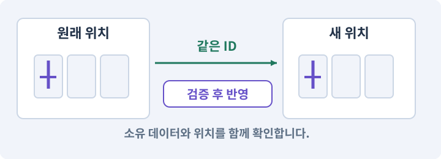

# 141. 소켓 한 칸에 룬 장착하기

**목표:** 룬을 뺐을 때 능력치가 원래대로 돌아옵니다.

**시작 상태:** 거래·창고·능력치 재계산

## 한눈에 보는 기능의 흐름

장비의 소켓 → 룬 삽입·해제 → 원본에서 재계산 → 발동 출처 구분



**경계:** 교체할 때마다 능력치가 더해지지 않기

그림은 실제 게임 실행 결과가 아닙니다. 값·규칙과 예제를 필요한 때 펼쳐 읽고 현재 단계의 메시지를 한 번씩 보냅니다.

## 1. 지금 상태 확인하기

첫 메시지를 보내 현재 준비 상태를 확인합니다. AI가 읽어 온 실제 프로젝트가 맞는지 보고, 없는 준비나 다른 상태가 있으면 먼저 알려 주세요. 아직 기능을 만들지 않는 단계입니다.

### AI에게 보낼 요구와 이유

#### 01. 소유 데이터와 룬의 적용 위치를 명확히

**“소켓 한 칸에 룬 장착하기” 작업을 시작하기 전에 현재 상태를 읽기 전용으로 확인해 줘.**

왜 이렇게 요청하나요? 룬이 가방과 장비 양쪽에 존재하거나 장착할 때마다 보너스가 누적되면 소유권과 능력치가 어긋납니다. 장착 위치·룬 ID·재계산 규칙을 함께 정해 이동과 효과를 분리합니다.

#### 02. 작업 대상부터 확인

**필요한 시작 상태는 거래·창고·능력치 재계산야.**

왜 이렇게 요청하나요? AI가 다른 프로젝트나 오래된 예제를 보고 작업할 수 있습니다. 실제 경로·파일·현재 기능을 읽게 하면 지금 이어서 작업할 대상을 먼저 맞출 수 있습니다.

#### 03. 실제 사용 중인 구현 재사용

**실제 프로젝트와 작업 기록을 읽고 이것이 준비되어 있는지, 이미 같은 기능이 있는지 확인해 줘.**

왜 이렇게 요청하나요? 이름이 비슷한 새 클래스를 또 만들면 기존 화면은 여전히 옛 코드를 사용할 수 있습니다. 실제 호출되는 진입점을 찾아 연결해야 두 구현이 충돌하거나 수정이 반영되지 않는 문제를 막습니다.

#### 04. 현재 상태와 다음 확인 지점 구분

**이번 기능이 연결될 실제 파일·화면·도구와 보존할 기존 동작을 짧게 정리해 줘.**

왜 이렇게 요청하나요? 이미 준비된 기능과 아직 확인하지 못한 기능을 섞으면 불필요한 재설치나 성급한 완료 판정이 생깁니다. 현재 대상과 남은 준비를 나눠 가장 작은 다음 작업을 선택하게 합니다.

#### 05. 조사 단계에서 변경하지 않기

**아직 새 구현·설치·유료 호출·파일 변경은 하지 마.**

왜 이렇게 요청하나요? 현재 상태를 알아보기만 할 때 파일 변경이나 결제가 시작되면 검토 전의 환경이 바뀝니다. 준비 확인과 실제 구현을 나눠 되돌리기 어려운 작업이 먼저 실행되지 않게 합니다.

#### 06. 막힌 준비를 먼저 해결

**준비가 다르면 부족한 항목과 다음에 필요한 작업을 알려 줘.**

왜 이렇게 요청하나요? 빠진 파일·권한·패키지를 있다고 가정하면 다음 구현이 엉뚱한 대상을 만들게 됩니다. 무엇이 없고 무엇을 먼저 해야 하는지 분리하면 불필요한 재작업을 줄일 수 있습니다.

<details>
<summary>보낼 원문 전체 — 설명은 복사되지 않습니다</summary>

```text
“소켓 한 칸에 룬 장착하기” 작업을 시작하기 전에 현재 상태를 읽기 전용으로 확인해 줘.
필요한 시작 상태는 거래·창고·능력치 재계산야. 실제 프로젝트와 작업 기록을 읽고 이것이 준비되어 있는지, 이미 같은 기능이 있는지 확인해 줘.
이번 기능이 연결될 실제 파일·화면·도구와 보존할 기존 동작을 짧게 정리해 줘. 아직 새 구현·설치·유료 호출·파일 변경은 하지 마. 준비가 다르면 부족한 항목과 다음에 필요한 작업을 알려 줘.
```

</details>

**기대 결과:** 호환 장비와 룬 효과·거래 규칙

### 직접 확인하기

1. AI가 읽은 실제 프로젝트 또는 도구 경로를 확인합니다.
2. 필수 준비가 없다면 문제 해결 요청을 보내고, 준비됐을 때 다음으로 갑니다.

## 2. 필요한 기능 만들기

준비가 확인되면 아래 요청을 보냅니다. AI가 파일·설정·실행을 맡습니다. 변경 범위나 비용 승인이 나오면 내용을 읽고 결정하세요.

### AI에게 보낼 요구와 이유

#### 01. 관찰 가능한 기준으로 확인

**내가 만든 하네스의 실제 경로와 현재 게임 후보를 확인하고 game-feature로 이 작업을 처리해 줘.**

왜 이렇게 요청하나요? 구현 완료라는 설명을 실제 결과로 바꾸기 위한 조건입니다. 요청에 나온 대상과 경계 상황을 확인해 정상 결과뿐 아니라 실패를 어떻게 구분했는지도 남깁니다.

#### 02. 구현과 판정의 책임 나누기

**필요한 담당 역할만 고르고 구현·QA·독립 검토를 분리해 줘.**

왜 이렇게 요청하나요? 구현자가 자신의 설명만으로 완료를 결정하면 놓친 가정을 그대로 통과시킬 수 있습니다. 원래 요구·실제 변경·테스트를 다른 관점에서 검토하고 쓰기 권한을 나눕니다.

#### 03. 작성한 도구를 실제로 사용

**변경안·승인한 후보·Unity 통합·현재 소스 검사를 실제로 연결하고, 참고 완성본으로 우회하지 마.**

왜 이렇게 요청하나요? 참고 완성본으로 몰래 실행하면 현재 만든 하네스의 누락이나 오류가 드러나지 않습니다. 실행 경로를 확인해 지금 개발한 도구가 작업과 검사를 수행하도록 합니다.

#### 04. 소유 데이터와 룬의 적용 위치를 명확히

**무기/갑옷 한 칸 소켓과 불씨·서리·수호 룬을 추가해 줘.**

왜 이렇게 요청하나요? 룬이 가방과 장비 양쪽에 존재하거나 장착할 때마다 보너스가 누적되면 소유권과 능력치가 어긋납니다. 장착 위치·룬 ID·재계산 규칙을 함께 정해 이동과 효과를 분리합니다.

#### 05. 거래·보상의 전체 성공 보장

**호환성과 비용을 명세 데이터에서 읽고 삽입·제거는 기존 거래 서비스에 통합해 줘.**

왜 이렇게 요청하나요? 재료 차감과 결과 지급이 따로 성공하면 손해나 복제가 생깁니다. 조건을 먼저 검사하고 한 거래로 반영하며 같은 요청을 다시 받아도 두 번 지급하지 않게 합니다.

#### 06. 소유 데이터와 룬의 적용 위치를 명확히

**장신구·두 번째 소켓·룬워드는 추가하지 마.**

왜 이렇게 요청하나요? 룬이 가방과 장비 양쪽에 존재하거나 장착할 때마다 보너스가 누적되면 소유권과 능력치가 어긋납니다. 장착 위치·룬 ID·재계산 규칙을 함께 정해 이동과 효과를 분리합니다.

#### 07. 전투 수치를 한 규칙으로 계산

**수호 룬은 최대체력만 재계산하고 현재체력을 회복시키지 마.**

왜 이렇게 요청하나요? 표시와 실제 피해 계산이 다르면 장비·레벨·스킬 효과를 믿을 수 없습니다. 경계값과 사망·회복 조건을 명확히 정하고 숫자와 체력바를 함께 비교합니다.

#### 08. 상태 효과의 발생 원인과 수명 구분

**플레이어 무기의 직접 타격만 불씨/서리 룬을 발동시키며 DoT·환경·동료 공격의 재귀는 막아 줘.**

왜 이렇게 요청하나요? 지속 피해가 직접 공격용 효과를 다시 발생시키면 연쇄 피해나 무한 발동이 생길 수 있습니다. 피해 출처·적용 시간·중첩·해제 조건을 구분해 전투 조합이 의도한 횟수로 작동하게 합니다.

#### 09. 종료 이후의 상태까지 확인

**100회 착탈·저장 복원·중복 이벤트 검사를 QA가 독립적으로 작성하게 해 줘.**

왜 이렇게 요청하나요? 현재 화면에서 맞는 값도 저장하거나 다시 구성할 때 빠질 수 있습니다. 실제 종료·불러오기 전후에 ID·옵션·장착·진행을 비교해야 유지되는 범위를 확인할 수 있습니다.

#### 10. 아래 항목을 완료 조건으로 사용

**이 기능의 규칙:**

왜 이렇게 요청하나요? 요구사항의 목록은 AI에게 참고 설명을 주는 것이 아니라 완료를 판단할 기준을 정합니다. 구현 뒤 각 항목을 실제 입력과 결과에 대응시켜 빠진 조건을 찾습니다.

#### 11. 장착 결과를 원본에서 재계산

**무기와 갑옷에 최대 한 칸의 소켓만 허용한다.**

왜 이렇게 요청하나요? 현재 능력치에 보너스를 계속 더하고 빼면 중복 이벤트나 저장 복원에서 오차가 쌓일 수 있습니다. 기본값과 현재 장착 상태에서 다시 계산해야 해제 후 원래 수치로 돌아옵니다.

#### 12. 상태 효과의 발생 원인과 수명 구분

**불씨 룬은 무기의 직접 타격으로 화상을, 서리 룬은 무기의 직접 타격으로 냉기를 적용한다.**

왜 이렇게 요청하나요? 지속 피해가 직접 공격용 효과를 다시 발생시키면 연쇄 피해나 무한 발동이 생길 수 있습니다. 피해 출처·적용 시간·중첩·해제 조건을 구분해 전투 조합이 의도한 횟수로 작동하게 합니다.

#### 13. 전투 수치를 한 규칙으로 계산

**수호 룬은 갑옷의 최대 체력10을 더한다.**

왜 이렇게 요청하나요? 표시와 실제 피해 계산이 다르면 장비·레벨·스킬 효과를 믿을 수 없습니다. 경계값과 사망·회복 조건을 명확히 정하고 숫자와 체력바를 함께 비교합니다.

#### 14. 소켓 적용 장비 범위

**현재 소켓 규칙은 무기와 갑옷에만 적용하고 장신구에는 적용하지 않는다.**

왜 이렇게 요청하나요? 한 번에 모든 슬롯과 조합을 늘리지 않도록 무기·갑옷만 소켓 대상으로 정합니다. 장신구의 기존 능력치와 소유 규칙은 유지합니다.

#### 15. 장착 결과를 원본에서 재계산

**세 룬은 재료처럼 별도 수량을 갖되 materialWallet과 runeWallet을 구분한다.**

왜 이렇게 요청하나요? 현재 능력치에 보너스를 계속 더하고 빼면 중복 이벤트나 저장 복원에서 오차가 쌓일 수 있습니다. 기본값과 현재 장착 상태에서 다시 계산해야 해제 후 원래 수치로 돌아옵니다.

#### 16. 거래·보상의 전체 성공 보장

**룬 레시피는 불씨=불씨2+가루2, 서리=불씨1+가루3, 수호=고철3+가루2로 정한다.**

왜 이렇게 요청하나요? 재료 차감과 결과 지급이 따로 성공하면 손해나 복제가 생깁니다. 조건을 먼저 검사하고 한 거래로 반영하며 같은 요청을 다시 받아도 두 번 지급하지 않게 합니다.

#### 17. 거래·보상의 전체 성공 보장

**기존 기본 장비 레시피3개와 합쳐 총6개다.**

왜 이렇게 요청하나요? 재료 차감과 결과 지급이 따로 성공하면 손해나 복제가 생깁니다. 조건을 먼저 검사하고 한 거래로 반영하며 같은 요청을 다시 받아도 두 번 지급하지 않게 합니다.

#### 18. 장착 결과를 원본에서 재계산

**제거 비용은 고철1이며 룬을 지갑으로 반환한다.**

왜 이렇게 요청하나요? 현재 능력치에 보너스를 계속 더하고 빼면 중복 이벤트나 저장 복원에서 오차가 쌓일 수 있습니다. 기본값과 현재 장착 상태에서 다시 계산해야 해제 후 원래 수치로 돌아옵니다.

#### 19. 실패의 시간·비용 상한 두기

**지갑 한도가 넘으면 제거 전체를 거부한다.**

왜 이렇게 요청하나요? 실패를 자동으로 반복하면 같은 원인으로 비용과 시간이 계속 들 수 있습니다. 종료·사용량·확인 불가 상태를 기록하고 정한 한도에서 멈춘 뒤 원인을 판단하게 합니다.

#### 20. 거래·보상의 전체 성공 보장

**룬이 든 장비의 분해는 금지해 환산·반환 규칙을 단순화한다.**

왜 이렇게 요청하나요? 재료 차감과 결과 지급이 따로 성공하면 손해나 복제가 생깁니다. 조건을 먼저 검사하고 한 거래로 반영하며 같은 요청을 다시 받아도 두 번 지급하지 않게 합니다.

#### 21. 같은 요청의 반복 처리 정의

**삽입·제거를 반복할 때 능력치를 계속 더하고 빼지 않는다.**

왜 이렇게 요청하나요? 클릭 연타·재연결·중복 이벤트는 개발과 플레이 중 모두 발생할 수 있습니다. 반복돼도 한 번 처리해야 하는 결과와 매번 새로 처리할 결과를 나눠 데이터가 누적되지 않게 합니다.

#### 22. 장착 결과를 원본에서 재계산

**기본 능력치+레벨+현재 장비+현재 룬의 합에서 재계산한다.**

왜 이렇게 요청하나요? 현재 능력치에 보너스를 계속 더하고 빼면 중복 이벤트나 저장 복원에서 오차가 쌓일 수 있습니다. 기본값과 현재 장착 상태에서 다시 계산해야 해제 후 원래 수치로 돌아옵니다.

#### 23. 전투 수치를 한 규칙으로 계산

**최대 체력 변화는 현재 체력을 새 최대치로 clamp할 뿐 회복시키지 않는다.**

왜 이렇게 요청하나요? 표시와 실제 피해 계산이 다르면 장비·레벨·스킬 효과를 믿을 수 없습니다. 경계값과 사망·회복 조건을 명확히 정하고 숫자와 체력바를 함께 비교합니다.

#### 24. 상태 효과의 발생 원인과 수명 구분

**룬 이벤트는 직접 타격만 듣고 DoT·환경·동료 공격에서 플레이어 룬이 발동하지 않는다.**

왜 이렇게 요청하나요? 지속 피해가 직접 공격용 효과를 다시 발생시키면 연쇄 피해나 무한 발동이 생길 수 있습니다. 피해 출처·적용 시간·중첩·해제 조건을 구분해 전투 조합이 의도한 횟수로 작동하게 합니다.

#### 25. 상태 효과의 발생 원인과 수명 구분

**룬은 ember(무기, 직접 타격 뒤 화상 적용, 불씨2·가루2), frost(무기, 직접 타격 뒤 냉기 적용, 불씨1·가루3), ward(갑옷, 최대HP+10, 고철3·가루2)다.**

왜 이렇게 요청하나요? 지속 피해가 직접 공격용 효과를 다시 발생시키면 연쇄 피해나 무한 발동이 생길 수 있습니다. 피해 출처·적용 시간·중첩·해제 조건을 구분해 전투 조합이 의도한 횟수로 작동하게 합니다.

#### 26. 소유 데이터와 룬의 적용 위치를 명확히

**장신구는 소켓이 없고 무기·갑옷 각각 한 칸이다.**

왜 이렇게 요청하나요? 룬이 가방과 장비 양쪽에 존재하거나 장착할 때마다 보너스가 누적되면 소유권과 능력치가 어긋납니다. 장착 위치·룬 ID·재계산 규칙을 함께 정해 이동과 효과를 분리합니다.

#### 27. 장착 결과를 원본에서 재계산

**제거 비용은 고철1, 제거한 룬은 지갑으로 반환해 줘.**

왜 이렇게 요청하나요? 현재 능력치에 보너스를 계속 더하고 빼면 중복 이벤트나 저장 복원에서 오차가 쌓일 수 있습니다. 기본값과 현재 장착 상태에서 다시 계산해야 해제 후 원래 수치로 돌아옵니다.

#### 28. 거래·보상의 전체 성공 보장

**한도 초과나 저장 실패에서는 거래 전체를 취소해 줘.**

왜 이렇게 요청하나요? 재료 차감과 결과 지급이 따로 성공하면 손해나 복제가 생깁니다. 조건을 먼저 검사하고 한 거래로 반영하며 같은 요청을 다시 받아도 두 번 지급하지 않게 합니다.

#### 29. 구현과 실행은 AI에게 맡기기

**코드·설정·파일 생성·실행은 네가 맡고, 필요한 화면과 결과를 보여 줘.**

왜 이렇게 요청하나요? 설명이나 코드 조각만 받으면 실제 파일 생성·연결·실행이 빠질 수 있습니다. AI가 개발 작업까지 수행하고, 사람은 요구·승인·결과 판단을 맡도록 역할을 분명히 합니다.

#### 30. 막힌 준비를 먼저 해결

**수행하지 못한 작업과 필요한 승인·도구 연결은 구분해서 알려 줘.**

왜 이렇게 요청하나요? 빠진 파일·권한·패키지를 있다고 가정하면 다음 구현이 엉뚱한 대상을 만들게 됩니다. 무엇이 없고 무엇을 먼저 해야 하는지 분리하면 불필요한 재작업을 줄일 수 있습니다.

<details>
<summary>보낼 원문 전체 — 설명은 복사되지 않습니다</summary>

```text
내가 만든 하네스의 실제 경로와 현재 게임 후보를 확인하고 game-feature로 이 작업을 처리해 줘. 필요한 담당 역할만 고르고 구현·QA·독립 검토를 분리해 줘. 변경안·승인한 후보·Unity 통합·현재 소스 검사를 실제로 연결하고, 참고 완성본으로 우회하지 마.

무기/갑옷 한 칸 소켓과 불씨·서리·수호 룬을 추가해 줘.
호환성과 비용을 명세 데이터에서 읽고 삽입·제거는 기존 거래 서비스에 통합해 줘.
장신구·두 번째 소켓·룬워드는 추가하지 마.
수호 룬은 최대체력만 재계산하고 현재체력을 회복시키지 마.
플레이어 무기의 직접 타격만 불씨/서리 룬을 발동시키며 DoT·환경·동료 공격의 재귀는 막아 줘.
100회 착탈·저장 복원·중복 이벤트 검사를 QA가 독립적으로 작성하게 해 줘.

이 기능의 규칙:
무기와 갑옷에 최대 한 칸의 소켓만 허용한다. 불씨 룬은 무기의 직접 타격으로 화상을, 서리 룬은 무기의 직접 타격으로 냉기를 적용한다. 수호 룬은 갑옷의 최대 체력10을 더한다. 현재 소켓 규칙은 무기와 갑옷에만 적용하고 장신구에는 적용하지 않는다. 세 룬은 재료처럼 별도 수량을 갖되 materialWallet과 runeWallet을 구분한다.

룬 레시피는 불씨=불씨2+가루2, 서리=불씨1+가루3, 수호=고철3+가루2로 정한다. 기존 기본 장비 레시피3개와 합쳐 총6개다. 제거 비용은 고철1이며 룬을 지갑으로 반환한다. 지갑 한도가 넘으면 제거 전체를 거부한다. 룬이 든 장비의 분해는 금지해 환산·반환 규칙을 단순화한다.

삽입·제거를 반복할 때 능력치를 계속 더하고 빼지 않는다. 기본 능력치+레벨+현재 장비+현재 룬의 합에서 재계산한다. 최대 체력 변화는 현재 체력을 새 최대치로 clamp할 뿐 회복시키지 않는다. 룬 이벤트는 직접 타격만 듣고 DoT·환경·동료 공격에서 플레이어 룬이 발동하지 않는다.

룬은 ember(무기, 직접 타격 뒤 화상 적용, 불씨2·가루2), frost(무기, 직접 타격 뒤 냉기 적용, 불씨1·가루3), ward(갑옷, 최대HP+10, 고철3·가루2)다. 장신구는 소켓이 없고 무기·갑옷 각각 한 칸이다. 제거 비용은 고철1, 제거한 룬은 지갑으로 반환해 줘. 한도 초과나 저장 실패에서는 거래 전체를 취소해 줘.

코드·설정·파일 생성·실행은 네가 맡고, 필요한 화면과 결과를 보여 줘. 수행하지 못한 작업과 필요한 승인·도구 연결은 구분해서 알려 줘.
```

</details>

**기대 결과:** 확인할 결과: 룬 거래·수치·발동 경계를 확인함. AI가 이 상태를 확인할 실제 화면과 변경 내용을 준비합니다. 아직 실행하지 못한 부분은 따로 표시합니다.

### 직접 확인하기

1. 제안서만 반환됐다면 “설명으로 끝내지 말고 승인한 범위의 실제 작업을 수행해 줘”라고 보냅니다.
2. 코드나 설정을 직접 고치라는 안내가 나오면 “작성과 실행은 네가 맡아 줘”라고 요청합니다.

## 3. 결과를 직접 확인하기

먼저 확인 요청을 보내 AI가 검사와 화면을 준비하게 하세요. 그다음 아래 동작을 하나씩 확인합니다.

### AI에게 보낼 요구와 이유

#### 01. 검사할 입력과 관찰 지점 준비

**방금 구현한 기능의 자동 검사와 확인 화면을 준비해 줘.**

왜 이렇게 요청하나요? 정상 예 하나만 보면 실패 조건을 놓치기 쉽습니다. 정상·경계·반례를 실제 입력으로 준비하고 사람이 볼 화면도 맞춰 확인 범위를 분명하게 합니다.

#### 02. 결과를 재확인할 근거 남기기

**정상 동작과 아래 실패 조건을 실제로 검사하고 대상·실행 수·결과를 보여 줘.**

왜 이렇게 요청하나요? “잘 됩니다”라는 요약만으로는 어떤 입력과 버전을 검사했는지 알 수 없습니다. 대상·실행 수·실패 내용·파일을 함께 남겨 같은 조건으로 다시 확인할 수 있게 합니다.

#### 03. 장착 결과를 원본에서 재계산

**무기에 수호 룬 또는 갑옷에 불씨 룬을 넣으면 비용 없이 거부한다.**

왜 이렇게 요청하나요? 현재 능력치에 보너스를 계속 더하고 빼면 중복 이벤트나 저장 복원에서 오차가 쌓일 수 있습니다. 기본값과 현재 장착 상태에서 다시 계산해야 해제 후 원래 수치로 돌아옵니다.

#### 04. 전투 수치를 한 규칙으로 계산

**현재체력이 낮을 때 수호 룬 착탈100회로 회복하거나 최대체력이 누적되지 않는다.**

왜 이렇게 요청하나요? 표시와 실제 피해 계산이 다르면 장비·레벨·스킬 효과를 믿을 수 없습니다. 경계값과 사망·회복 조건을 명확히 정하고 숫자와 체력바를 함께 비교합니다.

#### 05. 거래·보상의 전체 성공 보장

**룬이 들어 있는 장비는 분해되지 않고 제거 후에만 가능하다.**

왜 이렇게 요청하나요? 재료 차감과 결과 지급이 따로 성공하면 손해나 복제가 생깁니다. 조건을 먼저 검사하고 한 거래로 반영하며 같은 요청을 다시 받아도 두 번 지급하지 않게 합니다.

#### 06. 장착 결과를 원본에서 재계산

**같은 타격의 여러 콜라이더·DoT가 룬 효과를 추가 재귀 생성하지 않는다.**

왜 이렇게 요청하나요? 현재 능력치에 보너스를 계속 더하고 빼면 중복 이벤트나 저장 복원에서 오차가 쌓일 수 있습니다. 기본값과 현재 장착 상태에서 다시 계산해야 해제 후 원래 수치로 돌아옵니다.

#### 07. 사람 검사의 시작점 준비

**내가 조작해야 하는 부분은 실행할 화면과 시작 상태를 준비해 줘.**

왜 이렇게 요청하나요? 같은 기능이라도 시작 상태가 다르면 관찰 결과가 달라집니다. AI가 실행 화면과 재현 위치를 먼저 준비해야 사람이 이동·공격·소리·조작감을 같은 조건에서 확인할 수 있습니다.

#### 08. 사람이 실제로 본 것만 기록

**연결되지 않은 휴대폰의 터치나 사람이 보지 않은 재미·소리 품질을 대신 확인했다고 하지 마.**

왜 이렇게 요청하나요? AI가 준비한 검사와 사람이 직접 플레이하거나 들은 결과는 다른 근거입니다. 관찰하지 않은 조작감·소리·실기기 결과를 임의로 완료 처리하지 않게 합니다.

#### 09. 실제로 실행한 검사만 인정

**테스트 0개와 예전 소스 결과는 현재 성공으로 쓰지 마.**

왜 이렇게 요청하나요? 실행된 검사가 없거나 같은 결과를 중복 집계한 경우는 기능을 확인한 것이 아닙니다. 실행 수와 개별 결과를 함께 확인해야 형식적인 성공 표시를 걸러낼 수 있습니다.

<details>
<summary>보낼 원문 전체 — 설명은 복사되지 않습니다</summary>

```text
방금 구현한 기능의 자동 검사와 확인 화면을 준비해 줘. 정상 동작과 아래 실패 조건을 실제로 검사하고 대상·실행 수·결과를 보여 줘.

무기에 수호 룬 또는 갑옷에 불씨 룬을 넣으면 비용 없이 거부한다.

 현재체력이 낮을 때 수호 룬 착탈100회로 회복하거나 최대체력이 누적되지 않는다.

 룬이 들어 있는 장비는 분해되지 않고 제거 후에만 가능하다.

 같은 타격의 여러 콜라이더·DoT가 룬 효과를 추가 재귀 생성하지 않는다.

내가 조작해야 하는 부분은 실행할 화면과 시작 상태를 준비해 줘. 연결되지 않은 휴대폰의 터치나 사람이 보지 않은 재미·소리 품질을 대신 확인했다고 하지 마. 테스트 0개와 예전 소스 결과는 현재 성공으로 쓰지 마.
```

</details>

**기대 결과:** 룬 거래·수치·발동 경계를 확인함

### 직접 확인하기

1. 룬을 넣고 빼며 수치를 비교합니다.
2. 룬 장비를 창고에 넣었다 다시 장착합니다.
3. 직접 타격·지속 피해에서 룬 발동 차이를 봅니다.

## 4. 결과를 남기고 마무리하기

실제로 본 결과를 아래 메모에 적고 AI에 전달합니다. 결과 저장 요청으로 현재 상태를 남긴 뒤 다음 페이지로 갑니다.

### AI에게 보낼 요구와 이유

#### 01. 소유 데이터와 룬의 적용 위치를 명확히

**지금 작업한 “소켓 한 칸에 룬 장착하기”의 실제 결과를 정리해 줘.**

왜 이렇게 요청하나요? 룬이 가방과 장비 양쪽에 존재하거나 장착할 때마다 보너스가 누적되면 소유권과 능력치가 어긋납니다. 장착 위치·룬 ID·재계산 규칙을 함께 정해 이동과 효과를 분리합니다.

#### 02. 다음 작업이 읽을 인수인계

**변경한 기능·파일·현재 후보와 실제 실행한 검사, 남은 문제를 기능 이름으로 기록해 줘.**

왜 이렇게 요청하나요? 새 AI 세션은 이전 대화 전체를 알고 있다고 보장할 수 없습니다. 현재 후보·파일 위치·실행한 검사·남은 일을 남겨야 같은 작업을 반복하지 않고 이어갈 수 있습니다.

#### 03. 사람이 실제로 본 것만 기록

**자동 검사 결과와 내가 직접 확인한 결과를 구분하고, 내 관찰이 아직 없으면 미확인으로 남겨 줘.**

왜 이렇게 요청하나요? AI가 준비한 검사와 사람이 직접 플레이하거나 들은 결과는 다른 근거입니다. 관찰하지 않은 조작감·소리·실기기 결과를 임의로 완료 처리하지 않게 합니다.

#### 04. 다음 작업이 읽을 인수인계

**재시작하거나 다음 작업에서 읽을 기록의 실제 위치를 알려 줘.**

왜 이렇게 요청하나요? 새 AI 세션은 이전 대화 전체를 알고 있다고 보장할 수 없습니다. 현재 후보·파일 위치·실행한 검사·남은 일을 남겨야 같은 작업을 반복하지 않고 이어갈 수 있습니다.

#### 05. 미확인을 완료와 분리

**아직 확인하지 않은 결과를 완료로 채우지 마.**

왜 이렇게 요청하나요? 만들어진 것, 검사에 실패한 것, 아직 확인하지 못한 것을 나눠야 다음 작업을 정확히 고를 수 있습니다. 실행할 조건이 없는 기능을 성공으로 기록하면 뒤에서 원인을 찾기 어려워집니다.

<details>
<summary>보낼 원문 전체 — 설명은 복사되지 않습니다</summary>

```text
지금 작업한 “소켓 한 칸에 룬 장착하기”의 실제 결과를 정리해 줘. 변경한 기능·파일·현재 후보와 실제 실행한 검사, 남은 문제를 기능 이름으로 기록해 줘.
자동 검사 결과와 내가 직접 확인한 결과를 구분하고, 내 관찰이 아직 없으면 미확인으로 남겨 줘. 재시작하거나 다음 작업에서 읽을 기록의 실제 위치를 알려 줘. 아직 확인하지 않은 결과를 완료로 채우지 마.
```

</details>

**기대 결과:** 현재 상태·검사 결과·남은 문제·다음에 읽을 기록을 확인할 수 있습니다.

### 직접 확인하기

1. 자동 검사와 내 관찰 결과가 섞이지 않았는지 봅니다.
2. 문제가 남았다면 해결 요청을 보내고 같은 동작을 다시 확인합니다.

## 문제가 있으면

### AI에게 보낼 요구와 이유

#### 01. 구현할 결과와 조건 고정

**장착 때마다 보너스를 누적하지 마.**

왜 이렇게 요청하나요? “장착 때마다 보너스를 누적하지 마”를 명시하면 AI가 무엇을 구현하거나 검사해야 하는지 범위를 좁힐 수 있습니다. 룬을 뺐을 때 능력치가 원래대로 돌아옵니다. 이 결과를 확인할 때 이 조건이 실제로 반영됐는지 함께 봅니다.

#### 02. 한 공격의 피해 중복 방지

**공격 ID와 피해 종류로 중복 on-hit와 재귀 발동을 막아 줘.**

왜 이렇게 요청하나요? 한 적에 여러 피격 영역이 있거나 여러 프레임에서 겹치면 같은 공격이 반복 적용될 수 있습니다. 공격과 대상을 식별해 허용한 타격 횟수만 처리합니다.

#### 03. 원인 하나를 좁혀 수정

**새 기능을 추가하지 말고 현재 오류와 실제 로그를 먼저 읽어 줘.**

왜 이렇게 요청하나요? 오류 수정 중 새 기능까지 넣으면 어떤 변경이 문제를 해결하거나 악화했는지 알기 어렵습니다. 원래 재현을 보존하고 작은 변경 뒤 같은 입력과 주변 정상 동작을 다시 확인합니다.

#### 04. 원인 하나를 좁혀 수정

**최소 수정 뒤 같은 재현과 관련 정상 동작을 다시 검사해 줘.**

왜 이렇게 요청하나요? 오류 수정 중 새 기능까지 넣으면 어떤 변경이 문제를 해결하거나 악화했는지 알기 어렵습니다. 원래 재현을 보존하고 작은 변경 뒤 같은 입력과 주변 정상 동작을 다시 확인합니다.

#### 05. 실패도 재현 자료로 보존

**실패 기록은 지우지 마.**

왜 이렇게 요청하나요? 실패한 입력과 로그가 있어야 같은 문제가 다시 생겼을 때 비교할 수 있습니다. 성공 기록으로 덮어쓰지 않고 전후 자료를 남기면 무엇을 고쳤는지 확인할 수 있습니다.

<details>
<summary>보낼 원문 전체 — 설명은 복사되지 않습니다</summary>

```text
장착 때마다 보너스를 누적하지 마. 공격 ID와 피해 종류로 중복 on-hit와 재귀 발동을 막아 줘.
새 기능을 추가하지 말고 현재 오류와 실제 로그를 먼저 읽어 줘. 최소 수정 뒤 같은 재현과 관련 정상 동작을 다시 검사해 줘. 실패 기록은 지우지 마.
```

</details>

## 새 세션에서 이어가기

### AI에게 보낼 요구와 이유

#### 01. 이어서 할 작업 식별

**“소켓 한 칸에 룬 장착하기” 작업을 이어가고 싶어.**

왜 이렇게 요청하나요? 이름으로 재개할 작업을 찾고, 뒤에 이어지는 요청으로 실제 파일·진행 중 작업·기록을 다시 읽게 합니다. 제목만 보고 이전 상태를 기억한다고 가정하지 않습니다.

#### 02. 조회는 상태를 바꾸지 않게

**실제 프로젝트와 내 도구의 작업 기록을 읽고 어디까지 구현·검사됐는지 확인해 줘.**

왜 이렇게 요청하나요? 진행 상황을 물을 때 새 구현이나 유료 호출이 시작되면 단순 확인이 실행 명령이 되어 버립니다. 저장된 근거를 읽어 완료·진행·승인 대기·미검증을 나누게 합니다.

#### 03. 재개 전 중복 작업 방지

**진행 중인 프로세스·승인·미저장 변경을 확인한 뒤 남은 가장 작은 작업부터 안내해 줘.**

왜 이렇게 요청하나요? 대화가 끊겨도 외부 작업은 끝났거나 아직 실행 중일 수 있습니다. 프로세스·승인·미저장 상태를 먼저 읽어 같은 생성·빌드·결제를 두 번 시작하지 않도록 합니다.

#### 04. 되돌아갈 원본 남기기

**기존 성공과 실패 기록은 보존해 줘.**

왜 이렇게 요청하나요? 새 구현이 실패해도 이전 게임과 저장을 복원할 수 있어야 합니다. 현재 내용을 먼저 조사하고 별도 후보에서 작업하면 실험이 유일한 정상본을 망가뜨리는 일을 피할 수 있습니다.

<details>
<summary>보낼 원문 전체 — 설명은 복사되지 않습니다</summary>

```text
“소켓 한 칸에 룬 장착하기” 작업을 이어가고 싶어. 실제 프로젝트와 내 도구의 작업 기록을 읽고 어디까지 구현·검사됐는지 확인해 줘. 진행 중인 프로세스·승인·미저장 변경을 확인한 뒤 남은 가장 작은 작업부터 안내해 줘. 기존 성공과 실패 기록은 보존해 줘.
```

</details>

## 왜 이렇게 만드는가

룬 레시피는 불씨=불씨2+가루2, 서리=불씨1+가루3, 수호=고철3+가루2로 정한다. 기존 기본 장비 레시피3개와 합쳐 총6개다. 제거 비용은 고철1이며 룬을 지갑으로 반환한다. 지갑 한도가 넘으면 제거 전체를 거부한다. 룬이 든 장비의 분해는 금지해 환산·반환 규칙을 단순화한다.

삽입·제거를 반복할 때 능력치를 계속 더하고 빼지 않는다. 기본 능력치+레벨+현재 장비+현재 룬의 합에서 재계산한다. 최대 체력 변화는 현재 체력을 새 최대치로 clamp할 뿐 회복시키지 않는다. 룬 이벤트는 직접 타격만 듣고 DoT·환경·동료 공격에서 플레이어 룬이 발동하지 않는다.

## 공식 참고

