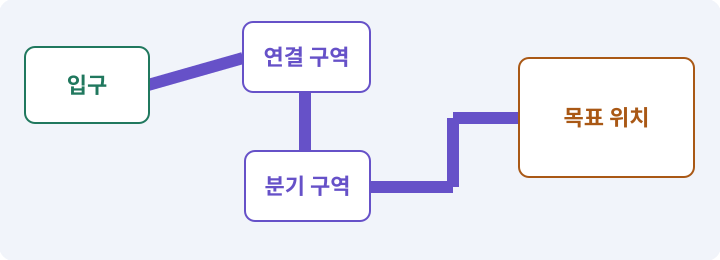

# 143. 새 랜덤 지역 봉인된 대장간 만들기

**목표:** 새 방 역할을 가진 지역을 탐험합니다.

**시작 상태:** 기존 랜덤맵과 환경 전투

## 한눈에 보는 기능의 흐름

지역 선택 → 기름방·구조방 → 보상·동선 → 용광로 보스방



**경계:** 새 방 역할이 기존 생성 안전 조건을 깨지 않기

그림은 실제 게임 실행 결과가 아닙니다. 값·규칙과 예제를 필요한 때 펼쳐 읽고 현재 단계의 메시지를 한 번씩 보냅니다.

## 1. 지금 상태 확인하기

첫 메시지를 보내 현재 준비 상태를 확인합니다. AI가 읽어 온 실제 프로젝트가 맞는지 보고, 없는 준비나 다른 상태가 있으면 먼저 알려 주세요. 아직 기능을 만들지 않는 단계입니다.

### AI에게 보낼 요구와 이유

#### 01. 작업 대상부터 확인

**“새 랜덤 지역 봉인된 대장간 만들기” 작업을 시작하기 전에 현재 상태를 읽기 전용으로 확인해 줘.**

왜 이렇게 요청하나요? AI가 다른 프로젝트나 오래된 예제를 보고 작업할 수 있습니다. 실제 경로·파일·현재 기능을 읽게 하면 지금 이어서 작업할 대상을 먼저 맞출 수 있습니다.

#### 02. 작업 대상부터 확인

**필요한 시작 상태는 기존 랜덤맵과 환경 전투야.**

왜 이렇게 요청하나요? AI가 다른 프로젝트나 오래된 예제를 보고 작업할 수 있습니다. 실제 경로·파일·현재 기능을 읽게 하면 지금 이어서 작업할 대상을 먼저 맞출 수 있습니다.

#### 03. 실제 사용 중인 구현 재사용

**실제 프로젝트와 작업 기록을 읽고 이것이 준비되어 있는지, 이미 같은 기능이 있는지 확인해 줘.**

왜 이렇게 요청하나요? 이름이 비슷한 새 클래스를 또 만들면 기존 화면은 여전히 옛 코드를 사용할 수 있습니다. 실제 호출되는 진입점을 찾아 연결해야 두 구현이 충돌하거나 수정이 반영되지 않는 문제를 막습니다.

#### 04. 현재 상태와 다음 확인 지점 구분

**이번 기능이 연결될 실제 파일·화면·도구와 보존할 기존 동작을 짧게 정리해 줘.**

왜 이렇게 요청하나요? 이미 준비된 기능과 아직 확인하지 못한 기능을 섞으면 불필요한 재설치나 성급한 완료 판정이 생깁니다. 현재 대상과 남은 준비를 나눠 가장 작은 다음 작업을 선택하게 합니다.

#### 05. 조사 단계에서 변경하지 않기

**아직 새 구현·설치·유료 호출·파일 변경은 하지 마.**

왜 이렇게 요청하나요? 현재 상태를 알아보기만 할 때 파일 변경이나 결제가 시작되면 검토 전의 환경이 바뀝니다. 준비 확인과 실제 구현을 나눠 되돌리기 어려운 작업이 먼저 실행되지 않게 합니다.

#### 06. 막힌 준비를 먼저 해결

**준비가 다르면 부족한 항목과 다음에 필요한 작업을 알려 줘.**

왜 이렇게 요청하나요? 빠진 파일·권한·패키지를 있다고 가정하면 다음 구현이 엉뚱한 대상을 만들게 됩니다. 무엇이 없고 무엇을 먼저 해야 하는지 분리하면 불필요한 재작업을 줄일 수 있습니다.

<details>
<summary>보낼 원문 전체 — 설명은 복사되지 않습니다</summary>

```text
“새 랜덤 지역 봉인된 대장간 만들기” 작업을 시작하기 전에 현재 상태를 읽기 전용으로 확인해 줘.
필요한 시작 상태는 기존 랜덤맵과 환경 전투야. 실제 프로젝트와 작업 기록을 읽고 이것이 준비되어 있는지, 이미 같은 기능이 있는지 확인해 줘.
이번 기능이 연결될 실제 파일·화면·도구와 보존할 기존 동작을 짧게 정리해 줘. 아직 새 구현·설치·유료 호출·파일 변경은 하지 마. 준비가 다르면 부족한 항목과 다음에 필요한 작업을 알려 줘.
```

</details>

**기대 결과:** 지역 선택과 새 방 역할의 연결도

### 직접 확인하기

1. AI가 읽은 실제 프로젝트 또는 도구 경로를 확인합니다.
2. 필수 준비가 없다면 문제 해결 요청을 보내고, 준비됐을 때 다음으로 갑니다.

## 2. 필요한 기능 만들기

준비가 확인되면 아래 요청을 보냅니다. AI가 파일·설정·실행을 맡습니다. 변경 범위나 비용 승인이 나오면 내용을 읽고 결정하세요.

### AI에게 보낼 요구와 이유

#### 01. 관찰 가능한 기준으로 확인

**내가 만든 하네스의 실제 경로와 현재 게임 후보를 확인하고 game-feature로 이 작업을 처리해 줘.**

왜 이렇게 요청하나요? 구현 완료라는 설명을 실제 결과로 바꾸기 위한 조건입니다. 요청에 나온 대상과 경계 상황을 확인해 정상 결과뿐 아니라 실패를 어떻게 구분했는지도 남깁니다.

#### 02. 구현과 판정의 책임 나누기

**필요한 담당 역할만 고르고 구현·QA·독립 검토를 분리해 줘.**

왜 이렇게 요청하나요? 구현자가 자신의 설명만으로 완료를 결정하면 놓친 가정을 그대로 통과시킬 수 있습니다. 원래 요구·실제 변경·테스트를 다른 관점에서 검토하고 쓰기 권한을 나눕니다.

#### 03. 작성한 도구를 실제로 사용

**변경안·승인한 후보·Unity 통합·현재 소스 검사를 실제로 연결하고, 참고 완성본으로 우회하지 마.**

왜 이렇게 요청하나요? 참고 완성본으로 몰래 실행하면 현재 만든 하네스의 누락이나 오류가 드러나지 않습니다. 실행 경로를 확인해 지금 개발한 도구가 작업과 검사를 수행하도록 합니다.

#### 04. 구현할 결과와 조건 고정

**기존 2D 무작위 던전 생성기를 확장해 봉인된 대장간 지역을 추가해 줘.**

왜 이렇게 요청하나요? “기존 2D 무작위 던전 생성기를 확장해 봉인된 대장간 지역을 추가해 줘”를 명시하면 AI가 무엇을 구현하거나 검사해야 하는지 범위를 좁힐 수 있습니다. 새 방 역할을 가진 지역을 탐험합니다. 이 결과를 확인할 때 이 조건이 실제로 반영됐는지 함께 봅니다.

#### 05. 그림 크기와 월드 크기 연결

**같은64×64/8방 Layout 계약을 유지하고 방 역할만 이번 명세대로 확장해 줘.**

왜 이렇게 요청하나요? 픽셀 수만 정하면 게임 안에서의 크기는 정해지지 않습니다. PPU와 배율을 함께 고정해야 자산을 바꿔도 캐릭터·바닥·UI의 크기 관계를 비교할 수 있습니다.

#### 06. 저장 중단과 손상에 대비

**원래 지역·생성 버전·세이브를 보존하고 새 regionId와 version을 명시해 줘.**

왜 이렇게 요청하나요? 파일 쓰기가 중단되거나 읽을 수 없는 값이 있으면 정상 진행을 잃을 수 있습니다. 완성된 데이터 검증·교체·백업 복구를 나눠 손상된 자료가 정상본을 덮지 않게 합니다.

#### 07. 환경 반응의 반복과 종료 제한

**밸브·구조·유물·보스방 접근성을 격자와 실제 몸체 검사로 확인해 줘.**

왜 이렇게 요청하나요? 한 폭발이 여러 충돌 이벤트를 만들면 피해나 보상이 반복될 수 있습니다. 점화·폭발·정지의 상태와 처리한 대상을 기록해 환경을 이용한 전투가 통제된 결과를 내게 합니다.

#### 08. 무작위 결과를 재현 가능하게

**장식 난수로 지형·전리품이 바뀌지 않게 하고 대장간 전용 fallback을 제공해 줘.**

왜 이렇게 요청하나요? 실패한 맵이나 전리품 결과를 다시 만들 수 있어야 원인을 고칠 수 있습니다. 생성 버전·설정·시드를 함께 기록하고 지형·장식·보상 난수를 분리해 작은 변경의 파급을 줄입니다.

#### 09. 아래 항목을 완료 조건으로 사용

**이 기능의 규칙:**

왜 이렇게 요청하나요? 요구사항의 목록은 AI에게 참고 설명을 주는 것이 아니라 완료를 판단할 기준을 정합니다. 구현 뒤 각 항목을 실제 입력과 결과에 대응시켜 빠진 조건을 찾습니다.

#### 10. 논리 지도·DungeonLayout의 적용 조건

**새 지역도 같은 Layout 계약을 쓴다.**

왜 이렇게 요청하나요? 논리 지도는 그림과 상관없이 방·통로·문·스폰 후보를 표현한 데이터입니다. 이를 2D Tilemap과 3D 메시가 각각 화면과 충돌로 바꿉니다. Layout이라는 단어는 UI 배치에도 쓰입니다. 여기서는 던전의 논리 배치 데이터입니다.

#### 11. 환경 반응의 반복과 종료 제한

**방8개는 입구1, 전투3, 밸브방1, 대장장이 구조방1, 유물방1, 보스방1로 구성한다.**

왜 이렇게 요청하나요? 한 폭발이 여러 충돌 이벤트를 만들면 피해나 보상이 반복될 수 있습니다. 점화·폭발·정지의 상태와 처리한 대상을 기록해 환경을 이용한 전투가 통제된 결과를 내게 합니다.

#### 12. 구현할 결과와 조건 고정

**이는 기존 던전의 적 종류만 바꾸는 것이 아니라 방 역할과 조우 구성을 바꾸는 확장이다.**

왜 이렇게 요청하나요? “이는 기존 던전의 적 종류만 바꾸는 것이 아니라 방 역할과 조우 구성을 바꾸는 확장이다”를 명시하면 AI가 무엇을 구현하거나 검사해야 하는지 범위를 좁힐 수 있습니다. 새 방 역할을 가진 지역을 탐험합니다. 이 결과를 확인할 때 이 조건이 실제로 반영됐는지 함께 봅니다.

#### 13. 구현할 결과와 조건 고정

**마을의 별도 포털에서 들어가고 기존 지역은 그대로 남긴다.**

왜 이렇게 요청하나요? “마을의 별도 포털에서 들어가고 기존 지역은 그대로 남긴다”를 명시하면 AI가 무엇을 구현하거나 검사해야 하는지 범위를 좁힐 수 있습니다. 새 방 역할을 가진 지역을 탐험합니다. 이 결과를 확인할 때 이 조건이 실제로 반영됐는지 함께 봅니다.

#### 14. 무작위 결과를 재현 가능하게

**맵 난수는 layout·encounter·loot·decoration·relicOffer 스트림을 분리한다.**

왜 이렇게 요청하나요? 실패한 맵이나 전리품 결과를 다시 만들 수 있어야 원인을 고칠 수 있습니다. 생성 버전·설정·시드를 함께 기록하고 지형·장식·보상 난수를 분리해 작은 변경의 파급을 줄입니다.

#### 15. 무작위 결과를 재현 가능하게

**지역 ID와 generatorVersion·configVersion·seed를 함께 기록한다.**

왜 이렇게 요청하나요? 실패한 맵이나 전리품 결과를 다시 만들 수 있어야 원인을 고칠 수 있습니다. 생성 버전·설정·시드를 함께 기록하고 지형·장식·보상 난수를 분리해 작은 변경의 파급을 줄입니다.

#### 16. 논리 지형과 플레이 가능한 지형 검사

**랜덤 실패 시 대장간 전용 고정 복구 맵을 사용한다.**

왜 이렇게 요청하나요? 방이 보기 좋게 놓였어도 통로가 끊기거나 출구가 막히면 완주할 수 없습니다. 연결성과 스폰·몸체 이동을 검사하고 실패한 생성은 재현 정보와 함께 복구합니다.

#### 17. 논리 지형과 플레이 가능한 지형 검사

**예전 지역의 고정맵으로 조용히 보내지 말고 복구 사용 사실을 로그에 남긴다.**

왜 이렇게 요청하나요? 방이 보기 좋게 놓였어도 통로가 끊기거나 출구가 막히면 완주할 수 없습니다. 연결성과 스폰·몸체 이동을 검사하고 실패한 생성은 재현 정보와 함께 복구합니다.

#### 18. 환경 반응의 반복과 종료 제한

**밸브 상호작용은 필수 경로를 완전히 막는 영구 자물쇠가 아니다.**

왜 이렇게 요청하나요? 한 폭발이 여러 충돌 이벤트를 만들면 피해나 보상이 반복될 수 있습니다. 점화·폭발·정지의 상태와 처리한 대상을 기록해 환경을 이용한 전투가 통제된 결과를 내게 합니다.

#### 19. 점이 아니라 몸체가 지나가게 하기

**구조방과 보스방은 유효한 몸체 반경으로 도달 가능해야 하고, 장식 기둥이 통로를 막으면 렌더링 전후의 공간 검사에서 드러나야 한다.**

왜 이렇게 요청하나요? 길의 중심점이 연결돼 있어도 반경이 있는 캐릭터는 모서리나 좁은 문에 걸릴 수 있습니다. 실제 몸체 크기로 통과·차단을 확인해야 길찾기 그림과 플레이 결과가 맞습니다.

#### 20. 길찾기와 실제 도달을 구분

**실제 TilemapCollider2D와 A*가 같은 차단 데이터를 쓰게 한다.**

왜 이렇게 요청하나요? 목적지 표시나 경로 목록이 있다고 캐릭터가 끝까지 갈 수 있는 것은 아닙니다. 이동 가능한 경로와 실제 몸체의 진행을 확인하고 막힌 지점을 성공으로 표시하지 않게 합니다.

#### 21. 구현과 실행은 AI에게 맡기기

**코드·설정·파일 생성·실행은 네가 맡고, 필요한 화면과 결과를 보여 줘.**

왜 이렇게 요청하나요? 설명이나 코드 조각만 받으면 실제 파일 생성·연결·실행이 빠질 수 있습니다. AI가 개발 작업까지 수행하고, 사람은 요구·승인·결과 판단을 맡도록 역할을 분명히 합니다.

#### 22. 막힌 준비를 먼저 해결

**수행하지 못한 작업과 필요한 승인·도구 연결은 구분해서 알려 줘.**

왜 이렇게 요청하나요? 빠진 파일·권한·패키지를 있다고 가정하면 다음 구현이 엉뚱한 대상을 만들게 됩니다. 무엇이 없고 무엇을 먼저 해야 하는지 분리하면 불필요한 재작업을 줄일 수 있습니다.

<details>
<summary>보낼 원문 전체 — 설명은 복사되지 않습니다</summary>

```text
내가 만든 하네스의 실제 경로와 현재 게임 후보를 확인하고 game-feature로 이 작업을 처리해 줘. 필요한 담당 역할만 고르고 구현·QA·독립 검토를 분리해 줘. 변경안·승인한 후보·Unity 통합·현재 소스 검사를 실제로 연결하고, 참고 완성본으로 우회하지 마.

기존 2D 무작위 던전 생성기를 확장해 봉인된 대장간 지역을 추가해 줘.
같은64×64/8방 Layout 계약을 유지하고 방 역할만 이번 명세대로 확장해 줘.
원래 지역·생성 버전·세이브를 보존하고 새 regionId와 version을 명시해 줘.
밸브·구조·유물·보스방 접근성을 격자와 실제 몸체 검사로 확인해 줘.
장식 난수로 지형·전리품이 바뀌지 않게 하고 대장간 전용 fallback을 제공해 줘.

이 기능의 규칙:
새 지역도 같은 Layout 계약을 쓴다. 방8개는 입구1, 전투3, 밸브방1, 대장장이 구조방1, 유물방1, 보스방1로 구성한다. 이는 기존 던전의 적 종류만 바꾸는 것이 아니라 방 역할과 조우 구성을 바꾸는 확장이다. 마을의 별도 포털에서 들어가고 기존 지역은 그대로 남긴다.

맵 난수는 layout·encounter·loot·decoration·relicOffer 스트림을 분리한다. 지역 ID와 generatorVersion·configVersion·seed를 함께 기록한다. 랜덤 실패 시 대장간 전용 고정 복구 맵을 사용한다. 예전 지역의 고정맵으로 조용히 보내지 말고 복구 사용 사실을 로그에 남긴다.

밸브 상호작용은 필수 경로를 완전히 막는 영구 자물쇠가 아니다. 구조방과 보스방은 유효한 몸체 반경으로 도달 가능해야 하고, 장식 기둥이 통로를 막으면 렌더링 전후의 공간 검사에서 드러나야 한다. 실제 TilemapCollider2D와 A*가 같은 차단 데이터를 쓰게 한다.

코드·설정·파일 생성·실행은 네가 맡고, 필요한 화면과 결과를 보여 줘. 수행하지 못한 작업과 필요한 승인·도구 연결은 구분해서 알려 줘.
```

</details>

**기대 결과:** 확인할 결과: 새 지역의 실제 탐험을 확인함. AI가 이 상태를 확인할 실제 화면과 변경 내용을 준비합니다. 아직 실행하지 못한 부분은 따로 표시합니다.

### 직접 확인하기

1. 제안서만 반환됐다면 “설명으로 끝내지 말고 승인한 범위의 실제 작업을 수행해 줘”라고 보냅니다.
2. 코드나 설정을 직접 고치라는 안내가 나오면 “작성과 실행은 네가 맡아 줘”라고 요청합니다.

## 3. 결과를 직접 확인하기

먼저 확인 요청을 보내 AI가 검사와 화면을 준비하게 하세요. 그다음 아래 동작을 하나씩 확인합니다.

### AI에게 보낼 요구와 이유

#### 01. 검사할 입력과 관찰 지점 준비

**방금 구현한 기능의 자동 검사와 확인 화면을 준비해 줘.**

왜 이렇게 요청하나요? 정상 예 하나만 보면 실패 조건을 놓치기 쉽습니다. 정상·경계·반례를 실제 입력으로 준비하고 사람이 볼 화면도 맞춰 확인 범위를 분명하게 합니다.

#### 02. 결과를 재확인할 근거 남기기

**정상 동작과 아래 실패 조건을 실제로 검사하고 대상·실행 수·결과를 보여 줘.**

왜 이렇게 요청하나요? “잘 됩니다”라는 요약만으로는 어떤 입력과 버전을 검사했는지 알 수 없습니다. 대상·실행 수·실패 내용·파일을 함께 남겨 같은 조건으로 다시 확인할 수 있게 합니다.

#### 03. 무작위 결과를 재현 가능하게

**같은 지역·버전·설정·시드는 같은 논리 지형을 만든다.**

왜 이렇게 요청하나요? 실패한 맵이나 전리품 결과를 다시 만들 수 있어야 원인을 고칠 수 있습니다. 생성 버전·설정·시드를 함께 기록하고 지형·장식·보상 난수를 분리해 작은 변경의 파급을 줄입니다.

#### 04. 시드·난수·PRNG의 적용 조건

**장식 설정만 바꿔도 방 연결과 전리품 RNG 시작 상태가 같다.**

왜 이렇게 요청하나요? 의사난수 생성기(PRNG)는 정해진 계산으로 불규칙해 보이는 수열을 만듭니다. 시드는 그 수열의 출발값입니다. 같은 시드만이 아니라 생성기·설정·호출 순서가 같아야 결과를 재현하기 쉽습니다. 시드가 같다는 이유만으로 서로 다른 버전·플랫폼·물리 결과까지 동일하다고 단정하지 않습니다.

#### 05. 구현할 결과와 조건 고정

**입구·구조방·유물방·보스방까지 실제 몸체가 지나갈 수 있다.**

왜 이렇게 요청하나요? “입구·구조방·유물방·보스방까지 실제 몸체가 지나갈 수 있다”를 명시하면 AI가 무엇을 구현하거나 검사해야 하는지 범위를 좁힐 수 있습니다. 새 방 역할을 가진 지역을 탐험합니다. 이 결과를 확인할 때 이 조건이 실제로 반영됐는지 함께 봅니다.

#### 06. 폴백·안전한 대체 경로의 적용 조건

**생성 실패가 명시되고 fallback에서도 새 퀘스트와 보스 흐름을 완료할 수 있다.**

왜 이렇게 요청하나요? 폴백은 요청한 기능이나 자산을 사용할 수 없을 때 미리 준비한 대안으로 진행하는 경로입니다. 원래 작업의 실패를 성공으로 바꿔 기록하는 것이 아닙니다. 폴백 자체도 입력·저장·포털·보상을 검증해야 합니다. 덜 중요한 경로라고 방치하지 않습니다.

#### 07. 사람 검사의 시작점 준비

**내가 조작해야 하는 부분은 실행할 화면과 시작 상태를 준비해 줘.**

왜 이렇게 요청하나요? 같은 기능이라도 시작 상태가 다르면 관찰 결과가 달라집니다. AI가 실행 화면과 재현 위치를 먼저 준비해야 사람이 이동·공격·소리·조작감을 같은 조건에서 확인할 수 있습니다.

#### 08. 사람이 실제로 본 것만 기록

**연결되지 않은 휴대폰의 터치나 사람이 보지 않은 재미·소리 품질을 대신 확인했다고 하지 마.**

왜 이렇게 요청하나요? AI가 준비한 검사와 사람이 직접 플레이하거나 들은 결과는 다른 근거입니다. 관찰하지 않은 조작감·소리·실기기 결과를 임의로 완료 처리하지 않게 합니다.

#### 09. 실제로 실행한 검사만 인정

**테스트 0개와 예전 소스 결과는 현재 성공으로 쓰지 마.**

왜 이렇게 요청하나요? 실행된 검사가 없거나 같은 결과를 중복 집계한 경우는 기능을 확인한 것이 아닙니다. 실행 수와 개별 결과를 함께 확인해야 형식적인 성공 표시를 걸러낼 수 있습니다.

<details>
<summary>보낼 원문 전체 — 설명은 복사되지 않습니다</summary>

```text
방금 구현한 기능의 자동 검사와 확인 화면을 준비해 줘. 정상 동작과 아래 실패 조건을 실제로 검사하고 대상·실행 수·결과를 보여 줘.

같은 지역·버전·설정·시드는 같은 논리 지형을 만든다.

 장식 설정만 바꿔도 방 연결과 전리품 RNG 시작 상태가 같다.

 입구·구조방·유물방·보스방까지 실제 몸체가 지나갈 수 있다.

 생성 실패가 명시되고 fallback에서도 새 퀘스트와 보스 흐름을 완료할 수 있다.

내가 조작해야 하는 부분은 실행할 화면과 시작 상태를 준비해 줘. 연결되지 않은 휴대폰의 터치나 사람이 보지 않은 재미·소리 품질을 대신 확인했다고 하지 마. 테스트 0개와 예전 소스 결과는 현재 성공으로 쓰지 마.
```

</details>

**기대 결과:** 기존 지역은 유지되고 새 방도 실제 몸체로 접근할 수 있습니다. 생성 실패는 기록 후 정한 복구 지도로 전환합니다.

### 직접 확인하기

1. 마을에서 새 지역을 선택합니다.
2. 기름방과 구조방을 지나 보스방에 갑니다.
3. 시드별 안전한 동선과 생성 실패 복구를 봅니다.

## 4. 결과를 남기고 마무리하기

실제로 본 결과를 아래 메모에 적고 AI에 전달합니다. 결과 저장 요청으로 현재 상태를 남긴 뒤 다음 페이지로 갑니다.

### AI에게 보낼 요구와 이유

#### 01. 결과를 재확인할 근거 남기기

**지금 작업한 “새 랜덤 지역 봉인된 대장간 만들기”의 실제 결과를 정리해 줘.**

왜 이렇게 요청하나요? “잘 됩니다”라는 요약만으로는 어떤 입력과 버전을 검사했는지 알 수 없습니다. 대상·실행 수·실패 내용·파일을 함께 남겨 같은 조건으로 다시 확인할 수 있게 합니다.

#### 02. 다음 작업이 읽을 인수인계

**변경한 기능·파일·현재 후보와 실제 실행한 검사, 남은 문제를 기능 이름으로 기록해 줘.**

왜 이렇게 요청하나요? 새 AI 세션은 이전 대화 전체를 알고 있다고 보장할 수 없습니다. 현재 후보·파일 위치·실행한 검사·남은 일을 남겨야 같은 작업을 반복하지 않고 이어갈 수 있습니다.

#### 03. 사람이 실제로 본 것만 기록

**자동 검사 결과와 내가 직접 확인한 결과를 구분하고, 내 관찰이 아직 없으면 미확인으로 남겨 줘.**

왜 이렇게 요청하나요? AI가 준비한 검사와 사람이 직접 플레이하거나 들은 결과는 다른 근거입니다. 관찰하지 않은 조작감·소리·실기기 결과를 임의로 완료 처리하지 않게 합니다.

#### 04. 다음 작업이 읽을 인수인계

**재시작하거나 다음 작업에서 읽을 기록의 실제 위치를 알려 줘.**

왜 이렇게 요청하나요? 새 AI 세션은 이전 대화 전체를 알고 있다고 보장할 수 없습니다. 현재 후보·파일 위치·실행한 검사·남은 일을 남겨야 같은 작업을 반복하지 않고 이어갈 수 있습니다.

#### 05. 미확인을 완료와 분리

**아직 확인하지 않은 결과를 완료로 채우지 마.**

왜 이렇게 요청하나요? 만들어진 것, 검사에 실패한 것, 아직 확인하지 못한 것을 나눠야 다음 작업을 정확히 고를 수 있습니다. 실행할 조건이 없는 기능을 성공으로 기록하면 뒤에서 원인을 찾기 어려워집니다.

<details>
<summary>보낼 원문 전체 — 설명은 복사되지 않습니다</summary>

```text
지금 작업한 “새 랜덤 지역 봉인된 대장간 만들기”의 실제 결과를 정리해 줘. 변경한 기능·파일·현재 후보와 실제 실행한 검사, 남은 문제를 기능 이름으로 기록해 줘.
자동 검사 결과와 내가 직접 확인한 결과를 구분하고, 내 관찰이 아직 없으면 미확인으로 남겨 줘. 재시작하거나 다음 작업에서 읽을 기록의 실제 위치를 알려 줘. 아직 확인하지 않은 결과를 완료로 채우지 마.
```

</details>

**기대 결과:** 현재 상태·검사 결과·남은 문제·다음에 읽을 기록을 확인할 수 있습니다.

### 직접 확인하기

1. 자동 검사와 내 관찰 결과가 섞이지 않았는지 봅니다.
2. 문제가 남았다면 해결 요청을 보내고 같은 동작을 다시 확인합니다.

## 구체적인 예로 이해하기

### 새 지역을 기존 생성기에 붙이기

지역은 별개의 생성기 복제품보다 기존 Layout 규칙에 방 역할과 콘텐츠를 확장하는 방식으로 연결합니다.

**시작 상태:** 기존 던전은 같은 시드로 재현되고 보스방까지 이동할 수 있습니다.

**직접 해 볼 동작:** 대장간 방 역할·밸브·스폰을 추가한 뒤 이전 지역과 새 지역의 같은 검사 목록을 실행합니다.

**보여야 하는 결과:** 기존 지역은 유지되고 새 방도 실제 몸체로 접근할 수 있습니다. 생성 실패는 기록 후 정한 복구 지도로 전환합니다.

**이렇게 되면 아직 안 됩니다:** 멋진 장식으로 길을 가리거나, 새 지역을 넣으면서 이전 생성 시드의 의미가 조용히 바뀝니다.

**생각해 보기:** 복구용 고정 지도로 입장했으면 랜덤 생성 성공으로 기록할까요?

<details><summary>해설 보기</summary>

아니요. 플레이 복구는 성공할 수 있지만 무작위 생성은 실패한 것입니다. 두 결과를 따로 남깁니다.

</details>

## 문제가 있으면

### AI에게 보낼 요구와 이유

#### 01. 구현할 결과와 조건 고정

**새 지역을 빈 장식 맵으로 만들지 마.**

왜 이렇게 요청하나요? “새 지역을 빈 장식 맵으로 만들지 마”를 명시하면 AI가 무엇을 구현하거나 검사해야 하는지 범위를 좁힐 수 있습니다. 새 방 역할을 가진 지역을 탐험합니다. 이 결과를 확인할 때 이 조건이 실제로 반영됐는지 함께 봅니다.

#### 02. 무작위 결과를 재현 가능하게

**방 역할·출입구·충돌·몸체 이동을 같은 시드로 확인해 줘.**

왜 이렇게 요청하나요? 실패한 맵이나 전리품 결과를 다시 만들 수 있어야 원인을 고칠 수 있습니다. 생성 버전·설정·시드를 함께 기록하고 지형·장식·보상 난수를 분리해 작은 변경의 파급을 줄입니다.

#### 03. 원인 하나를 좁혀 수정

**새 기능을 추가하지 말고 현재 오류와 실제 로그를 먼저 읽어 줘.**

왜 이렇게 요청하나요? 오류 수정 중 새 기능까지 넣으면 어떤 변경이 문제를 해결하거나 악화했는지 알기 어렵습니다. 원래 재현을 보존하고 작은 변경 뒤 같은 입력과 주변 정상 동작을 다시 확인합니다.

#### 04. 원인 하나를 좁혀 수정

**최소 수정 뒤 같은 재현과 관련 정상 동작을 다시 검사해 줘.**

왜 이렇게 요청하나요? 오류 수정 중 새 기능까지 넣으면 어떤 변경이 문제를 해결하거나 악화했는지 알기 어렵습니다. 원래 재현을 보존하고 작은 변경 뒤 같은 입력과 주변 정상 동작을 다시 확인합니다.

#### 05. 실패도 재현 자료로 보존

**실패 기록은 지우지 마.**

왜 이렇게 요청하나요? 실패한 입력과 로그가 있어야 같은 문제가 다시 생겼을 때 비교할 수 있습니다. 성공 기록으로 덮어쓰지 않고 전후 자료를 남기면 무엇을 고쳤는지 확인할 수 있습니다.

<details>
<summary>보낼 원문 전체 — 설명은 복사되지 않습니다</summary>

```text
새 지역을 빈 장식 맵으로 만들지 마. 방 역할·출입구·충돌·몸체 이동을 같은 시드로 확인해 줘.
새 기능을 추가하지 말고 현재 오류와 실제 로그를 먼저 읽어 줘. 최소 수정 뒤 같은 재현과 관련 정상 동작을 다시 검사해 줘. 실패 기록은 지우지 마.
```

</details>

## 새 세션에서 이어가기

### AI에게 보낼 요구와 이유

#### 01. 이어서 할 작업 식별

**“새 랜덤 지역 봉인된 대장간 만들기” 작업을 이어가고 싶어.**

왜 이렇게 요청하나요? 이름으로 재개할 작업을 찾고, 뒤에 이어지는 요청으로 실제 파일·진행 중 작업·기록을 다시 읽게 합니다. 제목만 보고 이전 상태를 기억한다고 가정하지 않습니다.

#### 02. 조회는 상태를 바꾸지 않게

**실제 프로젝트와 내 도구의 작업 기록을 읽고 어디까지 구현·검사됐는지 확인해 줘.**

왜 이렇게 요청하나요? 진행 상황을 물을 때 새 구현이나 유료 호출이 시작되면 단순 확인이 실행 명령이 되어 버립니다. 저장된 근거를 읽어 완료·진행·승인 대기·미검증을 나누게 합니다.

#### 03. 재개 전 중복 작업 방지

**진행 중인 프로세스·승인·미저장 변경을 확인한 뒤 남은 가장 작은 작업부터 안내해 줘.**

왜 이렇게 요청하나요? 대화가 끊겨도 외부 작업은 끝났거나 아직 실행 중일 수 있습니다. 프로세스·승인·미저장 상태를 먼저 읽어 같은 생성·빌드·결제를 두 번 시작하지 않도록 합니다.

#### 04. 되돌아갈 원본 남기기

**기존 성공과 실패 기록은 보존해 줘.**

왜 이렇게 요청하나요? 새 구현이 실패해도 이전 게임과 저장을 복원할 수 있어야 합니다. 현재 내용을 먼저 조사하고 별도 후보에서 작업하면 실험이 유일한 정상본을 망가뜨리는 일을 피할 수 있습니다.

<details>
<summary>보낼 원문 전체 — 설명은 복사되지 않습니다</summary>

```text
“새 랜덤 지역 봉인된 대장간 만들기” 작업을 이어가고 싶어. 실제 프로젝트와 내 도구의 작업 기록을 읽고 어디까지 구현·검사됐는지 확인해 줘. 진행 중인 프로세스·승인·미저장 변경을 확인한 뒤 남은 가장 작은 작업부터 안내해 줘. 기존 성공과 실패 기록은 보존해 줘.
```

</details>

## 왜 이렇게 만드는가

새 지역도 같은 Layout 계약을 쓴다. 방8개는 입구1, 전투3, 밸브방1, 대장장이 구조방1, 유물방1, 보스방1로 구성한다. 이는 기존 던전의 적 종류만 바꾸는 것이 아니라 방 역할과 조우 구성을 바꾸는 확장이다. 마을의 별도 포털에서 들어가고 기존 지역은 그대로 남긴다.

맵 난수는 layout·encounter·loot·decoration·relicOffer 스트림을 분리한다. 지역 ID와 generatorVersion·configVersion·seed를 함께 기록한다. 랜덤 실패 시 대장간 전용 고정 복구 맵을 사용한다. 예전 지역의 고정맵으로 조용히 보내지 말고 복구 사용 사실을 로그에 남긴다.

## 공식 참고

