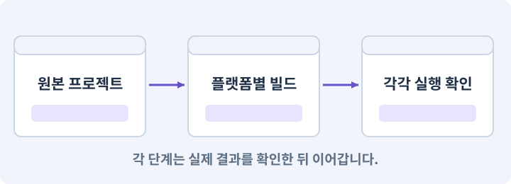

# 159. 최종 확장판 배포 후보 만들기

**목표:** 실제 Windows·Android 결과물을 구분합니다.

**시작 상태:** 모든 기능과 현재 통합 검사

## 한눈에 보는 기능의 흐름

현재 통합 소스 → Windows 후보 → Android 후보 → 이전 앱 업데이트



**경계:** 알려진 결함과 미검증을 숨기지 않기

그림은 실제 게임 실행 결과가 아닙니다. 값·규칙과 예제를 필요한 때 펼쳐 읽고 현재 단계의 메시지를 한 번씩 보냅니다.

## 1. 지금 상태 확인하기

첫 메시지를 보내 현재 준비 상태를 확인합니다. AI가 읽어 온 실제 프로젝트가 맞는지 보고, 없는 준비나 다른 상태가 있으면 먼저 알려 주세요. 아직 기능을 만들지 않는 단계입니다.

### AI에게 보낼 요구와 이유

#### 01. 작업 대상부터 확인

**“최종 확장판 배포 후보 만들기” 작업을 시작하기 전에 현재 상태를 읽기 전용으로 확인해 줘.**

왜 이렇게 요청하나요? AI가 다른 프로젝트나 오래된 예제를 보고 작업할 수 있습니다. 실제 경로·파일·현재 기능을 읽게 하면 지금 이어서 작업할 대상을 먼저 맞출 수 있습니다.

#### 02. 작업 대상부터 확인

**필요한 시작 상태는 모든 기능과 현재 통합 검사야.**

왜 이렇게 요청하나요? AI가 다른 프로젝트나 오래된 예제를 보고 작업할 수 있습니다. 실제 경로·파일·현재 기능을 읽게 하면 지금 이어서 작업할 대상을 먼저 맞출 수 있습니다.

#### 03. 실제 사용 중인 구현 재사용

**실제 프로젝트와 작업 기록을 읽고 이것이 준비되어 있는지, 이미 같은 기능이 있는지 확인해 줘.**

왜 이렇게 요청하나요? 이름이 비슷한 새 클래스를 또 만들면 기존 화면은 여전히 옛 코드를 사용할 수 있습니다. 실제 호출되는 진입점을 찾아 연결해야 두 구현이 충돌하거나 수정이 반영되지 않는 문제를 막습니다.

#### 04. 현재 상태와 다음 확인 지점 구분

**이번 기능이 연결될 실제 파일·화면·도구와 보존할 기존 동작을 짧게 정리해 줘.**

왜 이렇게 요청하나요? 이미 준비된 기능과 아직 확인하지 못한 기능을 섞으면 불필요한 재설치나 성급한 완료 판정이 생깁니다. 현재 대상과 남은 준비를 나눠 가장 작은 다음 작업을 선택하게 합니다.

#### 05. 조사 단계에서 변경하지 않기

**아직 새 구현·설치·유료 호출·파일 변경은 하지 마.**

왜 이렇게 요청하나요? 현재 상태를 알아보기만 할 때 파일 변경이나 결제가 시작되면 검토 전의 환경이 바뀝니다. 준비 확인과 실제 구현을 나눠 되돌리기 어려운 작업이 먼저 실행되지 않게 합니다.

#### 06. 막힌 준비를 먼저 해결

**준비가 다르면 부족한 항목과 다음에 필요한 작업을 알려 줘.**

왜 이렇게 요청하나요? 빠진 파일·권한·패키지를 있다고 가정하면 다음 구현이 엉뚱한 대상을 만들게 됩니다. 무엇이 없고 무엇을 먼저 해야 하는지 분리하면 불필요한 재작업을 줄일 수 있습니다.

<details>
<summary>보낼 원문 전체 — 설명은 복사되지 않습니다</summary>

```text
“최종 확장판 배포 후보 만들기” 작업을 시작하기 전에 현재 상태를 읽기 전용으로 확인해 줘.
필요한 시작 상태는 모든 기능과 현재 통합 검사야. 실제 프로젝트와 작업 기록을 읽고 이것이 준비되어 있는지, 이미 같은 기능이 있는지 확인해 줘.
이번 기능이 연결될 실제 파일·화면·도구와 보존할 기존 동작을 짧게 정리해 줘. 아직 새 구현·설치·유료 호출·파일 변경은 하지 마. 준비가 다르면 부족한 항목과 다음에 필요한 작업을 알려 줘.
```

</details>

**기대 결과:** 현재 후보의 빌드·저장·팩 호환표

### 직접 확인하기

1. AI가 읽은 실제 프로젝트 또는 도구 경로를 확인합니다.
2. 필수 준비가 없다면 문제 해결 요청을 보내고, 준비됐을 때 다음으로 갑니다.

## 2. 요청한 작업 진행하기

준비가 확인되면 아래 요청을 보냅니다. AI가 파일·설정·실행을 맡습니다. 변경 범위나 비용 승인이 나오면 내용을 읽고 결정하세요.

### AI에게 보낼 요구와 이유

#### 01. 관찰 가능한 기준으로 확인

**내가 만든 하네스의 실제 경로와 현재 게임 후보를 확인하고 game-feature로 이 작업을 처리해 줘.**

왜 이렇게 요청하나요? 구현 완료라는 설명을 실제 결과로 바꾸기 위한 조건입니다. 요청에 나온 대상과 경계 상황을 확인해 정상 결과뿐 아니라 실패를 어떻게 구분했는지도 남깁니다.

#### 02. 구현과 판정의 책임 나누기

**필요한 담당 역할만 고르고 구현·QA·독립 검토를 분리해 줘.**

왜 이렇게 요청하나요? 구현자가 자신의 설명만으로 완료를 결정하면 놓친 가정을 그대로 통과시킬 수 있습니다. 원래 요구·실제 변경·테스트를 다른 관점에서 검토하고 쓰기 권한을 나눕니다.

#### 03. 작성한 도구를 실제로 사용

**변경안·승인한 후보·Unity 통합·현재 소스 검사를 실제로 연결하고, 참고 완성본으로 우회하지 마.**

왜 이렇게 요청하나요? 참고 완성본으로 몰래 실행하면 현재 만든 하네스의 누락이나 오류가 드러나지 않습니다. 실행 경로를 확인해 지금 개발한 도구가 작업과 검사를 수행하도록 합니다.

#### 04. 구현할 결과와 조건 고정

**봉인된 대장간 2D 확장판의 최종 Windows/Android 후보를 준비해 줘.**

왜 이렇게 요청하나요? “봉인된 대장간 2D 확장판의 최종 Windows/Android 후보를 준비해 줘”를 명시하면 AI가 무엇을 구현하거나 검사해야 하는지 범위를 좁힐 수 있습니다. 실제 Windows·Android 결과물을 구분합니다. 이 결과를 확인할 때 이 조건이 실제로 반영됐는지 함께 봅니다.

#### 05. 종료 이후의 상태까지 확인

**현재 최종 통합 소스에서 필수 회귀를 다시 실행하고 실제 빌드 파일·source/content/build hash를 기록해 줘.**

왜 이렇게 요청하나요? 현재 화면에서 맞는 값도 저장하거나 다시 구성할 때 빠질 수 있습니다. 실제 종료·불러오기 전후에 ID·옵션·장착·진행을 비교해야 유지되는 범위를 확인할 수 있습니다.

#### 06. 끊긴 입력과 작업 정리

**신규오프라인·schema2업데이트·schema3재접속·팩/캐시·앱복귀를 구분해 검사해 줘.**

왜 이렇게 요청하나요? 앱 전환이나 창 닫기에서는 정상적인 손 떼기 이벤트가 오지 않을 수 있습니다. 중단 시 눌림·예약·임시 효과를 정리해야 복귀 후 멋대로 움직이거나 공격하지 않습니다.

#### 07. 관찰 가능한 기준으로 확인

**개발용 해금·테스트콘솔·무한재료가 배포에 포함되지 않게 해 줘.**

왜 이렇게 요청하나요? 구현 완료라는 설명을 실제 결과로 바꾸기 위한 조건입니다. 요청에 나온 대상과 경계 상황을 확인해 정상 결과뿐 아니라 실패를 어떻게 구분했는지도 남깁니다.

#### 08. 비용과 외부 작업은 별도 승인

**서명키를 읽어 보고서에 넣거나 승인 없이 게시·업로드하지 마.**

왜 이렇게 요청하나요? 로컬 파일을 고치는 것과 외부 서비스에 자료를 보내거나 비용을 지불하는 것은 영향이 다릅니다. 대상·내용·비용 범위를 확인한 승인 없이 요청이 확대되지 않도록 합니다.

#### 09. QA·비평·독립 검토의 적용 조건

**하네스 REVIEW_REQUIRED를 실제 출시 완료라고 부르지 마.**

왜 이렇게 요청하나요? QA는 결함을 재현·검사하고, 비평·검토는 원래 요구와 실제 결과 사이의 문제를 평가합니다. 구현자가 자기 설명만 검토하는 것보다 입력과 권한을 분리하는 것이 중요합니다. 같은 모델의 별도 세션이라는 이유만으로 자동 독립성이 보장되지 않습니다.

#### 10. 아래 항목을 완료 조건으로 사용

**이 기능의 규칙:**

왜 이렇게 요청하나요? 요구사항의 목록은 AI에게 참고 설명을 주는 것이 아니라 완료를 판단할 기준을 정합니다. 구현 뒤 각 항목을 실제 입력과 결과에 대응시켜 빠진 조건을 찾습니다.

#### 11. run·attempt·revision·인수인계의 적용 조건

**최종 후보는 서로 다른 run의 성공을 모은 목록이 아니라 하나의 실제 소스·설정·콘텐츠 조합이다.**

왜 이렇게 요청하나요? run은 고정한 작업 계획을 실행한 한 묶음, attempt는 그 안의 개별 시도, revision은 계획이나 후보의 새 버전입니다. 이 용어의 세부 정책은 하네스 구현에서 정합니다. 게임의 한 던전 탐험을 뜻하는 run과 개발 작업 run을 혼동하지 않습니다.

#### 12. 앱과 맞는 콘텐츠만 연결

**Windows 와 Android 에 대해 appVersion·saveSchema·contentContract·source seal·build hash·content catalog hash를 기록한다.**

왜 이렇게 요청하나요? 주소가 같아도 플랫폼·앱 버전·콘텐츠 규격이 다르면 사용할 수 없습니다. 카탈로그와 번들의 대상·호환성을 확인하고 새 버전 적용 실패에 대비해 이전 자료를 보존합니다.

#### 13. 인증 정보 노출 방지

**서명키와 API 키 자체는 보고서에 넣지 않는다.**

왜 이렇게 요청하나요? 인증 정보가 프롬프트·로그·저장소에 남으면 다른 사람이 재사용할 수 있습니다. 로그인은 공식 경로에서 처리하고, AI에는 키 자체가 아니라 연결 성공 여부만 확인시킵니다.

#### 14. 실패를 숨기지 않기

**검사 조합은 신규 설치 오프라인, 기존 schema2 저장 업그레이드, 정상 schema3 재접속, 고해상도팩 있음/없음, 캐시 삭제, 앱 중단 복귀다.**

왜 이렇게 요청하나요? 검사 조건을 약하게 만들면 결함이 남아 있어도 통과 표시가 나올 수 있습니다. 구현을 고친 뒤 원래 기준으로 다시 검사해야 실제 문제가 해결됐는지 알 수 있습니다.

#### 15. 관찰 가능한 기준으로 확인

**배포용 빌드에서 개발 해금 버튼·테스트 콘솔·무한 재료·로컬 민감 로그가 사라졌는지 확인한다.**

왜 이렇게 요청하나요? 구현 완료라는 설명을 실제 결과로 바꾸기 위한 조건입니다. 요청에 나온 대상과 경계 상황을 확인해 정상 결과뿐 아니라 실패를 어떻게 구분했는지도 남깁니다.

#### 16. QA·비평·독립 검토의 적용 조건

**하네스의 REVIEW_REQUIRED는 자동 게시가 아니다.**

왜 이렇게 요청하나요? QA는 결함을 재현·검사하고, 비평·검토는 원래 요구와 실제 결과 사이의 문제를 평가합니다. 구현자가 자기 설명만 검토하는 것보다 입력과 권한을 분리하는 것이 중요합니다. 같은 모델의 별도 세션이라는 이유만으로 자동 독립성이 보장되지 않습니다.

#### 17. 플랫폼별 실제 실행물 검사

**통과한 APK와 Windows 폴더를 준비하고 사용자가 최종 검토한다.**

왜 이렇게 요청하나요? Editor Play와 배포 앱은 빌드·파일·실행 환경이 다릅니다. 설치 형식과 대상 플랫폼을 구분하고 각 실제 실행물에서 메뉴·입력·저장·콘텐츠를 다시 확인합니다.

#### 18. 앱과 맞는 콘텐츠만 연결

**CDN 업로드·스토어 제출은 별도 명시 승인 작업이다.**

왜 이렇게 요청하나요? 주소가 같아도 플랫폼·앱 버전·콘텐츠 규격이 다르면 사용할 수 없습니다. 카탈로그와 번들의 대상·호환성을 확인하고 새 버전 적용 실패에 대비해 이전 자료를 보존합니다.

#### 19. 종료 이후의 상태까지 확인

**되돌리기는 앱과 저장을 무작정 이전 파일로 덮는 일이 아니다.**

왜 이렇게 요청하나요? 현재 화면에서 맞는 값도 저장하거나 다시 구성할 때 빠질 수 있습니다. 실제 종료·불러오기 전후에 ID·옵션·장착·진행을 비교해야 유지되는 범위를 확인할 수 있습니다.

#### 20. 스키마·JSON Schema·계약의 적용 조건

**schema3를 못 읽는 이전 앱으로 돌아가는 경로는 금지하거나 별도 호환 정책을 준비한다.**

왜 이렇게 요청하나요? 스키마는 데이터가 어떤 필드·타입·범위를 가져야 하는지 정한 구조 약속입니다. 스키마 버전은 구조가 바뀌었음을 식별하고 이전 데이터 변환에 사용합니다. JSON Schema 통과가 게임의 모든 불변 조건을 보장하지는 않습니다.

#### 21. 구현과 실행은 AI에게 맡기기

**코드·설정·파일 생성·실행은 네가 맡고, 필요한 화면과 결과를 보여 줘.**

왜 이렇게 요청하나요? 설명이나 코드 조각만 받으면 실제 파일 생성·연결·실행이 빠질 수 있습니다. AI가 개발 작업까지 수행하고, 사람은 요구·승인·결과 판단을 맡도록 역할을 분명히 합니다.

#### 22. 막힌 준비를 먼저 해결

**수행하지 못한 작업과 필요한 승인·도구 연결은 구분해서 알려 줘.**

왜 이렇게 요청하나요? 빠진 파일·권한·패키지를 있다고 가정하면 다음 구현이 엉뚱한 대상을 만들게 됩니다. 무엇이 없고 무엇을 먼저 해야 하는지 분리하면 불필요한 재작업을 줄일 수 있습니다.

<details>
<summary>보낼 원문 전체 — 설명은 복사되지 않습니다</summary>

```text
내가 만든 하네스의 실제 경로와 현재 게임 후보를 확인하고 game-feature로 이 작업을 처리해 줘. 필요한 담당 역할만 고르고 구현·QA·독립 검토를 분리해 줘. 변경안·승인한 후보·Unity 통합·현재 소스 검사를 실제로 연결하고, 참고 완성본으로 우회하지 마.

봉인된 대장간 2D 확장판의 최종 Windows/Android 후보를 준비해 줘.
현재 최종 통합 소스에서 필수 회귀를 다시 실행하고 실제 빌드 파일·source/content/build hash를 기록해 줘.
신규오프라인·schema2업데이트·schema3재접속·팩/캐시·앱복귀를 구분해 검사해 줘.
개발용 해금·테스트콘솔·무한재료가 배포에 포함되지 않게 해 줘.
서명키를 읽어 보고서에 넣거나 승인 없이 게시·업로드하지 마.
하네스 REVIEW_REQUIRED를 실제 출시 완료라고 부르지 마.

이 기능의 규칙:
최종 후보는 서로 다른 run의 성공을 모은 목록이 아니라 하나의 실제 소스·설정·콘텐츠 조합이다. Windows 와 Android 에 대해 appVersion·saveSchema·contentContract·source seal·build hash·content catalog hash를 기록한다. 서명키와 API 키 자체는 보고서에 넣지 않는다.

검사 조합은 신규 설치 오프라인, 기존 schema2 저장 업그레이드, 정상 schema3 재접속, 고해상도팩 있음/없음, 캐시 삭제, 앱 중단 복귀다. 배포용 빌드에서 개발 해금 버튼·테스트 콘솔·무한 재료·로컬 민감 로그가 사라졌는지 확인한다.

하네스의 REVIEW_REQUIRED는 자동 게시가 아니다. 통과한 APK와 Windows 폴더를 준비하고 사용자가 최종 검토한다. CDN 업로드·스토어 제출은 별도 명시 승인 작업이다. 되돌리기는 앱과 저장을 무작정 이전 파일로 덮는 일이 아니다. schema3를 못 읽는 이전 앱으로 돌아가는 경로는 금지하거나 별도 호환 정책을 준비한다.

코드·설정·파일 생성·실행은 네가 맡고, 필요한 화면과 결과를 보여 줘. 수행하지 못한 작업과 필요한 승인·도구 연결은 구분해서 알려 줘.
```

</details>

**기대 결과:** 확인할 결과: 출시 후보의 실제 범위를 확인함. AI가 이 상태를 확인할 실제 화면과 변경 내용을 준비합니다. 아직 실행하지 못한 부분은 따로 표시합니다.

### 직접 확인하기

1. 제안서만 반환됐다면 “설명으로 끝내지 말고 승인한 범위의 실제 작업을 수행해 줘”라고 보냅니다.
2. 코드나 설정을 직접 고치라는 안내가 나오면 “작성과 실행은 네가 맡아 줘”라고 요청합니다.

## 3. 결과를 직접 확인하기

먼저 확인 요청을 보내 AI가 검사와 화면을 준비하게 하세요. 그다음 아래 동작을 하나씩 확인합니다.

### AI에게 보낼 요구와 이유

#### 01. 검사할 입력과 관찰 지점 준비

**방금 구현한 기능의 자동 검사와 확인 화면을 준비해 줘.**

왜 이렇게 요청하나요? 정상 예 하나만 보면 실패 조건을 놓치기 쉽습니다. 정상·경계·반례를 실제 입력으로 준비하고 사람이 볼 화면도 맞춰 확인 범위를 분명하게 합니다.

#### 02. 결과를 재확인할 근거 남기기

**정상 동작과 아래 실패 조건을 실제로 검사하고 대상·실행 수·결과를 보여 줘.**

왜 이렇게 요청하나요? “잘 됩니다”라는 요약만으로는 어떤 입력과 버전을 검사했는지 알 수 없습니다. 대상·실행 수·실패 내용·파일을 함께 남겨 같은 조건으로 다시 확인할 수 있게 합니다.

#### 03. 플랫폼별 실제 실행물 검사

**Windows 실행 파일과 APK가 실제 생성되어 있으며 빌드·소스·콘텐츠 식별이 연결된다.**

왜 이렇게 요청하나요? Editor Play와 배포 앱은 빌드·파일·실행 환경이 다릅니다. 설치 형식과 대상 플랫폼을 구분하고 각 실제 실행물에서 메뉴·입력·저장·콘텐츠를 다시 확인합니다.

#### 04. 다른 이동 주체의 전환 관리

**개발 전용 기능 없이 새 퀘스트를 실제 진행해서 제작과 동료를 해금한다.**

왜 이렇게 요청하나요? 보조 캐릭터·탈것·수영 상태는 따라가기만 구현하면 길막·중복 생성·옛 입력 문제가 남을 수 있습니다. 제어권·추적 대상·진입과 종료 시 정리를 명확히 합니다.

#### 05. 되돌아갈 원본 남기기

**기존 저장 업그레이드에서 아이템·룬·퀘스트·스킬이 보존된다.**

왜 이렇게 요청하나요? 새 구현이 실패해도 이전 게임과 저장을 복원할 수 있어야 합니다. 현재 내용을 먼저 조사하고 별도 후보에서 작업하면 실험이 유일한 정상본을 망가뜨리는 일을 피할 수 있습니다.

#### 06. 관찰 가능한 기준으로 확인

**실제 미검증 기기·콘텐츠 경로와 외부 미게시 상태가 명시된다.**

왜 이렇게 요청하나요? 구현 완료라는 설명을 실제 결과로 바꾸기 위한 조건입니다. 요청에 나온 대상과 경계 상황을 확인해 정상 결과뿐 아니라 실패를 어떻게 구분했는지도 남깁니다.

#### 07. 사람 검사의 시작점 준비

**내가 조작해야 하는 부분은 실행할 화면과 시작 상태를 준비해 줘.**

왜 이렇게 요청하나요? 같은 기능이라도 시작 상태가 다르면 관찰 결과가 달라집니다. AI가 실행 화면과 재현 위치를 먼저 준비해야 사람이 이동·공격·소리·조작감을 같은 조건에서 확인할 수 있습니다.

#### 08. 사람이 실제로 본 것만 기록

**연결되지 않은 휴대폰의 터치나 사람이 보지 않은 재미·소리 품질을 대신 확인했다고 하지 마.**

왜 이렇게 요청하나요? AI가 준비한 검사와 사람이 직접 플레이하거나 들은 결과는 다른 근거입니다. 관찰하지 않은 조작감·소리·실기기 결과를 임의로 완료 처리하지 않게 합니다.

#### 09. 실제로 실행한 검사만 인정

**테스트 0개와 예전 소스 결과는 현재 성공으로 쓰지 마.**

왜 이렇게 요청하나요? 실행된 검사가 없거나 같은 결과를 중복 집계한 경우는 기능을 확인한 것이 아닙니다. 실행 수와 개별 결과를 함께 확인해야 형식적인 성공 표시를 걸러낼 수 있습니다.

<details>
<summary>보낼 원문 전체 — 설명은 복사되지 않습니다</summary>

```text
방금 구현한 기능의 자동 검사와 확인 화면을 준비해 줘. 정상 동작과 아래 실패 조건을 실제로 검사하고 대상·실행 수·결과를 보여 줘.

Windows 실행 파일과 APK가 실제 생성되어 있으며 빌드·소스·콘텐츠 식별이 연결된다.

 개발 전용 기능 없이 새 퀘스트를 실제 진행해서 제작과 동료를 해금한다.

 기존 저장 업그레이드에서 아이템·룬·퀘스트·스킬이 보존된다.

 실제 미검증 기기·콘텐츠 경로와 외부 미게시 상태가 명시된다.

내가 조작해야 하는 부분은 실행할 화면과 시작 상태를 준비해 줘. 연결되지 않은 휴대폰의 터치나 사람이 보지 않은 재미·소리 품질을 대신 확인했다고 하지 마. 테스트 0개와 예전 소스 결과는 현재 성공으로 쓰지 마.
```

</details>

**기대 결과:** 출시 후보의 실제 범위를 확인함

### 직접 확인하기

1. Windows 배포물과 Android APK를 실행합니다.
2. 이전 앱에서 업데이트해 저장을 봅니다.
3. 미검증과 알려진 결함이 숨겨지지 않았는지 확인합니다.

## 4. 결과를 남기고 마무리하기

실제로 본 결과를 아래 메모에 적고 AI에 전달합니다. 결과 저장 요청으로 현재 상태를 남긴 뒤 다음 페이지로 갑니다.

### AI에게 보낼 요구와 이유

#### 01. 결과를 재확인할 근거 남기기

**지금 작업한 “최종 확장판 배포 후보 만들기”의 실제 결과를 정리해 줘.**

왜 이렇게 요청하나요? “잘 됩니다”라는 요약만으로는 어떤 입력과 버전을 검사했는지 알 수 없습니다. 대상·실행 수·실패 내용·파일을 함께 남겨 같은 조건으로 다시 확인할 수 있게 합니다.

#### 02. 다음 작업이 읽을 인수인계

**변경한 기능·파일·현재 후보와 실제 실행한 검사, 남은 문제를 기능 이름으로 기록해 줘.**

왜 이렇게 요청하나요? 새 AI 세션은 이전 대화 전체를 알고 있다고 보장할 수 없습니다. 현재 후보·파일 위치·실행한 검사·남은 일을 남겨야 같은 작업을 반복하지 않고 이어갈 수 있습니다.

#### 03. 사람이 실제로 본 것만 기록

**자동 검사 결과와 내가 직접 확인한 결과를 구분하고, 내 관찰이 아직 없으면 미확인으로 남겨 줘.**

왜 이렇게 요청하나요? AI가 준비한 검사와 사람이 직접 플레이하거나 들은 결과는 다른 근거입니다. 관찰하지 않은 조작감·소리·실기기 결과를 임의로 완료 처리하지 않게 합니다.

#### 04. 다음 작업이 읽을 인수인계

**재시작하거나 다음 작업에서 읽을 기록의 실제 위치를 알려 줘.**

왜 이렇게 요청하나요? 새 AI 세션은 이전 대화 전체를 알고 있다고 보장할 수 없습니다. 현재 후보·파일 위치·실행한 검사·남은 일을 남겨야 같은 작업을 반복하지 않고 이어갈 수 있습니다.

#### 05. 미확인을 완료와 분리

**아직 확인하지 않은 결과를 완료로 채우지 마.**

왜 이렇게 요청하나요? 만들어진 것, 검사에 실패한 것, 아직 확인하지 못한 것을 나눠야 다음 작업을 정확히 고를 수 있습니다. 실행할 조건이 없는 기능을 성공으로 기록하면 뒤에서 원인을 찾기 어려워집니다.

<details>
<summary>보낼 원문 전체 — 설명은 복사되지 않습니다</summary>

```text
지금 작업한 “최종 확장판 배포 후보 만들기”의 실제 결과를 정리해 줘. 변경한 기능·파일·현재 후보와 실제 실행한 검사, 남은 문제를 기능 이름으로 기록해 줘.
자동 검사 결과와 내가 직접 확인한 결과를 구분하고, 내 관찰이 아직 없으면 미확인으로 남겨 줘. 재시작하거나 다음 작업에서 읽을 기록의 실제 위치를 알려 줘. 아직 확인하지 않은 결과를 완료로 채우지 마.
```

</details>

**기대 결과:** 현재 상태·검사 결과·남은 문제·다음에 읽을 기록을 확인할 수 있습니다.

### 직접 확인하기

1. 자동 검사와 내 관찰 결과가 섞이지 않았는지 봅니다.
2. 문제가 남았다면 해결 요청을 보내고 같은 동작을 다시 확인합니다.

## 문제가 있으면

### AI에게 보낼 요구와 이유

#### 01. 비용과 외부 작업은 별도 승인

**파일 생성과 외부 게시를 같은 승인으로 취급하지 마.**

왜 이렇게 요청하나요? 로컬 파일을 고치는 것과 외부 서비스에 자료를 보내거나 비용을 지불하는 것은 영향이 다릅니다. 대상·내용·비용 범위를 확인한 승인 없이 요청이 확대되지 않도록 합니다.

#### 02. 구현할 결과와 조건 고정

**소스·빌드·콘텐츠 해시가 지금 후보인지 대조해 줘.**

왜 이렇게 요청하나요? “소스·빌드·콘텐츠 해시가 지금 후보인지 대조해 줘”를 명시하면 AI가 무엇을 구현하거나 검사해야 하는지 범위를 좁힐 수 있습니다. 실제 Windows·Android 결과물을 구분합니다. 이 결과를 확인할 때 이 조건이 실제로 반영됐는지 함께 봅니다.

#### 03. 원인 하나를 좁혀 수정

**새 기능을 추가하지 말고 현재 오류와 실제 로그를 먼저 읽어 줘.**

왜 이렇게 요청하나요? 오류 수정 중 새 기능까지 넣으면 어떤 변경이 문제를 해결하거나 악화했는지 알기 어렵습니다. 원래 재현을 보존하고 작은 변경 뒤 같은 입력과 주변 정상 동작을 다시 확인합니다.

#### 04. 원인 하나를 좁혀 수정

**최소 수정 뒤 같은 재현과 관련 정상 동작을 다시 검사해 줘.**

왜 이렇게 요청하나요? 오류 수정 중 새 기능까지 넣으면 어떤 변경이 문제를 해결하거나 악화했는지 알기 어렵습니다. 원래 재현을 보존하고 작은 변경 뒤 같은 입력과 주변 정상 동작을 다시 확인합니다.

#### 05. 실패도 재현 자료로 보존

**실패 기록은 지우지 마.**

왜 이렇게 요청하나요? 실패한 입력과 로그가 있어야 같은 문제가 다시 생겼을 때 비교할 수 있습니다. 성공 기록으로 덮어쓰지 않고 전후 자료를 남기면 무엇을 고쳤는지 확인할 수 있습니다.

<details>
<summary>보낼 원문 전체 — 설명은 복사되지 않습니다</summary>

```text
파일 생성과 외부 게시를 같은 승인으로 취급하지 마. 소스·빌드·콘텐츠 해시가 지금 후보인지 대조해 줘.
새 기능을 추가하지 말고 현재 오류와 실제 로그를 먼저 읽어 줘. 최소 수정 뒤 같은 재현과 관련 정상 동작을 다시 검사해 줘. 실패 기록은 지우지 마.
```

</details>

## 새 세션에서 이어가기

### AI에게 보낼 요구와 이유

#### 01. 이어서 할 작업 식별

**“최종 확장판 배포 후보 만들기” 작업을 이어가고 싶어.**

왜 이렇게 요청하나요? 이름으로 재개할 작업을 찾고, 뒤에 이어지는 요청으로 실제 파일·진행 중 작업·기록을 다시 읽게 합니다. 제목만 보고 이전 상태를 기억한다고 가정하지 않습니다.

#### 02. 조회는 상태를 바꾸지 않게

**실제 프로젝트와 내 도구의 작업 기록을 읽고 어디까지 구현·검사됐는지 확인해 줘.**

왜 이렇게 요청하나요? 진행 상황을 물을 때 새 구현이나 유료 호출이 시작되면 단순 확인이 실행 명령이 되어 버립니다. 저장된 근거를 읽어 완료·진행·승인 대기·미검증을 나누게 합니다.

#### 03. 재개 전 중복 작업 방지

**진행 중인 프로세스·승인·미저장 변경을 확인한 뒤 남은 가장 작은 작업부터 안내해 줘.**

왜 이렇게 요청하나요? 대화가 끊겨도 외부 작업은 끝났거나 아직 실행 중일 수 있습니다. 프로세스·승인·미저장 상태를 먼저 읽어 같은 생성·빌드·결제를 두 번 시작하지 않도록 합니다.

#### 04. 되돌아갈 원본 남기기

**기존 성공과 실패 기록은 보존해 줘.**

왜 이렇게 요청하나요? 새 구현이 실패해도 이전 게임과 저장을 복원할 수 있어야 합니다. 현재 내용을 먼저 조사하고 별도 후보에서 작업하면 실험이 유일한 정상본을 망가뜨리는 일을 피할 수 있습니다.

<details>
<summary>보낼 원문 전체 — 설명은 복사되지 않습니다</summary>

```text
“최종 확장판 배포 후보 만들기” 작업을 이어가고 싶어. 실제 프로젝트와 내 도구의 작업 기록을 읽고 어디까지 구현·검사됐는지 확인해 줘. 진행 중인 프로세스·승인·미저장 변경을 확인한 뒤 남은 가장 작은 작업부터 안내해 줘. 기존 성공과 실패 기록은 보존해 줘.
```

</details>

## 왜 이렇게 만드는가

최종 후보는 서로 다른 run의 성공을 모은 목록이 아니라 하나의 실제 소스·설정·콘텐츠 조합이다. Windows 와 Android 에 대해 appVersion·saveSchema·contentContract·source seal·build hash·content catalog hash를 기록한다. 서명키와 API 키 자체는 보고서에 넣지 않는다.

검사 조합은 신규 설치 오프라인, 기존 schema2 저장 업그레이드, 정상 schema3 재접속, 고해상도팩 있음/없음, 캐시 삭제, 앱 중단 복귀다. 배포용 빌드에서 개발 해금 버튼·테스트 콘솔·무한 재료·로컬 민감 로그가 사라졌는지 확인한다.

## 공식 참고


## 실제 Unity Editor 화면 참고
공식 예시와 내 프로젝트 실행 결과를 구분하세요. 원본 사진은 온라인 연결이 필요합니다.

- [Project 창의 Build Profiles — 플랫폼 설정도 자산으로 찾기](../editor_references/build-profiles.md)
