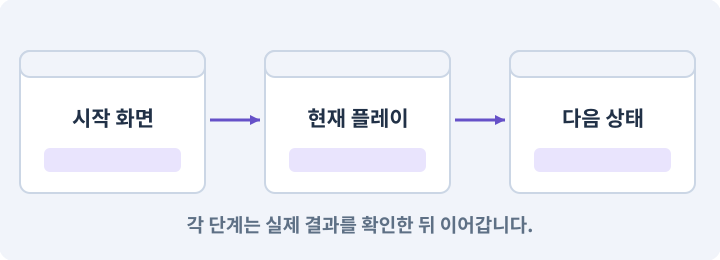

# 160. 대장간 보스까지 완주하고 새 기능 맡기기

**목표:** 기능 요청부터 수정·완주까지 대화로 진행합니다.

**시작 상태:** 최종 확장판과 직접 만든 하네스

## 한눈에 보는 기능의 흐름

타이틀·새 게임 → 대장간 전체 흐름 → 보스·저장 → 새 요구 독립 구현



**경계:** 예제 밖 요구도 계획·수정·검사까지 이어가기

그림은 실제 게임 실행 결과가 아닙니다. 값·규칙과 예제를 필요한 때 펼쳐 읽고 현재 단계의 메시지를 한 번씩 보냅니다.

## 1. 지금 상태 확인하기

첫 메시지를 보내 현재 준비 상태를 확인합니다. AI가 읽어 온 실제 프로젝트가 맞는지 보고, 없는 준비나 다른 상태가 있으면 먼저 알려 주세요. 아직 기능을 만들지 않는 단계입니다.

### AI에게 보낼 요구와 이유

#### 01. 작업 대상부터 확인

**“대장간 보스까지 완주하고 새 기능 맡기기” 작업을 시작하기 전에 현재 상태를 읽기 전용으로 확인해 줘.**

왜 이렇게 요청하나요? AI가 다른 프로젝트나 오래된 예제를 보고 작업할 수 있습니다. 실제 경로·파일·현재 기능을 읽게 하면 지금 이어서 작업할 대상을 먼저 맞출 수 있습니다.

#### 02. 작업 대상부터 확인

**필요한 시작 상태는 최종 확장판과 직접 만든 하네스야.**

왜 이렇게 요청하나요? AI가 다른 프로젝트나 오래된 예제를 보고 작업할 수 있습니다. 실제 경로·파일·현재 기능을 읽게 하면 지금 이어서 작업할 대상을 먼저 맞출 수 있습니다.

#### 03. 실제 사용 중인 구현 재사용

**실제 프로젝트와 작업 기록을 읽고 이것이 준비되어 있는지, 이미 같은 기능이 있는지 확인해 줘.**

왜 이렇게 요청하나요? 이름이 비슷한 새 클래스를 또 만들면 기존 화면은 여전히 옛 코드를 사용할 수 있습니다. 실제 호출되는 진입점을 찾아 연결해야 두 구현이 충돌하거나 수정이 반영되지 않는 문제를 막습니다.

#### 04. 현재 상태와 다음 확인 지점 구분

**이번 기능이 연결될 실제 파일·화면·도구와 보존할 기존 동작을 짧게 정리해 줘.**

왜 이렇게 요청하나요? 이미 준비된 기능과 아직 확인하지 못한 기능을 섞으면 불필요한 재설치나 성급한 완료 판정이 생깁니다. 현재 대상과 남은 준비를 나눠 가장 작은 다음 작업을 선택하게 합니다.

#### 05. 조사 단계에서 변경하지 않기

**아직 새 구현·설치·유료 호출·파일 변경은 하지 마.**

왜 이렇게 요청하나요? 현재 상태를 알아보기만 할 때 파일 변경이나 결제가 시작되면 검토 전의 환경이 바뀝니다. 준비 확인과 실제 구현을 나눠 되돌리기 어려운 작업이 먼저 실행되지 않게 합니다.

#### 06. 막힌 준비를 먼저 해결

**준비가 다르면 부족한 항목과 다음에 필요한 작업을 알려 줘.**

왜 이렇게 요청하나요? 빠진 파일·권한·패키지를 있다고 가정하면 다음 구현이 엉뚱한 대상을 만들게 됩니다. 무엇이 없고 무엇을 먼저 해야 하는지 분리하면 불필요한 재작업을 줄일 수 있습니다.

<details>
<summary>보낼 원문 전체 — 설명은 복사되지 않습니다</summary>

```text
“대장간 보스까지 완주하고 새 기능 맡기기” 작업을 시작하기 전에 현재 상태를 읽기 전용으로 확인해 줘.
필요한 시작 상태는 최종 확장판과 직접 만든 하네스야. 실제 프로젝트와 작업 기록을 읽고 이것이 준비되어 있는지, 이미 같은 기능이 있는지 확인해 줘.
이번 기능이 연결될 실제 파일·화면·도구와 보존할 기존 동작을 짧게 정리해 줘. 아직 새 구현·설치·유료 호출·파일 변경은 하지 마. 준비가 다르면 부족한 항목과 다음에 필요한 작업을 알려 줘.
```

</details>

**기대 결과:** 최종 플레이 순서와 미실행 조건

### 직접 확인하기

1. AI가 읽은 실제 프로젝트 또는 도구 경로를 확인합니다.
2. 필수 준비가 없다면 문제 해결 요청을 보내고, 준비됐을 때 다음으로 갑니다.

## 2. 요청한 작업 진행하기

준비가 확인되면 아래 요청을 보냅니다. AI가 파일·설정·실행을 맡습니다. 변경 범위나 비용 승인이 나오면 내용을 읽고 결정하세요.

### AI에게 보낼 요구와 이유

#### 01. 관찰 가능한 기준으로 확인

**내가 만든 하네스의 실제 경로와 현재 게임 후보를 확인하고 game-feature로 이 작업을 처리해 줘.**

왜 이렇게 요청하나요? 구현 완료라는 설명을 실제 결과로 바꾸기 위한 조건입니다. 요청에 나온 대상과 경계 상황을 확인해 정상 결과뿐 아니라 실패를 어떻게 구분했는지도 남깁니다.

#### 02. 구현과 판정의 책임 나누기

**필요한 담당 역할만 고르고 구현·QA·독립 검토를 분리해 줘.**

왜 이렇게 요청하나요? 구현자가 자신의 설명만으로 완료를 결정하면 놓친 가정을 그대로 통과시킬 수 있습니다. 원래 요구·실제 변경·테스트를 다른 관점에서 검토하고 쓰기 권한을 나눕니다.

#### 03. 작성한 도구를 실제로 사용

**변경안·승인한 후보·Unity 통합·현재 소스 검사를 실제로 연결하고, 참고 완성본으로 우회하지 마.**

왜 이렇게 요청하나요? 참고 완성본으로 몰래 실행하면 현재 만든 하네스의 누락이나 오류가 드러나지 않습니다. 실행 경로를 확인해 지금 개발한 도구가 작업과 검사를 수행하도록 합니다.

#### 04. 종료 이후의 상태까지 확인

**최종 2D 확장판을 새 게임부터 대장간 보스 보상·저장 재실행까지 검증해 줘.**

왜 이렇게 요청하나요? 현재 화면에서 맞는 값도 저장하거나 다시 구성할 때 빠질 수 있습니다. 실제 종료·불러오기 전후에 ID·옵션·장착·진행을 비교해야 유지되는 범위를 확인할 수 있습니다.

#### 05. 다른 이동 주체의 전환 관리

**필터→구조→분해/제작→룬→동료→유물→보스가 실제 플레이 흐름에서 연결되는지 확인해 줘.**

왜 이렇게 요청하나요? 보조 캐릭터·탈것·수영 상태는 따라가기만 구현하면 길막·중복 생성·옛 입력 문제가 남을 수 있습니다. 제어권·추적 대상·진입과 종료 시 정리를 명확히 합니다.

#### 06. 종료 이후의 상태까지 확인

**Windows/Android·새게임/기존저장·오프라인/선택팩을 구분하고 실행하지 않은 조합은 그대로 표시해 줘.**

왜 이렇게 요청하나요? 현재 화면에서 맞는 값도 저장하거나 다시 구성할 때 빠질 수 있습니다. 실제 종료·불러오기 전후에 ID·옵션·장착·진행을 비교해야 유지되는 범위를 확인할 수 있습니다.

#### 07. 구현과 판정의 책임 나누기

**독립 비평은 실제 관찰 범위만 사용하고 점수로 미검증을 덮지 마.**

왜 이렇게 요청하나요? 구현자가 자신의 설명만으로 완료를 결정하면 놓친 가정을 그대로 통과시킬 수 있습니다. 원래 요구·실제 변경·테스트를 다른 관점에서 검토하고 쓰기 권한을 나눕니다.

#### 08. 관찰 가능한 기준으로 확인

**최종 통합본의 소스·빌드·콘텐츠·증거 해시와 역할별 run·실패·수정·비용을 묶어 보고해 줘.**

왜 이렇게 요청하나요? 구현 완료라는 설명을 실제 결과로 바꾸기 위한 조건입니다. 요청에 나온 대상과 경계 상황을 확인해 정상 결과뿐 아니라 실패를 어떻게 구분했는지도 남깁니다.

#### 09. 구현할 결과와 조건 고정

**자동 게시나 계속되는 백그라운드 작업을 시작하지 마.**

왜 이렇게 요청하나요? “자동 게시나 계속되는 백그라운드 작업을 시작하지 마”를 명시하면 AI가 무엇을 구현하거나 검사해야 하는지 범위를 좁힐 수 있습니다. 기능 요청부터 수정·완주까지 대화로 진행합니다. 이 결과를 확인할 때 이 조건이 실제로 반영됐는지 함께 봅니다.

#### 10. 아래 항목을 완료 조건으로 사용

**이 기능의 규칙:**

왜 이렇게 요청하나요? 요구사항의 목록은 AI에게 참고 설명을 주는 것이 아니라 완료를 판단할 기준을 정합니다. 구현 뒤 각 항목을 실제 입력과 결과에 대응시켜 빠진 조건을 찾습니다.

#### 11. 구현할 결과와 조건 고정

**마지막은 기능 체크박스를 보는 대신 플레이어의 흐름을 완주한다.**

왜 이렇게 요청하나요? “마지막은 기능 체크박스를 보는 대신 플레이어의 흐름을 완주한다”를 명시하면 AI가 무엇을 구현하거나 검사해야 하는지 범위를 좁힐 수 있습니다. 기능 요청부터 수정·완주까지 대화로 진행합니다. 이 결과를 확인할 때 이 조건이 실제로 반영됐는지 함께 봅니다.

#### 12. 다른 이동 주체의 전환 관리

**새 게임→기존 던전과 퀘스트→대장간 진입→대장장이 구조→마을 복귀→분해·제작·룬→동료 선택→유물 선택→새 보스→퀘스트 보상→저장·재실행의 흐름이다.**

왜 이렇게 요청하나요? 보조 캐릭터·탈것·수영 상태는 따라가기만 구현하면 길막·중복 생성·옛 입력 문제가 남을 수 있습니다. 제어권·추적 대상·진입과 종료 시 정리를 명확히 합니다.

#### 13. 종료 이후의 상태까지 확인

**기존 저장 플레이어도 별도 검사한다.**

왜 이렇게 요청하나요? 현재 화면에서 맞는 값도 저장하거나 다시 구성할 때 빠질 수 있습니다. 실제 종료·불러오기 전후에 ID·옵션·장착·진행을 비교해야 유지되는 범위를 확인할 수 있습니다.

#### 14. 장착 결과를 원본에서 재계산

**전리품 필터가 재료를 놓치게 하지 않는지, 제작을 이해할 수 있는지, 장비·룬·스킬 변형·유물의 선택이 실제 전투에 차이를 만드는지 관찰한다.**

왜 이렇게 요청하나요? 현재 능력치에 보너스를 계속 더하고 빼면 중복 이벤트나 저장 복원에서 오차가 쌓일 수 있습니다. 기본값과 현재 장착 상태에서 다시 계산해야 해제 후 원래 수치로 돌아옵니다.

#### 15. 다른 이동 주체의 전환 관리

**유료 아트나 고해상도팩·동료가 없어도 필수 흐름은 완료되어야 한다.**

왜 이렇게 요청하나요? 보조 캐릭터·탈것·수영 상태는 따라가기만 구현하면 길막·중복 생성·옛 입력 문제가 남을 수 있습니다. 제어권·추적 대상·진입과 종료 시 정리를 명확히 합니다.

#### 16. 비교할 조건 고정

**미검증 재미를 점수 하나로 자동 PASS 처리하지 않는다.**

왜 이렇게 요청하나요? 여러 수치와 화면을 동시에 바꾸면 어떤 선택이 전투를 바꿨는지 알기 어렵습니다. 같은 조건에서 한 요소씩 조정하고 조작 실수·규칙 오류·주관적인 재미를 따로 관찰합니다.

#### 17. 관찰 가능한 기준으로 확인

**하네스를 잘 썼다는 근거는 에이전트 수가 아니라 누가 무엇을 제안했고 어떤 입력을 읽었으며 어떤 실패를 재현·수정했고 어떤 후보를 실제 검증했는지다.**

왜 이렇게 요청하나요? 구현 완료라는 설명을 실제 결과로 바꾸기 위한 조건입니다. 요청에 나온 대상과 경계 상황을 확인해 정상 결과뿐 아니라 실패를 어떻게 구분했는지도 남깁니다.

#### 18. 관찰 가능한 기준으로 확인

**비용·시도 횟수·중단·미검증을 모두 남긴다.**

왜 이렇게 요청하나요? 구현 완료라는 설명을 실제 결과로 바꾸기 위한 조건입니다. 요청에 나온 대상과 경계 상황을 확인해 정상 결과뿐 아니라 실패를 어떻게 구분했는지도 남깁니다.

#### 19. 관찰 가능한 기준으로 확인

**campaign 집계는 이력 보조이고 최종 릴리스는 현재 소스의 전체 검사와 사람의 검토에 달려 있다.**

왜 이렇게 요청하나요? 구현 완료라는 설명을 실제 결과로 바꾸기 위한 조건입니다. 요청에 나온 대상과 경계 상황을 확인해 정상 결과뿐 아니라 실패를 어떻게 구분했는지도 남깁니다.

#### 20. 구현과 실행은 AI에게 맡기기

**코드·설정·파일 생성·실행은 네가 맡고, 필요한 화면과 결과를 보여 줘.**

왜 이렇게 요청하나요? 설명이나 코드 조각만 받으면 실제 파일 생성·연결·실행이 빠질 수 있습니다. AI가 개발 작업까지 수행하고, 사람은 요구·승인·결과 판단을 맡도록 역할을 분명히 합니다.

#### 21. 막힌 준비를 먼저 해결

**수행하지 못한 작업과 필요한 승인·도구 연결은 구분해서 알려 줘.**

왜 이렇게 요청하나요? 빠진 파일·권한·패키지를 있다고 가정하면 다음 구현이 엉뚱한 대상을 만들게 됩니다. 무엇이 없고 무엇을 먼저 해야 하는지 분리하면 불필요한 재작업을 줄일 수 있습니다.

<details>
<summary>보낼 원문 전체 — 설명은 복사되지 않습니다</summary>

```text
내가 만든 하네스의 실제 경로와 현재 게임 후보를 확인하고 game-feature로 이 작업을 처리해 줘. 필요한 담당 역할만 고르고 구현·QA·독립 검토를 분리해 줘. 변경안·승인한 후보·Unity 통합·현재 소스 검사를 실제로 연결하고, 참고 완성본으로 우회하지 마.

최종 2D 확장판을 새 게임부터 대장간 보스 보상·저장 재실행까지 검증해 줘.
필터→구조→분해/제작→룬→동료→유물→보스가 실제 플레이 흐름에서 연결되는지 확인해 줘.
Windows/Android·새게임/기존저장·오프라인/선택팩을 구분하고 실행하지 않은 조합은 그대로 표시해 줘.
독립 비평은 실제 관찰 범위만 사용하고 점수로 미검증을 덮지 마.
최종 통합본의 소스·빌드·콘텐츠·증거 해시와 역할별 run·실패·수정·비용을 묶어 보고해 줘.
자동 게시나 계속되는 백그라운드 작업을 시작하지 마.

이 기능의 규칙:
마지막은 기능 체크박스를 보는 대신 플레이어의 흐름을 완주한다. 새 게임→기존 던전과 퀘스트→대장간 진입→대장장이 구조→마을 복귀→분해·제작·룬→동료 선택→유물 선택→새 보스→퀘스트 보상→저장·재실행의 흐름이다. 기존 저장 플레이어도 별도 검사한다.

전리품 필터가 재료를 놓치게 하지 않는지, 제작을 이해할 수 있는지, 장비·룬·스킬 변형·유물의 선택이 실제 전투에 차이를 만드는지 관찰한다. 유료 아트나 고해상도팩·동료가 없어도 필수 흐름은 완료되어야 한다. 미검증 재미를 점수 하나로 자동 PASS 처리하지 않는다.

하네스를 잘 썼다는 근거는 에이전트 수가 아니라 누가 무엇을 제안했고 어떤 입력을 읽었으며 어떤 실패를 재현·수정했고 어떤 후보를 실제 검증했는지다. 비용·시도 횟수·중단·미검증을 모두 남긴다. campaign 집계는 이력 보조이고 최종 릴리스는 현재 소스의 전체 검사와 사람의 검토에 달려 있다.

코드·설정·파일 생성·실행은 네가 맡고, 필요한 화면과 결과를 보여 줘. 수행하지 못한 작업과 필요한 승인·도구 연결은 구분해서 알려 줘.
```

</details>

**기대 결과:** 확인할 결과: 확장팩 완주와 독립적인 다음 작업을 확인함. AI가 이 상태를 확인할 실제 화면과 변경 내용을 준비합니다. 아직 실행하지 못한 부분은 따로 표시합니다.

### 직접 확인하기

1. 제안서만 반환됐다면 “설명으로 끝내지 말고 승인한 범위의 실제 작업을 수행해 줘”라고 보냅니다.
2. 코드나 설정을 직접 고치라는 안내가 나오면 “작성과 실행은 네가 맡아 줘”라고 요청합니다.

## 3. 결과를 직접 확인하기

먼저 확인 요청을 보내 AI가 검사와 화면을 준비하게 하세요. 그다음 아래 동작을 하나씩 확인합니다.

### AI에게 보낼 요구와 이유

#### 01. 검사할 입력과 관찰 지점 준비

**방금 구현한 기능의 자동 검사와 확인 화면을 준비해 줘.**

왜 이렇게 요청하나요? 정상 예 하나만 보면 실패 조건을 놓치기 쉽습니다. 정상·경계·반례를 실제 입력으로 준비하고 사람이 볼 화면도 맞춰 확인 범위를 분명하게 합니다.

#### 02. 결과를 재확인할 근거 남기기

**정상 동작과 아래 실패 조건을 실제로 검사하고 대상·실행 수·결과를 보여 줘.**

왜 이렇게 요청하나요? “잘 됩니다”라는 요약만으로는 어떤 입력과 버전을 검사했는지 알 수 없습니다. 대상·실행 수·실패 내용·파일을 함께 남겨 같은 조건으로 다시 확인할 수 있게 합니다.

#### 03. 상호작용·NPC·퀘스트의 적용 조건

**기존 던전·퀘스트와 새 지역·대장간·보스 흐름을 모두 실제로 진행한다.**

왜 이렇게 요청하나요? 상호작용은 근처 객체와 대화·문 열기·줍기 등의 행동을 하는 기능입니다. NPC는 플레이어가 아닌 캐릭터, 퀘스트는 목표와 진행·보상 규칙을 가진 작업입니다. NPC의 말풍선을 봤다고 보상 지급이 완료된 것은 아닙니다. 데이터 상태와 저장을 확인합니다.

#### 04. 장착 결과를 원본에서 재계산

**새 게임과 이전 저장에서 소유권·보상·스킬·창고·룬이 일관된다.**

왜 이렇게 요청하나요? 현재 능력치에 보너스를 계속 더하고 빼면 중복 이벤트나 저장 복원에서 오차가 쌓일 수 있습니다. 기본값과 현재 장착 상태에서 다시 계산해야 해제 후 원래 수치로 돌아옵니다.

#### 05. 구현할 결과와 조건 고정

**최종 각 플랫폼의 실제 빌드와 관찰 기록이 같은 소스·콘텐츠 기준을 가리킨다.**

왜 이렇게 요청하나요? “최종 각 플랫폼의 실제 빌드와 관찰 기록이 같은 소스·콘텐츠 기준을 가리킨다”를 명시하면 AI가 무엇을 구현하거나 검사해야 하는지 범위를 좁힐 수 있습니다. 기능 요청부터 수정·완주까지 대화로 진행합니다. 이 결과를 확인할 때 이 조건이 실제로 반영됐는지 함께 봅니다.

#### 06. 관찰 가능한 기준으로 확인

**미검증·실패·차단·사람 검토가 숨겨지지 않고 하네스 기록과 최종 보고가 일치한다.**

왜 이렇게 요청하나요? 구현 완료라는 설명을 실제 결과로 바꾸기 위한 조건입니다. 요청에 나온 대상과 경계 상황을 확인해 정상 결과뿐 아니라 실패를 어떻게 구분했는지도 남깁니다.

#### 07. 사람 검사의 시작점 준비

**내가 조작해야 하는 부분은 실행할 화면과 시작 상태를 준비해 줘.**

왜 이렇게 요청하나요? 같은 기능이라도 시작 상태가 다르면 관찰 결과가 달라집니다. AI가 실행 화면과 재현 위치를 먼저 준비해야 사람이 이동·공격·소리·조작감을 같은 조건에서 확인할 수 있습니다.

#### 08. 사람이 실제로 본 것만 기록

**연결되지 않은 휴대폰의 터치나 사람이 보지 않은 재미·소리 품질을 대신 확인했다고 하지 마.**

왜 이렇게 요청하나요? AI가 준비한 검사와 사람이 직접 플레이하거나 들은 결과는 다른 근거입니다. 관찰하지 않은 조작감·소리·실기기 결과를 임의로 완료 처리하지 않게 합니다.

#### 09. 실제로 실행한 검사만 인정

**테스트 0개와 예전 소스 결과는 현재 성공으로 쓰지 마.**

왜 이렇게 요청하나요? 실행된 검사가 없거나 같은 결과를 중복 집계한 경우는 기능을 확인한 것이 아닙니다. 실행 수와 개별 결과를 함께 확인해야 형식적인 성공 표시를 걸러낼 수 있습니다.

<details>
<summary>보낼 원문 전체 — 설명은 복사되지 않습니다</summary>

```text
방금 구현한 기능의 자동 검사와 확인 화면을 준비해 줘. 정상 동작과 아래 실패 조건을 실제로 검사하고 대상·실행 수·결과를 보여 줘.

기존 던전·퀘스트와 새 지역·대장간·보스 흐름을 모두 실제로 진행한다.

 새 게임과 이전 저장에서 소유권·보상·스킬·창고·룬이 일관된다.

 최종 각 플랫폼의 실제 빌드와 관찰 기록이 같은 소스·콘텐츠 기준을 가리킨다.

 미검증·실패·차단·사람 검토가 숨겨지지 않고 하네스 기록과 최종 보고가 일치한다.

내가 조작해야 하는 부분은 실행할 화면과 시작 상태를 준비해 줘. 연결되지 않은 휴대폰의 터치나 사람이 보지 않은 재미·소리 품질을 대신 확인했다고 하지 마. 테스트 0개와 예전 소스 결과는 현재 성공으로 쓰지 마.
```

</details>

**기대 결과:** 확장팩 완주와 독립적인 다음 작업을 확인함

### 직접 확인하기

1. 새 게임부터 대장간 보스 보상까지 진행합니다.
2. 이전 저장과 오프라인에서도 필요한 흐름을 봅니다.
3. 새로운 작은 기능을 내 말로 정해 계획·구현·검증·인계까지 맡깁니다.

## 4. 결과를 남기고 마무리하기

실제로 본 결과를 아래 메모에 적고 AI에 전달합니다. 결과 저장 요청으로 현재 상태를 남긴 뒤 다음 페이지로 갑니다.

### AI에게 보낼 요구와 이유

#### 01. 결과를 재확인할 근거 남기기

**지금 작업한 “대장간 보스까지 완주하고 새 기능 맡기기”의 실제 결과를 정리해 줘.**

왜 이렇게 요청하나요? “잘 됩니다”라는 요약만으로는 어떤 입력과 버전을 검사했는지 알 수 없습니다. 대상·실행 수·실패 내용·파일을 함께 남겨 같은 조건으로 다시 확인할 수 있게 합니다.

#### 02. 다음 작업이 읽을 인수인계

**변경한 기능·파일·현재 후보와 실제 실행한 검사, 남은 문제를 기능 이름으로 기록해 줘.**

왜 이렇게 요청하나요? 새 AI 세션은 이전 대화 전체를 알고 있다고 보장할 수 없습니다. 현재 후보·파일 위치·실행한 검사·남은 일을 남겨야 같은 작업을 반복하지 않고 이어갈 수 있습니다.

#### 03. 사람이 실제로 본 것만 기록

**자동 검사 결과와 내가 직접 확인한 결과를 구분하고, 내 관찰이 아직 없으면 미확인으로 남겨 줘.**

왜 이렇게 요청하나요? AI가 준비한 검사와 사람이 직접 플레이하거나 들은 결과는 다른 근거입니다. 관찰하지 않은 조작감·소리·실기기 결과를 임의로 완료 처리하지 않게 합니다.

#### 04. 다음 작업이 읽을 인수인계

**재시작하거나 다음 작업에서 읽을 기록의 실제 위치를 알려 줘.**

왜 이렇게 요청하나요? 새 AI 세션은 이전 대화 전체를 알고 있다고 보장할 수 없습니다. 현재 후보·파일 위치·실행한 검사·남은 일을 남겨야 같은 작업을 반복하지 않고 이어갈 수 있습니다.

#### 05. 미확인을 완료와 분리

**아직 확인하지 않은 결과를 완료로 채우지 마.**

왜 이렇게 요청하나요? 만들어진 것, 검사에 실패한 것, 아직 확인하지 못한 것을 나눠야 다음 작업을 정확히 고를 수 있습니다. 실행할 조건이 없는 기능을 성공으로 기록하면 뒤에서 원인을 찾기 어려워집니다.

<details>
<summary>보낼 원문 전체 — 설명은 복사되지 않습니다</summary>

```text
지금 작업한 “대장간 보스까지 완주하고 새 기능 맡기기”의 실제 결과를 정리해 줘. 변경한 기능·파일·현재 후보와 실제 실행한 검사, 남은 문제를 기능 이름으로 기록해 줘.
자동 검사 결과와 내가 직접 확인한 결과를 구분하고, 내 관찰이 아직 없으면 미확인으로 남겨 줘. 재시작하거나 다음 작업에서 읽을 기록의 실제 위치를 알려 줘. 아직 확인하지 않은 결과를 완료로 채우지 마.
```

</details>

**기대 결과:** 현재 상태·검사 결과·남은 문제·다음에 읽을 기록을 확인할 수 있습니다.

### 직접 확인하기

1. 자동 검사와 내 관찰 결과가 섞이지 않았는지 봅니다.
2. 문제가 남았다면 해결 요청을 보내고 같은 동작을 다시 확인합니다.

## 문제가 있으면

### AI에게 보낼 요구와 이유

#### 01. 구현할 결과와 조건 고정

**보지 않은 화면이나 실행하지 않은 기기를 성공으로 적지 마.**

왜 이렇게 요청하나요? “보지 않은 화면이나 실행하지 않은 기기를 성공으로 적지 마”를 명시하면 AI가 무엇을 구현하거나 검사해야 하는지 범위를 좁힐 수 있습니다. 기능 요청부터 수정·완주까지 대화로 진행합니다. 이 결과를 확인할 때 이 조건이 실제로 반영됐는지 함께 봅니다.

#### 02. 관찰 가능한 기준으로 확인

**처음 막힌 지점을 고치고 현재 빌드 전체 흐름을 다시 확인해 줘.**

왜 이렇게 요청하나요? 구현 완료라는 설명을 실제 결과로 바꾸기 위한 조건입니다. 요청에 나온 대상과 경계 상황을 확인해 정상 결과뿐 아니라 실패를 어떻게 구분했는지도 남깁니다.

#### 03. 원인 하나를 좁혀 수정

**새 기능을 추가하지 말고 현재 오류와 실제 로그를 먼저 읽어 줘.**

왜 이렇게 요청하나요? 오류 수정 중 새 기능까지 넣으면 어떤 변경이 문제를 해결하거나 악화했는지 알기 어렵습니다. 원래 재현을 보존하고 작은 변경 뒤 같은 입력과 주변 정상 동작을 다시 확인합니다.

#### 04. 원인 하나를 좁혀 수정

**최소 수정 뒤 같은 재현과 관련 정상 동작을 다시 검사해 줘.**

왜 이렇게 요청하나요? 오류 수정 중 새 기능까지 넣으면 어떤 변경이 문제를 해결하거나 악화했는지 알기 어렵습니다. 원래 재현을 보존하고 작은 변경 뒤 같은 입력과 주변 정상 동작을 다시 확인합니다.

#### 05. 실패도 재현 자료로 보존

**실패 기록은 지우지 마.**

왜 이렇게 요청하나요? 실패한 입력과 로그가 있어야 같은 문제가 다시 생겼을 때 비교할 수 있습니다. 성공 기록으로 덮어쓰지 않고 전후 자료를 남기면 무엇을 고쳤는지 확인할 수 있습니다.

<details>
<summary>보낼 원문 전체 — 설명은 복사되지 않습니다</summary>

```text
보지 않은 화면이나 실행하지 않은 기기를 성공으로 적지 마. 처음 막힌 지점을 고치고 현재 빌드 전체 흐름을 다시 확인해 줘.
새 기능을 추가하지 말고 현재 오류와 실제 로그를 먼저 읽어 줘. 최소 수정 뒤 같은 재현과 관련 정상 동작을 다시 검사해 줘. 실패 기록은 지우지 마.
```

</details>

## 새 세션에서 이어가기

### AI에게 보낼 요구와 이유

#### 01. 이어서 할 작업 식별

**“대장간 보스까지 완주하고 새 기능 맡기기” 작업을 이어가고 싶어.**

왜 이렇게 요청하나요? 이름으로 재개할 작업을 찾고, 뒤에 이어지는 요청으로 실제 파일·진행 중 작업·기록을 다시 읽게 합니다. 제목만 보고 이전 상태를 기억한다고 가정하지 않습니다.

#### 02. 조회는 상태를 바꾸지 않게

**실제 프로젝트와 내 도구의 작업 기록을 읽고 어디까지 구현·검사됐는지 확인해 줘.**

왜 이렇게 요청하나요? 진행 상황을 물을 때 새 구현이나 유료 호출이 시작되면 단순 확인이 실행 명령이 되어 버립니다. 저장된 근거를 읽어 완료·진행·승인 대기·미검증을 나누게 합니다.

#### 03. 재개 전 중복 작업 방지

**진행 중인 프로세스·승인·미저장 변경을 확인한 뒤 남은 가장 작은 작업부터 안내해 줘.**

왜 이렇게 요청하나요? 대화가 끊겨도 외부 작업은 끝났거나 아직 실행 중일 수 있습니다. 프로세스·승인·미저장 상태를 먼저 읽어 같은 생성·빌드·결제를 두 번 시작하지 않도록 합니다.

#### 04. 되돌아갈 원본 남기기

**기존 성공과 실패 기록은 보존해 줘.**

왜 이렇게 요청하나요? 새 구현이 실패해도 이전 게임과 저장을 복원할 수 있어야 합니다. 현재 내용을 먼저 조사하고 별도 후보에서 작업하면 실험이 유일한 정상본을 망가뜨리는 일을 피할 수 있습니다.

<details>
<summary>보낼 원문 전체 — 설명은 복사되지 않습니다</summary>

```text
“대장간 보스까지 완주하고 새 기능 맡기기” 작업을 이어가고 싶어. 실제 프로젝트와 내 도구의 작업 기록을 읽고 어디까지 구현·검사됐는지 확인해 줘. 진행 중인 프로세스·승인·미저장 변경을 확인한 뒤 남은 가장 작은 작업부터 안내해 줘. 기존 성공과 실패 기록은 보존해 줘.
```

</details>

## 새 요구를 한 번 끝까지 진행하기

기존 확장팩에 작은 기능 하나를 정하고 계획→역할 작업→검토→후보→실제 검사→수정→두 플랫폼 확인을 진행하세요. 기존 예제를 그대로 복제하지 말고 새로운 예외 조건을 하나 넣습니다.

**확인할 결과:** 원래 요청, 예외 조건, 실제 변경, 실패와 수정, 현재 결과, 다음 세션 인수인계가 연결되어야 합니다.

## 왜 이렇게 만드는가

마지막은 기능 체크박스를 보는 대신 플레이어의 흐름을 완주한다. 새 게임→기존 던전과 퀘스트→대장간 진입→대장장이 구조→마을 복귀→분해·제작·룬→동료 선택→유물 선택→새 보스→퀘스트 보상→저장·재실행의 흐름이다. 기존 저장 플레이어도 별도 검사한다.

전리품 필터가 재료를 놓치게 하지 않는지, 제작을 이해할 수 있는지, 장비·룬·스킬 변형·유물의 선택이 실제 전투에 차이를 만드는지 관찰한다. 유료 아트나 고해상도팩·동료가 없어도 필수 흐름은 완료되어야 한다. 미검증 재미를 점수 하나로 자동 PASS 처리하지 않는다.

## 공식 참고

