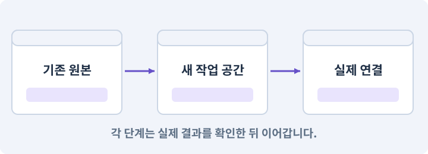

# 161. 회색 서약: 새 3D RPG의 제작 범위 정하기

**목표:** 기존 게임을 보존하고 새 프로젝트의 범위와 끝까지 이어질 이야기를 정합니다.

**시작 상태:** 기존 2D RPG와 AI 하네스를 사용한 경험. 81~104의 3D 이동·카메라·물리 개념을 먼저 읽으면 좋습니다

## 한눈에 보는 기능의 흐름

기존 게임 보존 → 새 GrayOath 프로젝트 → 세 지역·28퀘스트 → 타이틀부터 세 엔딩



**경계:** 원작급 분량을 이미 완성한 것으로 표현하지 않기

그림은 실제 게임 실행 결과가 아닙니다. 값·규칙과 예제를 필요한 때 펼쳐 읽고 현재 단계의 메시지를 한 번씩 보냅니다.

## 1. 지금 상태 확인하기

첫 메시지를 보내 현재 프로젝트와 필요한 준비가 맞는지 확인하세요. 이름만 같은 예제를 실제 게임으로 착각하지 않습니다.

### AI에게 보낼 요구와 이유

#### 01. 작업 대상부터 확인

**기존 AshfallRPG2D와 AshfallRPG3D, 내 하네스의 실제 위치와 정상 저장·빌드 기록을 읽기 전용으로 확인해 줘.**

왜 이렇게 요청하나요? AI가 다른 프로젝트나 오래된 예제를 보고 작업할 수 있습니다. 실제 경로·파일·현재 기능을 읽게 하면 지금 이어서 작업할 대상을 먼저 맞출 수 있습니다.

#### 02. 내 PC와 작업 세션 연결 확인

**새 GrayOathRPG3D를 둘 위치와 현재 로컬 AI·Unity CLI 연결을 확인하되, 기존 프로젝트와 세이브를 수정하지 마.**

왜 이렇게 요청하나요? 웹 대화가 열린 것만으로 내 PC의 파일이나 Unity를 조작할 수 있는 것은 아닙니다. 실제 파일 읽기와 도구 호출의 결과로 어느 컴퓨터에서 작업하는지 확인합니다.

<details>
<summary>보낼 원문 전체 — 설명은 복사되지 않습니다</summary>

```text
기존 AshfallRPG2D와 AshfallRPG3D, 내 하네스의 실제 위치와 정상 저장·빌드 기록을 읽기 전용으로 확인해 줘. 새 GrayOathRPG3D를 둘 위치와 현재 로컬 AI·Unity CLI 연결을 확인하되, 기존 프로젝트와 세이브를 수정하지 마.
```

</details>

**기대 결과:** 기존 프로젝트·하네스·원본 보존 위치의 실제 위치·연결과 준비 여부

### 직접 확인하기

1. 새 프로젝트가 기존 게임과 다른 위치인지 확인합니다.
2. 필요한 준비가 없으면 먼저 해결하도록 요청합니다. 코드를 직접 입력하지 않습니다.

## 2. 이번 기능 만들기

아래 요청을 보냅니다. 코드와 도구 제작·데이터 입력은 AI가 합니다. 먼저 작은 결과를 보고 나머지 조건을 확인하세요.

### AI에게 보낼 요구와 이유

#### 01. 되돌아갈 원본 남기기

**기존 게임은 그대로 두고 GrayOathRPG3D라는 새 오프라인 3D 액션 RPG를 준비해 줘.**

왜 이렇게 요청하나요? 새 구현이 실패해도 이전 게임과 저장을 복원할 수 있어야 합니다. 현재 내용을 먼저 조사하고 별도 후보에서 작업하면 실험이 유일한 정상본을 망가뜨리는 일을 피할 수 있습니다.

#### 02. 구현할 결과와 조건 고정

**주인공은 사냥꾼 서린, 무대는 물안개 마을·갈대늪, 철문 장터·철문 고개, 잿빛 성채야.**

왜 이렇게 요청하나요? “주인공은 사냥꾼 서린, 무대는 물안개 마을·갈대늪, 철문 장터·철문 고개, 잿빛 성채야”를 명시하면 AI가 무엇을 구현하거나 검사해야 하는지 범위를 좁힐 수 있습니다. 기존 게임을 보존하고 새 프로젝트의 범위와 끝까지 이어질 이야기를 정합니다. 이 결과를 확인할 때 이 조건이 실제로 반영됐는지 함께 봅니다.

#### 03. 연출 전후의 실제 진행 유지

**안개의 근원에 얽힌 사람들과 계약을 조사한 뒤 봉인·공존·단절 중 한 결말에 도달해.**

왜 이렇게 요청하나요? 영상이나 대사를 건너뛰어도 보상·다음 상태·조작권은 일관되게 처리되어야 합니다. 연출 재생 여부와 게임 진행을 분리해 엔딩·재개가 막히지 않게 합니다.

#### 04. 환경 변화 줄이기

**Unity 6.3 LTS에서 사용할 패치를 고정하고 Universal 3D/URP 프로젝트를 별도 위치에 생성해 줘.**

왜 이렇게 요청하나요? 기능을 만드는 중 엔진·패키지 버전까지 바뀌면 오류 원인이 섞입니다. 시작 버전을 고정하고 변경은 따로 판단해야 AI가 같은 API와 설정을 기준으로 작업할 수 있습니다.

#### 05. 3D 프로젝트의 렌더러를 별도로 구성

**Universal Renderer를 사용하고 기존 2D Renderer 설정을 가져오지 마.**

왜 이렇게 요청하나요? 2D용 렌더러 설정을 그대로 가져오면 3D 재질·조명·그림자와 맞지 않을 수 있습니다. 기존 2D 프로젝트는 보존하고 새 3D 렌더 경로에서 자산을 확인합니다.

#### 06. 관찰 가능한 기준으로 확인

**이미 지정한 폴더가 있으면 덮어쓰지 말고 실제 내용을 먼저 확인해 줘.**

왜 이렇게 요청하나요? 구현 완료라는 설명을 실제 결과로 바꾸기 위한 조건입니다. 요청에 나온 대상과 경계 상황을 확인해 정상 결과뿐 아니라 실패를 어떻게 구분했는지도 남깁니다.

#### 07. 플랫폼 빌드 준비 맞추기

**Windows와 Android에 필요한 Editor 모듈도 조사하되 설치는 승인받아 수행해 줘.**

왜 이렇게 요청하나요? Editor에서 실행되는 것과 Android 설치 파일을 만드는 데 필요한 도구는 다릅니다. Editor와 맞는 빌드 지원을 준비해야 코드 문제와 빌드 환경 문제를 구분할 수 있습니다.

#### 08. 제작물과 사용 권한 추적

**원작 게임의 이름·캐릭터·자산은 제품 안에 복제하지 마.**

왜 이렇게 요청하나요? 자산을 받았다는 사실만으로 배포에 필요한 사용 조건이 확인된 것은 아닙니다. 출처·제작 경로·허용 범위를 남겨 나중에 교체하거나 공개할 때 판단할 수 있게 합니다.

#### 09. 저장 중단과 손상에 대비

**새 데이터 ID와 저장 경로를 만들고 이전 세이브는 자동으로 가져오지 마.**

왜 이렇게 요청하나요? 파일 쓰기가 중단되거나 읽을 수 없는 값이 있으면 정상 진행을 잃을 수 있습니다. 완성된 데이터 검증·교체·백업 복구를 나눠 손상된 자료가 정상본을 덮지 않게 합니다.

#### 10. 성장을 한 번씩 정확히 반영

**제작 범위는 3개 야외 지역(각 초기 384×384m), 두 마을, 실내 5곳, 28퀘스트(메인10/서브8/계약6/탐험4), 레벨1~20, 24스킬 노드·장착6칸, 근접·석궁·폭탄·마법5개, 말·수영·작은 배·미니게임1개야.**

왜 이렇게 요청하나요? 처치 이벤트가 반복되거나 큰 경험치로 여러 단계를 넘으면 성장 수치가 빠지거나 중복될 수 있습니다. 증가·해금·상한을 한 흐름으로 처리하고 경계값을 검사합니다.

#### 11. 저장 중단과 손상에 대비

**네트워크 대전·클라우드 세이브·게임 중 LLM 호출은 만들지 마.**

왜 이렇게 요청하나요? 파일 쓰기가 중단되거나 읽을 수 없는 값이 있으면 정상 진행을 잃을 수 있습니다. 완성된 데이터 검증·교체·백업 복구를 나눠 손상된 자료가 정상본을 덮지 않게 합니다.

#### 12. 종료 이후의 상태까지 확인

**Windows를 기준 화질로, Android는 같은 이야기·저장 규칙에 낮은 밀도와 화질을 가진 별도 빌드로 설계해 줘.**

왜 이렇게 요청하나요? 현재 화면에서 맞는 값도 저장하거나 다시 구성할 때 빠질 수 있습니다. 실제 종료·불러오기 전후에 ID·옵션·장착·진행을 비교해야 유지되는 범위를 확인할 수 있습니다.

#### 13. 설계 목표와 측정 결과 구분

**목표 프레임은 PC60/Android30이지만 아직 성능으로 보고하지 마.**

왜 이렇게 요청하나요? 60fps·30fps는 아직 달성한 수치가 아니라 목표입니다. 실제 대상 빌드에서 정한 장면을 측정한 뒤 조건과 결과를 함께 기록해야 합니다.

#### 14. 규칙과 화면 구현 분리

**먼저 재사용 가능한 순수 규칙만 목록으로 만들고 독립 프로젝트·범위 기록·미구현 목록을 보여 줘.**

왜 이렇게 요청하나요? 피해 계산·아이템 ID 같은 규칙은 재사용할 수 있지만 물리·렌더링·입력 연결은 환경에 맞아야 합니다. 무엇을 유지하고 무엇을 교체하는지 먼저 구분해 불필요한 의존성을 가져오지 않게 합니다.

#### 15. 규칙과 화면 구현 분리

**기존 게임의 모든 파일을 복사해 새 프로젝트라고 부르지 마.**

왜 이렇게 요청하나요? 피해 계산·아이템 ID 같은 규칙은 재사용할 수 있지만 물리·렌더링·입력 연결은 환경에 맞아야 합니다. 무엇을 유지하고 무엇을 교체하는지 먼저 구분해 불필요한 의존성을 가져오지 않게 합니다.

#### 16. 구현과 실행은 AI에게 맡기기

**파일·코드·설정·Editor 조작·명령 실행은 네가 맡아 줘.**

왜 이렇게 요청하나요? 설명이나 코드 조각만 받으면 실제 파일 생성·연결·실행이 빠질 수 있습니다. AI가 개발 작업까지 수행하고, 사람은 요구·승인·결과 판단을 맡도록 역할을 분명히 합니다.

#### 17. 실제 사용 중인 코드에 연결

**먼저 실제 구현을 읽고 기존 진입점을 재사용해 줘.**

왜 이렇게 요청하나요? 예제와 이름이 다르더라도 현재 씬과 입력에서 호출하는 구현이 작업 대상입니다. 같은 기능을 새로 만들기보다 기존 진입점을 확인해 수정이 실제 게임에 반영되고 중복 실행되지 않게 합니다.

#### 18. 관찰 가능한 기준으로 확인

**이번 기능을 작은 변경으로 나눠 컴파일·관련 테스트·실제 씬 연결까지 수행해 줘.**

왜 이렇게 요청하나요? 구현 완료라는 설명을 실제 결과로 바꾸기 위한 조건입니다. 요청에 나온 대상과 경계 상황을 확인해 정상 결과뿐 아니라 실패를 어떻게 구분했는지도 남깁니다.

#### 19. 실패를 숨기지 않기

**테스트를 삭제하거나 조건을 낮춰 통과시키지 마.**

왜 이렇게 요청하나요? 검사 조건을 약하게 만들면 결함이 남아 있어도 통과 표시가 나올 수 있습니다. 구현을 고친 뒤 원래 기준으로 다시 검사해야 실제 문제가 해결됐는지 알 수 있습니다.

#### 20. 비용과 외부 작업은 별도 승인

**새 비용·외부 전송·게시에는 별도 승인이 필요해.**

왜 이렇게 요청하나요? 로컬 파일을 고치는 것과 외부 서비스에 자료를 보내거나 비용을 지불하는 것은 영향이 다릅니다. 대상·내용·비용 범위를 확인한 승인 없이 요청이 확대되지 않도록 합니다.

#### 21. 사람 검사의 시작점 준비

**실제 실행하지 못한 작업과 내가 직접 볼 부분은 구분해 줘.**

왜 이렇게 요청하나요? 같은 기능이라도 시작 상태가 다르면 관찰 결과가 달라집니다. AI가 실행 화면과 재현 위치를 먼저 준비해야 사람이 이동·공격·소리·조작감을 같은 조건에서 확인할 수 있습니다.

<details>
<summary>보낼 원문 전체 — 설명은 복사되지 않습니다</summary>

```text
기존 게임은 그대로 두고 GrayOathRPG3D라는 새 오프라인 3D 액션 RPG를 준비해 줘. 주인공은 사냥꾼 서린, 무대는 물안개 마을·갈대늪, 철문 장터·철문 고개, 잿빛 성채야. 안개의 근원에 얽힌 사람들과 계약을 조사한 뒤 봉인·공존·단절 중 한 결말에 도달해.
Unity 6.3 LTS에서 사용할 패치를 고정하고 Universal 3D/URP 프로젝트를 별도 위치에 생성해 줘. Universal Renderer를 사용하고 기존 2D Renderer 설정을 가져오지 마. 이미 지정한 폴더가 있으면 덮어쓰지 말고 실제 내용을 먼저 확인해 줘. Windows와 Android에 필요한 Editor 모듈도 조사하되 설치는 승인받아 수행해 줘.
원작 게임의 이름·캐릭터·자산은 제품 안에 복제하지 마. 새 데이터 ID와 저장 경로를 만들고 이전 세이브는 자동으로 가져오지 마.
제작 범위는 3개 야외 지역(각 초기 384×384m), 두 마을, 실내 5곳, 28퀘스트(메인10/서브8/계약6/탐험4), 레벨1~20, 24스킬 노드·장착6칸, 근접·석궁·폭탄·마법5개, 말·수영·작은 배·미니게임1개야. 네트워크 대전·클라우드 세이브·게임 중 LLM 호출은 만들지 마.
Windows를 기준 화질로, Android는 같은 이야기·저장 규칙에 낮은 밀도와 화질을 가진 별도 빌드로 설계해 줘. 목표 프레임은 PC60/Android30이지만 아직 성능으로 보고하지 마.
먼저 재사용 가능한 순수 규칙만 목록으로 만들고 독립 프로젝트·범위 기록·미구현 목록을 보여 줘. 기존 게임의 모든 파일을 복사해 새 프로젝트라고 부르지 마.

파일·코드·설정·Editor 조작·명령 실행은 네가 맡아 줘. 먼저 실제 구현을 읽고 기존 진입점을 재사용해 줘. 이번 기능을 작은 변경으로 나눠 컴파일·관련 테스트·실제 씬 연결까지 수행해 줘. 테스트를 삭제하거나 조건을 낮춰 통과시키지 마. 새 비용·외부 전송·게시에는 별도 승인이 필요해. 실제 실행하지 못한 작업과 내가 직접 볼 부분은 구분해 줘.
```

</details>

**기대 결과:** 새 프로젝트 위치, 게임 범위표, 기존 자료의 보존 위치가 보이는 준비 보고

### 직접 확인하기

1. AI에게 아래 목표 화면을 열어 달라고 하고 실제로 보이는지 확인합니다.
2. 확인할 화면: 새 프로젝트 위치, 게임 범위표, 기존 자료의 보존 위치가 보이는 준비 보고

## 3. 직접 써 보고 반례 확인하기

AI가 검사와 화면을 준비한 뒤 다음 동작을 하나씩 해 보세요. Editor 버튼은 완성된 도구를 사용하는 조작이며 코드나 데이터 파일을 직접 편집하지 않습니다.

### AI에게 보낼 요구와 이유

#### 01. 현재 코드와 검사 결과 연결

**방금 만든 기능을 현재 소스에서 검증하고 내가 볼 시작 화면을 준비해 줘.**

왜 이렇게 요청하나요? 코드나 설정이 바뀌면 이전 버전에서 통과한 검사로 새 버전의 정상 동작을 보장할 수 없습니다. 어떤 소스에서 나온 결과인지 묶어야 바뀐 부분을 다시 검사할 수 있습니다.

#### 02. 검사할 입력과 관찰 지점 준비

**다음 항목을 실제 검사해 줘.**

왜 이렇게 요청하나요? 정상 예 하나만 보면 실패 조건을 놓치기 쉽습니다. 정상·경계·반례를 실제 입력으로 준비하고 사람이 볼 화면도 맞춰 확인 범위를 분명하게 합니다.

#### 03. 되돌아갈 원본 남기기

**- 기존 프로젝트 파일과 저장의 해시 불변**

왜 이렇게 요청하나요? 새 구현이 실패해도 이전 게임과 저장을 복원할 수 있어야 합니다. 현재 내용을 먼저 조사하고 별도 후보에서 작업하면 실험이 유일한 정상본을 망가뜨리는 일을 피할 수 있습니다.

#### 04. 구현할 결과와 조건 고정

**- 새 namespace·application ID·saveRoot 분리**

왜 이렇게 요청하나요? “새 namespace·application ID·saveRoot 분리”를 명시하면 AI가 무엇을 구현하거나 검사해야 하는지 범위를 좁힐 수 있습니다. 기존 게임을 보존하고 새 프로젝트의 범위와 끝까지 이어질 이야기를 정합니다. 이 결과를 확인할 때 이 조건이 실제로 반영됐는지 함께 봅니다.

#### 05. 미확인을 완료와 분리

**- 플랫폼별 목표와 미실행 항목 표시**

왜 이렇게 요청하나요? 만들어진 것, 검사에 실패한 것, 아직 확인하지 못한 것을 나눠야 다음 작업을 정확히 고를 수 있습니다. 실행할 조건이 없는 기능을 성공으로 기록하면 뒤에서 원인을 찾기 어려워집니다.

#### 06. 결과를 재확인할 근거 남기기

**오류 로그·대상·실행 수·파일 해시를 남겨 줘.**

왜 이렇게 요청하나요? “잘 됩니다”라는 요약만으로는 어떤 입력과 버전을 검사했는지 알 수 없습니다. 대상·실행 수·실패 내용·파일을 함께 남겨 같은 조건으로 다시 확인할 수 있게 합니다.

#### 07. 보여 준 자료의 한계 구분

**화면 캡처만으로 조작 성공을, 모의 응답만으로 실제 AI 호출을 주장하지 마.**

왜 이렇게 요청하나요? 사진 한 장은 입력·저장·시간에 따른 동작까지 증명하지 못하고, 정해진 모의 응답은 실제 서비스 호출이 아닙니다. 각각 확인할 수 있는 범위만 기록하게 하는 요청입니다.

#### 08. 사람 검사의 시작점 준비

**내 관찰·기기 검사가 필요한 부분은 실행 화면을 준비하고 별도로 표시해 줘.**

왜 이렇게 요청하나요? 같은 기능이라도 시작 상태가 다르면 관찰 결과가 달라집니다. AI가 실행 화면과 재현 위치를 먼저 준비해야 사람이 이동·공격·소리·조작감을 같은 조건에서 확인할 수 있습니다.

<details>
<summary>보낼 원문 전체 — 설명은 복사되지 않습니다</summary>

```text
방금 만든 기능을 현재 소스에서 검증하고 내가 볼 시작 화면을 준비해 줘. 다음 항목을 실제 검사해 줘.
- 기존 프로젝트 파일과 저장의 해시 불변
- 새 namespace·application ID·saveRoot 분리
- 플랫폼별 목표와 미실행 항목 표시
오류 로그·대상·실행 수·파일 해시를 남겨 줘. 화면 캡처만으로 조작 성공을, 모의 응답만으로 실제 AI 호출을 주장하지 마. 내 관찰·기기 검사가 필요한 부분은 실행 화면을 준비하고 별도로 표시해 줘.
```

</details>

**기대 결과:** 정상 동작과 실패 조건의 결과가 따로 보이고, 직접 확인할 화면이 준비됨

### 직접 확인하기

1. 기존 2D 게임과 새 게임 경로가 다른지 봅니다.
2. 주인공·세 지역·세 엔딩의 이름과 제외 범위를 읽습니다.
3. 지금 만든 것이 완성 게임이 아니라 준비 상태임을 확인합니다.

## 4. 결과를 남기고 이어가기

실제로 본 결과를 메모해 전달하세요. 실패했다면 현재 페이지의 “막혔어요” 요청으로 같은 문제부터 고칩니다.

### AI에게 보낼 요구와 이유

#### 01. 다음 작업이 읽을 인수인계

**“회색 서약: 새 3D RPG의 제작 범위 정하기” 작업을 마무리해 줘.**

왜 이렇게 요청하나요? 새 AI 세션은 이전 대화 전체를 알고 있다고 보장할 수 없습니다. 현재 후보·파일 위치·실행한 검사·남은 일을 남겨야 같은 작업을 반복하지 않고 이어갈 수 있습니다.

#### 02. 미확인을 완료와 분리

**실제로 만든 파일과 연결한 Editor 도구, 검사한 소스·데이터 버전, 성공·실패·미실행을 구분해 기록해 줘.**

왜 이렇게 요청하나요? 만들어진 것, 검사에 실패한 것, 아직 확인하지 못한 것을 나눠야 다음 작업을 정확히 고를 수 있습니다. 실행할 조건이 없는 기능을 성공으로 기록하면 뒤에서 원인을 찾기 어려워집니다.

#### 03. 관찰하지 않은 성공을 채우지 않기

**내가 전달한 관찰만 사람 검사에 반영해 줘.**

왜 이렇게 요청하나요? 자동 검사·AI의 추정·사람의 실제 관찰은 다른 종류의 근거입니다. 수행하지 않은 기기나 조작 검사는 미확인으로 남겨 나중에 실제 확인할 수 있게 합니다.

#### 04. 미확인을 완료와 분리

**미완료 상태를 완료로 바꾸지 말고, 정상 후보와 이전 기록을 보존해 다음 세션에서 이어갈 진입점을 남겨 줘.**

왜 이렇게 요청하나요? 만들어진 것, 검사에 실패한 것, 아직 확인하지 못한 것을 나눠야 다음 작업을 정확히 고를 수 있습니다. 실행할 조건이 없는 기능을 성공으로 기록하면 뒤에서 원인을 찾기 어려워집니다.

<details>
<summary>보낼 원문 전체 — 설명은 복사되지 않습니다</summary>

```text
“회색 서약: 새 3D RPG의 제작 범위 정하기” 작업을 마무리해 줘. 실제로 만든 파일과 연결한 Editor 도구, 검사한 소스·데이터 버전, 성공·실패·미실행을 구분해 기록해 줘. 내가 전달한 관찰만 사람 검사에 반영해 줘. 미완료 상태를 완료로 바꾸지 말고, 정상 후보와 이전 기록을 보존해 다음 세션에서 이어갈 진입점을 남겨 줘.
```

</details>

**기대 결과:** 실제 구현·검사·관찰과 다음 시작점이 프로젝트 기록에 남음

### 직접 확인하기

1. 직접 보지 않은 결과가 완료로 적히지 않았는지 확인합니다.
2. 미완료 문제가 없다면 결과를 확인한 뒤 다음 페이지로 갑니다.

## 이 작업에서 사용할 값과 규칙 전체

설계 시작값이며 측정된 성능·게임 성공 결과가 아닙니다. 구현은 AI가 수행합니다.

기존 게임은 그대로 두고 GrayOathRPG3D라는 새 오프라인 3D 액션 RPG를 준비해 줘. 주인공은 사냥꾼 서린, 무대는 물안개 마을·갈대늪, 철문 장터·철문 고개, 잿빛 성채야. 안개의 근원에 얽힌 사람들과 계약을 조사한 뒤 봉인·공존·단절 중 한 결말에 도달해.
Unity 6.3 LTS에서 사용할 패치를 고정하고 Universal 3D/URP 프로젝트를 별도 위치에 생성해 줘. Universal Renderer를 사용하고 기존 2D Renderer 설정을 가져오지 마. 이미 지정한 폴더가 있으면 덮어쓰지 말고 실제 내용을 먼저 확인해 줘. Windows와 Android에 필요한 Editor 모듈도 조사하되 설치는 승인받아 수행해 줘.
원작 게임의 이름·캐릭터·자산은 제품 안에 복제하지 마. 새 데이터 ID와 저장 경로를 만들고 이전 세이브는 자동으로 가져오지 마.
제작 범위는 3개 야외 지역(각 초기 384×384m), 두 마을, 실내 5곳, 28퀘스트(메인10/서브8/계약6/탐험4), 레벨1~20, 24스킬 노드·장착6칸, 근접·석궁·폭탄·마법5개, 말·수영·작은 배·미니게임1개야. 네트워크 대전·클라우드 세이브·게임 중 LLM 호출은 만들지 마.
Windows를 기준 화질로, Android는 같은 이야기·저장 규칙에 낮은 밀도와 화질을 가진 별도 빌드로 설계해 줘. 목표 프레임은 PC60/Android30이지만 아직 성능으로 보고하지 마.
먼저 재사용 가능한 순수 규칙만 목록으로 만들고 독립 프로젝트·범위 기록·미구현 목록을 보여 줘. 기존 게임의 모든 파일을 복사해 새 프로젝트라고 부르지 마.

## 문제가 있으면

### AI에게 보낼 요구와 이유

#### 01. 연출 전후의 실제 진행 유지

**범위가 원작 전체 재현이나 새 대규모 온라인 기능으로 커졌다면 세 지역·28퀘스트·세 엔딩으로 되돌려 줘.**

왜 이렇게 요청하나요? 영상이나 대사를 건너뛰어도 보상·다음 상태·조작권은 일관되게 처리되어야 합니다. 연출 재생 여부와 게임 진행을 분리해 엔딩·재개가 막히지 않게 합니다.

#### 02. 원인 하나를 좁혀 수정

**현재 대상과 실제 오류부터 읽고 최소 수정해 줘.**

왜 이렇게 요청하나요? 오류 수정 중 새 기능까지 넣으면 어떤 변경이 문제를 해결하거나 악화했는지 알기 어렵습니다. 원래 재현을 보존하고 작은 변경 뒤 같은 입력과 주변 정상 동작을 다시 확인합니다.

#### 03. 원인 하나를 좁혀 수정

**이전 정상 후보와 실패 근거는 보존하고 같은 반례와 관련 정상 동작을 다시 검사해 줘.**

왜 이렇게 요청하나요? 오류 수정 중 새 기능까지 넣으면 어떤 변경이 문제를 해결하거나 악화했는지 알기 어렵습니다. 원래 재현을 보존하고 작은 변경 뒤 같은 입력과 주변 정상 동작을 다시 확인합니다.

#### 04. 구현과 실행은 AI에게 맡기기

**작업을 다른 기능으로 돌리거나 내가 코드·설정을 편집하게 하지 마.**

왜 이렇게 요청하나요? 설명이나 코드 조각만 받으면 실제 파일 생성·연결·실행이 빠질 수 있습니다. AI가 개발 작업까지 수행하고, 사람은 요구·승인·결과 판단을 맡도록 역할을 분명히 합니다.

<details>
<summary>보낼 원문 전체 — 설명은 복사되지 않습니다</summary>

```text
범위가 원작 전체 재현이나 새 대규모 온라인 기능으로 커졌다면 세 지역·28퀘스트·세 엔딩으로 되돌려 줘.
현재 대상과 실제 오류부터 읽고 최소 수정해 줘. 이전 정상 후보와 실패 근거는 보존하고 같은 반례와 관련 정상 동작을 다시 검사해 줘. 작업을 다른 기능으로 돌리거나 내가 코드·설정을 편집하게 하지 마.
```

</details>

## 새 세션에서 이어가기

### AI에게 보낼 요구와 이유

#### 01. 이어서 할 작업 식별

**“회색 서약: 새 3D RPG의 제작 범위 정하기” 작업을 이어가고 싶어.**

왜 이렇게 요청하나요? 이름으로 재개할 작업을 찾고, 뒤에 이어지는 요청으로 실제 파일·진행 중 작업·기록을 다시 읽게 합니다. 제목만 보고 이전 상태를 기억한다고 가정하지 않습니다.

#### 02. 재개 전 중복 작업 방지

**실제 GrayOathRPG3D와 내 하네스의 기록·진행 중 작업·승인 상태를 읽고, 마지막으로 검증한 결과와 남은 일을 구분해 줘.**

왜 이렇게 요청하나요? 대화가 끊겨도 외부 작업은 끝났거나 아직 실행 중일 수 있습니다. 프로세스·승인·미저장 상태를 먼저 읽어 같은 생성·빌드·결제를 두 번 시작하지 않도록 합니다.

#### 03. 재개 전 중복 작업 방지

**다른 프로젝트를 바꾸거나 유료 요청을 중복 제출하지 말고 가장 작은 미완료 작업부터 진행해 줘.**

왜 이렇게 요청하나요? 대화가 끊겨도 외부 작업은 끝났거나 아직 실행 중일 수 있습니다. 프로세스·승인·미저장 상태를 먼저 읽어 같은 생성·빌드·결제를 두 번 시작하지 않도록 합니다.

<details>
<summary>보낼 원문 전체 — 설명은 복사되지 않습니다</summary>

```text
“회색 서약: 새 3D RPG의 제작 범위 정하기” 작업을 이어가고 싶어. 실제 GrayOathRPG3D와 내 하네스의 기록·진행 중 작업·승인 상태를 읽고, 마지막으로 검증한 결과와 남은 일을 구분해 줘. 다른 프로젝트를 바꾸거나 유료 요청을 중복 제출하지 말고 가장 작은 미완료 작업부터 진행해 줘.
```

</details>

## 왜 이렇게 만드는가

이번 게임은 《회색 서약: 안개골의 사냥꾼》입니다. 위쳐 3에서 떠올리는 탐험·의뢰·준비형 전투·대화 선택을 작은 독립 게임에 담습니다. 원작의 캐릭터·대사·맵·음악·로고를 사용하지 않습니다.

넓이와 자산 수를 줄이고 시스템은 연결합니다. 목표는 세 지역, 두 마을, 실내 다섯 곳, 메인 10·서브 8·사냥 계약 6·탐험 4의 퀘스트 28개와 세 엔딩입니다. 원작 전체나 같은 제작 규모를 재현했다는 뜻은 아닙니다.

## 공식 참고

- [Unity · CLI reference](https://docs.unity.com/en-us/unity-cli/unity-cli-reference)


## 실제 Unity Editor 화면 참고
공식 예시와 내 프로젝트 실행 결과를 구분하세요. 원본 사진은 온라인 연결이 필요합니다.

- [Editor 전체 배치 — 어디를 보고 있는지 구분하기](../editor_references/editor-layout.md)
