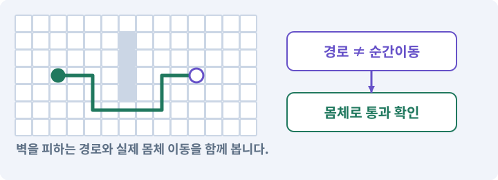

# 166. 회전 카메라로 마을을 걷고 사람에게 말 걸기

**목표:** 3인칭 캐릭터를 이동하고 눈앞의 대상 하나와 상호작용합니다.

**시작 상태:** 165번에서 확인한 타이틀에서 새 게임으로 들어가 일시정지 후 타이틀로 돌아오는 화면 및 GrayOathRPG3D 작업 기록

## 한눈에 보는 기능의 흐름

카메라 방향 → 캐릭터 이동 → 눈앞 대상 선택 → 대화·UI 처리



**경계:** UI 클릭이 NPC와 문에 동시에 전달되지 않기

그림은 실제 게임 실행 결과가 아닙니다. 값·규칙과 예제를 필요한 때 펼쳐 읽고 현재 단계의 메시지를 한 번씩 보냅니다.

## 1. 지금 상태 확인하기

첫 메시지를 보내 현재 프로젝트와 필요한 준비가 맞는지 확인하세요. 이름만 같은 예제를 실제 게임으로 착각하지 않습니다.

### AI에게 보낼 요구와 이유

#### 01. 작업 대상부터 확인

**현재 GrayOathRPG3D 프로젝트에서 입력·CharacterController·카메라·상호작용 서비스을 읽기 전용으로 확인해 줘.**

왜 이렇게 요청하나요? AI가 다른 프로젝트나 오래된 예제를 보고 작업할 수 있습니다. 실제 경로·파일·현재 기능을 읽게 하면 지금 이어서 작업할 대상을 먼저 맞출 수 있습니다.

#### 02. 지금 요청하는 작업의 범위

**지금 하려는 일은 “회전 카메라로 마을을 걷고 사람에게 말 걸기”이야.**

왜 이렇게 요청하나요? 지금 다루려는 기능의 이름을 실제 작업 문맥으로 지정합니다. 이 문장은 구현 완료나 게임 속 대사 생성 요청이 아니라, 이후 조사·변경의 대상을 맞추는 역할을 합니다.

#### 03. 구현할 결과와 조건 고정

**실제 대상·미완료 준비·재사용할 부분을 구분해 줘.**

왜 이렇게 요청하나요? “실제 대상·미완료 준비·재사용할 부분을 구분해 줘”를 명시하면 AI가 무엇을 구현하거나 검사해야 하는지 범위를 좁힐 수 있습니다. 3인칭 캐릭터를 이동하고 눈앞의 대상 하나와 상호작용합니다. 이 결과를 확인할 때 이 조건이 실제로 반영됐는지 함께 봅니다.

#### 04. 조사 단계에서 변경하지 않기

**아직 파일 수정·설치·유료 요청은 하지 마.**

왜 이렇게 요청하나요? 현재 상태를 알아보기만 할 때 파일 변경이나 결제가 시작되면 검토 전의 환경이 바뀝니다. 준비 확인과 실제 구현을 나눠 되돌리기 어려운 작업이 먼저 실행되지 않게 합니다.

<details>
<summary>보낼 원문 전체 — 설명은 복사되지 않습니다</summary>

```text
현재 GrayOathRPG3D 프로젝트에서 입력·CharacterController·카메라·상호작용 서비스을 읽기 전용으로 확인해 줘. 지금 하려는 일은 “회전 카메라로 마을을 걷고 사람에게 말 걸기”이야. 실제 대상·미완료 준비·재사용할 부분을 구분해 줘. 아직 파일 수정·설치·유료 요청은 하지 마.
```

</details>

**기대 결과:** 입력·CharacterController·카메라·상호작용 서비스의 실제 위치·연결과 준비 여부

### 직접 확인하기

1. AI가 보여 준 프로젝트가 GrayOathRPG3D인지 확인합니다.
2. 필요한 준비가 없으면 먼저 해결하도록 요청합니다. 코드를 직접 입력하지 않습니다.

## 2. 이번 기능 만들기

아래 요청을 보냅니다. 코드와 도구 제작·데이터 입력은 AI가 합니다. 먼저 작은 결과를 보고 나머지 조건을 확인하세요.

### AI에게 보낼 요구와 이유

#### 01. 좌표계 혼동 방지

**XZ 지면에서 CharacterController를 사용하는 PlayerMotor 하나를 만들어 줘.**

왜 이렇게 요청하나요? 2D의 XY와 3D의 XZ는 같은 이동 의미라도 축 배치가 다릅니다. 변환 위치를 한 곳으로 모아야 지도·물리·카메라가 서로 다른 축을 높이나 전진 방향으로 해석하지 않습니다.

#### 02. 시간·방향과 물리 이동 일치

**WASD/패드 스틱은 카메라 수평 방향 기준으로 움직이고 대각선 속도를 정규화해 줘.**

왜 이렇게 요청하나요? 입력 방향의 길이와 프레임 간격을 그대로 이동량에 섞으면 대각선이나 기기 속도에 따라 이동이 달라집니다. 정해진 속도·시간 기준과 물리 이동 경로를 사용해 비교 가능한 움직임을 만듭니다.

#### 03. 구현할 결과와 조건 고정

**중력과 지면 감지를 넣되 지금은 걷기만 구현해 줘.**

왜 이렇게 요청하나요? “중력과 지면 감지를 넣되 지금은 걷기만 구현해 줘”를 명시하면 AI가 무엇을 구현하거나 검사해야 하는지 범위를 좁힐 수 있습니다. 3인칭 캐릭터를 이동하고 눈앞의 대상 하나와 상호작용합니다. 이 결과를 확인할 때 이 조건이 실제로 반영됐는지 함께 봅니다.

#### 04. 카메라·직교·원근의 적용 조건

**마우스/오른쪽 스틱으로 카메라를 회전하고 벽 안으로 들어가지 않게 해 줘.**

왜 이렇게 요청하나요? 카메라는 게임 세계를 어떤 위치·방향·범위로 볼지 정합니다. 직교 투영은 거리에 따른 크기 감소가 없고, 원근 투영은 먼 물체가 작아 보이게 합니다. 카메라를 멀리 옮기는 것만으로 직교 화면의 캐릭터 크기가 줄지는 않습니다. 직교 크기를 봅니다.

#### 05. 적이 아는 정보에 맞춰 행동

**앞의 나래 NPC와 문·게시판을 2m 범위와 시야로 골라 상호작용 안내를 표시해 줘.**

왜 이렇게 요청하나요? 적이 플레이어의 실제 위치를 항상 읽으면 벽 뒤에 숨는 행동에 의미가 없습니다. 감지·기억·추적·귀환을 나눠 실제 관측 정보가 행동을 결정하게 합니다.

#### 06. UI 입력과 월드 입력 분리

**UI 클릭은 월드 상호작용으로 넘기지 마.**

왜 이렇게 요청하나요? 가방 버튼을 누른 입력이 뒤의 바닥 클릭으로도 처리되면 캐릭터가 원치 않게 이동하거나 공격합니다. 입력이 시작된 대상을 구분해 한 행동이 서로 다른 명령으로 중복 처리되지 않게 합니다.

#### 07. 대화 중단의 모든 출구에서 복구

**대화 동안 이동을 잠그되 닫기·대상 소멸·씬 변경에서 반드시 복구해 줘.**

왜 이렇게 요청하나요? 정상 닫기뿐 아니라 NPC가 사라지거나 씬이 바뀌어도 이동 잠금을 해제해야 합니다. 그렇지 않으면 대화는 없어졌는데 플레이어가 계속 움직이지 못할 수 있습니다.

#### 08. 시작부터 플레이까지 한 흐름으로 연결

**실제 마을 실습장과 기본 도형 캐릭터를 배치하고 타이틀에서 진입하게 해 줘.**

왜 이렇게 요청하나요? 개발 씬을 직접 여는 것과 사용자가 타이틀에서 시작하는 것은 다른 경로입니다. 초기화·저장 선택·씬 이동·조작권을 연결해야 배포한 게임에서도 같은 기능을 사용할 수 있습니다.

#### 09. 구현과 실행은 AI에게 맡기기

**파일·코드·설정·Editor 조작·명령 실행은 네가 맡아 줘.**

왜 이렇게 요청하나요? 설명이나 코드 조각만 받으면 실제 파일 생성·연결·실행이 빠질 수 있습니다. AI가 개발 작업까지 수행하고, 사람은 요구·승인·결과 판단을 맡도록 역할을 분명히 합니다.

#### 10. 실제 사용 중인 코드에 연결

**먼저 실제 구현을 읽고 기존 진입점을 재사용해 줘.**

왜 이렇게 요청하나요? 예제와 이름이 다르더라도 현재 씬과 입력에서 호출하는 구현이 작업 대상입니다. 같은 기능을 새로 만들기보다 기존 진입점을 확인해 수정이 실제 게임에 반영되고 중복 실행되지 않게 합니다.

#### 11. 관찰 가능한 기준으로 확인

**이번 기능을 작은 변경으로 나눠 컴파일·관련 테스트·실제 씬 연결까지 수행해 줘.**

왜 이렇게 요청하나요? 구현 완료라는 설명을 실제 결과로 바꾸기 위한 조건입니다. 요청에 나온 대상과 경계 상황을 확인해 정상 결과뿐 아니라 실패를 어떻게 구분했는지도 남깁니다.

#### 12. 실패를 숨기지 않기

**테스트를 삭제하거나 조건을 낮춰 통과시키지 마.**

왜 이렇게 요청하나요? 검사 조건을 약하게 만들면 결함이 남아 있어도 통과 표시가 나올 수 있습니다. 구현을 고친 뒤 원래 기준으로 다시 검사해야 실제 문제가 해결됐는지 알 수 있습니다.

#### 13. 비용과 외부 작업은 별도 승인

**새 비용·외부 전송·게시에는 별도 승인이 필요해.**

왜 이렇게 요청하나요? 로컬 파일을 고치는 것과 외부 서비스에 자료를 보내거나 비용을 지불하는 것은 영향이 다릅니다. 대상·내용·비용 범위를 확인한 승인 없이 요청이 확대되지 않도록 합니다.

#### 14. 사람 검사의 시작점 준비

**실제 실행하지 못한 작업과 내가 직접 볼 부분은 구분해 줘.**

왜 이렇게 요청하나요? 같은 기능이라도 시작 상태가 다르면 관찰 결과가 달라집니다. AI가 실행 화면과 재현 위치를 먼저 준비해야 사람이 이동·공격·소리·조작감을 같은 조건에서 확인할 수 있습니다.

<details>
<summary>보낼 원문 전체 — 설명은 복사되지 않습니다</summary>

```text
XZ 지면에서 CharacterController를 사용하는 PlayerMotor 하나를 만들어 줘. WASD/패드 스틱은 카메라 수평 방향 기준으로 움직이고 대각선 속도를 정규화해 줘. 중력과 지면 감지를 넣되 지금은 걷기만 구현해 줘.
마우스/오른쪽 스틱으로 카메라를 회전하고 벽 안으로 들어가지 않게 해 줘. 앞의 나래 NPC와 문·게시판을 2m 범위와 시야로 골라 상호작용 안내를 표시해 줘. UI 클릭은 월드 상호작용으로 넘기지 마.
대화 동안 이동을 잠그되 닫기·대상 소멸·씬 변경에서 반드시 복구해 줘. 실제 마을 실습장과 기본 도형 캐릭터를 배치하고 타이틀에서 진입하게 해 줘.

파일·코드·설정·Editor 조작·명령 실행은 네가 맡아 줘. 먼저 실제 구현을 읽고 기존 진입점을 재사용해 줘. 이번 기능을 작은 변경으로 나눠 컴파일·관련 테스트·실제 씬 연결까지 수행해 줘. 테스트를 삭제하거나 조건을 낮춰 통과시키지 마. 새 비용·외부 전송·게시에는 별도 승인이 필요해. 실제 실행하지 못한 작업과 내가 직접 볼 부분은 구분해 줘.
```

</details>

**기대 결과:** 회전 카메라로 걷고 NPC에게 말을 걸었다 닫을 수 있는 마을

### 직접 확인하기

1. AI에게 아래 목표 화면을 열어 달라고 하고 실제로 보이는지 확인합니다.
2. 확인할 화면: 회전 카메라로 걷고 NPC에게 말을 걸었다 닫을 수 있는 마을

## 3. 직접 써 보고 반례 확인하기

AI가 검사와 화면을 준비한 뒤 다음 동작을 하나씩 해 보세요. Editor 버튼은 완성된 도구를 사용하는 조작이며 코드나 데이터 파일을 직접 편집하지 않습니다.

### AI에게 보낼 요구와 이유

#### 01. 현재 코드와 검사 결과 연결

**방금 만든 기능을 현재 소스에서 검증하고 내가 볼 시작 화면을 준비해 줘.**

왜 이렇게 요청하나요? 코드나 설정이 바뀌면 이전 버전에서 통과한 검사로 새 버전의 정상 동작을 보장할 수 없습니다. 어떤 소스에서 나온 결과인지 묶어야 바뀐 부분을 다시 검사할 수 있습니다.

#### 02. 검사할 입력과 관찰 지점 준비

**다음 항목을 실제 검사해 줘.**

왜 이렇게 요청하나요? 정상 예 하나만 보면 실패 조건을 놓치기 쉽습니다. 정상·경계·반례를 실제 입력으로 준비하고 사람이 볼 화면도 맞춰 확인 범위를 분명하게 합니다.

#### 03. 구현할 결과와 조건 고정

**- 위치 변경 담당 하나**

왜 이렇게 요청하나요? “위치 변경 담당 하나”를 명시하면 AI가 무엇을 구현하거나 검사해야 하는지 범위를 좁힐 수 있습니다. 3인칭 캐릭터를 이동하고 눈앞의 대상 하나와 상호작용합니다. 이 결과를 확인할 때 이 조건이 실제로 반영됐는지 함께 봅니다.

#### 04. 적이 아는 정보에 맞춰 행동

**- 시야 밖·벽 뒤 상호작용 거부**

왜 이렇게 요청하나요? 적이 플레이어의 실제 위치를 항상 읽으면 벽 뒤에 숨는 행동에 의미가 없습니다. 감지·기억·추적·귀환을 나눠 실제 관측 정보가 행동을 결정하게 합니다.

#### 05. 대화 취소 뒤 조작권 복원

**- 대화 취소 후 이동·카메라 복귀**

왜 이렇게 요청하나요? 취소는 정상적인 사용 경로입니다. 카메라와 이동 입력이 원래 상태로 돌아오는지 실제로 확인해야 진행이 막히지 않습니다.

#### 06. 결과를 재확인할 근거 남기기

**오류 로그·대상·실행 수·파일 해시를 남겨 줘.**

왜 이렇게 요청하나요? “잘 됩니다”라는 요약만으로는 어떤 입력과 버전을 검사했는지 알 수 없습니다. 대상·실행 수·실패 내용·파일을 함께 남겨 같은 조건으로 다시 확인할 수 있게 합니다.

#### 07. 보여 준 자료의 한계 구분

**화면 캡처만으로 조작 성공을, 모의 응답만으로 실제 AI 호출을 주장하지 마.**

왜 이렇게 요청하나요? 사진 한 장은 입력·저장·시간에 따른 동작까지 증명하지 못하고, 정해진 모의 응답은 실제 서비스 호출이 아닙니다. 각각 확인할 수 있는 범위만 기록하게 하는 요청입니다.

#### 08. 사람 검사의 시작점 준비

**내 관찰·기기 검사가 필요한 부분은 실행 화면을 준비하고 별도로 표시해 줘.**

왜 이렇게 요청하나요? 같은 기능이라도 시작 상태가 다르면 관찰 결과가 달라집니다. AI가 실행 화면과 재현 위치를 먼저 준비해야 사람이 이동·공격·소리·조작감을 같은 조건에서 확인할 수 있습니다.

<details>
<summary>보낼 원문 전체 — 설명은 복사되지 않습니다</summary>

```text
방금 만든 기능을 현재 소스에서 검증하고 내가 볼 시작 화면을 준비해 줘. 다음 항목을 실제 검사해 줘.
- 위치 변경 담당 하나
- 시야 밖·벽 뒤 상호작용 거부
- 대화 취소 후 이동·카메라 복귀
오류 로그·대상·실행 수·파일 해시를 남겨 줘. 화면 캡처만으로 조작 성공을, 모의 응답만으로 실제 AI 호출을 주장하지 마. 내 관찰·기기 검사가 필요한 부분은 실행 화면을 준비하고 별도로 표시해 줘.
```

</details>

**기대 결과:** 정상 동작과 실패 조건의 결과가 따로 보이고, 직접 확인할 화면이 준비됨

### 직접 확인하기

1. 카메라를 돌린 뒤 앞으로 이동해 봅니다.
2. NPC 앞에서 대화를 열고 닫습니다.
3. UI를 누를 때 뒤의 NPC나 문이 동시에 작동하지 않는지 봅니다.

## 4. 결과를 남기고 이어가기

실제로 본 결과를 메모해 전달하세요. 실패했다면 현재 페이지의 “막혔어요” 요청으로 같은 문제부터 고칩니다.

### AI에게 보낼 요구와 이유

#### 01. 다음 작업이 읽을 인수인계

**“회전 카메라로 마을을 걷고 사람에게 말 걸기” 작업을 마무리해 줘.**

왜 이렇게 요청하나요? 새 AI 세션은 이전 대화 전체를 알고 있다고 보장할 수 없습니다. 현재 후보·파일 위치·실행한 검사·남은 일을 남겨야 같은 작업을 반복하지 않고 이어갈 수 있습니다.

#### 02. 미확인을 완료와 분리

**실제로 만든 파일과 연결한 Editor 도구, 검사한 소스·데이터 버전, 성공·실패·미실행을 구분해 기록해 줘.**

왜 이렇게 요청하나요? 만들어진 것, 검사에 실패한 것, 아직 확인하지 못한 것을 나눠야 다음 작업을 정확히 고를 수 있습니다. 실행할 조건이 없는 기능을 성공으로 기록하면 뒤에서 원인을 찾기 어려워집니다.

#### 03. 관찰하지 않은 성공을 채우지 않기

**내가 전달한 관찰만 사람 검사에 반영해 줘.**

왜 이렇게 요청하나요? 자동 검사·AI의 추정·사람의 실제 관찰은 다른 종류의 근거입니다. 수행하지 않은 기기나 조작 검사는 미확인으로 남겨 나중에 실제 확인할 수 있게 합니다.

#### 04. 미확인을 완료와 분리

**미완료 상태를 완료로 바꾸지 말고, 정상 후보와 이전 기록을 보존해 다음 세션에서 이어갈 진입점을 남겨 줘.**

왜 이렇게 요청하나요? 만들어진 것, 검사에 실패한 것, 아직 확인하지 못한 것을 나눠야 다음 작업을 정확히 고를 수 있습니다. 실행할 조건이 없는 기능을 성공으로 기록하면 뒤에서 원인을 찾기 어려워집니다.

<details>
<summary>보낼 원문 전체 — 설명은 복사되지 않습니다</summary>

```text
“회전 카메라로 마을을 걷고 사람에게 말 걸기” 작업을 마무리해 줘. 실제로 만든 파일과 연결한 Editor 도구, 검사한 소스·데이터 버전, 성공·실패·미실행을 구분해 기록해 줘. 내가 전달한 관찰만 사람 검사에 반영해 줘. 미완료 상태를 완료로 바꾸지 말고, 정상 후보와 이전 기록을 보존해 다음 세션에서 이어갈 진입점을 남겨 줘.
```

</details>

**기대 결과:** 실제 구현·검사·관찰과 다음 시작점이 프로젝트 기록에 남음

### 직접 확인하기

1. 직접 보지 않은 결과가 완료로 적히지 않았는지 확인합니다.
2. 미완료 문제가 없다면 결과를 확인한 뒤 다음 페이지로 갑니다.

## 이 작업에서 사용할 값과 규칙 전체

설계 시작값이며 측정된 성능·게임 성공 결과가 아닙니다. 구현은 AI가 수행합니다.

XZ 지면에서 CharacterController를 사용하는 PlayerMotor 하나를 만들어 줘. WASD/패드 스틱은 카메라 수평 방향 기준으로 움직이고 대각선 속도를 정규화해 줘. 중력과 지면 감지를 넣되 지금은 걷기만 구현해 줘.
마우스/오른쪽 스틱으로 카메라를 회전하고 벽 안으로 들어가지 않게 해 줘. 앞의 나래 NPC와 문·게시판을 2m 범위와 시야로 골라 상호작용 안내를 표시해 줘. UI 클릭은 월드 상호작용으로 넘기지 마.
대화 동안 이동을 잠그되 닫기·대상 소멸·씬 변경에서 반드시 복구해 줘. 실제 마을 실습장과 기본 도형 캐릭터를 배치하고 타이틀에서 진입하게 해 줘.

## 문제가 있으면

### AI에게 보낼 요구와 이유

#### 01. 공유 Editor의 작업 순서 보장

**모터 두 개가 위치를 덮어쓰면 기존 한 경로로 통합하고 잠금 해제를 검사해 줘.**

왜 이렇게 요청하나요? 씬 수정·Play·빌드가 같은 Editor에서 겹치면 서로의 상태를 바꿀 수 있습니다. 하나의 실행 창구와 잠금으로 순서를 만들되 사용자의 외부 편집까지 자동 차단한다고 가정하지 않습니다.

#### 02. 원인 하나를 좁혀 수정

**현재 대상과 실제 오류부터 읽고 최소 수정해 줘.**

왜 이렇게 요청하나요? 오류 수정 중 새 기능까지 넣으면 어떤 변경이 문제를 해결하거나 악화했는지 알기 어렵습니다. 원래 재현을 보존하고 작은 변경 뒤 같은 입력과 주변 정상 동작을 다시 확인합니다.

#### 03. 원인 하나를 좁혀 수정

**이전 정상 후보와 실패 근거는 보존하고 같은 반례와 관련 정상 동작을 다시 검사해 줘.**

왜 이렇게 요청하나요? 오류 수정 중 새 기능까지 넣으면 어떤 변경이 문제를 해결하거나 악화했는지 알기 어렵습니다. 원래 재현을 보존하고 작은 변경 뒤 같은 입력과 주변 정상 동작을 다시 확인합니다.

#### 04. 구현과 실행은 AI에게 맡기기

**작업을 다른 기능으로 돌리거나 내가 코드·설정을 편집하게 하지 마.**

왜 이렇게 요청하나요? 설명이나 코드 조각만 받으면 실제 파일 생성·연결·실행이 빠질 수 있습니다. AI가 개발 작업까지 수행하고, 사람은 요구·승인·결과 판단을 맡도록 역할을 분명히 합니다.

<details>
<summary>보낼 원문 전체 — 설명은 복사되지 않습니다</summary>

```text
모터 두 개가 위치를 덮어쓰면 기존 한 경로로 통합하고 잠금 해제를 검사해 줘.
현재 대상과 실제 오류부터 읽고 최소 수정해 줘. 이전 정상 후보와 실패 근거는 보존하고 같은 반례와 관련 정상 동작을 다시 검사해 줘. 작업을 다른 기능으로 돌리거나 내가 코드·설정을 편집하게 하지 마.
```

</details>

## 새 세션에서 이어가기

### AI에게 보낼 요구와 이유

#### 01. 이어서 할 작업 식별

**“회전 카메라로 마을을 걷고 사람에게 말 걸기” 작업을 이어가고 싶어.**

왜 이렇게 요청하나요? 이름으로 재개할 작업을 찾고, 뒤에 이어지는 요청으로 실제 파일·진행 중 작업·기록을 다시 읽게 합니다. 제목만 보고 이전 상태를 기억한다고 가정하지 않습니다.

#### 02. 재개 전 중복 작업 방지

**실제 GrayOathRPG3D와 내 하네스의 기록·진행 중 작업·승인 상태를 읽고, 마지막으로 검증한 결과와 남은 일을 구분해 줘.**

왜 이렇게 요청하나요? 대화가 끊겨도 외부 작업은 끝났거나 아직 실행 중일 수 있습니다. 프로세스·승인·미저장 상태를 먼저 읽어 같은 생성·빌드·결제를 두 번 시작하지 않도록 합니다.

#### 03. 재개 전 중복 작업 방지

**다른 프로젝트를 바꾸거나 유료 요청을 중복 제출하지 말고 가장 작은 미완료 작업부터 진행해 줘.**

왜 이렇게 요청하나요? 대화가 끊겨도 외부 작업은 끝났거나 아직 실행 중일 수 있습니다. 프로세스·승인·미저장 상태를 먼저 읽어 같은 생성·빌드·결제를 두 번 시작하지 않도록 합니다.

<details>
<summary>보낼 원문 전체 — 설명은 복사되지 않습니다</summary>

```text
“회전 카메라로 마을을 걷고 사람에게 말 걸기” 작업을 이어가고 싶어. 실제 GrayOathRPG3D와 내 하네스의 기록·진행 중 작업·승인 상태를 읽고, 마지막으로 검증한 결과와 남은 일을 구분해 줘. 다른 프로젝트를 바꾸거나 유료 요청을 중복 제출하지 말고 가장 작은 미완료 작업부터 진행해 줘.
```

</details>

## 왜 이렇게 만드는가

기존 사선 고정 화면과 달리 이 게임은 회전하는 3인칭 카메라를 사용합니다. 카메라 방향과 캐릭터 이동, 대화 입력은 같은 상태를 공유해야 합니다.

## 공식 참고

- [Unity · Cinemachine 3](https://docs.unity3d.com/Packages/com.unity.cinemachine@3.1/manual/index.html)


## 실제 Unity Editor 화면 참고
공식 예시와 내 프로젝트 실행 결과를 구분하세요. 원본 사진은 온라인 연결이 필요합니다.

- [Input Actions — 입력 묶음·행동·값의 종류 읽기](../editor_references/input-actions.md)
