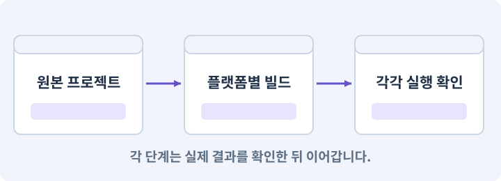

# 168. 작은 게임을 PC와 Android에서 먼저 실행하기

**목표:** 첫 플레이 흐름을 두 플랫폼에서 확인하고 비교 기준을 남깁니다.

**시작 상태:** 167번에서 확인한 타이틀→의뢰 수락→전투→등불 반환→보상→계속하기가 이어지는 작은 플레이 및 GrayOathRPG3D 작업 기록

## 한눈에 보는 기능의 흐름

같은 첫 의뢰 → Windows 실행 → Android 실행 → 저장·음량 복원



**경계:** Editor 성공을 실기기 검사로 대체하지 않기

그림은 실제 게임 실행 결과가 아닙니다. 값·규칙과 예제를 필요한 때 펼쳐 읽고 현재 단계의 메시지를 한 번씩 보냅니다.

## 1. 지금 상태 확인하기

첫 메시지를 보내 현재 프로젝트와 필요한 준비가 맞는지 확인하세요. 이름만 같은 예제를 실제 게임으로 착각하지 않습니다.

### AI에게 보낼 요구와 이유

#### 01. 작업 대상부터 확인

**현재 GrayOathRPG3D 프로젝트에서 작은 의뢰 완주·플랫폼 모듈·빌드 프로필·기기 연결을 읽기 전용으로 확인해 줘.**

왜 이렇게 요청하나요? AI가 다른 프로젝트나 오래된 예제를 보고 작업할 수 있습니다. 실제 경로·파일·현재 기능을 읽게 하면 지금 이어서 작업할 대상을 먼저 맞출 수 있습니다.

#### 02. 지금 요청하는 작업의 범위

**지금 하려는 일은 “작은 게임을 PC와 Android에서 먼저 실행하기”이야.**

왜 이렇게 요청하나요? 지금 다루려는 기능의 이름을 실제 작업 문맥으로 지정합니다. 이 문장은 구현 완료나 게임 속 대사 생성 요청이 아니라, 이후 조사·변경의 대상을 맞추는 역할을 합니다.

#### 03. 구현할 결과와 조건 고정

**실제 대상·미완료 준비·재사용할 부분을 구분해 줘.**

왜 이렇게 요청하나요? “실제 대상·미완료 준비·재사용할 부분을 구분해 줘”를 명시하면 AI가 무엇을 구현하거나 검사해야 하는지 범위를 좁힐 수 있습니다. 첫 플레이 흐름을 두 플랫폼에서 확인하고 비교 기준을 남깁니다. 이 결과를 확인할 때 이 조건이 실제로 반영됐는지 함께 봅니다.

#### 04. 조사 단계에서 변경하지 않기

**아직 파일 수정·설치·유료 요청은 하지 마.**

왜 이렇게 요청하나요? 현재 상태를 알아보기만 할 때 파일 변경이나 결제가 시작되면 검토 전의 환경이 바뀝니다. 준비 확인과 실제 구현을 나눠 되돌리기 어려운 작업이 먼저 실행되지 않게 합니다.

<details>
<summary>보낼 원문 전체 — 설명은 복사되지 않습니다</summary>

```text
현재 GrayOathRPG3D 프로젝트에서 작은 의뢰 완주·플랫폼 모듈·빌드 프로필·기기 연결을 읽기 전용으로 확인해 줘. 지금 하려는 일은 “작은 게임을 PC와 Android에서 먼저 실행하기”이야. 실제 대상·미완료 준비·재사용할 부분을 구분해 줘. 아직 파일 수정·설치·유료 요청은 하지 마.
```

</details>

**기대 결과:** 작은 의뢰 완주·플랫폼 모듈·빌드 프로필·기기 연결의 실제 위치·연결과 준비 여부

### 직접 확인하기

1. AI가 보여 준 프로젝트가 GrayOathRPG3D인지 확인합니다.
2. 필요한 준비가 없으면 먼저 해결하도록 요청합니다. 코드를 직접 입력하지 않습니다.

## 2. 이번 기능 만들기

아래 요청을 보냅니다. 코드와 도구 제작·데이터 입력은 AI가 합니다. 먼저 작은 결과를 보고 나머지 조건을 확인하세요.

### AI에게 보낼 요구와 이유

#### 01. 플랫폼별 실제 실행물 검사

**현재 작은 게임을 Windows x86_64와 Android ARM64 테스트 빌드로 만들어 줘.**

왜 이렇게 요청하나요? Editor Play와 배포 앱은 빌드·파일·실행 환경이 다릅니다. 설치 형식과 대상 플랫폼을 구분하고 각 실제 실행물에서 메뉴·입력·저장·콘텐츠를 다시 확인합니다.

#### 02. 상호작용·NPC·퀘스트의 적용 조건

**Android에는 이동 스틱·카메라 드래그 영역·공격·상호작용·메뉴를 배치해 줘.**

왜 이렇게 요청하나요? 상호작용은 근처 객체와 대화·문 열기·줍기 등의 행동을 하는 기능입니다. NPC는 플레이어가 아닌 캐릭터, 퀘스트는 목표와 진행·보상 규칙을 가진 작업입니다. NPC의 말풍선을 봤다고 보상 지급이 완료된 것은 아닙니다. 데이터 상태와 저장을 확인합니다.

#### 03. 카메라·직교·원근의 적용 조건

**UI 위 터치가 카메라를 돌리지 않게 해 줘.**

왜 이렇게 요청하나요? 카메라는 게임 세계를 어떤 위치·방향·범위로 볼지 정합니다. 직교 투영은 거리에 따른 크기 감소가 없고, 원근 투영은 먼 물체가 작아 보이게 합니다. 카메라를 멀리 옮기는 것만으로 직교 화면의 캐릭터 크기가 줄지는 않습니다. 직교 크기를 봅니다.

#### 04. 패키지·패키지 관리자의 적용 조건

**Windows와 Android를 다른 출력 폴더에 두고 소스·패키지·빌드 해시와 실제 기기 이름을 기록해 줘.**

왜 이렇게 요청하나요? 패키지는 입력·타일맵·테스트처럼 특정 기능을 묶어 프로젝트에 추가하는 단위입니다. Unity Package Manager가 설치와 의존 버전을 관리합니다. 이름이 비슷한 제삼자 패키지를 공식 패키지로 오해하지 않습니다. 버전과 출처를 기록합니다.

#### 05. 조명·Lit·Unlit·그림자의 적용 조건

**Android는 낮은 그림자·해상도 초기 프로필로 시작하되 규칙과 퀘스트는 같아야 해.**

왜 이렇게 요청하나요? 조명은 표면이 밝고 어두워 보이는 원인을 계산하는 요소입니다. Lit 재질은 지정된 조명 경로의 영향을 받고 Unlit은 일반적으로 그 조명 계산 없이 표시됩니다. Unlit이 모든 투명·후처리·색 영향에서 완전히 자유롭다는 뜻은 아닙니다. 파이프라인 구성을 봅니다.

#### 06. 시작부터 플레이까지 한 흐름으로 연결

**연결된 기기에만 설치하고 타이틀부터 첫 보상까지 확인 화면을 준비해 줘.**

왜 이렇게 요청하나요? 개발 씬을 직접 여는 것과 사용자가 타이틀에서 시작하는 것은 다른 경로입니다. 초기화·저장 선택·씬 이동·조작권을 연결해야 배포한 게임에서도 같은 기능을 사용할 수 있습니다.

#### 07. 미확인을 완료와 분리

**기기가 없으면 PC 결과와 별도로 BLOCKED를 남겨 줘.**

왜 이렇게 요청하나요? 만들어진 것, 검사에 실패한 것, 아직 확인하지 못한 것을 나눠야 다음 작업을 정확히 고를 수 있습니다. 실행할 조건이 없는 기능을 성공으로 기록하면 뒤에서 원인을 찾기 어려워집니다.

#### 08. 플랫폼별 실제 실행물 검사

**스토어 업로드와 서명키 생성은 아직 하지 마.**

왜 이렇게 요청하나요? Editor Play와 배포 앱은 빌드·파일·실행 환경이 다릅니다. 설치 형식과 대상 플랫폼을 구분하고 각 실제 실행물에서 메뉴·입력·저장·콘텐츠를 다시 확인합니다.

#### 09. 환경 변화 줄이기

**새 프로젝트를 만들었다면 Unity 6.3 LTS의 기존에 검증한 한 패치를 먼저 비교하고 URP Universal Renderer를 선택해 줘.**

왜 이렇게 요청하나요? 기능을 만드는 중 엔진·패키지 버전까지 바뀌면 오류 원인이 섞입니다. 시작 버전을 고정하고 변경은 따로 판단해야 AI가 같은 API와 설정을 기준으로 작업할 수 있습니다.

#### 10. 패키지·패키지 관리자의 적용 조건

**버전 변경이 필요하면 호환 차이와 승인을 먼저 받으며, 아예 설치되지 않은 패키지는 있는 것처럼 호출하지 마.**

왜 이렇게 요청하나요? 패키지는 입력·타일맵·테스트처럼 특정 기능을 묶어 프로젝트에 추가하는 단위입니다. Unity Package Manager가 설치와 의존 버전을 관리합니다. 이름이 비슷한 제삼자 패키지를 공식 패키지로 오해하지 않습니다. 버전과 출처를 기록합니다.

#### 11. 구현과 실행은 AI에게 맡기기

**파일·코드·설정·Editor 조작·명령 실행은 네가 맡아 줘.**

왜 이렇게 요청하나요? 설명이나 코드 조각만 받으면 실제 파일 생성·연결·실행이 빠질 수 있습니다. AI가 개발 작업까지 수행하고, 사람은 요구·승인·결과 판단을 맡도록 역할을 분명히 합니다.

#### 12. 실제 사용 중인 코드에 연결

**먼저 실제 구현을 읽고 기존 진입점을 재사용해 줘.**

왜 이렇게 요청하나요? 예제와 이름이 다르더라도 현재 씬과 입력에서 호출하는 구현이 작업 대상입니다. 같은 기능을 새로 만들기보다 기존 진입점을 확인해 수정이 실제 게임에 반영되고 중복 실행되지 않게 합니다.

#### 13. 관찰 가능한 기준으로 확인

**이번 기능을 작은 변경으로 나눠 컴파일·관련 테스트·실제 씬 연결까지 수행해 줘.**

왜 이렇게 요청하나요? 구현 완료라는 설명을 실제 결과로 바꾸기 위한 조건입니다. 요청에 나온 대상과 경계 상황을 확인해 정상 결과뿐 아니라 실패를 어떻게 구분했는지도 남깁니다.

#### 14. 실패를 숨기지 않기

**테스트를 삭제하거나 조건을 낮춰 통과시키지 마.**

왜 이렇게 요청하나요? 검사 조건을 약하게 만들면 결함이 남아 있어도 통과 표시가 나올 수 있습니다. 구현을 고친 뒤 원래 기준으로 다시 검사해야 실제 문제가 해결됐는지 알 수 있습니다.

#### 15. 비용과 외부 작업은 별도 승인

**새 비용·외부 전송·게시에는 별도 승인이 필요해.**

왜 이렇게 요청하나요? 로컬 파일을 고치는 것과 외부 서비스에 자료를 보내거나 비용을 지불하는 것은 영향이 다릅니다. 대상·내용·비용 범위를 확인한 승인 없이 요청이 확대되지 않도록 합니다.

#### 16. 사람 검사의 시작점 준비

**실제 실행하지 못한 작업과 내가 직접 볼 부분은 구분해 줘.**

왜 이렇게 요청하나요? 같은 기능이라도 시작 상태가 다르면 관찰 결과가 달라집니다. AI가 실행 화면과 재현 위치를 먼저 준비해야 사람이 이동·공격·소리·조작감을 같은 조건에서 확인할 수 있습니다.

<details>
<summary>보낼 원문 전체 — 설명은 복사되지 않습니다</summary>

```text
현재 작은 게임을 Windows x86_64와 Android ARM64 테스트 빌드로 만들어 줘. Android에는 이동 스틱·카메라 드래그 영역·공격·상호작용·메뉴를 배치해 줘. UI 위 터치가 카메라를 돌리지 않게 해 줘.
Windows와 Android를 다른 출력 폴더에 두고 소스·패키지·빌드 해시와 실제 기기 이름을 기록해 줘. Android는 낮은 그림자·해상도 초기 프로필로 시작하되 규칙과 퀘스트는 같아야 해.
연결된 기기에만 설치하고 타이틀부터 첫 보상까지 확인 화면을 준비해 줘. 기기가 없으면 PC 결과와 별도로 BLOCKED를 남겨 줘. 스토어 업로드와 서명키 생성은 아직 하지 마.
새 프로젝트를 만들었다면 Unity 6.3 LTS의 기존에 검증한 한 패치를 먼저 비교하고 URP Universal Renderer를 선택해 줘. 버전 변경이 필요하면 호환 차이와 승인을 먼저 받으며, 아예 설치되지 않은 패키지는 있는 것처럼 호출하지 마.

파일·코드·설정·Editor 조작·명령 실행은 네가 맡아 줘. 먼저 실제 구현을 읽고 기존 진입점을 재사용해 줘. 이번 기능을 작은 변경으로 나눠 컴파일·관련 테스트·실제 씬 연결까지 수행해 줘. 테스트를 삭제하거나 조건을 낮춰 통과시키지 마. 새 비용·외부 전송·게시에는 별도 승인이 필요해. 실제 실행하지 못한 작업과 내가 직접 볼 부분은 구분해 줘.
```

</details>

**기대 결과:** 실행할 수 있는 Windows 빌드와 연결된 경우 Android 설치 화면

### 직접 확인하기

1. AI에게 아래 목표 화면을 열어 달라고 하고 실제로 보이는지 확인합니다.
2. 확인할 화면: 실행할 수 있는 Windows 빌드와 연결된 경우 Android 설치 화면

## 3. 직접 써 보고 반례 확인하기

AI가 검사와 화면을 준비한 뒤 다음 동작을 하나씩 해 보세요. Editor 버튼은 완성된 도구를 사용하는 조작이며 코드나 데이터 파일을 직접 편집하지 않습니다.

### AI에게 보낼 요구와 이유

#### 01. 현재 코드와 검사 결과 연결

**방금 만든 기능을 현재 소스에서 검증하고 내가 볼 시작 화면을 준비해 줘.**

왜 이렇게 요청하나요? 코드나 설정이 바뀌면 이전 버전에서 통과한 검사로 새 버전의 정상 동작을 보장할 수 없습니다. 어떤 소스에서 나온 결과인지 묶어야 바뀐 부분을 다시 검사할 수 있습니다.

#### 02. 검사할 입력과 관찰 지점 준비

**다음 항목을 실제 검사해 줘.**

왜 이렇게 요청하나요? 정상 예 하나만 보면 실패 조건을 놓치기 쉽습니다. 정상·경계·반례를 실제 입력으로 준비하고 사람이 볼 화면도 맞춰 확인 범위를 분명하게 합니다.

#### 03. 구현할 결과와 조건 고정

**- 플랫폼별 빌드·실행 결과 분리**

왜 이렇게 요청하나요? “플랫폼별 빌드·실행 결과 분리”를 명시하면 AI가 무엇을 구현하거나 검사해야 하는지 범위를 좁힐 수 있습니다. 첫 플레이 흐름을 두 플랫폼에서 확인하고 비교 기준을 남깁니다. 이 결과를 확인할 때 이 조건이 실제로 반영됐는지 함께 봅니다.

#### 04. 관찰 가능한 기준으로 확인

**- 터치 동시 입력·홈 복귀 검사**

왜 이렇게 요청하나요? 구현 완료라는 설명을 실제 결과로 바꾸기 위한 조건입니다. 요청에 나온 대상과 경계 상황을 확인해 정상 결과뿐 아니라 실패를 어떻게 구분했는지도 남깁니다.

#### 05. 구현할 결과와 조건 고정

**- 미연결 실기기를 성공으로 기록하지 않음**

왜 이렇게 요청하나요? “미연결 실기기를 성공으로 기록하지 않음”를 명시하면 AI가 무엇을 구현하거나 검사해야 하는지 범위를 좁힐 수 있습니다. 첫 플레이 흐름을 두 플랫폼에서 확인하고 비교 기준을 남깁니다. 이 결과를 확인할 때 이 조건이 실제로 반영됐는지 함께 봅니다.

#### 06. 결과를 재확인할 근거 남기기

**오류 로그·대상·실행 수·파일 해시를 남겨 줘.**

왜 이렇게 요청하나요? “잘 됩니다”라는 요약만으로는 어떤 입력과 버전을 검사했는지 알 수 없습니다. 대상·실행 수·실패 내용·파일을 함께 남겨 같은 조건으로 다시 확인할 수 있게 합니다.

#### 07. 보여 준 자료의 한계 구분

**화면 캡처만으로 조작 성공을, 모의 응답만으로 실제 AI 호출을 주장하지 마.**

왜 이렇게 요청하나요? 사진 한 장은 입력·저장·시간에 따른 동작까지 증명하지 못하고, 정해진 모의 응답은 실제 서비스 호출이 아닙니다. 각각 확인할 수 있는 범위만 기록하게 하는 요청입니다.

#### 08. 사람 검사의 시작점 준비

**내 관찰·기기 검사가 필요한 부분은 실행 화면을 준비하고 별도로 표시해 줘.**

왜 이렇게 요청하나요? 같은 기능이라도 시작 상태가 다르면 관찰 결과가 달라집니다. AI가 실행 화면과 재현 위치를 먼저 준비해야 사람이 이동·공격·소리·조작감을 같은 조건에서 확인할 수 있습니다.

<details>
<summary>보낼 원문 전체 — 설명은 복사되지 않습니다</summary>

```text
방금 만든 기능을 현재 소스에서 검증하고 내가 볼 시작 화면을 준비해 줘. 다음 항목을 실제 검사해 줘.
- 플랫폼별 빌드·실행 결과 분리
- 터치 동시 입력·홈 복귀 검사
- 미연결 실기기를 성공으로 기록하지 않음
오류 로그·대상·실행 수·파일 해시를 남겨 줘. 화면 캡처만으로 조작 성공을, 모의 응답만으로 실제 AI 호출을 주장하지 마. 내 관찰·기기 검사가 필요한 부분은 실행 화면을 준비하고 별도로 표시해 줘.
```

</details>

**기대 결과:** 정상 동작과 실패 조건의 결과가 따로 보이고, 직접 확인할 화면이 준비됨

### 직접 확인하기

1. PC에서 타이틀부터 첫 보상까지 진행합니다.
2. 연결한 폰에서 이동하면서 공격해 봅니다.
3. 앱 종료·재실행 후 저장과 음량을 확인합니다.

## 4. 결과를 남기고 이어가기

실제로 본 결과를 메모해 전달하세요. 실패했다면 현재 페이지의 “막혔어요” 요청으로 같은 문제부터 고칩니다.

### AI에게 보낼 요구와 이유

#### 01. 다음 작업이 읽을 인수인계

**“작은 게임을 PC와 Android에서 먼저 실행하기” 작업을 마무리해 줘.**

왜 이렇게 요청하나요? 새 AI 세션은 이전 대화 전체를 알고 있다고 보장할 수 없습니다. 현재 후보·파일 위치·실행한 검사·남은 일을 남겨야 같은 작업을 반복하지 않고 이어갈 수 있습니다.

#### 02. 미확인을 완료와 분리

**실제로 만든 파일과 연결한 Editor 도구, 검사한 소스·데이터 버전, 성공·실패·미실행을 구분해 기록해 줘.**

왜 이렇게 요청하나요? 만들어진 것, 검사에 실패한 것, 아직 확인하지 못한 것을 나눠야 다음 작업을 정확히 고를 수 있습니다. 실행할 조건이 없는 기능을 성공으로 기록하면 뒤에서 원인을 찾기 어려워집니다.

#### 03. 관찰하지 않은 성공을 채우지 않기

**내가 전달한 관찰만 사람 검사에 반영해 줘.**

왜 이렇게 요청하나요? 자동 검사·AI의 추정·사람의 실제 관찰은 다른 종류의 근거입니다. 수행하지 않은 기기나 조작 검사는 미확인으로 남겨 나중에 실제 확인할 수 있게 합니다.

#### 04. 미확인을 완료와 분리

**미완료 상태를 완료로 바꾸지 말고, 정상 후보와 이전 기록을 보존해 다음 세션에서 이어갈 진입점을 남겨 줘.**

왜 이렇게 요청하나요? 만들어진 것, 검사에 실패한 것, 아직 확인하지 못한 것을 나눠야 다음 작업을 정확히 고를 수 있습니다. 실행할 조건이 없는 기능을 성공으로 기록하면 뒤에서 원인을 찾기 어려워집니다.

<details>
<summary>보낼 원문 전체 — 설명은 복사되지 않습니다</summary>

```text
“작은 게임을 PC와 Android에서 먼저 실행하기” 작업을 마무리해 줘. 실제로 만든 파일과 연결한 Editor 도구, 검사한 소스·데이터 버전, 성공·실패·미실행을 구분해 기록해 줘. 내가 전달한 관찰만 사람 검사에 반영해 줘. 미완료 상태를 완료로 바꾸지 말고, 정상 후보와 이전 기록을 보존해 다음 세션에서 이어갈 진입점을 남겨 줘.
```

</details>

**기대 결과:** 실제 구현·검사·관찰과 다음 시작점이 프로젝트 기록에 남음

### 직접 확인하기

1. 직접 보지 않은 결과가 완료로 적히지 않았는지 확인합니다.
2. 미완료 문제가 없다면 결과를 확인한 뒤 다음 페이지로 갑니다.

## 이 작업에서 사용할 값과 규칙 전체

설계 시작값이며 측정된 성능·게임 성공 결과가 아닙니다. 구현은 AI가 수행합니다.

현재 작은 게임을 Windows x86_64와 Android ARM64 테스트 빌드로 만들어 줘. Android에는 이동 스틱·카메라 드래그 영역·공격·상호작용·메뉴를 배치해 줘. UI 위 터치가 카메라를 돌리지 않게 해 줘.
Windows와 Android를 다른 출력 폴더에 두고 소스·패키지·빌드 해시와 실제 기기 이름을 기록해 줘. Android는 낮은 그림자·해상도 초기 프로필로 시작하되 규칙과 퀘스트는 같아야 해.
연결된 기기에만 설치하고 타이틀부터 첫 보상까지 확인 화면을 준비해 줘. 기기가 없으면 PC 결과와 별도로 BLOCKED를 남겨 줘. 스토어 업로드와 서명키 생성은 아직 하지 마.
새 프로젝트를 만들었다면 Unity 6.3 LTS의 기존에 검증한 한 패치를 먼저 비교하고 URP Universal Renderer를 선택해 줘. 버전 변경이 필요하면 호환 차이와 승인을 먼저 받으며, 아예 설치되지 않은 패키지는 있는 것처럼 호출하지 마.

## 문제가 있으면

### AI에게 보낼 요구와 이유

#### 01. 컴파일·어셈블리·도메인 리로드의 적용 조건

**빌드 실패를 전체 기능 재작성으로 해결하지 말고 모듈·컴파일·플랫폼 의존성을 분리해 줘.**

왜 이렇게 요청하나요? 컴파일은 작성한 코드를 실행 가능한 형태로 변환하며 문법·타입 등의 문제를 검사하는 과정입니다. 어셈블리는 코드 묶음이고, 도메인 리로드는 스크립트 실행 환경을 다시 준비하는 과정입니다. 컴파일 성공은 모든 로직·참조·플랫폼 검사 성공이 아닙니다. 리로드 비활성 설정에서는 정적 상태 정리에 더 주의합니다.

#### 02. 원인 하나를 좁혀 수정

**현재 대상과 실제 오류부터 읽고 최소 수정해 줘.**

왜 이렇게 요청하나요? 오류 수정 중 새 기능까지 넣으면 어떤 변경이 문제를 해결하거나 악화했는지 알기 어렵습니다. 원래 재현을 보존하고 작은 변경 뒤 같은 입력과 주변 정상 동작을 다시 확인합니다.

#### 03. 원인 하나를 좁혀 수정

**이전 정상 후보와 실패 근거는 보존하고 같은 반례와 관련 정상 동작을 다시 검사해 줘.**

왜 이렇게 요청하나요? 오류 수정 중 새 기능까지 넣으면 어떤 변경이 문제를 해결하거나 악화했는지 알기 어렵습니다. 원래 재현을 보존하고 작은 변경 뒤 같은 입력과 주변 정상 동작을 다시 확인합니다.

#### 04. 구현과 실행은 AI에게 맡기기

**작업을 다른 기능으로 돌리거나 내가 코드·설정을 편집하게 하지 마.**

왜 이렇게 요청하나요? 설명이나 코드 조각만 받으면 실제 파일 생성·연결·실행이 빠질 수 있습니다. AI가 개발 작업까지 수행하고, 사람은 요구·승인·결과 판단을 맡도록 역할을 분명히 합니다.

<details>
<summary>보낼 원문 전체 — 설명은 복사되지 않습니다</summary>

```text
빌드 실패를 전체 기능 재작성으로 해결하지 말고 모듈·컴파일·플랫폼 의존성을 분리해 줘.
현재 대상과 실제 오류부터 읽고 최소 수정해 줘. 이전 정상 후보와 실패 근거는 보존하고 같은 반례와 관련 정상 동작을 다시 검사해 줘. 작업을 다른 기능으로 돌리거나 내가 코드·설정을 편집하게 하지 마.
```

</details>

## 새 세션에서 이어가기

### AI에게 보낼 요구와 이유

#### 01. 이어서 할 작업 식별

**“작은 게임을 PC와 Android에서 먼저 실행하기” 작업을 이어가고 싶어.**

왜 이렇게 요청하나요? 이름으로 재개할 작업을 찾고, 뒤에 이어지는 요청으로 실제 파일·진행 중 작업·기록을 다시 읽게 합니다. 제목만 보고 이전 상태를 기억한다고 가정하지 않습니다.

#### 02. 재개 전 중복 작업 방지

**실제 GrayOathRPG3D와 내 하네스의 기록·진행 중 작업·승인 상태를 읽고, 마지막으로 검증한 결과와 남은 일을 구분해 줘.**

왜 이렇게 요청하나요? 대화가 끊겨도 외부 작업은 끝났거나 아직 실행 중일 수 있습니다. 프로세스·승인·미저장 상태를 먼저 읽어 같은 생성·빌드·결제를 두 번 시작하지 않도록 합니다.

#### 03. 재개 전 중복 작업 방지

**다른 프로젝트를 바꾸거나 유료 요청을 중복 제출하지 말고 가장 작은 미완료 작업부터 진행해 줘.**

왜 이렇게 요청하나요? 대화가 끊겨도 외부 작업은 끝났거나 아직 실행 중일 수 있습니다. 프로세스·승인·미저장 상태를 먼저 읽어 같은 생성·빌드·결제를 두 번 시작하지 않도록 합니다.

<details>
<summary>보낼 원문 전체 — 설명은 복사되지 않습니다</summary>

```text
“작은 게임을 PC와 Android에서 먼저 실행하기” 작업을 이어가고 싶어. 실제 GrayOathRPG3D와 내 하네스의 기록·진행 중 작업·승인 상태를 읽고, 마지막으로 검증한 결과와 남은 일을 구분해 줘. 다른 프로젝트를 바꾸거나 유료 요청을 중복 제출하지 말고 가장 작은 미완료 작업부터 진행해 줘.
```

</details>

## 왜 이렇게 만드는가

PC에서 되는 입력과 렌더링이 휴대폰에서도 된다는 보장은 없습니다. 복잡한 콘텐츠를 넣기 전에 설치와 터치·저장 경로를 확인합니다. 기기가 없다면 연결되지 않은 검사는 남겨 두어야 합니다.

## 공식 참고

- [Unity · 실제 대상 기기 프로파일링](https://docs.unity3d.com/6000.3/Documentation/Manual/profiling-target-device.html)


## 실제 Unity Editor 화면 참고
공식 예시와 내 프로젝트 실행 결과를 구분하세요. 원본 사진은 온라인 연결이 필요합니다.

- [Project 창의 Build Profiles — 플랫폼 설정도 자산으로 찾기](../editor_references/build-profiles.md)
