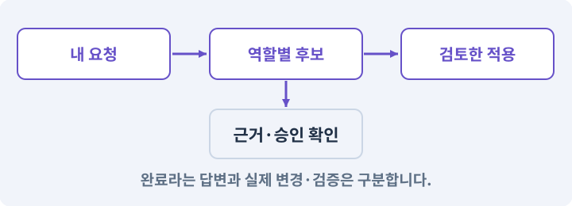

# 194. AI 초안을 비교하고 안전하게 적용하기

**목표:** 검토한 버전만 한 번에 적용하고 되돌릴 수 있습니다.

**시작 상태:** 193번에서 확인한 줄거리·분기·보상·필요 자산·반례가 함께 있는 AI 생성 후보 및 GrayOathRPG3D 작업 기록

## 한눈에 보는 기능의 흐름

원본 버전 → AI 후보 → 차이·충돌 확인 → 승인·Undo



**경계:** 생성 중 바뀐 원본에 옛 후보를 자동 적용하지 않기

그림은 실제 게임 실행 결과가 아닙니다. 값·규칙과 예제를 필요한 때 펼쳐 읽고 현재 단계의 메시지를 한 번씩 보냅니다.

## 1. 지금 상태 확인하기

첫 메시지를 보내 현재 프로젝트와 필요한 준비가 맞는지 확인하세요. 이름만 같은 예제를 실제 게임으로 착각하지 않습니다.

### AI에게 보낼 요구와 이유

#### 01. 작업 대상부터 확인

**현재 GrayOathRPG3D 프로젝트에서 후보 JSON·baseRevision·퀘스트 asset·Undo·파일 백업을 읽기 전용으로 확인해 줘.**

왜 이렇게 요청하나요? AI가 다른 프로젝트나 오래된 예제를 보고 작업할 수 있습니다. 실제 경로·파일·현재 기능을 읽게 하면 지금 이어서 작업할 대상을 먼저 맞출 수 있습니다.

#### 02. 지금 요청하는 작업의 범위

**지금 하려는 일은 “AI 초안을 비교하고 안전하게 적용하기”이야.**

왜 이렇게 요청하나요? 지금 다루려는 기능의 이름을 실제 작업 문맥으로 지정합니다. 이 문장은 구현 완료나 게임 속 대사 생성 요청이 아니라, 이후 조사·변경의 대상을 맞추는 역할을 합니다.

#### 03. 구현할 결과와 조건 고정

**실제 대상·미완료 준비·재사용할 부분을 구분해 줘.**

왜 이렇게 요청하나요? “실제 대상·미완료 준비·재사용할 부분을 구분해 줘”를 명시하면 AI가 무엇을 구현하거나 검사해야 하는지 범위를 좁힐 수 있습니다. 검토한 버전만 한 번에 적용하고 되돌릴 수 있습니다. 이 결과를 확인할 때 이 조건이 실제로 반영됐는지 함께 봅니다.

#### 04. 조사 단계에서 변경하지 않기

**아직 파일 수정·설치·유료 요청은 하지 마.**

왜 이렇게 요청하나요? 현재 상태를 알아보기만 할 때 파일 변경이나 결제가 시작되면 검토 전의 환경이 바뀝니다. 준비 확인과 실제 구현을 나눠 되돌리기 어려운 작업이 먼저 실행되지 않게 합니다.

<details>
<summary>보낼 원문 전체 — 설명은 복사되지 않습니다</summary>

```text
현재 GrayOathRPG3D 프로젝트에서 후보 JSON·baseRevision·퀘스트 asset·Undo·파일 백업을 읽기 전용으로 확인해 줘. 지금 하려는 일은 “AI 초안을 비교하고 안전하게 적용하기”이야. 실제 대상·미완료 준비·재사용할 부분을 구분해 줘. 아직 파일 수정·설치·유료 요청은 하지 마.
```

</details>

**기대 결과:** 후보 JSON·baseRevision·퀘스트 asset·Undo·파일 백업의 실제 위치·연결과 준비 여부

### 직접 확인하기

1. AI가 보여 준 프로젝트가 GrayOathRPG3D인지 확인합니다.
2. 필요한 준비가 없으면 먼저 해결하도록 요청합니다. 코드를 직접 입력하지 않습니다.

## 2. 이번 기능 만들기

아래 요청을 보냅니다. 코드와 도구 제작·데이터 입력은 AI가 합니다. 먼저 작은 결과를 보고 나머지 조건을 확인하세요.

### AI에게 보낼 요구와 이유

#### 01. 바뀔 내용 전체를 승인 전에 보기

**후보 비교 화면에 추가/삭제/변경 노드·대화·조건·보상·참조·예상 플레이 경로를 표시해 줘.**

왜 이렇게 요청하나요? 새 내용만 보면 삭제되는 대사·보상·참조를 놓치기 쉽습니다. 추가·삭제·변경과 예상 경로를 나란히 보여 줘야 어떤 플레이 결과를 승인하는지 판단할 수 있습니다.

#### 02. 검사·미리보기·실제 적용을 나누기

**‘검증’, ‘시뮬레이션’, ‘이 후보 적용’, ‘되돌리기’를 분리해 줘.**

왜 이렇게 요청하나요? 초안을 검사하거나 시험하는 행동이 곧 원본 변경이 되어서는 안 됩니다. 버튼과 상태를 분리하면 문제를 발견했을 때 적용하지 않고 초안만 수정할 수 있습니다.

#### 03. 적용 대상과 최신 기준을 다시 확인

**적용 직전에 projectId·questId·baseRevision·schema·content ID를 재검사해 줘.**

왜 이렇게 요청하나요? 다른 프로젝트의 퀘스트나 생성 이후 바뀐 원본에 초안을 적용하지 않으려는 검사입니다. 프로젝트·퀘스트 ID와 기준 버전, 스키마, 등록된 콘텐츠 ID를 대조해 현재 원본에 적용할 수 있는 변경인지 확인합니다.

#### 04. 오래된 초안의 덮어쓰기 중단

**원본 revision이 바뀌었으면 충돌로 멈추고 새 기준으로 다시 비교하게 해 줘.**

왜 이렇게 요청하나요? 초안을 만드는 동안 다른 편집이 발생할 수 있습니다. 적용 직전의 원본이 생성 시작 시점과 다르면 멈추고 차이를 다시 비교해야 최신 수정을 잃지 않습니다.

#### 05. 여러 파일의 변경을 함께 완료하거나 복구

**복수 에셋은 임시 stage→전체 검증→백업→커밋으로 처리하고 중간 실패는 이전 원본을 복구해 줘.**

왜 이렇게 요청하나요? 퀘스트는 그래프·대사·보상 등 여러 자산을 참조합니다. 일부만 저장되면 서로 맞지 않는 상태가 되므로 전체 후보를 검사한 뒤 적용하고 중간 실패 시 원본 묶음을 복구하게 합니다.

#### 06. Undo와 파일 복구의 차이 확인

**Undo는 Editor 객체 상태를 위한 것이며 디스크 복구와 같다고 하지 마.**

왜 이렇게 요청하나요? Editor의 Undo는 등록된 객체 편집을 되돌리는 장치이며 모든 디스크 파일을 복원하는 백업과 같지 않습니다. 객체 되돌리기와 파일 적용 실패 복구를 각각 검사해야 합니다.

#### 07. 승인한 후보를 같은 요청에서 한 번만 적용

**requestId·후보 해시·승인한 변경 범위를 기록하고 동일 요청 재적용을 중복 처리하지 마.**

왜 이렇게 요청하나요? 버튼 연타나 재시도로 같은 후보가 다시 도착할 수 있습니다. 요청 ID·후보 해시·승인 범위를 함께 기록해 이미 적용한 변경을 중복 실행하거나 다른 후보에 승인을 재사용하지 않습니다.

#### 08. 되돌아갈 원본 남기기

**내 승인 전에 원본 퀘스트는 바꾸지 마.**

왜 이렇게 요청하나요? 새 구현이 실패해도 이전 게임과 저장을 복원할 수 있어야 합니다. 현재 내용을 먼저 조사하고 별도 후보에서 작업하면 실험이 유일한 정상본을 망가뜨리는 일을 피할 수 있습니다.

#### 09. 구현과 실행은 AI에게 맡기기

**파일·코드·설정·Editor 조작·명령 실행은 네가 맡아 줘.**

왜 이렇게 요청하나요? 설명이나 코드 조각만 받으면 실제 파일 생성·연결·실행이 빠질 수 있습니다. AI가 개발 작업까지 수행하고, 사람은 요구·승인·결과 판단을 맡도록 역할을 분명히 합니다.

#### 10. 실제 사용 중인 코드에 연결

**먼저 실제 구현을 읽고 기존 진입점을 재사용해 줘.**

왜 이렇게 요청하나요? 예제와 이름이 다르더라도 현재 씬과 입력에서 호출하는 구현이 작업 대상입니다. 같은 기능을 새로 만들기보다 기존 진입점을 확인해 수정이 실제 게임에 반영되고 중복 실행되지 않게 합니다.

#### 11. 관찰 가능한 기준으로 확인

**이번 기능을 작은 변경으로 나눠 컴파일·관련 테스트·실제 씬 연결까지 수행해 줘.**

왜 이렇게 요청하나요? 구현 완료라는 설명을 실제 결과로 바꾸기 위한 조건입니다. 요청에 나온 대상과 경계 상황을 확인해 정상 결과뿐 아니라 실패를 어떻게 구분했는지도 남깁니다.

#### 12. 실패를 숨기지 않기

**테스트를 삭제하거나 조건을 낮춰 통과시키지 마.**

왜 이렇게 요청하나요? 검사 조건을 약하게 만들면 결함이 남아 있어도 통과 표시가 나올 수 있습니다. 구현을 고친 뒤 원래 기준으로 다시 검사해야 실제 문제가 해결됐는지 알 수 있습니다.

#### 13. 비용과 외부 작업은 별도 승인

**새 비용·외부 전송·게시에는 별도 승인이 필요해.**

왜 이렇게 요청하나요? 로컬 파일을 고치는 것과 외부 서비스에 자료를 보내거나 비용을 지불하는 것은 영향이 다릅니다. 대상·내용·비용 범위를 확인한 승인 없이 요청이 확대되지 않도록 합니다.

#### 14. 사람 검사의 시작점 준비

**실제 실행하지 못한 작업과 내가 직접 볼 부분은 구분해 줘.**

왜 이렇게 요청하나요? 같은 기능이라도 시작 상태가 다르면 관찰 결과가 달라집니다. AI가 실행 화면과 재현 위치를 먼저 준비해야 사람이 이동·공격·소리·조작감을 같은 조건에서 확인할 수 있습니다.

<details>
<summary>보낼 원문 전체 — 설명은 복사되지 않습니다</summary>

```text
후보 비교 화면에 추가/삭제/변경 노드·대화·조건·보상·참조·예상 플레이 경로를 표시해 줘. ‘검증’, ‘시뮬레이션’, ‘이 후보 적용’, ‘되돌리기’를 분리해 줘.
적용 직전에 projectId·questId·baseRevision·schema·content ID를 재검사해 줘. 원본 revision이 바뀌었으면 충돌로 멈추고 새 기준으로 다시 비교하게 해 줘. 복수 에셋은 임시 stage→전체 검증→백업→커밋으로 처리하고 중간 실패는 이전 원본을 복구해 줘.
Undo는 Editor 객체 상태를 위한 것이며 디스크 복구와 같다고 하지 마. requestId·후보 해시·승인한 변경 범위를 기록하고 동일 요청 재적용을 중복 처리하지 마. 내 승인 전에 원본 퀘스트는 바꾸지 마.

파일·코드·설정·Editor 조작·명령 실행은 네가 맡아 줘. 먼저 실제 구현을 읽고 기존 진입점을 재사용해 줘. 이번 기능을 작은 변경으로 나눠 컴파일·관련 테스트·실제 씬 연결까지 수행해 줘. 테스트를 삭제하거나 조건을 낮춰 통과시키지 마. 새 비용·외부 전송·게시에는 별도 승인이 필요해. 실제 실행하지 못한 작업과 내가 직접 볼 부분은 구분해 줘.
```

</details>

**기대 결과:** 원본과 후보를 비교해 승인·적용·Undo·복구할 수 있는 화면

### 직접 확인하기

1. AI에게 아래 목표 화면을 열어 달라고 하고 실제로 보이는지 확인합니다.
2. 확인할 화면: 원본과 후보를 비교해 승인·적용·Undo·복구할 수 있는 화면

## 3. 직접 써 보고 반례 확인하기

AI가 검사와 화면을 준비한 뒤 다음 동작을 하나씩 해 보세요. Editor 버튼은 완성된 도구를 사용하는 조작이며 코드나 데이터 파일을 직접 편집하지 않습니다.

### AI에게 보낼 요구와 이유

#### 01. 현재 코드와 검사 결과 연결

**방금 만든 기능을 현재 소스에서 검증하고 내가 볼 시작 화면을 준비해 줘.**

왜 이렇게 요청하나요? 코드나 설정이 바뀌면 이전 버전에서 통과한 검사로 새 버전의 정상 동작을 보장할 수 없습니다. 어떤 소스에서 나온 결과인지 묶어야 바뀐 부분을 다시 검사할 수 있습니다.

#### 02. 검사할 입력과 관찰 지점 준비

**다음 항목을 실제 검사해 줘.**

왜 이렇게 요청하나요? 정상 예 하나만 보면 실패 조건을 놓치기 쉽습니다. 정상·경계·반례를 실제 입력으로 준비하고 사람이 볼 화면도 맞춰 확인 범위를 분명하게 합니다.

#### 03. 기준 버전 충돌 검사의 적용 조건

**- 낡은 baseRevision 적용 거부**

왜 이렇게 요청하나요? 편집을 시작할 때의 기준 버전과 적용 직전의 현재 버전을 비교해 다른 변경을 덮어쓰지 않게 하는 방식입니다. “낙관적”은 검사 없이 믿는다는 뜻이 아닙니다. 생성 요청 시 검사했더라도 적용 시 재검사를 생략하면 충돌을 막을 수 없습니다.

#### 04. 기존 결과를 보호

**- 부분 파일 실패에서 원본 복구**

왜 이렇게 요청하나요? 새 작업이 이미 정상인 기능이나 자산까지 바꾸면 원인을 추적하기 어렵습니다. 유지할 대상을 명시해 변경 전후를 비교하고 원치 않은 영향을 찾습니다.

#### 05. 같은 요청의 반복 처리 정의

**- 동일 요청 중복 적용 없음**

왜 이렇게 요청하나요? 클릭 연타·재연결·중복 이벤트는 개발과 플레이 중 모두 발생할 수 있습니다. 반복돼도 한 번 처리해야 하는 결과와 매번 새로 처리할 결과를 나눠 데이터가 누적되지 않게 합니다.

#### 06. Undo와 파일 복구의 차이 확인

**- Undo/디스크 백업 판정 분리**

왜 이렇게 요청하나요? Editor의 Undo는 등록된 객체 편집을 되돌리는 장치이며 모든 디스크 파일을 복원하는 백업과 같지 않습니다. 객체 되돌리기와 파일 적용 실패 복구를 각각 검사해야 합니다.

#### 07. 결과를 재확인할 근거 남기기

**오류 로그·대상·실행 수·파일 해시를 남겨 줘.**

왜 이렇게 요청하나요? “잘 됩니다”라는 요약만으로는 어떤 입력과 버전을 검사했는지 알 수 없습니다. 대상·실행 수·실패 내용·파일을 함께 남겨 같은 조건으로 다시 확인할 수 있게 합니다.

#### 08. 보여 준 자료의 한계 구분

**화면 캡처만으로 조작 성공을, 모의 응답만으로 실제 AI 호출을 주장하지 마.**

왜 이렇게 요청하나요? 사진 한 장은 입력·저장·시간에 따른 동작까지 증명하지 못하고, 정해진 모의 응답은 실제 서비스 호출이 아닙니다. 각각 확인할 수 있는 범위만 기록하게 하는 요청입니다.

#### 09. 사람 검사의 시작점 준비

**내 관찰·기기 검사가 필요한 부분은 실행 화면을 준비하고 별도로 표시해 줘.**

왜 이렇게 요청하나요? 같은 기능이라도 시작 상태가 다르면 관찰 결과가 달라집니다. AI가 실행 화면과 재현 위치를 먼저 준비해야 사람이 이동·공격·소리·조작감을 같은 조건에서 확인할 수 있습니다.

<details>
<summary>보낼 원문 전체 — 설명은 복사되지 않습니다</summary>

```text
방금 만든 기능을 현재 소스에서 검증하고 내가 볼 시작 화면을 준비해 줘. 다음 항목을 실제 검사해 줘.
- 낡은 baseRevision 적용 거부
- 부분 파일 실패에서 원본 복구
- 동일 요청 중복 적용 없음
- Undo/디스크 백업 판정 분리
오류 로그·대상·실행 수·파일 해시를 남겨 줘. 화면 캡처만으로 조작 성공을, 모의 응답만으로 실제 AI 호출을 주장하지 마. 내 관찰·기기 검사가 필요한 부분은 실행 화면을 준비하고 별도로 표시해 줘.
```

</details>

**기대 결과:** A는 충돌로 멈춰 새 기준에서 차이를 다시 보여 줍니다. 정상 적용은 관련 파일을 검증·백업한 뒤 한 후보로 반영합니다.

### 직접 확인하기

1. 후보를 만들고 원본을 한 번 변경하는 충돌 테스트를 봅니다.
2. 오래된 후보 적용이 멈추는지 확인합니다.
3. 정상 후보를 적용하고 되돌린 뒤 재개방합니다.

## 4. 결과를 남기고 이어가기

실제로 본 결과를 메모해 전달하세요. 실패했다면 현재 페이지의 “막혔어요” 요청으로 같은 문제부터 고칩니다.

### AI에게 보낼 요구와 이유

#### 01. 다음 작업이 읽을 인수인계

**“AI 초안을 비교하고 안전하게 적용하기” 작업을 마무리해 줘.**

왜 이렇게 요청하나요? 새 AI 세션은 이전 대화 전체를 알고 있다고 보장할 수 없습니다. 현재 후보·파일 위치·실행한 검사·남은 일을 남겨야 같은 작업을 반복하지 않고 이어갈 수 있습니다.

#### 02. 미확인을 완료와 분리

**실제로 만든 파일과 연결한 Editor 도구, 검사한 소스·데이터 버전, 성공·실패·미실행을 구분해 기록해 줘.**

왜 이렇게 요청하나요? 만들어진 것, 검사에 실패한 것, 아직 확인하지 못한 것을 나눠야 다음 작업을 정확히 고를 수 있습니다. 실행할 조건이 없는 기능을 성공으로 기록하면 뒤에서 원인을 찾기 어려워집니다.

#### 03. 관찰하지 않은 성공을 채우지 않기

**내가 전달한 관찰만 사람 검사에 반영해 줘.**

왜 이렇게 요청하나요? 자동 검사·AI의 추정·사람의 실제 관찰은 다른 종류의 근거입니다. 수행하지 않은 기기나 조작 검사는 미확인으로 남겨 나중에 실제 확인할 수 있게 합니다.

#### 04. 미확인을 완료와 분리

**미완료 상태를 완료로 바꾸지 말고, 정상 후보와 이전 기록을 보존해 다음 세션에서 이어갈 진입점을 남겨 줘.**

왜 이렇게 요청하나요? 만들어진 것, 검사에 실패한 것, 아직 확인하지 못한 것을 나눠야 다음 작업을 정확히 고를 수 있습니다. 실행할 조건이 없는 기능을 성공으로 기록하면 뒤에서 원인을 찾기 어려워집니다.

<details>
<summary>보낼 원문 전체 — 설명은 복사되지 않습니다</summary>

```text
“AI 초안을 비교하고 안전하게 적용하기” 작업을 마무리해 줘. 실제로 만든 파일과 연결한 Editor 도구, 검사한 소스·데이터 버전, 성공·실패·미실행을 구분해 기록해 줘. 내가 전달한 관찰만 사람 검사에 반영해 줘. 미완료 상태를 완료로 바꾸지 말고, 정상 후보와 이전 기록을 보존해 다음 세션에서 이어갈 진입점을 남겨 줘.
```

</details>

**기대 결과:** 실제 구현·검사·관찰과 다음 시작점이 프로젝트 기록에 남음

### 직접 확인하기

1. 직접 보지 않은 결과가 완료로 적히지 않았는지 확인합니다.
2. 미완료 문제가 없다면 결과를 확인한 뒤 다음 페이지로 갑니다.

## 구체적인 예로 이해하기

### 초안을 만드는 동안 원본이 바뀌면

AI는 요청 시점의 원본을 봅니다. 승인 시점의 원본이 같은지 확인하지 않으면 최신 수정이 사라질 수 있습니다.

**시작 상태:** revision 4를 기준으로 초안 A를 만들고, 원본 퀘스트를 revision 5로 수정합니다.

**직접 해 볼 동작:** 초안 A를 적용하려고 하고, 원본과 같은 기준의 정상 초안도 적용합니다.

**보여야 하는 결과:** A는 충돌로 멈춰 새 기준에서 차이를 다시 보여 줍니다. 정상 적용은 관련 파일을 검증·백업한 뒤 한 후보로 반영합니다.

**이렇게 되면 아직 안 됩니다:** 승인 버튼만 눌렸다는 이유로 원본 revision 검사를 생략합니다.

**생각해 보기:** 객체 Undo와 디스크 백업을 왜 둘 다 확인하나요?

<details><summary>해설 보기</summary>

Editor 편집 복구와 여러 파일의 적용 실패 복구가 다른 일이기 때문입니다. 하나가 된다고 다른 것도 된 것은 아닙니다.

</details>

## 이 작업에서 사용할 값과 규칙 전체

설계 시작값이며 측정된 성능·게임 성공 결과가 아닙니다. 구현은 AI가 수행합니다.

후보 비교 화면에 추가/삭제/변경 노드·대화·조건·보상·참조·예상 플레이 경로를 표시해 줘. ‘검증’, ‘시뮬레이션’, ‘이 후보 적용’, ‘되돌리기’를 분리해 줘.
적용 직전에 projectId·questId·baseRevision·schema·content ID를 재검사해 줘. 원본 revision이 바뀌었으면 충돌로 멈추고 새 기준으로 다시 비교하게 해 줘. 복수 에셋은 임시 stage→전체 검증→백업→커밋으로 처리하고 중간 실패는 이전 원본을 복구해 줘.
Undo는 Editor 객체 상태를 위한 것이며 디스크 복구와 같다고 하지 마. requestId·후보 해시·승인한 변경 범위를 기록하고 동일 요청 재적용을 중복 처리하지 마. 내 승인 전에 원본 퀘스트는 바꾸지 마.

## 문제가 있으면

### AI에게 보낼 요구와 이유

#### 01. 여러 파일의 변경을 함께 완료하거나 복구

**적용 중 일부 대화만 바뀌었다면 복수 에셋 stage와 커밋 로그를 조사해 전체 원본을 복구해 줘.**

왜 이렇게 요청하나요? 퀘스트는 그래프·대사·보상 등 여러 자산을 참조합니다. 일부만 저장되면 서로 맞지 않는 상태가 되므로 전체 후보를 검사한 뒤 적용하고 중간 실패 시 원본 묶음을 복구하게 합니다.

#### 02. 원인 하나를 좁혀 수정

**현재 대상과 실제 오류부터 읽고 최소 수정해 줘.**

왜 이렇게 요청하나요? 오류 수정 중 새 기능까지 넣으면 어떤 변경이 문제를 해결하거나 악화했는지 알기 어렵습니다. 원래 재현을 보존하고 작은 변경 뒤 같은 입력과 주변 정상 동작을 다시 확인합니다.

#### 03. 원인 하나를 좁혀 수정

**이전 정상 후보와 실패 근거는 보존하고 같은 반례와 관련 정상 동작을 다시 검사해 줘.**

왜 이렇게 요청하나요? 오류 수정 중 새 기능까지 넣으면 어떤 변경이 문제를 해결하거나 악화했는지 알기 어렵습니다. 원래 재현을 보존하고 작은 변경 뒤 같은 입력과 주변 정상 동작을 다시 확인합니다.

#### 04. 구현과 실행은 AI에게 맡기기

**작업을 다른 기능으로 돌리거나 내가 코드·설정을 편집하게 하지 마.**

왜 이렇게 요청하나요? 설명이나 코드 조각만 받으면 실제 파일 생성·연결·실행이 빠질 수 있습니다. AI가 개발 작업까지 수행하고, 사람은 요구·승인·결과 판단을 맡도록 역할을 분명히 합니다.

<details>
<summary>보낼 원문 전체 — 설명은 복사되지 않습니다</summary>

```text
적용 중 일부 대화만 바뀌었다면 복수 에셋 stage와 커밋 로그를 조사해 전체 원본을 복구해 줘.
현재 대상과 실제 오류부터 읽고 최소 수정해 줘. 이전 정상 후보와 실패 근거는 보존하고 같은 반례와 관련 정상 동작을 다시 검사해 줘. 작업을 다른 기능으로 돌리거나 내가 코드·설정을 편집하게 하지 마.
```

</details>

## 새 세션에서 이어가기

### AI에게 보낼 요구와 이유

#### 01. 이어서 할 작업 식별

**“AI 초안을 비교하고 안전하게 적용하기” 작업을 이어가고 싶어.**

왜 이렇게 요청하나요? 이름으로 재개할 작업을 찾고, 뒤에 이어지는 요청으로 실제 파일·진행 중 작업·기록을 다시 읽게 합니다. 제목만 보고 이전 상태를 기억한다고 가정하지 않습니다.

#### 02. 재개 전 중복 작업 방지

**실제 GrayOathRPG3D와 내 하네스의 기록·진행 중 작업·승인 상태를 읽고, 마지막으로 검증한 결과와 남은 일을 구분해 줘.**

왜 이렇게 요청하나요? 대화가 끊겨도 외부 작업은 끝났거나 아직 실행 중일 수 있습니다. 프로세스·승인·미저장 상태를 먼저 읽어 같은 생성·빌드·결제를 두 번 시작하지 않도록 합니다.

#### 03. 재개 전 중복 작업 방지

**다른 프로젝트를 바꾸거나 유료 요청을 중복 제출하지 말고 가장 작은 미완료 작업부터 진행해 줘.**

왜 이렇게 요청하나요? 대화가 끊겨도 외부 작업은 끝났거나 아직 실행 중일 수 있습니다. 프로세스·승인·미저장 상태를 먼저 읽어 같은 생성·빌드·결제를 두 번 시작하지 않도록 합니다.

<details>
<summary>보낼 원문 전체 — 설명은 복사되지 않습니다</summary>

```text
“AI 초안을 비교하고 안전하게 적용하기” 작업을 이어가고 싶어. 실제 GrayOathRPG3D와 내 하네스의 기록·진행 중 작업·승인 상태를 읽고, 마지막으로 검증한 결과와 남은 일을 구분해 줘. 다른 프로젝트를 바꾸거나 유료 요청을 중복 제출하지 말고 가장 작은 미완료 작업부터 진행해 줘.
```

</details>

## 왜 이렇게 만드는가

AI가 초안을 만드는 동안 원본이 바뀔 수 있습니다. 오래된 초안을 바로 덮어쓰면 누군가의 수정이 사라집니다. 버전 비교와 승인된 변경 목록이 필요합니다.

## 공식 참고

- [Unity · Undo](https://docs.unity3d.com/6000.3/Documentation/ScriptReference/Undo.html)
- [Unity · AssetDatabase](https://docs.unity3d.com/6000.3/Documentation/ScriptReference/AssetDatabase.html)


## 실제 Unity Editor 화면 참고
공식 예시와 내 프로젝트 실행 결과를 구분하세요. 원본 사진은 온라인 연결이 필요합니다.

- [Console — 오류 줄과 상세 원인을 함께 읽기](../editor_references/console.md)
- [UI Builder — 편집기 화면을 구성하는 기본 작업창](../editor_references/ui-builder.md)
