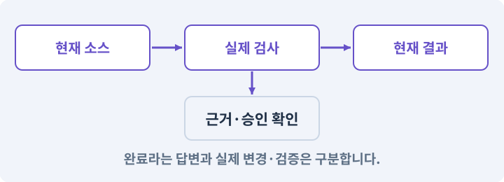

# 245. 플레이 흐름을 반복하는 회귀 검사 도구 만들기

**목표:** 같은 요청·저장·퀘스트 흐름을 다시 실행해 변경을 비교합니다.

**시작 상태:** 244번에서 확인한 실제 기기의 장시간 성능 추세와 필요한 품질 조정 결과 및 GrayOathRPG3D 작업 기록

## 한눈에 보는 기능의 흐름

시나리오 입력 → 실제 실행 → 기준과 비교 → 재현·대상 연결



**경계:** 자동 검사 성공과 실제 손의 조작 검사는 분리

그림은 실제 게임 실행 결과가 아닙니다. 값·규칙과 예제를 필요한 때 펼쳐 읽고 현재 단계의 메시지를 한 번씩 보냅니다.

## 1. 지금 상태 확인하기

첫 메시지를 보내 현재 프로젝트와 필요한 준비가 맞는지 확인하세요. 이름만 같은 예제를 실제 게임으로 착각하지 않습니다.

### AI에게 보낼 요구와 이유

#### 01. 작업 대상부터 확인

**현재 GrayOathRPG3D 프로젝트에서 실제 테스트 어셈블리·도구 등록·사건 reducer·scene bootstrap을 읽기 전용으로 확인해 줘.**

왜 이렇게 요청하나요? AI가 다른 프로젝트나 오래된 예제를 보고 작업할 수 있습니다. 실제 경로·파일·현재 기능을 읽게 하면 지금 이어서 작업할 대상을 먼저 맞출 수 있습니다.

#### 02. 지금 요청하는 작업의 범위

**지금 하려는 일은 “플레이 흐름을 반복하는 회귀 검사 도구 만들기”이야.**

왜 이렇게 요청하나요? 지금 다루려는 기능의 이름을 실제 작업 문맥으로 지정합니다. 이 문장은 구현 완료나 게임 속 대사 생성 요청이 아니라, 이후 조사·변경의 대상을 맞추는 역할을 합니다.

#### 03. 구현할 결과와 조건 고정

**실제 대상·미완료 준비·재사용할 부분을 구분해 줘.**

왜 이렇게 요청하나요? “실제 대상·미완료 준비·재사용할 부분을 구분해 줘”를 명시하면 AI가 무엇을 구현하거나 검사해야 하는지 범위를 좁힐 수 있습니다. 같은 요청·저장·퀘스트 흐름을 다시 실행해 변경을 비교합니다. 이 결과를 확인할 때 이 조건이 실제로 반영됐는지 함께 봅니다.

#### 04. 조사 단계에서 변경하지 않기

**아직 파일 수정·설치·유료 요청은 하지 마.**

왜 이렇게 요청하나요? 현재 상태를 알아보기만 할 때 파일 변경이나 결제가 시작되면 검토 전의 환경이 바뀝니다. 준비 확인과 실제 구현을 나눠 되돌리기 어려운 작업이 먼저 실행되지 않게 합니다.

<details>
<summary>보낼 원문 전체 — 설명은 복사되지 않습니다</summary>

```text
현재 GrayOathRPG3D 프로젝트에서 실제 테스트 어셈블리·도구 등록·사건 reducer·scene bootstrap을 읽기 전용으로 확인해 줘. 지금 하려는 일은 “플레이 흐름을 반복하는 회귀 검사 도구 만들기”이야. 실제 대상·미완료 준비·재사용할 부분을 구분해 줘. 아직 파일 수정·설치·유료 요청은 하지 마.
```

</details>

**기대 결과:** 실제 테스트 어셈블리·도구 등록·사건 reducer·scene bootstrap의 실제 위치·연결과 준비 여부

### 직접 확인하기

1. AI가 보여 준 프로젝트가 GrayOathRPG3D인지 확인합니다.
2. 필요한 준비가 없으면 먼저 해결하도록 요청합니다. 코드를 직접 입력하지 않습니다.

## 2. 이번 기능 만들기

아래 요청을 보냅니다. 코드와 도구 제작·데이터 입력은 AI가 합니다. 먼저 작은 결과를 보고 나머지 조건을 확인하세요.

### AI에게 보낼 요구와 이유

#### 01. 사용자가 결과를 이해하게 표시

**Playtest Runner 창을 만들어 줘.**

왜 이렇게 요청하나요? 내부 데이터가 맞아도 화면에 현재 선택과 가능한 행동이 보이지 않으면 기능을 쓰기 어렵습니다. 선택 전후와 사용할 수 없는 상태를 구분해 조작과 실제 결과가 연결되게 합니다.

#### 02. 저장 중단과 손상에 대비

**퀘스트 수락→조사→대화 선택→이동→처치 또는 해제→보상→저장 복원 시나리오를 scenarioId로 선택하고 독립 테스트 세이브에서 실행해 줘.**

왜 이렇게 요청하나요? 파일 쓰기가 중단되거나 읽을 수 없는 값이 있으면 정상 진행을 잃을 수 있습니다. 완성된 데이터 검증·교체·백업 복구를 나눠 손상된 자료가 정상본을 덮지 않게 합니다.

#### 03. 무작위 결과를 재현 가능하게

**논리 사건 replay와 실제 입력/물리 검사를 구분하고 시간 순서·eventId·random stream·contentRevision을 기록해 줘.**

왜 이렇게 요청하나요? 실패한 맵이나 전리품 결과를 다시 만들 수 있어야 원인을 고칠 수 있습니다. 생성 버전·설정·시드를 함께 기록하고 지형·장식·보상 난수를 분리해 작은 변경의 파급을 줄입니다.

#### 04. 실제로 실행한 검사만 인정

**NUnit XML은 expected test identity·실행 수·실패·skipped를 검사하고 0개나 중복 identity를 성공으로 처리하지 마.**

왜 이렇게 요청하나요? 실행된 검사가 없거나 같은 결과를 중복 집계한 경우는 기능을 확인한 것이 아닙니다. 실행 수와 개별 결과를 함께 확인해야 형식적인 성공 표시를 걸러낼 수 있습니다.

#### 05. 버튼과 자연어가 같은 기능을 사용

**UI의 테스트 버튼과 CLI 진입점은 같은 서비스로 연결해 줘.**

왜 이렇게 요청하나요? 버튼용 코드와 자연어용 코드를 따로 만들면 검증·저장 규칙이 서로 달라질 수 있습니다. 두 진입점이 같은 서비스로 들어가야 어느 쪽에서 실행해도 동일한 제약과 결과를 얻습니다.

#### 06. 이벤트·콜백·구독·이벤트 버스의 적용 조건

**실패를 클릭하면 재현 seed/save/event와 관련 Editor 도구가 열리고 AI 수정 요청 초안을 만들게 해 줘.**

왜 이렇게 요청하나요? 이벤트는 어떤 일이 일어났다는 알림입니다. 구독자는 관심 있는 알림을 받아 콜백을 실행합니다. 이벤트 버스는 여러 기능 사이의 알림 전달을 모으는 구조입니다. 모든 것을 전역 이벤트로 만들면 흐름을 추적하기 어려워집니다. 소유권·발행 시점·순서를 명시합니다.

#### 07. 기존 결과를 보호

**자동으로 원본을 고치거나 릴리스를 승인하지 마.**

왜 이렇게 요청하나요? 새 작업이 이미 정상인 기능이나 자산까지 바꾸면 원인을 추적하기 어렵습니다. 유지할 대상을 명시해 변경 전후를 비교하고 원치 않은 영향을 찾습니다.

#### 08. 구현과 실행은 AI에게 맡기기

**파일·코드·설정·Editor 조작·명령 실행은 네가 맡아 줘.**

왜 이렇게 요청하나요? 설명이나 코드 조각만 받으면 실제 파일 생성·연결·실행이 빠질 수 있습니다. AI가 개발 작업까지 수행하고, 사람은 요구·승인·결과 판단을 맡도록 역할을 분명히 합니다.

#### 09. 실제 사용 중인 코드에 연결

**먼저 실제 구현을 읽고 기존 진입점을 재사용해 줘.**

왜 이렇게 요청하나요? 예제와 이름이 다르더라도 현재 씬과 입력에서 호출하는 구현이 작업 대상입니다. 같은 기능을 새로 만들기보다 기존 진입점을 확인해 수정이 실제 게임에 반영되고 중복 실행되지 않게 합니다.

#### 10. 관찰 가능한 기준으로 확인

**이번 기능을 작은 변경으로 나눠 컴파일·관련 테스트·실제 씬 연결까지 수행해 줘.**

왜 이렇게 요청하나요? 구현 완료라는 설명을 실제 결과로 바꾸기 위한 조건입니다. 요청에 나온 대상과 경계 상황을 확인해 정상 결과뿐 아니라 실패를 어떻게 구분했는지도 남깁니다.

#### 11. 실패를 숨기지 않기

**테스트를 삭제하거나 조건을 낮춰 통과시키지 마.**

왜 이렇게 요청하나요? 검사 조건을 약하게 만들면 결함이 남아 있어도 통과 표시가 나올 수 있습니다. 구현을 고친 뒤 원래 기준으로 다시 검사해야 실제 문제가 해결됐는지 알 수 있습니다.

#### 12. 비용과 외부 작업은 별도 승인

**새 비용·외부 전송·게시에는 별도 승인이 필요해.**

왜 이렇게 요청하나요? 로컬 파일을 고치는 것과 외부 서비스에 자료를 보내거나 비용을 지불하는 것은 영향이 다릅니다. 대상·내용·비용 범위를 확인한 승인 없이 요청이 확대되지 않도록 합니다.

#### 13. 사람 검사의 시작점 준비

**실제 실행하지 못한 작업과 내가 직접 볼 부분은 구분해 줘.**

왜 이렇게 요청하나요? 같은 기능이라도 시작 상태가 다르면 관찰 결과가 달라집니다. AI가 실행 화면과 재현 위치를 먼저 준비해야 사람이 이동·공격·소리·조작감을 같은 조건에서 확인할 수 있습니다.

<details>
<summary>보낼 원문 전체 — 설명은 복사되지 않습니다</summary>

```text
Playtest Runner 창을 만들어 줘. 퀘스트 수락→조사→대화 선택→이동→처치 또는 해제→보상→저장 복원 시나리오를 scenarioId로 선택하고 독립 테스트 세이브에서 실행해 줘.
논리 사건 replay와 실제 입력/물리 검사를 구분하고 시간 순서·eventId·random stream·contentRevision을 기록해 줘. NUnit XML은 expected test identity·실행 수·실패·skipped를 검사하고 0개나 중복 identity를 성공으로 처리하지 마.
UI의 테스트 버튼과 CLI 진입점은 같은 서비스로 연결해 줘. 실패를 클릭하면 재현 seed/save/event와 관련 Editor 도구가 열리고 AI 수정 요청 초안을 만들게 해 줘. 자동으로 원본을 고치거나 릴리스를 승인하지 마.

파일·코드·설정·Editor 조작·명령 실행은 네가 맡아 줘. 먼저 실제 구현을 읽고 기존 진입점을 재사용해 줘. 이번 기능을 작은 변경으로 나눠 컴파일·관련 테스트·실제 씬 연결까지 수행해 줘. 테스트를 삭제하거나 조건을 낮춰 통과시키지 마. 새 비용·외부 전송·게시에는 별도 승인이 필요해. 실제 실행하지 못한 작업과 내가 직접 볼 부분은 구분해 줘.
```

</details>

**기대 결과:** 실패한 시나리오의 실제 자산·사건으로 이동하는 회귀 검사 화면

### 직접 확인하기

1. AI에게 아래 목표 화면을 열어 달라고 하고 실제로 보이는지 확인합니다.
2. 확인할 화면: 실패한 시나리오의 실제 자산·사건으로 이동하는 회귀 검사 화면

## 3. 직접 써 보고 반례 확인하기

AI가 검사와 화면을 준비한 뒤 다음 동작을 하나씩 해 보세요. Editor 버튼은 완성된 도구를 사용하는 조작이며 코드나 데이터 파일을 직접 편집하지 않습니다.

### AI에게 보낼 요구와 이유

#### 01. 현재 코드와 검사 결과 연결

**방금 만든 기능을 현재 소스에서 검증하고 내가 볼 시작 화면을 준비해 줘.**

왜 이렇게 요청하나요? 코드나 설정이 바뀌면 이전 버전에서 통과한 검사로 새 버전의 정상 동작을 보장할 수 없습니다. 어떤 소스에서 나온 결과인지 묶어야 바뀐 부분을 다시 검사할 수 있습니다.

#### 02. 검사할 입력과 관찰 지점 준비

**다음 항목을 실제 검사해 줘.**

왜 이렇게 요청하나요? 정상 예 하나만 보면 실패 조건을 놓치기 쉽습니다. 정상·경계·반례를 실제 입력으로 준비하고 사람이 볼 화면도 맞춰 확인 범위를 분명하게 합니다.

#### 03. 사건 재생과 회귀 실행의 적용 조건

**- 논리 replay vs 실제 물리 오차 분리**

왜 이렇게 요청하나요? 기록된 의미 사건과 입력을 다시 실행해 결과를 비교하는 방식입니다. 논리 사건의 결정성과 물리 엔진·프레임·화면의 동일성을 혼동하지 않습니다. 사건 재생 성공을 새 플레이어가 UI만 보고 완주한 증거라고 부르지 않습니다.

#### 04. 구현할 결과와 조건 고정

**- NUnit identity·count·skipped 엄격**

왜 이렇게 요청하나요? “NUnit identity·count·skipped 엄격”를 명시하면 AI가 무엇을 구현하거나 검사해야 하는지 범위를 좁힐 수 있습니다. 같은 요청·저장·퀘스트 흐름을 다시 실행해 변경을 비교합니다. 이 결과를 확인할 때 이 조건이 실제로 반영됐는지 함께 봅니다.

#### 05. 기존 결과를 보호

**- 원본save 불변·fixture 격리**

왜 이렇게 요청하나요? 새 작업이 이미 정상인 기능이나 자산까지 바꾸면 원인을 추적하기 어렵습니다. 유지할 대상을 명시해 변경 전후를 비교하고 원치 않은 영향을 찾습니다.

#### 06. 결과를 재확인할 근거 남기기

**오류 로그·대상·실행 수·파일 해시를 남겨 줘.**

왜 이렇게 요청하나요? “잘 됩니다”라는 요약만으로는 어떤 입력과 버전을 검사했는지 알 수 없습니다. 대상·실행 수·실패 내용·파일을 함께 남겨 같은 조건으로 다시 확인할 수 있게 합니다.

#### 07. 보여 준 자료의 한계 구분

**화면 캡처만으로 조작 성공을, 모의 응답만으로 실제 AI 호출을 주장하지 마.**

왜 이렇게 요청하나요? 사진 한 장은 입력·저장·시간에 따른 동작까지 증명하지 못하고, 정해진 모의 응답은 실제 서비스 호출이 아닙니다. 각각 확인할 수 있는 범위만 기록하게 하는 요청입니다.

#### 08. 사람 검사의 시작점 준비

**내 관찰·기기 검사가 필요한 부분은 실행 화면을 준비하고 별도로 표시해 줘.**

왜 이렇게 요청하나요? 같은 기능이라도 시작 상태가 다르면 관찰 결과가 달라집니다. AI가 실행 화면과 재현 위치를 먼저 준비해야 사람이 이동·공격·소리·조작감을 같은 조건에서 확인할 수 있습니다.

<details>
<summary>보낼 원문 전체 — 설명은 복사되지 않습니다</summary>

```text
방금 만든 기능을 현재 소스에서 검증하고 내가 볼 시작 화면을 준비해 줘. 다음 항목을 실제 검사해 줘.
- 논리 replay vs 실제 물리 오차 분리
- NUnit identity·count·skipped 엄격
- 원본save 불변·fixture 격리
오류 로그·대상·실행 수·파일 해시를 남겨 줘. 화면 캡처만으로 조작 성공을, 모의 응답만으로 실제 AI 호출을 주장하지 마. 내 관찰·기기 검사가 필요한 부분은 실행 화면을 준비하고 별도로 표시해 줘.
```

</details>

**기대 결과:** 정상 동작과 실패 조건의 결과가 따로 보이고, 직접 확인할 화면이 준비됨

### 직접 확인하기

1. 정상 시나리오와 고의 실패 fixture를 각각 실행해 달라고 합니다.
2. 실패를 눌러 재현과 연결된 퀘스트를 봅니다.
3. 테스트 성공과 실제 기기 검사가 따로 표시되는지 확인합니다.

## 4. 결과를 남기고 이어가기

실제로 본 결과를 메모해 전달하세요. 실패했다면 현재 페이지의 “막혔어요” 요청으로 같은 문제부터 고칩니다.

### AI에게 보낼 요구와 이유

#### 01. 다음 작업이 읽을 인수인계

**“플레이 흐름을 반복하는 회귀 검사 도구 만들기” 작업을 마무리해 줘.**

왜 이렇게 요청하나요? 새 AI 세션은 이전 대화 전체를 알고 있다고 보장할 수 없습니다. 현재 후보·파일 위치·실행한 검사·남은 일을 남겨야 같은 작업을 반복하지 않고 이어갈 수 있습니다.

#### 02. 미확인을 완료와 분리

**실제로 만든 파일과 연결한 Editor 도구, 검사한 소스·데이터 버전, 성공·실패·미실행을 구분해 기록해 줘.**

왜 이렇게 요청하나요? 만들어진 것, 검사에 실패한 것, 아직 확인하지 못한 것을 나눠야 다음 작업을 정확히 고를 수 있습니다. 실행할 조건이 없는 기능을 성공으로 기록하면 뒤에서 원인을 찾기 어려워집니다.

#### 03. 관찰하지 않은 성공을 채우지 않기

**내가 전달한 관찰만 사람 검사에 반영해 줘.**

왜 이렇게 요청하나요? 자동 검사·AI의 추정·사람의 실제 관찰은 다른 종류의 근거입니다. 수행하지 않은 기기나 조작 검사는 미확인으로 남겨 나중에 실제 확인할 수 있게 합니다.

#### 04. 미확인을 완료와 분리

**미완료 상태를 완료로 바꾸지 말고, 정상 후보와 이전 기록을 보존해 다음 세션에서 이어갈 진입점을 남겨 줘.**

왜 이렇게 요청하나요? 만들어진 것, 검사에 실패한 것, 아직 확인하지 못한 것을 나눠야 다음 작업을 정확히 고를 수 있습니다. 실행할 조건이 없는 기능을 성공으로 기록하면 뒤에서 원인을 찾기 어려워집니다.

<details>
<summary>보낼 원문 전체 — 설명은 복사되지 않습니다</summary>

```text
“플레이 흐름을 반복하는 회귀 검사 도구 만들기” 작업을 마무리해 줘. 실제로 만든 파일과 연결한 Editor 도구, 검사한 소스·데이터 버전, 성공·실패·미실행을 구분해 기록해 줘. 내가 전달한 관찰만 사람 검사에 반영해 줘. 미완료 상태를 완료로 바꾸지 말고, 정상 후보와 이전 기록을 보존해 다음 세션에서 이어갈 진입점을 남겨 줘.
```

</details>

**기대 결과:** 실제 구현·검사·관찰과 다음 시작점이 프로젝트 기록에 남음

### 직접 확인하기

1. 직접 보지 않은 결과가 완료로 적히지 않았는지 확인합니다.
2. 미완료 문제가 없다면 결과를 확인한 뒤 다음 페이지로 갑니다.

## 이 작업에서 사용할 값과 규칙 전체

설계 시작값이며 측정된 성능·게임 성공 결과가 아닙니다. 구현은 AI가 수행합니다.

Playtest Runner 창을 만들어 줘. 퀘스트 수락→조사→대화 선택→이동→처치 또는 해제→보상→저장 복원 시나리오를 scenarioId로 선택하고 독립 테스트 세이브에서 실행해 줘.
논리 사건 replay와 실제 입력/물리 검사를 구분하고 시간 순서·eventId·random stream·contentRevision을 기록해 줘. NUnit XML은 expected test identity·실행 수·실패·skipped를 검사하고 0개나 중복 identity를 성공으로 처리하지 마.
UI의 테스트 버튼과 CLI 진입점은 같은 서비스로 연결해 줘. 실패를 클릭하면 재현 seed/save/event와 관련 Editor 도구가 열리고 AI 수정 요청 초안을 만들게 해 줘. 자동으로 원본을 고치거나 릴리스를 승인하지 마.

## 문제가 있으면

### AI에게 보낼 요구와 이유

#### 01. 서비스 결과를 게임용 자산으로 확인

**검사는 녹색인데 해당 흐름이 실행되지 않았다면 테스트 이름과 actual scenario 진입점을 연결해 줘.**

왜 이렇게 요청하나요? 이미지를 생성하는 것과 규격에 맞는 프레임·투명도·크기의 게임 자산을 얻는 것은 다릅니다. 지원 기능·실제 출력 파일·후처리를 확인하고 서비스가 하지 못한 작업을 완료로 표시하지 않습니다.

#### 02. 원인 하나를 좁혀 수정

**현재 대상과 실제 오류부터 읽고 최소 수정해 줘.**

왜 이렇게 요청하나요? 오류 수정 중 새 기능까지 넣으면 어떤 변경이 문제를 해결하거나 악화했는지 알기 어렵습니다. 원래 재현을 보존하고 작은 변경 뒤 같은 입력과 주변 정상 동작을 다시 확인합니다.

#### 03. 원인 하나를 좁혀 수정

**이전 정상 후보와 실패 근거는 보존하고 같은 반례와 관련 정상 동작을 다시 검사해 줘.**

왜 이렇게 요청하나요? 오류 수정 중 새 기능까지 넣으면 어떤 변경이 문제를 해결하거나 악화했는지 알기 어렵습니다. 원래 재현을 보존하고 작은 변경 뒤 같은 입력과 주변 정상 동작을 다시 확인합니다.

#### 04. 구현과 실행은 AI에게 맡기기

**작업을 다른 기능으로 돌리거나 내가 코드·설정을 편집하게 하지 마.**

왜 이렇게 요청하나요? 설명이나 코드 조각만 받으면 실제 파일 생성·연결·실행이 빠질 수 있습니다. AI가 개발 작업까지 수행하고, 사람은 요구·승인·결과 판단을 맡도록 역할을 분명히 합니다.

<details>
<summary>보낼 원문 전체 — 설명은 복사되지 않습니다</summary>

```text
검사는 녹색인데 해당 흐름이 실행되지 않았다면 테스트 이름과 actual scenario 진입점을 연결해 줘.
현재 대상과 실제 오류부터 읽고 최소 수정해 줘. 이전 정상 후보와 실패 근거는 보존하고 같은 반례와 관련 정상 동작을 다시 검사해 줘. 작업을 다른 기능으로 돌리거나 내가 코드·설정을 편집하게 하지 마.
```

</details>

## 새 세션에서 이어가기

### AI에게 보낼 요구와 이유

#### 01. 이어서 할 작업 식별

**“플레이 흐름을 반복하는 회귀 검사 도구 만들기” 작업을 이어가고 싶어.**

왜 이렇게 요청하나요? 이름으로 재개할 작업을 찾고, 뒤에 이어지는 요청으로 실제 파일·진행 중 작업·기록을 다시 읽게 합니다. 제목만 보고 이전 상태를 기억한다고 가정하지 않습니다.

#### 02. 재개 전 중복 작업 방지

**실제 GrayOathRPG3D와 내 하네스의 기록·진행 중 작업·승인 상태를 읽고, 마지막으로 검증한 결과와 남은 일을 구분해 줘.**

왜 이렇게 요청하나요? 대화가 끊겨도 외부 작업은 끝났거나 아직 실행 중일 수 있습니다. 프로세스·승인·미저장 상태를 먼저 읽어 같은 생성·빌드·결제를 두 번 시작하지 않도록 합니다.

#### 03. 재개 전 중복 작업 방지

**다른 프로젝트를 바꾸거나 유료 요청을 중복 제출하지 말고 가장 작은 미완료 작업부터 진행해 줘.**

왜 이렇게 요청하나요? 대화가 끊겨도 외부 작업은 끝났거나 아직 실행 중일 수 있습니다. 프로세스·승인·미저장 상태를 먼저 읽어 같은 생성·빌드·결제를 두 번 시작하지 않도록 합니다.

<details>
<summary>보낼 원문 전체 — 설명은 복사되지 않습니다</summary>

```text
“플레이 흐름을 반복하는 회귀 검사 도구 만들기” 작업을 이어가고 싶어. 실제 GrayOathRPG3D와 내 하네스의 기록·진행 중 작업·승인 상태를 읽고, 마지막으로 검증한 결과와 남은 일을 구분해 줘. 다른 프로젝트를 바꾸거나 유료 요청을 중복 제출하지 말고 가장 작은 미완료 작업부터 진행해 줘.
```

</details>

## 왜 이렇게 만드는가

게임 전체의 물리와 화면을 픽셀 단위로 똑같이 재생하기보다, 퀘스트 사건과 거래·선택을 같은 순서로 넣고 불변 조건을 검사합니다. 실제 이동·회피·카메라는 허용 오차를 명시한 별도 PlayMode/사람 검사입니다.

## 공식 참고

- [Unity · CLI reference](https://docs.unity.com/en-us/unity-cli/unity-cli-reference)
- [Unity · 실제 대상 기기 프로파일링](https://docs.unity3d.com/6000.3/Documentation/Manual/profiling-target-device.html)


## 실제 Unity Editor 화면 참고
공식 예시와 내 프로젝트 실행 결과를 구분하세요. 원본 사진은 온라인 연결이 필요합니다.

- [Console — 오류 줄과 상세 원인을 함께 읽기](../editor_references/console.md)
- [UI Builder — 편집기 화면을 구성하는 기본 작업창](../editor_references/ui-builder.md)
