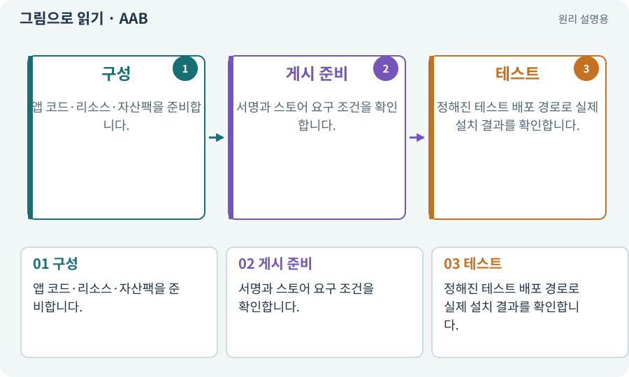

# AAB·스토어 배포 묶음

**분야:** 비동기·다운로드·빌드·버전 관리

AAB는 Google Play가 기기별로 필요한 APK들을 생성해 전달할 수 있도록 만든 게시용 형식입니다. 보통 APK처럼 파일을 직접 눌러 설치하는 용도로 설명하지 않습니다.

**찾아오는 이름:** AAB·스토어 배포 묶음, AAB, aab, Android App Bundle

## 익숙한 것에 비유하면

모든 규격 부품을 담은 배송 원본을 보내면 유통 시스템이 고객 기기에 맞는 구성으로 나누는 것입니다.



개념도입니다. 실제 Unity 화면이나 검사 결과가 아닙니다. 그림의 순서·색은 역할을 구분하며 실제 설정값은 프로젝트에서 확인합니다.

## 이렇게 작동합니다

### 1. 구성

앱 코드·리소스·자산팩을 준비합니다.

### 2. 게시 준비

서명과 스토어 요구 조건을 확인합니다.

### 3. 테스트

정해진 테스트 배포 경로로 실제 설치 결과를 확인합니다.

## 우리 RPG에서는 이렇게 만나요

기초 실습은 APK로 설치·실행을 빠르게 확인하고, AAB·Play Asset Delivery는 선택 배포 단계에서 다룹니다. 스토어 게시에는 별도 사용자 승인이 필요합니다.

## 이것과 혼동하지 마세요

AAB 파일이 있다고 Play 심사·공개 게시가 끝난 것은 아닙니다.

## 이해했는지 한 번 생각해 보기

AAB를 휴대폰에 복사해 바로 여는 것과 APK 설치가 같은가요?

<details><summary>답과 이유</summary>

같은 경로가 아닙니다. 배포 도구나 Play 테스트 경로를 사용합니다.

</details>

## 내 프로젝트에서 확인하고 싶다면

아래 요청은 읽기 전용으로 실제 대상을 확인하는 선택 요청입니다. 코드나 설정을 직접 편집할 필요는 없습니다.

```text
현재 프로젝트에서 AAB·스토어 배포 묶음 관련 요소가 어떻게 사용되는지 읽기 전용으로 확인해 줘. 실제 대상과 설정을 찾아 쉬운 말과 작은 예로 설명해 줘. 특히 다음 혼동을 구분해 줘: AAB 파일이 있다고 Play 심사·공개 게시가 끝난 것은 아닙니다. 아직 코드·설정·파일은 바꾸지 말고, 확인할 수 없는 내용은 따로 알려 줘.
```

## 이어지는 개념

[APK·Android 설치 파일](apk.md) · [Play Asset Delivery·전달 시점](pad.md) · [앱 서명·키·자격 증명](signature.md) · [권한·승인·최소 권한](permission.md)

## 이 개념을 사용하는 실습

[11 · PC와 휴대폰에서 처음 실행하기](../index.html#lesson-011) · [39 · 다른 PC와 Android 에서 실행할 파일 만들기](../index.html#lesson-039) · [78 · 선택: Google Play 에셋 전달 사용하기](../index.html#lesson-078) · [80 · 나만의 2D RPG 완성하기](../index.html#lesson-080) · [102 · 네 배포물을 구분해 만들기](../index.html#lesson-102)

## 참고와 설명의 범위

기본 도구 동작은 아래 공식 자료를 참고했습니다. 비유·그림·RPG의 예시 수치와 정책은 이해를 위한 자체 예제입니다. 실제 API·지원 기능은 설치 버전과 계정에서 확인합니다.

- [Unity · Android 빌드](https://docs.unity3d.com/6000.3/Documentation/Manual/android-BuildProcess.html)
- [Google · Unity용 Play Asset Delivery](https://developer.android.com/guide/playcore/asset-delivery/integrate-unity)

그림·계산 예제·조작 모형은 자체 제작한 설명입니다. 실제 Unity 화면, 서비스 생성 결과, 성능 실측 또는 게임 테스트 결과가 아닙니다. 자료 확인: 2026년 9월 26일.
