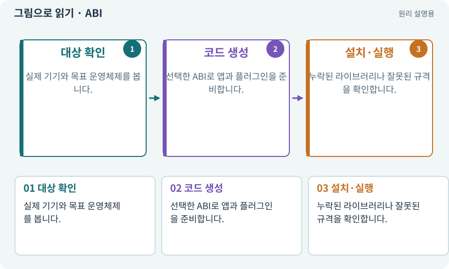

# ABI·ARM64·x86_64

**분야:** 비동기·다운로드·빌드·버전 관리

ABI는 실행 코드와 플랫폼이 맞물리는 이진 규약입니다. ARM64·x86_64는 대표적인 CPU 명령 집합 계열입니다. 같은 운영체제 이름이라도 CPU와 네이티브 플러그인 조건을 확인해야 합니다.

**찾아오는 이름:** ABI·ARM64·x86_64, ABI, ARM64, arm64, arm64-v8a, x86_64, 아키텍처

## 익숙한 것에 비유하면

서로 다른 규격의 콘센트와 플러그를 맞추는 것처럼, 실행할 기계에 맞는 코드가 필요합니다.



개념도입니다. 실제 Unity 화면이나 검사 결과가 아닙니다. 그림의 순서·색은 역할을 구분하며 실제 설정값은 프로젝트에서 확인합니다.

## 이렇게 작동합니다

### 1. 대상 확인

실제 기기와 목표 운영체제를 봅니다.

### 2. 코드 생성

선택한 ABI로 앱과 플러그인을 준비합니다.

### 3. 설치·실행

누락된 라이브러리나 잘못된 규격을 확인합니다.

## 우리 RPG에서는 이렇게 만나요

이 과정의 Windows 결과물은 x86_64, Android는 ARM64를 기준으로 합니다. 에뮬레이터의 환경과 실제 휴대폰의 ABI가 같다고 단정하지 않습니다.

## 이것과 혼동하지 마세요

64비트라는 이유만으로 두 플랫폼 바이너리가 서로 실행되는 것은 아닙니다.

## 이해했는지 한 번 생각해 보기

Windows용 DLL을 Android에 그대로 넣어도 되나요?

<details><summary>답과 이유</summary>

네이티브 코드라면 목표 OS·ABI와 지원 조건이 맞아야 합니다.

</details>

## 내 프로젝트에서 확인하고 싶다면

아래 요청은 읽기 전용으로 실제 대상을 확인하는 선택 요청입니다. 코드나 설정을 직접 편집할 필요는 없습니다.

```text
현재 프로젝트에서 ABI·ARM64·x86_64 관련 요소가 어떻게 사용되는지 읽기 전용으로 확인해 줘. 실제 대상과 설정을 찾아 쉬운 말과 작은 예로 설명해 줘. 특히 다음 혼동을 구분해 줘: 64비트라는 이유만으로 두 플랫폼 바이너리가 서로 실행되는 것은 아닙니다. 아직 코드·설정·파일은 바꾸지 말고, 확인할 수 없는 내용은 따로 알려 줘.
```

## 이어지는 개념

[플랫폼 모듈·SDK·NDK·JDK](module.md) · [Mono·IL2CPP·AOT](il2cpp.md) · [APK·Android 설치 파일](apk.md) · [게임 빌드·개발 빌드·배포](build.md)

## 이 개념을 사용하는 실습

[01 · 빈 2D 프로젝트 만들기](../index.html#lesson-001) · [11 · PC와 휴대폰에서 처음 실행하기](../index.html#lesson-011) · [39 · 다른 PC와 Android 에서 실행할 파일 만들기](../index.html#lesson-039) · [98 · 3D 팩을 2D 팩과 따로 내려받기](../index.html#lesson-098)

## 참고와 설명의 범위

기본 도구 동작은 아래 공식 자료를 참고했습니다. 비유·그림·RPG의 예시 수치와 정책은 이해를 위한 자체 예제입니다. 실제 API·지원 기능은 설치 버전과 계정에서 확인합니다.

- [Unity · Android SDK·NDK·JDK 준비](https://docs.unity3d.com/6000.3/Documentation/Manual/android-sdksetup.html)

그림·계산 예제·조작 모형은 자체 제작한 설명입니다. 실제 Unity 화면, 서비스 생성 결과, 성능 실측 또는 게임 테스트 결과가 아닙니다. 자료 확인: 2026년 9월 26일.
