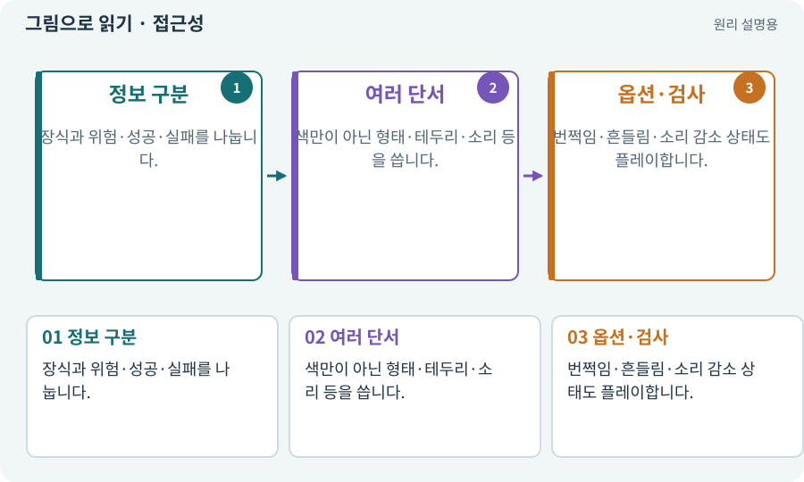

# 접근성·가독성·피드백

**분야:** 입력·UI·소리·성능

접근성은 다양한 감각·조작 조건에서도 정보를 이해하고 사용할 수 있게 하는 설계입니다. 가독성은 현재 무엇이 일어나는지 구분하기 쉬운 정도이며 피드백은 행동 결과를 알려 주는 반응입니다.

**찾아오는 이름:** 접근성·가독성·피드백, 접근성, 가독성, 피드백, Feedback, 색각, 색약, 진동

## 익숙한 것에 비유하면

위험을 빨간색 하나로만 알리지 않고 모양·문구·소리도 함께 제공하는 안내 체계입니다.



개념도입니다. 실제 Unity 화면이나 검사 결과가 아닙니다. 그림의 순서·색은 역할을 구분하며 실제 설정값은 프로젝트에서 확인합니다.

## 이렇게 작동합니다

### 1. 정보 구분

장식과 위험·성공·실패를 나눕니다.

### 2. 여러 단서

색만이 아닌 형태·테두리·소리 등을 씁니다.

### 3. 옵션·검사

번쩍임·흔들림·소리 감소 상태도 플레이합니다.

## 우리 RPG에서는 이렇게 만나요

피해 숫자·짧은 번쩍임·효과음은 타격 결과를 알려 주지만 너무 많으면 바닥 예고를 가립니다. 모바일 Low에서도 필수 정보는 남겨야 합니다.

## 이것과 혼동하지 마세요

강한 흔들림이 항상 좋은 타격감은 아닙니다. 끄거나 줄일 수 있게 합니다.

## 이해했는지 한 번 생각해 보기

붉은 화상과 초록 독만 색으로 구분하면 충분한가요?

<details><summary>답과 이유</summary>

색을 구분하기 어려운 조건을 위해 아이콘·형태·문구도 고려합니다.

</details>

## 내 프로젝트에서 확인하고 싶다면

아래 요청은 읽기 전용으로 실제 대상을 확인하는 선택 요청입니다. 코드나 설정을 직접 편집할 필요는 없습니다.

```text
현재 프로젝트에서 접근성·가독성·피드백 관련 요소가 어떻게 사용되는지 읽기 전용으로 확인해 줘. 실제 대상과 설정을 찾아 쉬운 말과 작은 예로 설명해 줘. 특히 다음 혼동을 구분해 줘: 강한 흔들림이 항상 좋은 타격감은 아닙니다. 끄거나 줄일 수 있게 합니다. 아직 코드·설정·파일은 바꾸지 말고, 확인할 수 없는 내용은 따로 알려 줘.
```

## 이어지는 개념

[공격 예고·선행동작·회복](telegraph.md) · [UI·HUD·UGUI](ui.md) · [믹서·볼륨·dB·동시 재생](audio-mixer.md) · [VFX·Particle System·플립북](vfx.md)

## 이 개념을 사용하는 실습

[19 · 누가 때렸는지 보이는 전투 만들기](../index.html#lesson-019) · [53 · 입력은 빠르게, 취소 규칙은 명확하게](../index.html#lesson-053) · [71 · 카메라·소리·피해 숫자 맞추기](../index.html#lesson-071) · [95 · 3D 조명과 환경을 읽기 좋게 만들기](../index.html#lesson-095) · [143 · 새 랜덤 지역 봉인된 대장간 만들기](../index.html#lesson-143) · [150 · 소리가 없어도 읽히는 전투 만들기](../index.html#lesson-150)

## 참고와 설명의 범위

기본 도구 동작은 아래 공식 자료를 참고했습니다. 비유·그림·RPG의 예시 수치와 정책은 이해를 위한 자체 예제입니다. 실제 API·지원 기능은 설치 버전과 계정에서 확인합니다.

- [Unity Input System · UI 지원](https://docs.unity3d.com/Packages/com.unity.inputsystem@1.17/manual/UISupport.html)

그림·계산 예제·조작 모형은 자체 제작한 설명입니다. 실제 Unity 화면, 서비스 생성 결과, 성능 실측 또는 게임 테스트 결과가 아닙니다. 자료 확인: 2026년 9월 26일.
