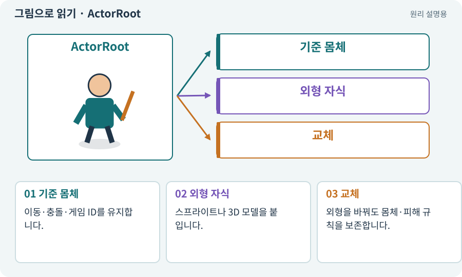

# ActorRoot·VisualRoot·ModelRoot

**분야:** 오브젝트·좌표·움직임

이 이름들은 프로젝트에서 몸체·게임 규칙과 외형을 분리하기 위해 정한 오브젝트 이름입니다. ActorRoot는 실제 위치·생명·이동의 기준, VisualRoot나 ModelRoot는 그림·모델을 담는 하위 객체로 사용합니다.

**찾아오는 이름:** ActorRoot·VisualRoot·ModelRoot, ActorRoot, VisualRoot, ModelRoot, Root, 아트 루트

## 익숙한 것에 비유하면

사람의 실제 발 위치와 무대 의상을 분리하는 것입니다. 모자를 크게 써도 발이 두 배 커지는 것은 아닙니다.



개념도입니다. 실제 Unity 화면이나 검사 결과가 아닙니다. 그림의 순서·색은 역할을 구분하며 실제 설정값은 프로젝트에서 확인합니다.

## 이렇게 작동합니다

### 1. 기준 몸체

이동·충돌·게임 ID를 유지합니다.

### 2. 외형 자식

스프라이트나 3D 모델을 붙입니다.

### 3. 교체

외형을 바꿔도 몸체·피해 규칙을 보존합니다.

## 우리 RPG에서는 이렇게 만나요

AI가 스프라이트를 3D 모델로 교체할 때 같은 체력·장비 데이터를 ActorRoot에 남기면 두 버전의 규칙을 비교하기 쉽습니다.

## 이것과 혼동하지 마세요

Root라는 이름만 붙인다고 이런 분리가 자동으로 생기지는 않습니다. 실제 컴포넌트와 호출 관계가 중요합니다.

## 이해했는지 한 번 생각해 보기

ModelRoot를 삭제하면 체력 데이터도 삭제돼야 하나요?

<details><summary>답과 이유</summary>

외형만 맡겼다면 그렇지 않아야 합니다. 책임과 소유권을 확인합니다.

</details>

## 내 프로젝트에서 확인하고 싶다면

아래 요청은 읽기 전용으로 실제 대상을 확인하는 선택 요청입니다. 코드나 설정을 직접 편집할 필요는 없습니다.

```text
현재 프로젝트에서 ActorRoot·VisualRoot·ModelRoot 관련 요소가 어떻게 사용되는지 읽기 전용으로 확인해 줘. 실제 대상과 설정을 찾아 쉬운 말과 작은 예로 설명해 줘. 특히 다음 혼동을 구분해 줘: Root라는 이름만 붙인다고 이런 분리가 자동으로 생기지는 않습니다. 실제 컴포넌트와 호출 관계가 중요합니다. 아직 코드·설정·파일은 바꾸지 말고, 확인할 수 없는 내용은 따로 알려 줘.
```

## 이어지는 개념

[Hierarchy와 부모·자식](hierarchy.md) · [이동 모터와 단일 위치 책임](motor.md) · [GameObject](gameobject.md) · [어댑터·인터페이스·의존성 분리](adapter.md)

## 이 개념을 사용하는 실습

[07 · 캐릭터와 벽이 있는 공간 만들기](../index.html#lesson-007) · [13 · 적을 클릭해 접근하고 공격하기](../index.html#lesson-013) · [33 · 기본 캐릭터·몬스터·타일 아트 만들기](../index.html#lesson-033) · [34 · 걷기·공격·피격·사망 움직임 연결하기](../index.html#lesson-034) · [46 · 랜덤 지도 위를 실제로 걷기](../index.html#lesson-046) · [55 · 어떤 그림도 맞춰 넣는 아트 규격 정하기](../index.html#lesson-055) · [64 · 추가 결제 없이 AI로 2D 프레임 만들기](../index.html#lesson-064) · [65 · 스프라이트를 정리해 실제 캐릭터에 넣기](../index.html#lesson-065) · [79 · 추가 기능을 하나의 게임으로 합치기](../index.html#lesson-079) · [87 · 같은 캐릭터를 실제 3D 모델로 만들기](../index.html#lesson-087) · [88 · 3D 모델에 걷기와 공격 연결하기](../index.html#lesson-088) · [92 · 무기를 손에 쥐고 전리품 표시하기](../index.html#lesson-092) · [94 · 같은 랜덤 던전을 3D로 생성하기](../index.html#lesson-094)

## 참고와 설명의 범위

기본 도구 동작은 아래 공식 자료를 참고했습니다. 비유·그림·RPG의 예시 수치와 정책은 이해를 위한 자체 예제입니다. 실제 API·지원 기능은 설치 버전과 계정에서 확인합니다.

- [Unity · GameObject와 컴포넌트](https://docs.unity3d.com/6000.3/Documentation/Manual/GameObjects.html)

그림·계산 예제·조작 모형은 자체 제작한 설명입니다. 실제 Unity 화면, 서비스 생성 결과, 성능 실측 또는 게임 테스트 결과가 아닙니다. 자료 확인: 2026년 9월 26일.
