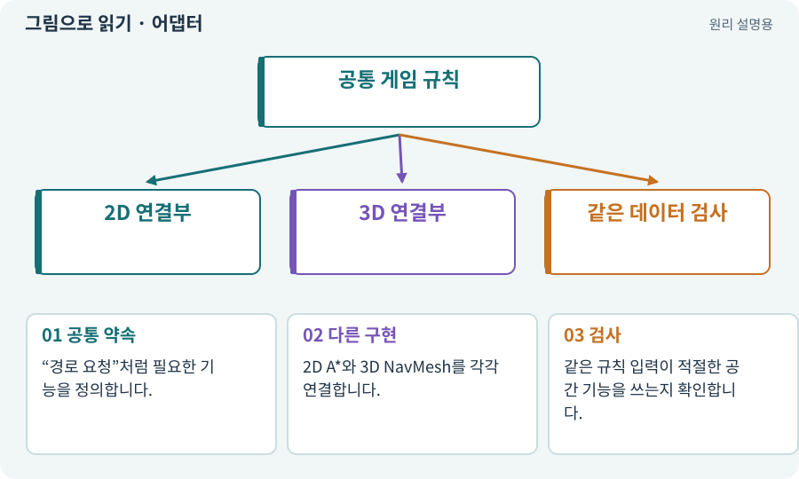

# 어댑터·인터페이스·의존성 분리

**분야:** 코드·데이터·저장·검사

인터페이스는 기능에 요구하는 약속이고 어댑터는 서로 다른 구현을 그 약속에 맞춰 연결하는 구성요소입니다. 의존성 주입은 사용할 구현을 외부에서 지정하는 방식입니다.

**찾아오는 이름:** 어댑터·인터페이스·의존성 분리, 어댑터, Adapter, 인터페이스, Interface, 의존성 주입, DI

## 익숙한 것에 비유하면

서로 다른 콘센트를 공통 플러그 규격에 맞춰 연결하는 변환 장치입니다.



개념도입니다. 실제 Unity 화면이나 검사 결과가 아닙니다. 그림의 순서·색은 역할을 구분하며 실제 설정값은 프로젝트에서 확인합니다.

## 이렇게 작동합니다

### 1. 공통 약속

“경로 요청”처럼 필요한 기능을 정의합니다.

### 2. 다른 구현

2D A*와 3D NavMesh를 각각 연결합니다.

### 3. 검사

같은 규칙 입력이 적절한 공간 기능을 쓰는지 확인합니다.

## 우리 RPG에서는 이렇게 만나요

전투 규칙은 “벽에 가렸는가”를 묻고 2D 어댑터는 Physics2D, 3D 어댑터는 Physics를 사용할 수 있습니다. 규칙 전체를 두 벌 복제하지 않아도 됩니다.

## 이것과 혼동하지 마세요

모든 작은 함수를 인터페이스로 만들 필요는 없습니다. 실제 교체·검사 경계에 사용합니다.

## 이해했는지 한 번 생각해 보기

2D 코드를 문자열 치환해 3D로 바꾸면 충분할까요?

<details><summary>답과 이유</summary>

좌표·물리·카메라 동작이 달라 명시적인 연결과 별도 검증이 필요합니다.

</details>

## 내 프로젝트에서 확인하고 싶다면

아래 요청은 읽기 전용으로 실제 대상을 확인하는 선택 요청입니다. 코드나 설정을 직접 편집할 필요는 없습니다.

```text
현재 프로젝트에서 어댑터·인터페이스·의존성 분리 관련 요소가 어떻게 사용되는지 읽기 전용으로 확인해 줘. 실제 대상과 설정을 찾아 쉬운 말과 작은 예로 설명해 줘. 특히 다음 혼동을 구분해 줘: 모든 작은 함수를 인터페이스로 만들 필요는 없습니다. 실제 교체·검사 경계에 사용합니다. 아직 코드·설정·파일은 바꾸지 말고, 확인할 수 없는 내용은 따로 알려 줘.
```

## 이어지는 개념

[순수 함수·불변 조건·결정적 계산](pure-function.md) · [Physics2D와 3D Physics](physics2d.md) · [XY·XZ 평면과 논리 좌표](coordinates.md) · [단위·통합·회귀 테스트](test.md)

## 이 개념을 사용하는 실습

[06 · 시작 메뉴와 테스트 공간 연결하기](../index.html#lesson-006) · [78 · 선택: Google Play 에셋 전달 사용하기](../index.html#lesson-078) · [82 · 게임 규칙은 재사용하고 공간만 바꾸기](../index.html#lesson-082) · [89 · 같은 전투 규칙을 3D에 연결하기](../index.html#lesson-089) · [90 · 적의 판단을 3D 공간에 연결하기](../index.html#lesson-090) · [91 · 보스 예고를 3D 바닥에 맞추기](../index.html#lesson-091) · [100 · 두 버전이 같은 게임인지 비교하기](../index.html#lesson-100) · [130 · 첫 확장 작업을 하네스에 연결하기](../index.html#lesson-130) · [148 · 아트 역할로 새 지역 외형 완성하기](../index.html#lesson-148)

## 참고와 설명의 범위

이 항목의 비유·그림·RPG 수치·운영 규칙은 개념을 이해하기 위한 자체 설계 예제입니다. 특정 도구가 이 규칙을 자동으로 구현한다는 뜻은 아닙니다.


그림·계산 예제·조작 모형은 자체 제작한 설명입니다. 실제 Unity 화면, 서비스 생성 결과, 성능 실측 또는 게임 테스트 결과가 아닙니다. 자료 확인: 2026년 9월 26일.
