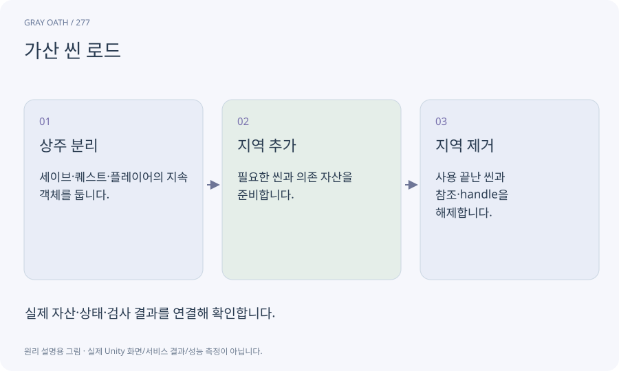

# 가산 씬 로드

현재 씬을 모두 없애지 않고 다른 씬을 함께 불러오는 방식입니다. 상주 게임 상태와 가까운 지역의 오브젝트를 나누는 데 사용합니다.

## 익숙한 비유

무대의 기본 조명은 둔 채 다음 세트를 옆에 들이는 것과 같습니다.



## 작동 원리

### 1. 상주 분리

세이브·퀘스트·플레이어의 지속 객체를 둡니다.

### 2. 지역 추가

필요한 씬과 의존 자산을 준비합니다.

### 3. 지역 제거

사용 끝난 씬과 참조·handle을 해제합니다.

## 게임 속 예

갈대늪 cell을 내렸어도 이미 처리한 늪 괴물 계약의 완료 사실은 상주 WorldState에 남아야 합니다.

## 혼동하지 않기

각 씬이 별도 Player나 AudioListener를 생성하면 중복 실행이 생길 수 있습니다.

## 확인 질문

씬을 내리면 퀘스트도 없어져야 하나요?

정의/진행과 일시적인 NPC 오브젝트를 분리해 진행을 유지합니다.

## 내 프로젝트에서 확인하기

```text
현재 GrayOathRPG3D에서 가산 씬 로드을 사용하는 실제 대상과 동작을 읽기 전용으로 확인해 줘. 쉬운 말과 작은 사례로 설명하고 각 씬이 별도 Player나 AudioListener를 생성하면 중복 실행이 생길 수 있습니다. 이 문제를 어떻게 막는지 보여 줘. 코드·데이터·설정은 아직 수정하지 마.
```

## 관련 해설

[streaming-cell](streaming-cell.md) · [world-state](world-state.md) · [handle](handle.md)

## 공식 참고

- [Unity · Addressables memory management](https://docs.unity3d.com/Packages/com.unity.addressables@2.7/manual/MemoryManagement.html)
