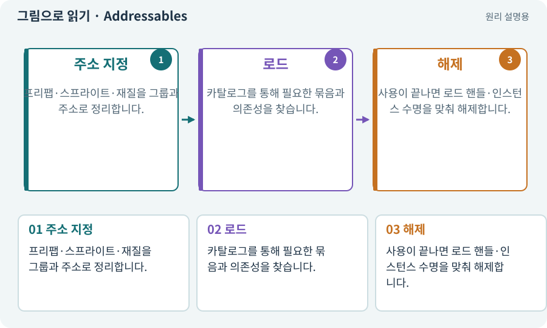

# Addressables·주소로 에셋 불러오기

**분야:** 비동기·다운로드·빌드·버전 관리

Addressables는 이름·주소·레이블로 에셋을 찾아 비동기로 로드하고 의존성과 수명을 관리하는 Unity 패키지입니다. 로컬 에셋에도 사용할 수 있어 원격 다운로드와 같은 말은 아닙니다.

**찾아오는 이름:** Addressables·주소로 에셋 불러오기, Addressables, Addressable, 어드레서블, AssetReference

## 익숙한 것에 비유하면

도서관에서 서가 위치를 직접 외우는 대신 목록의 식별자로 책을 신청하는 방식입니다. 책은 같은 건물 안에 있거나 외부 창고에 있을 수 있습니다.



개념도입니다. 실제 Unity 화면이나 검사 결과가 아닙니다. 그림의 순서·색은 역할을 구분하며 실제 설정값은 프로젝트에서 확인합니다.

## 이렇게 작동합니다

### 1. 주소 지정

프리팹·스프라이트·재질을 그룹과 주소로 정리합니다.

### 2. 로드

카탈로그를 통해 필요한 묶음과 의존성을 찾습니다.

### 3. 해제

사용이 끝나면 로드 핸들·인스턴스 수명을 맞춰 해제합니다.

## 다운로드와 메모리 로드는 다른 단계입니다

주소로 에셋을 요청하면 카탈로그를 따라 필요한 번들을 찾습니다. 원격 파일이 없으면 다운로드하고, 캐시에 있으면 그 사본을 사용합니다. 이후 메모리에 로드해 실제 프리팹·텍스처·재질로 사용합니다.

씬을 떠날 때에는 해당 자원의 사용이 끝났는지 확인해 로드 핸들과 생성 인스턴스를 적절히 해제합니다. 디스크 캐시가 남아 있어도 RAM·VRAM에서 계속 사용할 필요는 없습니다.

게임 코어와 최소 외형은 로컬에 남기고 선택팩만 원격화하면 실패와 오프라인을 단순하게 다룰 수 있습니다. 이 구분은 패키지가 저절로 정해 주지 않고 프로젝트가 설계합니다.

| 상태 | 디스크 | 메모리 |
| --- | --- | --- |
| 아직 받지 않음 | 없음 | 없음 |
| 다운로드 완료 | 캐시 있음 | 아직 로드 전일 수 있음 |
| 사용 중 | 캐시 있을 수 있음 | 로드와 참조 유지 |
| 사용 종료 | 캐시 정책에 따름 | 참조 해제·언로드 검토 |

## 직접 값을 바꾸며 보기

[웹 해설의 조작 모형 열기](../index.html#tech-addressables). 조작은 설명용 모형만 바꿉니다. 실제 프로젝트·AI·진행 체크·게임 테스트는 실행하거나 변경하지 않습니다.

## 우리 RPG에서는 이렇게 만나요

기본 캐릭터는 로컬 주소로, 대장간 고해상도 외형은 원격 주소로 구성할 수 있습니다. 원격팩에 실패해도 기본 외형으로 게임을 완주하게 합니다.

## 이것과 혼동하지 마세요

AssetReference는 다운로드 완료된 오브젝트 자체가 아닙니다. 주소를 안다고 즉시 사용할 수 있는 것도 아닙니다.

## 이해했는지 한 번 생각해 보기

Addressables를 쓰면 인터넷이 항상 필요한가요?

<details><summary>답과 이유</summary>

아닙니다. 로컬 그룹과 원격 그룹을 나누고 캐시·오프라인 정책을 정합니다.

</details>

## 내 프로젝트에서 확인하고 싶다면

아래 요청은 읽기 전용으로 실제 대상을 확인하는 선택 요청입니다. 코드나 설정을 직접 편집할 필요는 없습니다.

```text
현재 프로젝트에서 Addressables·주소로 에셋 불러오기 관련 요소가 어떻게 사용되는지 읽기 전용으로 확인해 줘. 실제 대상과 설정을 찾아 쉬운 말과 작은 예로 설명해 줘. 특히 다음 혼동을 구분해 줘: AssetReference는 다운로드 완료된 오브젝트 자체가 아닙니다. 주소를 안다고 즉시 사용할 수 있는 것도 아닙니다. 아직 코드·설정·파일은 바꾸지 말고, 확인할 수 없는 내용은 따로 알려 줘.
```

## 이어지는 개념

[카탈로그·주소 목록·콘텐츠 버전](catalog.md) · [AssetBundle·그룹·레이블](bundle.md) · [핸들·참조 계수·Release](handle.md) · [비동기·await·콜백](async.md) · [캐시·적중·무효화](cache.md)

## 이 개념을 사용하는 실습

[37 · 느려지는 원인을 측정해 고치기](../index.html#lesson-037) · [73 · 주소로 에셋 불러오기](../index.html#lesson-073) · [74 · 추가 외형을 서버에서 받게 준비하기](../index.html#lesson-074) · [76 · 연결이 끊겨도 게임 계속하기](../index.html#lesson-076) · [77 · 앱을 바꾸지 않고 외형 업데이트하기](../index.html#lesson-077) · [78 · 선택: Google Play 에셋 전달 사용하기](../index.html#lesson-078) · [98 · 3D 팩을 2D 팩과 따로 내려받기](../index.html#lesson-098) · [102 · 네 배포물을 구분해 만들기](../index.html#lesson-102) · [153 · 대장간 고해상도팩 선택 다운로드하기](../index.html#lesson-153)

## 참고와 설명의 범위

기본 도구 동작은 아래 공식 자료를 참고했습니다. 비유·그림·RPG의 예시 수치와 정책은 이해를 위한 자체 예제입니다. 실제 API·지원 기능은 설치 버전과 계정에서 확인합니다.

- [Unity · Addressables 개요](https://docs.unity3d.com/Packages/com.unity.addressables@2.7/manual/index.html)
- [Unity Addressables · 메모리 관리](https://docs.unity3d.com/Packages/com.unity.addressables@2.7/manual/MemoryManagement.html)

그림·계산 예제·조작 모형은 자체 제작한 설명입니다. 실제 Unity 화면, 서비스 생성 결과, 성능 실측 또는 게임 테스트 결과가 아닙니다. 자료 확인: 2026년 9월 26일.
