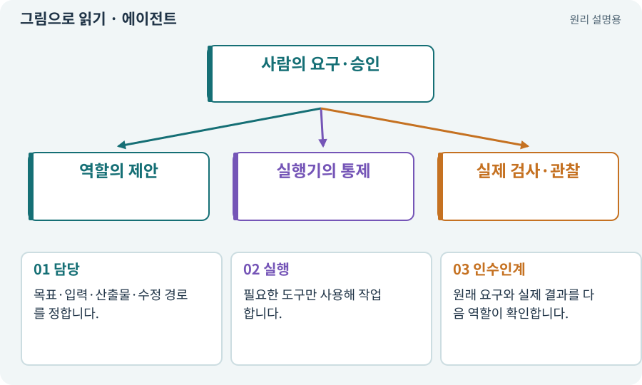

# 에이전트·서브에이전트·역할

**분야:** AI·스킬·훅·하네스 운영

에이전트는 모델이 작업 상태를 보며 도구를 사용하고 결과를 받아 다음 행동을 선택하는 실행 주체입니다. 역할은 책임·입력·권한을 나눈 계약이며 서브에이전트는 별도로 위임한 작업 주체입니다.

**찾아오는 이름:** 에이전트·서브에이전트·역할, 에이전트, Agent, 서브에이전트, Subagent, sub-agent, role, 역할

## 익숙한 것에 비유하면

기획·시공·검수 담당을 나누는 팀입니다. 이름표를 다르게 붙였다고 자동으로 독립적 검증이 생기지는 않습니다.



개념도입니다. 실제 Unity 화면이나 검사 결과가 아닙니다. 그림의 순서·색은 역할을 구분하며 실제 설정값은 프로젝트에서 확인합니다.

## 이렇게 작동합니다

### 1. 담당

목표·입력·산출물·수정 경로를 정합니다.

### 2. 실행

필요한 도구만 사용해 작업합니다.

### 3. 인수인계

원래 요구와 실제 결과를 다음 역할이 확인합니다.

## 우리 RPG에서는 이렇게 만나요

QA와 critic은 구현자 설명만 믿지 않고 요구·변경안·검사 근거를 다시 읽어야 합니다. 모든 작은 작업에 15개 역할을 다 호출할 필요는 없습니다.

## 이것과 혼동하지 마세요

여러 역할이 같은 파일을 동시에 고치면 협업이 아니라 충돌이 될 수 있습니다.

## 이해했는지 한 번 생각해 보기

같은 모델 두 개가 서로 동의하면 무조건 정확한가요?

<details><summary>답과 이유</summary>

아닙니다. 같은 잘못된 전제를 공유할 수 있어 독립 입력과 반례 검사가 필요합니다.

</details>

## 내 프로젝트에서 확인하고 싶다면

아래 요청은 읽기 전용으로 실제 대상을 확인하는 선택 요청입니다. 코드나 설정을 직접 편집할 필요는 없습니다.

```text
현재 프로젝트에서 에이전트·서브에이전트·역할 관련 요소가 어떻게 사용되는지 읽기 전용으로 확인해 줘. 실제 대상과 설정을 찾아 쉬운 말과 작은 예로 설명해 줘. 특히 다음 혼동을 구분해 줘: 여러 역할이 같은 파일을 동시에 고치면 협업이 아니라 충돌이 될 수 있습니다. 아직 코드·설정·파일은 바꾸지 말고, 확인할 수 없는 내용은 따로 알려 줘.
```

## 이어지는 개념

[개발 하네스](harness.md) · [파일 소유권·읽기 범위·쓰기 범위](ownership.md) · [QA·비평·독립 검토](review.md) · [도구 호출·로컬·클라우드](tool.md)

## 이 개념을 사용하는 실습

[27 · 회복하고 물약을 사는 마을 만들기](../index.html#lesson-027) · [28 · 여덟 구역의 첫 던전 만들기](../index.html#lesson-028) · [44 · 시드로 같은 던전 다시 만들기](../index.html#lesson-044) · [45 · 무작위 방과 통로 만들기](../index.html#lesson-045) · [47 · 실패하는 시드를 찾고 복구하기](../index.html#lesson-047) · [51 · 전투 전체의 압박 조절하기](../index.html#lesson-051) · [52 · 전투에서 선택할 이유 만들기](../index.html#lesson-052) · [68 · 피격 불꽃과 먼지 만들기](../index.html#lesson-068) · [79 · 추가 기능을 하나의 게임으로 합치기](../index.html#lesson-079) · [82 · 게임 규칙은 재사용하고 공간만 바꾸기](../index.html#lesson-082) · [84 · 같은 지도를 3D 바닥과 벽으로 만들기](../index.html#lesson-084) · [86 · 3D에서도 클릭한 곳까지 돌아가기](../index.html#lesson-086) · [87 · 같은 캐릭터를 실제 3D 모델로 만들기](../index.html#lesson-087) · [90 · 적의 판단을 3D 공간에 연결하기](../index.html#lesson-090) · [95 · 3D 조명과 환경을 읽기 좋게 만들기](../index.html#lesson-095) · [100 · 두 버전이 같은 게임인지 비교하기](../index.html#lesson-100) · [107 · 원본을 보호하고 허용 경로 정하기](../index.html#lesson-107) · [108 · 기획·구현·QA·검토 역할 만들기](../index.html#lesson-108) · [109 · 요청을 검사 가능한 작업표로 바꾸기](../index.html#lesson-109) · [110 · 작업마다 필요한 자료만 준비하기](../index.html#lesson-110) · [111 · AI 답변을 안전한 변경안으로 받기](../index.html#lesson-111) · [112 · 네 역할을 순서대로 실행하기](../index.html#lesson-112) · [113 · 검토한 후보만 승인해 적용하기](../index.html#lesson-113) · [114 · 테스트를 실행하고 결과 읽기](../index.html#lesson-114) · [117 · Unity 작업을 한 창구로 모으기](../index.html#lesson-117) · [118 · 모의 응답 대신 실제 Claude 연결하기](../index.html#lesson-118) · [120 · 자연어 요청을 계획으로 바꾸기](../index.html#lesson-120) · [121 · 필요한 역할을 하나 추가하기](../index.html#lesson-121) · [122 · 내 게임에 맞는 검사기 추가하기](../index.html#lesson-122) · [125 · 하네스로 작은 전리품 화면 만들기](../index.html#lesson-125) · [126 · 한 요청으로 필터 기능 끝내기](../index.html#lesson-126) · [127 · 내 반복 업무에 맞게 도구 개조하기](../index.html#lesson-127) · [129 · 기존 2D 게임에서 확장팩 시작하기](../index.html#lesson-129) · [130 · 첫 확장 작업을 하네스에 연결하기](../index.html#lesson-130) · [131 · 중요한 전리품만 표시하는 규칙 만들기](../index.html#lesson-131) · [132 · 필터를 실제 던전과 모바일에 연결하기](../index.html#lesson-132) · [133 · 첫 기능의 실패를 고쳐 다음 기준 만들기](../index.html#lesson-133) · [134 · 화상·냉기·표식으로 전투 확장하기](../index.html#lesson-134) · [135 · 벽을 통과하지 않는 회피 만들기](../index.html#lesson-135) · [136 · 방패병과 화염술사 정예 추가하기](../index.html#lesson-136) · [137 · 기름·폭발통·밸브로 공간 활용하기](../index.html#lesson-137) · [138 · 장비를 분해해 재료 얻기](../index.html#lesson-138) · [139 · 재료로 장비 제작하기](../index.html#lesson-139) · [140 · 개인 창고와 즐겨찾기 만들기](../index.html#lesson-140) · [141 · 소켓 한 칸에 룬 장착하기](../index.html#lesson-141) · [142 · 배운 스킬의 변형 선택하기](../index.html#lesson-142) · [143 · 새 랜덤 지역 봉인된 대장간 만들기](../index.html#lesson-143) · [144 · 이번 탐험에만 남는 유물 고르기](../index.html#lesson-144) · [145 · 지원 동료 하나 만들기](../index.html#lesson-145) · [146 · 대장장이 구조 퀘스트 만들기](../index.html#lesson-146) · [147 · 용광로 감시자와 3단계 전투 만들기](../index.html#lesson-147) · [148 · 아트 역할로 새 지역 외형 완성하기](../index.html#lesson-148) · [149 · 상태와 보스 효과를 같은 데이터로 맞추기](../index.html#lesson-149) · [150 · 소리가 없어도 읽히는 전투 만들기](../index.html#lesson-150) · [151 · 도감과 장비 비교로 새 기능 찾기](../index.html#lesson-151) · [152 · 이전 저장을 새 확장판으로 가져오기](../index.html#lesson-152) · [153 · 대장간 고해상도팩 선택 다운로드하기](../index.html#lesson-153) · [154 · 확장 기능을 켠 휴대폰 성능 고치기](../index.html#lesson-154) · [155 · 기록을 보고 제작 경제와 전투 조정하기](../index.html#lesson-155) · [156 · 기능 조합에서 숨은 오류 찾기](../index.html#lesson-156) · [157 · 하네스가 실패해도 기록 지키기](../index.html#lesson-157) · [158 · 룬 교체 버그를 역할로 수정하기](../index.html#lesson-158) · [159 · 최종 확장판 배포 후보 만들기](../index.html#lesson-159) · [160 · 대장간 보스까지 완주하고 새 기능 맡기기](../index.html#lesson-160)

## 참고와 설명의 범위

기본 도구 동작은 아래 공식 자료를 참고했습니다. 비유·그림·RPG의 예시 수치와 정책은 이해를 위한 자체 예제입니다. 실제 API·지원 기능은 설치 버전과 계정에서 확인합니다.

- [Claude Code · Subagents](https://code.claude.com/docs/en/sub-agents)

그림·계산 예제·조작 모형은 자체 제작한 설명입니다. 실제 Unity 화면, 서비스 생성 결과, 성능 실측 또는 게임 테스트 결과가 아닙니다. 자료 확인: 2026년 9월 26일.
