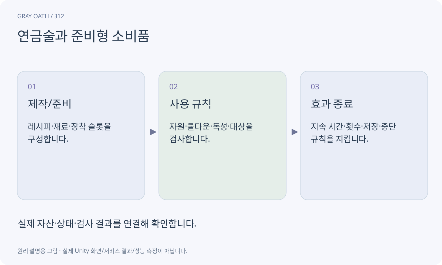

# 연금술과 준비형 소비품

포션·기름·폭탄의 레시피와 사용 조건·효과를 연결하는 시스템입니다. 전투 전 정보를 얻고 맞는 준비물을 고르는 선택을 만듭니다.

## 익숙한 비유

등산 전에 코스에 맞는 장비와 음료를 준비하는 과정입니다.



## 작동 원리

### 1. 제작/준비

레시피·재료·장착 슬롯을 구성합니다.

### 2. 사용 규칙

자원·쿨다운·독성·대상을 검사합니다.

### 3. 효과 종료

지속 시간·횟수·저장·중단 규칙을 지킵니다.

## 게임 속 예

망령용 기름은 정해진 공격 횟수에 적용되고 종류가 다른 적에게는 기본 규칙을 따릅니다. 포션은 실패한 사용에서 소모되지 않습니다.

## 혼동하지 않기

아이콘만 바꾸고 실제 피해 계산과 도감 설명이 다르면 준비의 의미가 사라집니다.

## 확인 질문

명상하면 모든 것을 무제한 회복하나요?

게임의 비용·위치·시간 정책에 따라 처리하고 전투 중 편법 회복을 막습니다.

## 내 프로젝트에서 확인하기

```text
현재 GrayOathRPG3D에서 연금술과 준비형 소비품을 사용하는 실제 대상과 동작을 읽기 전용으로 확인해 줘. 쉬운 말과 작은 사례로 설명하고 아이콘만 바꾸고 실제 피해 계산과 도감 설명이 다르면 준비의 의미가 사라집니다. 이 문제를 어떻게 막는지 보여 줘. 코드·데이터·설정은 아직 수정하지 마.
```

## 관련 해설

[crafting](crafting.md) · [toxicity](toxicity.md) · [bestiary](bestiary.md)

## 공식 참고

- [Unity · AssetDatabase](https://docs.unity3d.com/6000.3/Documentation/ScriptReference/AssetDatabase.html)
