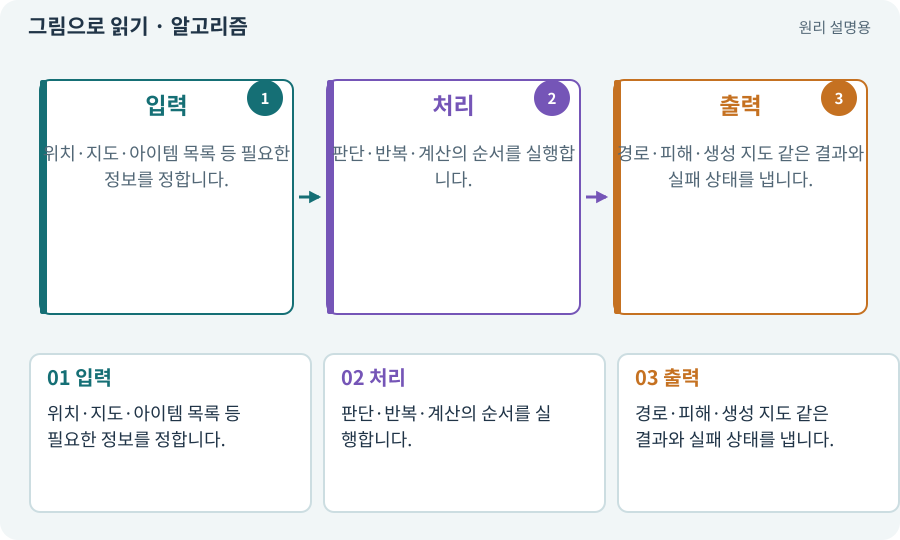

# 알고리즘·입력·출력

**분야:** 설명을 읽기 위한 기초 언어

알고리즘은 입력을 받아 원하는 결과를 얻기 위한 유한한 처리 절차입니다. AI 모델, 코드 파일, 기능 전체와 같은 말은 아닙니다. 같은 목표에도 여러 절차를 비교할 수 있습니다.

**찾아오는 이름:** 알고리즘·입력·출력, 알고리즘, Algorithm, 알고리듬

## 익숙한 것에 비유하면

요리 순서처럼 무엇을 먼저 확인하고 어떤 경우에 다르게 처리하는지 정한 방법입니다.



개념도입니다. 실제 Unity 화면이나 검사 결과가 아닙니다. 그림의 순서·색은 역할을 구분하며 실제 설정값은 프로젝트에서 확인합니다.

## 이렇게 작동합니다

### 1. 입력

위치·지도·아이템 목록 등 필요한 정보를 정합니다.

### 2. 처리

판단·반복·계산의 순서를 실행합니다.

### 3. 출력

경로·피해·생성 지도 같은 결과와 실패 상태를 냅니다.

## 우리 RPG에서는 이렇게 만나요

랜덤 던전 알고리즘은 시드·크기·방 수를 받아 셀과 방 연결도를 만듭니다. 그림을 배치하는 코드와 분리하면 같은 결과를 2D 타일 또는 3D 메시로 표현할 수 있습니다.

## 이것과 혼동하지 마세요

알고리즘 설명이 있다고 실제 코드가 그 방법대로 동작한다는 뜻은 아닙니다. 반례와 실제 결과를 검사합니다.

## 이해했는지 한 번 생각해 보기

같은 요구를 다른 알고리즘으로 만들 수 있나요?

<details><summary>답과 이유</summary>

가능합니다. 정확성·복잡도·속도·이해하기 쉬움·검사 가능성을 비교합니다.

</details>

## 내 프로젝트에서 확인하고 싶다면

아래 요청은 읽기 전용으로 실제 대상을 확인하는 선택 요청입니다. 코드나 설정을 직접 편집할 필요는 없습니다.

```text
현재 프로젝트에서 알고리즘·입력·출력 관련 요소가 어떻게 사용되는지 읽기 전용으로 확인해 줘. 실제 대상과 설정을 찾아 쉬운 말과 작은 예로 설명해 줘. 특히 다음 혼동을 구분해 줘: 알고리즘 설명이 있다고 실제 코드가 그 방법대로 동작한다는 뜻은 아닙니다. 반례와 실제 결과를 검사합니다. 아직 코드·설정·파일은 바꾸지 말고, 확인할 수 없는 내용은 따로 알려 줘.
```

## 이어지는 개념

[순수 함수·불변 조건·결정적 계산](pure-function.md) · [절차적·무작위 지형 생성](generation.md) · [A* 길찾기](astar.md) · [단위·통합·회귀 테스트](test.md)

## 이 개념을 사용하는 실습

[44 · 시드로 같은 던전 다시 만들기](../index.html#lesson-044) · [140 · 개인 창고와 즐겨찾기 만들기](../index.html#lesson-140)

## 참고와 설명의 범위

이 항목의 비유·그림·RPG 수치·운영 규칙은 개념을 이해하기 위한 자체 설계 예제입니다. 특정 도구가 이 규칙을 자동으로 구현한다는 뜻은 아닙니다.


그림·계산 예제·조작 모형은 자체 제작한 설명입니다. 실제 Unity 화면, 서비스 생성 결과, 성능 실측 또는 게임 테스트 결과가 아닙니다. 자료 확인: 2026년 9월 26일.
