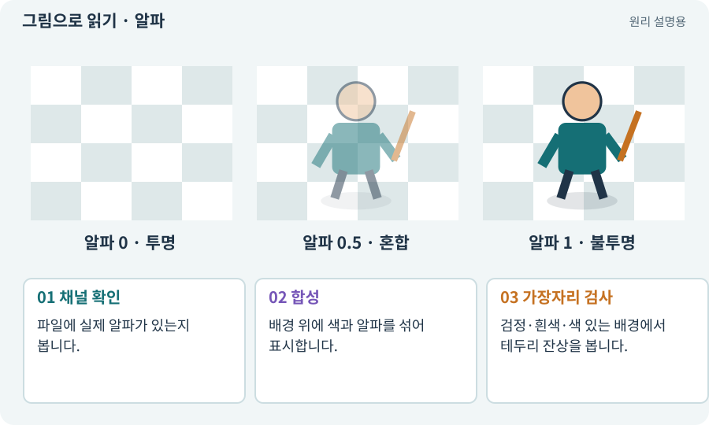

# 알파·RGBA·투명 배경

**분야:** 그림·애니메이션·화면 만들기

RGBA는 빨강·초록·파랑의 색 채널과 투명도를 나타내는 알파 채널입니다. 흰 배경이나 체크무늬가 그려진 이미지가 실제 투명 이미지인 것은 아닙니다.

**찾아오는 이름:** 알파·RGBA·투명 배경, 알파, alpha, RGBA, 투명 배경, 투명도, PNG

## 익숙한 것에 비유하면

유리에 칠한 색과 빛이 얼마나 통과하는지를 따로 정하는 것입니다. 색이 흰색인 것과 투명한 것은 다릅니다.



개념도입니다. 실제 Unity 화면이나 검사 결과가 아닙니다. 그림의 순서·색은 역할을 구분하며 실제 설정값은 프로젝트에서 확인합니다.

## 이렇게 작동합니다

### 1. 채널 확인

파일에 실제 알파가 있는지 봅니다.

### 2. 합성

배경 위에 색과 알파를 섞어 표시합니다.

### 3. 가장자리 검사

검정·흰색·색 있는 배경에서 테두리 잔상을 봅니다.

## 색과 투명도는 다른 값입니다

RGBA의 RGB는 색이고 A는 투명도입니다. 단순한 일반 알파 혼합에서는 앞색×알파 + 배경색×(1−알파)로 생각할 수 있습니다. 실제 파이프라인에는 색 공간·premultiplied alpha 등 추가 조건이 있으므로 이 식은 개념 설명입니다.

체크무늬가 픽셀에 그려져 있다면 불투명 배경입니다. 이미지 뷰어가 투명 영역 뒤에 표시하는 체크무늬와 구분해야 합니다. 배경 제거 뒤 윤곽에 흰 테두리가 남는 문제도 검사합니다.

아래에서 알파를 바꾸면 배경이 비치는 정도가 달라집니다. Unity 결과나 실제 파일의 알파 검사를 대신하는 모형은 아닙니다.

| 알파 | 눈에 보이는 상태 | 주의 |
| --- | --- | --- |
| 0 | 완전 투명 | RGB가 남아 있을 수 있음 |
| 0.5 | 앞·뒤 색을 섞음 | 합성 규칙에 따라 차이 |
| 1 | 앞색이 불투명 | 체크무늬도 그림일 수 있음 |

## 직접 값을 바꾸며 보기

[웹 해설의 조작 모형 열기](../index.html#tech-alpha). 조작은 설명용 모형만 바꿉니다. 실제 프로젝트·AI·진행 체크·게임 테스트는 실행하거나 변경하지 않습니다.

## 우리 RPG에서는 이렇게 만나요

캐릭터 생성 이미지의 체크무늬가 픽셀로 들어 있으면 게임에도 체크무늬가 보입니다. AI가 실제 파일의 알파 채널을 검사하고 검은 배경에서도 확인하게 합니다.

## 이것과 혼동하지 마세요

알파 0인 픽셀의 색값과 필터링이 가장자리 후광에 영향을 줄 수 있습니다. 한 배경에서만 검사하지 않습니다.

## 이해했는지 한 번 생각해 보기

투명도를 50%로 두면 충돌도 절반이 되나요?

<details><summary>답과 이유</summary>

아닙니다. 화면 합성과 물리 경계는 별개입니다.

</details>

## 내 프로젝트에서 확인하고 싶다면

아래 요청은 읽기 전용으로 실제 대상을 확인하는 선택 요청입니다. 코드나 설정을 직접 편집할 필요는 없습니다.

```text
현재 프로젝트에서 알파·RGBA·투명 배경 관련 요소가 어떻게 사용되는지 읽기 전용으로 확인해 줘. 실제 대상과 설정을 찾아 쉬운 말과 작은 예로 설명해 줘. 특히 다음 혼동을 구분해 줘: 알파 0인 픽셀의 색값과 필터링이 가장자리 후광에 영향을 줄 수 있습니다. 한 배경에서만 검사하지 않습니다. 아직 코드·설정·파일은 바꾸지 말고, 확인할 수 없는 내용은 따로 알려 줘.
```

## 이어지는 개념

[텍스처·픽셀·해상도](texture.md) · [패딩·여백·필터링 번짐](padding.md) · [블렌딩·알파 혼합·가산 합성](blending.md) · [Collider와 몸체 경계](collider.md)

## 이 개념을 사용하는 실습

[05 · 말로 스프라이트 하나 만들기](../index.html#lesson-005) · [33 · 기본 캐릭터·몬스터·타일 아트 만들기](../index.html#lesson-033) · [35 · 앞뒤 가림과 PC 조작 다듬기](../index.html#lesson-035) · [37 · 느려지는 원인을 측정해 고치기](../index.html#lesson-037) · [55 · 어떤 그림도 맞춰 넣는 아트 규격 정하기](../index.html#lesson-055) · [56 · Unity AI로 캐릭터 움직임 만들기](../index.html#lesson-056) · [57 · Unity AI로 바닥과 벽 타일 만들기](../index.html#lesson-057) · [58 · PixelLab로 방향별 픽셀 캐릭터 만들기](../index.html#lesson-058) · [59 · Retro Diffusion으로 캐릭터와 타일 만들기](../index.html#lesson-059) · [60 · Scenario로 스타일과 동작 유지하기](../index.html#lesson-060) · [61 · Ludo.ai로 키 포즈를 지정해 움직임 만들기](../index.html#lesson-061) · [62 · OpenAI 이미지로 게임 자산 만들기](../index.html#lesson-062) · [63 · Grok 이미지로 같은 자산 시험하기](../index.html#lesson-063) · [64 · 추가 결제 없이 AI로 2D 프레임 만들기](../index.html#lesson-064) · [65 · 스프라이트를 정리해 실제 캐릭터에 넣기](../index.html#lesson-065) · [67 · 내 게임의 아트 제작 경로 선택하기](../index.html#lesson-067) · [68 · 피격 불꽃과 먼지 만들기](../index.html#lesson-068) · [69 · 베기와 폭발을 시트 애니메이션으로 만들기](../index.html#lesson-069) · [70 · 피격 강조와 보스 예고 셰이더 만들기](../index.html#lesson-070) · [97 · 선택: 3D 모델에서 2D 시트 만들기](../index.html#lesson-097) · [148 · 아트 역할로 새 지역 외형 완성하기](../index.html#lesson-148)

## 참고와 설명의 범위

기본 도구 동작은 아래 공식 자료를 참고했습니다. 비유·그림·RPG의 예시 수치와 정책은 이해를 위한 자체 예제입니다. 실제 API·지원 기능은 설치 버전과 계정에서 확인합니다.

- [Unity · Sprite](https://docs.unity3d.com/6000.3/Documentation/Manual/sprite/sprite-landing.html)
- [Unity Shader Graph · 시작](https://docs.unity3d.com/Packages/com.unity.shadergraph@17.3/manual/Getting-Started.html)

그림·계산 예제·조작 모형은 자체 제작한 설명입니다. 실제 Unity 화면, 서비스 생성 결과, 성능 실측 또는 게임 테스트 결과가 아닙니다. 자료 확인: 2026년 9월 26일.
