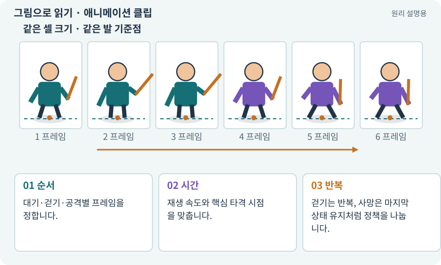

# 애니메이션 클립·프레임·키프레임

**분야:** 그림·애니메이션·화면 만들기

애니메이션 클립은 시간에 따라 그림이나 속성이 어떻게 변하는지 기록한 자료입니다. 프레임 그림을 교체하거나 3D 관절 값을 움직일 수 있습니다. 키프레임은 특정 시간에 지정한 값입니다.

**찾아오는 이름:** 애니메이션 클립·프레임·키프레임, AnimationClip, Animation Clip, 클립, 프레임, 키프레임, keyframe, 루프

## 익숙한 것에 비유하면

플립북의 그림 순서와 넘기는 속도를 함께 정한 악보입니다.



개념도입니다. 실제 Unity 화면이나 검사 결과가 아닙니다. 그림의 순서·색은 역할을 구분하며 실제 설정값은 프로젝트에서 확인합니다.

## 이렇게 작동합니다

### 1. 순서

대기·걷기·공격별 프레임을 정합니다.

### 2. 시간

재생 속도와 핵심 타격 시점을 맞춥니다.

### 3. 반복

걷기는 반복, 사망은 마지막 상태 유지처럼 정책을 나눕니다.

## 우리 RPG에서는 이렇게 만나요

8프레임을 초당 12프레임으로 재생하면 약 0.667초입니다. 이것이 게임 전체 FPS가 12라는 뜻은 아닙니다.

## 이것과 혼동하지 마세요

클립 반복이 공격 피해 반복과 무조건 연결되면 안 됩니다. 타격 사건의 권한을 한 곳에 둡니다.

## 이해했는지 한 번 생각해 보기

애니메이션 12fps와 게임 60FPS는 충돌하나요?

<details><summary>답과 이유</summary>

아닙니다. 그림 교체 속도와 화면 렌더링 속도는 다릅니다.

</details>

## 내 프로젝트에서 확인하고 싶다면

아래 요청은 읽기 전용으로 실제 대상을 확인하는 선택 요청입니다. 코드나 설정을 직접 편집할 필요는 없습니다.

```text
현재 프로젝트에서 애니메이션 클립·프레임·키프레임 관련 요소가 어떻게 사용되는지 읽기 전용으로 확인해 줘. 실제 대상과 설정을 찾아 쉬운 말과 작은 예로 설명해 줘. 특히 다음 혼동을 구분해 줘: 클립 반복이 공격 피해 반복과 무조건 연결되면 안 됩니다. 타격 사건의 권한을 한 곳에 둡니다. 아직 코드·설정·파일은 바꾸지 말고, 확인할 수 없는 내용은 따로 알려 줘.
```

## 이어지는 개념

[Animator·Controller·전이](animator.md) · [스프라이트 시트](sprite-sheet.md) · [Animation Event와 타격 시점](animation-event.md) · [FPS·프레임 시간·ms](frame-time.md)

## 이 개념을 사용하는 실습

[06 · 시작 메뉴와 테스트 공간 연결하기](../index.html#lesson-006) · [08 · WASD로 벽에 부딪히며 이동하기](../index.html#lesson-008) · [09 · 클릭한 곳까지 벽을 돌아가기](../index.html#lesson-009) · [13 · 적을 클릭해 접근하고 공격하기](../index.html#lesson-013) · [15 · 다른 방식으로 싸우는 적 추가하기](../index.html#lesson-015) · [16 · 물약을 쓰고 죽은 뒤 다시 시작하기](../index.html#lesson-016) · [17 · 적을 잡아 레벨 올리기](../index.html#lesson-017) · [22 · 장비를 주워 24칸 가방에 넣기](../index.html#lesson-022) · [33 · 기본 캐릭터·몬스터·타일 아트 만들기](../index.html#lesson-033) · [34 · 걷기·공격·피격·사망 움직임 연결하기](../index.html#lesson-034) · [37 · 느려지는 원인을 측정해 고치기](../index.html#lesson-037) · [38 · 테스트 결과와 실제 플레이 구분하기](../index.html#lesson-038) · [45 · 무작위 방과 통로 만들기](../index.html#lesson-045) · [48 · 적이 나를 보고 놓치게 만들기](../index.html#lesson-048) · [49 · 여러 근접 적의 공격 나누기](../index.html#lesson-049) · [50 · 석궁수가 거리를 유지하게 만들기](../index.html#lesson-050) · [51 · 전투 전체의 압박 조절하기](../index.html#lesson-051) · [53 · 입력은 빠르게, 취소 규칙은 명확하게](../index.html#lesson-053) · [55 · 어떤 그림도 맞춰 넣는 아트 규격 정하기](../index.html#lesson-055) · [56 · Unity AI로 캐릭터 움직임 만들기](../index.html#lesson-056) · [58 · PixelLab로 방향별 픽셀 캐릭터 만들기](../index.html#lesson-058) · [59 · Retro Diffusion으로 캐릭터와 타일 만들기](../index.html#lesson-059) · [60 · Scenario로 스타일과 동작 유지하기](../index.html#lesson-060) · [61 · Ludo.ai로 키 포즈를 지정해 움직임 만들기](../index.html#lesson-061) · [62 · OpenAI 이미지로 게임 자산 만들기](../index.html#lesson-062) · [63 · Grok 이미지로 같은 자산 시험하기](../index.html#lesson-063) · [64 · 추가 결제 없이 AI로 2D 프레임 만들기](../index.html#lesson-064) · [65 · 스프라이트를 정리해 실제 캐릭터에 넣기](../index.html#lesson-065) · [67 · 내 게임의 아트 제작 경로 선택하기](../index.html#lesson-067) · [68 · 피격 불꽃과 먼지 만들기](../index.html#lesson-068) · [69 · 베기와 폭발을 시트 애니메이션으로 만들기](../index.html#lesson-069) · [71 · 카메라·소리·피해 숫자 맞추기](../index.html#lesson-071) · [72 · 모바일 효과를 줄여도 위험은 남기기](../index.html#lesson-072) · [73 · 주소로 에셋 불러오기](../index.html#lesson-073) · [82 · 게임 규칙은 재사용하고 공간만 바꾸기](../index.html#lesson-082) · [88 · 3D 모델에 걷기와 공격 연결하기](../index.html#lesson-088) · [94 · 같은 랜덤 던전을 3D로 생성하기](../index.html#lesson-094) · [97 · 선택: 3D 모델에서 2D 시트 만들기](../index.html#lesson-097) · [100 · 두 버전이 같은 게임인지 비교하기](../index.html#lesson-100) · [101 · 3D Android 성능 다시 측정하기](../index.html#lesson-101) · [116 · “어디까지 됐어?”에 근거로 답하기](../index.html#lesson-116) · [132 · 필터를 실제 던전과 모바일에 연결하기](../index.html#lesson-132) · [147 · 용광로 감시자와 3단계 전투 만들기](../index.html#lesson-147) · [148 · 아트 역할로 새 지역 외형 완성하기](../index.html#lesson-148) · [154 · 확장 기능을 켠 휴대폰 성능 고치기](../index.html#lesson-154) · [155 · 기록을 보고 제작 경제와 전투 조정하기](../index.html#lesson-155)

## 참고와 설명의 범위

기본 도구 동작은 아래 공식 자료를 참고했습니다. 비유·그림·RPG의 예시 수치와 정책은 이해를 위한 자체 예제입니다. 실제 API·지원 기능은 설치 버전과 계정에서 확인합니다.

- [Unity · Sprite](https://docs.unity3d.com/6000.3/Documentation/Manual/sprite/sprite-landing.html)

그림·계산 예제·조작 모형은 자체 제작한 설명입니다. 실제 Unity 화면, 서비스 생성 결과, 성능 실측 또는 게임 테스트 결과가 아닙니다. 자료 확인: 2026년 9월 26일.
