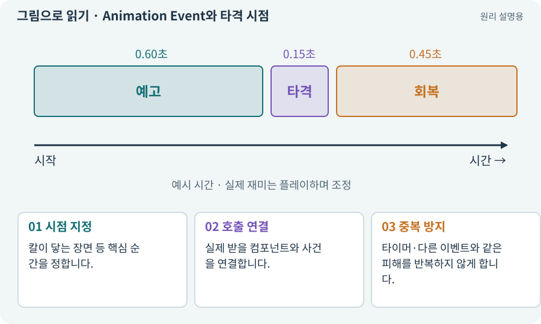

# Animation Event와 타격 시점

**분야:** 그림·애니메이션·화면 만들기

Animation Event는 클립의 특정 시점에 코드 동작을 알리는 기능입니다. 소리·효과·타격 연결에 쓸 수 있지만 중복과 취소를 신중히 처리해야 합니다.

**찾아오는 이름:** Animation Event와 타격 시점, Animation Event, 애니메이션 이벤트, 타격 시점, 타격 프레임

## 익숙한 것에 비유하면

영화의 특정 프레임에 박수 효과음을 넣는 표시입니다. 표시가 두 번 있으면 소리가 두 번 날 수 있습니다.



개념도입니다. 실제 Unity 화면이나 검사 결과가 아닙니다. 그림의 순서·색은 역할을 구분하며 실제 설정값은 프로젝트에서 확인합니다.

## 이렇게 작동합니다

### 1. 시점 지정

칼이 닿는 장면 등 핵심 순간을 정합니다.

### 2. 호출 연결

실제 받을 컴포넌트와 사건을 연결합니다.

### 3. 중복 방지

타이머·다른 이벤트와 같은 피해를 반복하지 않게 합니다.

## 우리 RPG에서는 이렇게 만나요

공격 취소로 클립이 중단된 뒤 이벤트가 안 오면 토큰 반환까지 이벤트에만 의존한 로직은 멈출 수 있습니다. 취소 정리는 별도 수명주기로 보장합니다.

## 이것과 혼동하지 마세요

애니메이션 이벤트와 별도 타이머가 모두 피해를 주게 두지 않습니다.

## 이해했는지 한 번 생각해 보기

효과음 이벤트가 누락되면 피해도 무조건 없어져야 하나요?

<details><summary>답과 이유</summary>

소리와 피해의 권한을 분리한 설계라면 그렇지 않습니다. 연결 정책을 확인합니다.

</details>

## 내 프로젝트에서 확인하고 싶다면

아래 요청은 읽기 전용으로 실제 대상을 확인하는 선택 요청입니다. 코드나 설정을 직접 편집할 필요는 없습니다.

```text
현재 프로젝트에서 Animation Event와 타격 시점 관련 요소가 어떻게 사용되는지 읽기 전용으로 확인해 줘. 실제 대상과 설정을 찾아 쉬운 말과 작은 예로 설명해 줘. 특히 다음 혼동을 구분해 줘: 애니메이션 이벤트와 별도 타이머가 모두 피해를 주게 두지 않습니다. 아직 코드·설정·파일은 바꾸지 말고, 확인할 수 없는 내용은 따로 알려 줘.
```

## 이어지는 개념

[피해 계산·스냅샷·피해 사건](damage.md) · [공격 ID·사건 ID·중복 피해 방지](event-id.md) · [수명주기·초기화·정리](lifecycle.md) · [Animator·Controller·전이](animator.md)

## 이 개념을 사용하는 실습

[13 · 적을 클릭해 접근하고 공격하기](../index.html#lesson-013) · [34 · 걷기·공격·피격·사망 움직임 연결하기](../index.html#lesson-034) · [61 · Ludo.ai로 키 포즈를 지정해 움직임 만들기](../index.html#lesson-061) · [69 · 베기와 폭발을 시트 애니메이션으로 만들기](../index.html#lesson-069) · [70 · 피격 강조와 보스 예고 셰이더 만들기](../index.html#lesson-070) · [88 · 3D 모델에 걷기와 공격 연결하기](../index.html#lesson-088) · [89 · 같은 전투 규칙을 3D에 연결하기](../index.html#lesson-089)

## 참고와 설명의 범위

기본 도구 동작은 아래 공식 자료를 참고했습니다. 비유·그림·RPG의 예시 수치와 정책은 이해를 위한 자체 예제입니다. 실제 API·지원 기능은 설치 버전과 계정에서 확인합니다.

- [Unity · Sprite](https://docs.unity3d.com/6000.3/Documentation/Manual/sprite/sprite-landing.html)

그림·계산 예제·조작 모형은 자체 제작한 설명입니다. 실제 Unity 화면, 서비스 생성 결과, 성능 실측 또는 게임 테스트 결과가 아닙니다. 자료 확인: 2026년 9월 26일.
