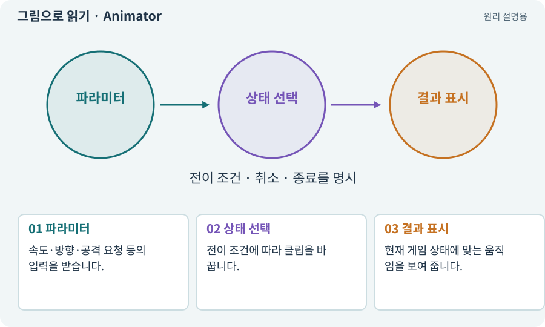

# Animator·Controller·전이

**분야:** 그림·애니메이션·화면 만들기

Animator는 클립과 상태 전환 규칙을 실행합니다. Controller는 대기·걷기·공격처럼 어떤 클립을 언제 재생할지 정하고, Blend Tree는 값을 따라 여러 동작을 섞는 데 쓰입니다.

**찾아오는 이름:** Animator·Controller·전이, Animator, Animator Controller, 애니메이터, 전이, Transition, Blend Tree

## 익숙한 것에 비유하면

음악 재생 목록과 재생 담당자입니다. 목록에 곡이 있다고 지금 어떤 곡이 나오는지는 별도 상태입니다.



개념도입니다. 실제 Unity 화면이나 검사 결과가 아닙니다. 그림의 순서·색은 역할을 구분하며 실제 설정값은 프로젝트에서 확인합니다.

## 이렇게 작동합니다

### 1. 파라미터

속도·방향·공격 요청 등의 입력을 받습니다.

### 2. 상태 선택

전이 조건에 따라 클립을 바꿉니다.

### 3. 결과 표시

현재 게임 상태에 맞는 움직임을 보여 줍니다.

## 우리 RPG에서는 이렇게 만나요

적은 이미 Dead인데 Animator가 Walk에 남으면 미끄러지는 시체처럼 보일 수 있습니다. 게임 상태와 표시 상태의 연결을 확인합니다.

## 이것과 혼동하지 마세요

Animator 상태가 곧 피해 계산의 유일한 권한일 필요는 없습니다. 게임 로직과 표시의 책임을 정합니다.

## 이해했는지 한 번 생각해 보기

검을 휘둘렀는데 피해가 없으면 Animator만 보면 되나요?

<details><summary>답과 이유</summary>

타격 사건·거리·시야·피격 대상까지 확인해야 합니다.

</details>

## 내 프로젝트에서 확인하고 싶다면

아래 요청은 읽기 전용으로 실제 대상을 확인하는 선택 요청입니다. 코드나 설정을 직접 편집할 필요는 없습니다.

```text
현재 프로젝트에서 Animator·Controller·전이 관련 요소가 어떻게 사용되는지 읽기 전용으로 확인해 줘. 실제 대상과 설정을 찾아 쉬운 말과 작은 예로 설명해 줘. 특히 다음 혼동을 구분해 줘: Animator 상태가 곧 피해 계산의 유일한 권한일 필요는 없습니다. 게임 로직과 표시의 책임을 정합니다. 아직 코드·설정·파일은 바꾸지 말고, 확인할 수 없는 내용은 따로 알려 줘.
```

## 이어지는 개념

[애니메이션 클립·프레임·키프레임](animation-clip.md) · [상태 기계·FSM](state-machine.md) · [루트 모션과 제자리 동작](root-motion.md) · [피해 계산·스냅샷·피해 사건](damage.md)

## 이 개념을 사용하는 실습

[07 · 캐릭터와 벽이 있는 공간 만들기](../index.html#lesson-007) · [14 · 나를 발견하고 공격하는 적 만들기](../index.html#lesson-014) · [22 · 장비를 주워 24칸 가방에 넣기](../index.html#lesson-022) · [31 · 퀘스트를 받아 엔딩까지 이어가기](../index.html#lesson-031) · [34 · 걷기·공격·피격·사망 움직임 연결하기](../index.html#lesson-034) · [38 · 테스트 결과와 실제 플레이 구분하기](../index.html#lesson-038) · [44 · 시드로 같은 던전 다시 만들기](../index.html#lesson-044) · [65 · 스프라이트를 정리해 실제 캐릭터에 넣기](../index.html#lesson-065) · [76 · 연결이 끊겨도 게임 계속하기](../index.html#lesson-076) · [85 · 3D 캐릭터를 한 모터로 움직이기](../index.html#lesson-085) · [88 · 3D 모델에 걷기와 공격 연결하기](../index.html#lesson-088) · [90 · 적의 판단을 3D 공간에 연결하기](../index.html#lesson-090) · [93 · 3D 마을과 퀘스트 연결하기](../index.html#lesson-093) · [99 · 2D와 3D 사이에 진행 가져오기](../index.html#lesson-099) · [100 · 두 버전이 같은 게임인지 비교하기](../index.html#lesson-100) · [125 · 하네스로 작은 전리품 화면 만들기](../index.html#lesson-125) · [146 · 대장장이 구조 퀘스트 만들기](../index.html#lesson-146) · [147 · 용광로 감시자와 3단계 전투 만들기](../index.html#lesson-147)

## 참고와 설명의 범위

기본 도구 동작은 아래 공식 자료를 참고했습니다. 비유·그림·RPG의 예시 수치와 정책은 이해를 위한 자체 예제입니다. 실제 API·지원 기능은 설치 버전과 계정에서 확인합니다.

- [Unity · 애니메이션 개요](https://docs.unity3d.com/6000.3/Documentation/Manual/AnimationOverview.html)

그림·계산 예제·조작 모형은 자체 제작한 설명입니다. 실제 Unity 화면, 서비스 생성 결과, 성능 실측 또는 게임 테스트 결과가 아닙니다. 자료 확인: 2026년 9월 26일.
