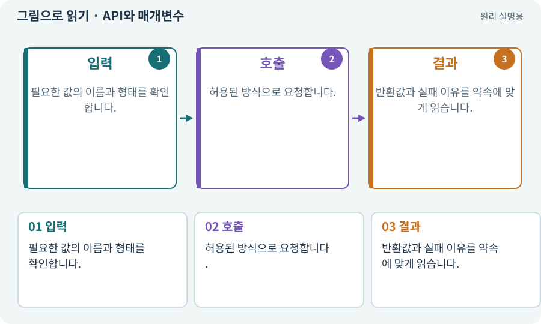

# API와 매개변수

**분야:** 시작·도구·작업 공간

API는 프로그램이 다른 기능을 요청할 때 지켜야 하는 공개된 약속입니다. 기능 이름, 전달할 값, 반환값과 오류 조건이 포함됩니다.

**찾아오는 이름:** API와 매개변수, API, 매개변수, parameter, 인자, 입력 계약

## 익숙한 것에 비유하면

식당 주문서의 메뉴명·수량·옵션 칸입니다. 없는 메뉴를 그럴듯한 이름으로 적어도 조리할 수 없습니다.



개념도입니다. 실제 Unity 화면이나 검사 결과가 아닙니다. 그림의 순서·색은 역할을 구분하며 실제 설정값은 프로젝트에서 확인합니다.

## 이렇게 작동합니다

### 1. 입력

필요한 값의 이름과 형태를 확인합니다.

### 2. 호출

허용된 방식으로 요청합니다.

### 3. 결과

반환값과 실패 이유를 약속에 맞게 읽습니다.

## 우리 RPG에서는 이렇게 만나요

Physics2D의 겹침 검사는 위치·크기·대상 LayerMask 등을 받습니다. 이름을 추측한 옵션을 추가하지 않고 설치된 버전의 문서를 AI가 확인하게 합니다.

## 이것과 혼동하지 마세요

API가 있다는 말은 계정 권한·인터넷·비용 승인이 있다는 뜻이 아닙니다.

## 이해했는지 한 번 생각해 보기

명령 이름을 맞혔는데 실패하면 무엇을 보나요?

<details><summary>답과 이유</summary>

매개변수 타입·대상·버전·권한과 실제 오류를 확인합니다.

</details>

## 내 프로젝트에서 확인하고 싶다면

아래 요청은 읽기 전용으로 실제 대상을 확인하는 선택 요청입니다. 코드나 설정을 직접 편집할 필요는 없습니다.

```text
현재 프로젝트에서 API와 매개변수 관련 요소가 어떻게 사용되는지 읽기 전용으로 확인해 줘. 실제 대상과 설정을 찾아 쉬운 말과 작은 예로 설명해 줘. 특히 다음 혼동을 구분해 줘: API가 있다는 말은 계정 권한·인터넷·비용 승인이 있다는 뜻이 아닙니다. 아직 코드·설정·파일은 바꾸지 말고, 확인할 수 없는 내용은 따로 알려 줘.
```

## 이어지는 개념

[CLI와 GUI](cli.md) · [JSON·객체·배열·필드](json.md) · [스키마·JSON Schema·계약](schema.md) · [권한·승인·최소 권한](permission.md)

## 이 개념을 사용하는 실습

[01 · 빈 2D 프로젝트 만들기](../index.html#lesson-001) · [03 · AI와 실행 중인 Unity 연결하기](../index.html#lesson-003) · [04 · 되돌릴 수 있는 작업 습관 만들기](../index.html#lesson-004) · [05 · 말로 스프라이트 하나 만들기](../index.html#lesson-005) · [08 · WASD로 벽에 부딪히며 이동하기](../index.html#lesson-008) · [58 · PixelLab로 방향별 픽셀 캐릭터 만들기](../index.html#lesson-058) · [61 · Ludo.ai로 키 포즈를 지정해 움직임 만들기](../index.html#lesson-061) · [62 · OpenAI 이미지로 게임 자산 만들기](../index.html#lesson-062) · [63 · Grok 이미지로 같은 자산 시험하기](../index.html#lesson-063) · [65 · 스프라이트를 정리해 실제 캐릭터에 넣기](../index.html#lesson-065) · [67 · 내 게임의 아트 제작 경로 선택하기](../index.html#lesson-067) · [75 · 다운로드 용량과 진행률 보여 주기](../index.html#lesson-075) · [76 · 연결이 끊겨도 게임 계속하기](../index.html#lesson-076) · [79 · 추가 기능을 하나의 게임으로 합치기](../index.html#lesson-079) · [82 · 게임 규칙은 재사용하고 공간만 바꾸기](../index.html#lesson-082) · [114 · 테스트를 실행하고 결과 읽기](../index.html#lesson-114) · [117 · Unity 작업을 한 창구로 모으기](../index.html#lesson-117) · [125 · 하네스로 작은 전리품 화면 만들기](../index.html#lesson-125) · [132 · 필터를 실제 던전과 모바일에 연결하기](../index.html#lesson-132)

## 참고와 설명의 범위

기본 도구 동작은 아래 공식 자료를 참고했습니다. 비유·그림·RPG의 예시 수치와 정책은 이해를 위한 자체 예제입니다. 실제 API·지원 기능은 설치 버전과 계정에서 확인합니다.

- [Unity · Pipeline과 CLI 연결](https://docs.unity.com/en-us/unity-cli/unity-pipeline/unity-pipeline-package)
- [Microsoft · C# 메서드](https://learn.microsoft.com/en-us/dotnet/csharp/methods)

그림·계산 예제·조작 모형은 자체 제작한 설명입니다. 실제 Unity 화면, 서비스 생성 결과, 성능 실측 또는 게임 테스트 결과가 아닙니다. 자료 확인: 2026년 9월 26일.
