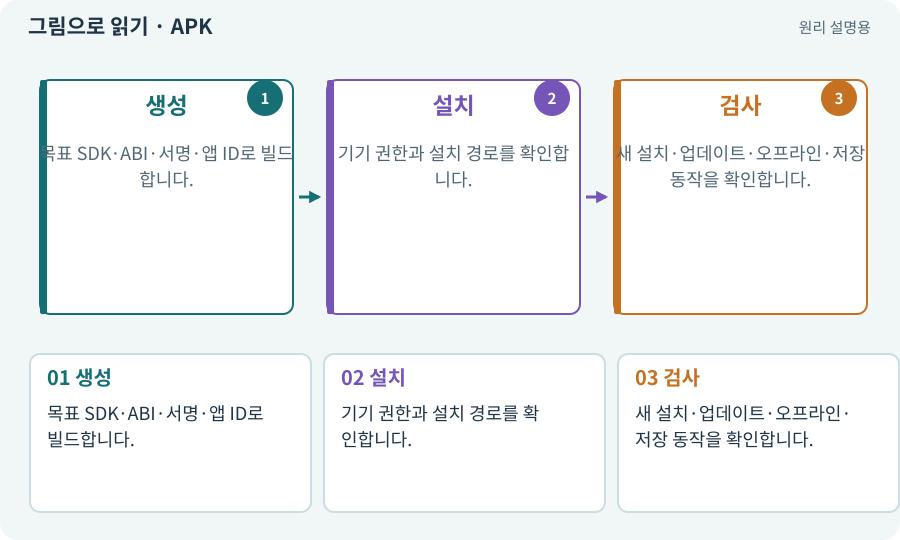

# APK·Android 설치 파일

**분야:** 비동기·다운로드·빌드·버전 관리

APK는 Android 기기에 설치하는 앱 패키지 형식입니다. 코드·리소스·메타데이터·서명 등을 담습니다. 모든 기기에서 무조건 설치되는 파일은 아닙니다.

**찾아오는 이름:** APK·Android 설치 파일, APK, apk, 테스트 APK

## 익숙한 것에 비유하면

제품을 실제 기기에 전달하는 설치 상자입니다. 상자의 규격과 기기의 규격이 맞아야 합니다.



개념도입니다. 실제 Unity 화면이나 검사 결과가 아닙니다. 그림의 순서·색은 역할을 구분하며 실제 설정값은 프로젝트에서 확인합니다.

## 이렇게 작동합니다

### 1. 생성

목표 SDK·ABI·서명·앱 ID로 빌드합니다.

### 2. 설치

기기 권한과 설치 경로를 확인합니다.

### 3. 검사

새 설치·업데이트·오프라인·저장 동작을 확인합니다.

## 우리 RPG에서는 이렇게 만나요

같은 앱을 업데이트하려면 앱 식별자와 서명 등 조건이 맞아야 합니다. 서명이 다르다고 기존 앱을 무작정 삭제하면 저장이 사라질 수 있어 사본과 정책을 확인합니다.

## 이것과 혼동하지 마세요

APK 생성 성공은 설치·실행·실제 플레이 성공이 아닙니다.

## 이해했는지 한 번 생각해 보기

APK가 생겼으면 Android 검사를 PASS로 적어도 되나요?

<details><summary>답과 이유</summary>

설치와 실제 동작을 별도로 확인해야 합니다.

</details>

## 내 프로젝트에서 확인하고 싶다면

아래 요청은 읽기 전용으로 실제 대상을 확인하는 선택 요청입니다. 코드나 설정을 직접 편집할 필요는 없습니다.

```text
현재 프로젝트에서 APK·Android 설치 파일 관련 요소가 어떻게 사용되는지 읽기 전용으로 확인해 줘. 실제 대상과 설정을 찾아 쉬운 말과 작은 예로 설명해 줘. 특히 다음 혼동을 구분해 줘: APK 생성 성공은 설치·실행·실제 플레이 성공이 아닙니다. 아직 코드·설정·파일은 바꾸지 말고, 확인할 수 없는 내용은 따로 알려 줘.
```

## 이어지는 개념

[AAB·스토어 배포 묶음](aab.md) · [ABI·ARM64·x86_64](abi.md) · [앱 서명·키·자격 증명](signature.md) · [게임 빌드·개발 빌드·배포](build.md)

## 이 개념을 사용하는 실습

[11 · PC와 휴대폰에서 처음 실행하기](../index.html#lesson-011) · [39 · 다른 PC와 Android 에서 실행할 파일 만들기](../index.html#lesson-039) · [62 · OpenAI 이미지로 게임 자산 만들기](../index.html#lesson-062) · [77 · 앱을 바꾸지 않고 외형 업데이트하기](../index.html#lesson-077) · [78 · 선택: Google Play 에셋 전달 사용하기](../index.html#lesson-078) · [79 · 추가 기능을 하나의 게임으로 합치기](../index.html#lesson-079) · [80 · 나만의 2D RPG 완성하기](../index.html#lesson-080) · [102 · 네 배포물을 구분해 만들기](../index.html#lesson-102) · [129 · 기존 2D 게임에서 확장팩 시작하기](../index.html#lesson-129) · [159 · 최종 확장판 배포 후보 만들기](../index.html#lesson-159)

## 참고와 설명의 범위

기본 도구 동작은 아래 공식 자료를 참고했습니다. 비유·그림·RPG의 예시 수치와 정책은 이해를 위한 자체 예제입니다. 실제 API·지원 기능은 설치 버전과 계정에서 확인합니다.

- [Unity · Android 빌드](https://docs.unity3d.com/6000.3/Documentation/Manual/android-BuildProcess.html)

그림·계산 예제·조작 모형은 자체 제작한 설명입니다. 실제 Unity 화면, 서비스 생성 결과, 성능 실측 또는 게임 테스트 결과가 아닙니다. 자료 확인: 2026년 9월 26일.
