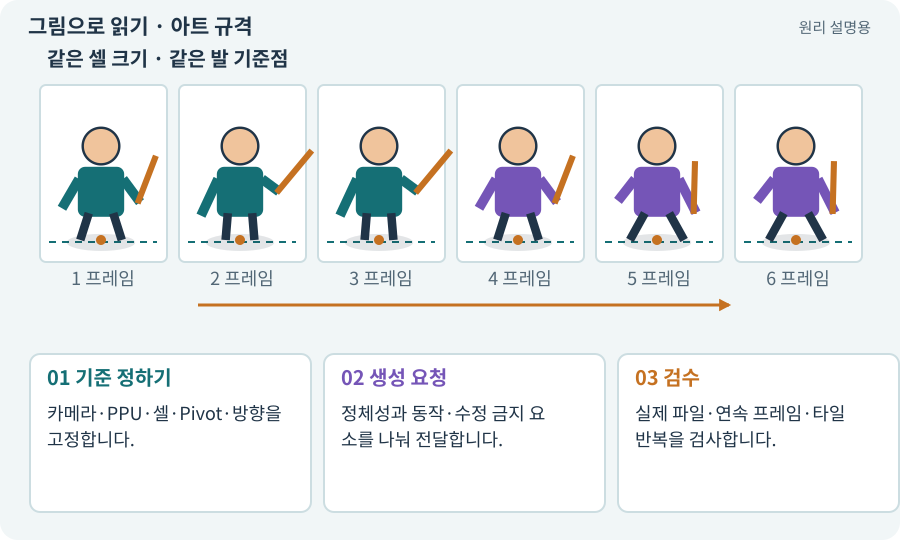

# 아트 규격·레퍼런스·키 포즈

**분야:** 그림·애니메이션·화면 만들기

아트 규격은 캐릭터·몬스터·타일이 함께 쓸 크기·방향·색·광원·프레임·파일 조건을 정한 약속입니다. 레퍼런스와 키 포즈는 정체성과 동작의 중요한 순간을 전달하는 자료입니다.

**찾아오는 이름:** 아트 규격·레퍼런스·키 포즈, 아트 규격, 레퍼런스, 참조 이미지, reference image, 키 포즈, key pose, 프롬프트 일관성

## 익숙한 것에 비유하면

여러 사람이 같은 유니폼을 만들도록 색표·치수·앞뒤 도면을 제공하는 것입니다.



개념도입니다. 실제 Unity 화면이나 검사 결과가 아닙니다. 그림의 순서·색은 역할을 구분하며 실제 설정값은 프로젝트에서 확인합니다.

## 이렇게 작동합니다

### 1. 기준 정하기

카메라·PPU·셀·Pivot·방향을 고정합니다.

### 2. 생성 요청

정체성과 동작·수정 금지 요소를 나눠 전달합니다.

### 3. 검수

실제 파일·연속 프레임·타일 반복을 검사합니다.

## 우리 RPG에서는 이렇게 만나요

앞 프레임의 오른손 검이 다음 프레임에서 왼손으로 바뀌면 “멋진 이미지”여도 사용할 수 없습니다. 무기·발·실루엣의 일관성을 직접 봅니다.

## 이것과 혼동하지 마세요

같은 프롬프트나 시드를 쓴다고 완벽한 캐릭터 일관성이 보장되는 것은 아닙니다.

## 이해했는지 한 번 생각해 보기

생성 이미지 한 장이 예쁘면 시트로 바로 써도 되나요?

<details><summary>답과 이유</summary>

규격·알파·프레임·방향·연속 동작을 확인해야 합니다.

</details>

## 내 프로젝트에서 확인하고 싶다면

아래 요청은 읽기 전용으로 실제 대상을 확인하는 선택 요청입니다. 코드나 설정을 직접 편집할 필요는 없습니다.

```text
현재 프로젝트에서 아트 규격·레퍼런스·키 포즈 관련 요소가 어떻게 사용되는지 읽기 전용으로 확인해 줘. 실제 대상과 설정을 찾아 쉬운 말과 작은 예로 설명해 줘. 특히 다음 혼동을 구분해 줘: 같은 프롬프트나 시드를 쓴다고 완벽한 캐릭터 일관성이 보장되는 것은 아닙니다. 아직 코드·설정·파일은 바꾸지 말고, 확인할 수 없는 내용은 따로 알려 줘.
```

## 이어지는 개념

[스프라이트 시트](sprite-sheet.md) · [Pivot과 발 기준점](pivot.md) · [라이선스·출처·사용 조건](license.md) · [생성형 아트·참조 이미지·후처리](image-service.md)

## 이 개념을 사용하는 실습

[55 · 어떤 그림도 맞춰 넣는 아트 규격 정하기](../index.html#lesson-055) · [56 · Unity AI로 캐릭터 움직임 만들기](../index.html#lesson-056) · [57 · Unity AI로 바닥과 벽 타일 만들기](../index.html#lesson-057) · [58 · PixelLab로 방향별 픽셀 캐릭터 만들기](../index.html#lesson-058) · [59 · Retro Diffusion으로 캐릭터와 타일 만들기](../index.html#lesson-059) · [60 · Scenario로 스타일과 동작 유지하기](../index.html#lesson-060) · [61 · Ludo.ai로 키 포즈를 지정해 움직임 만들기](../index.html#lesson-061) · [62 · OpenAI 이미지로 게임 자산 만들기](../index.html#lesson-062) · [63 · Grok 이미지로 같은 자산 시험하기](../index.html#lesson-063) · [67 · 내 게임의 아트 제작 경로 선택하기](../index.html#lesson-067)

## 참고와 설명의 범위

이 항목의 비유·그림·RPG 수치·운영 규칙은 개념을 이해하기 위한 자체 설계 예제입니다. 특정 도구가 이 규칙을 자동으로 구현한다는 뜻은 아닙니다.


그림·계산 예제·조작 모형은 자체 제작한 설명입니다. 실제 Unity 화면, 서비스 생성 결과, 성능 실측 또는 게임 테스트 결과가 아닙니다. 자료 확인: 2026년 9월 26일.
