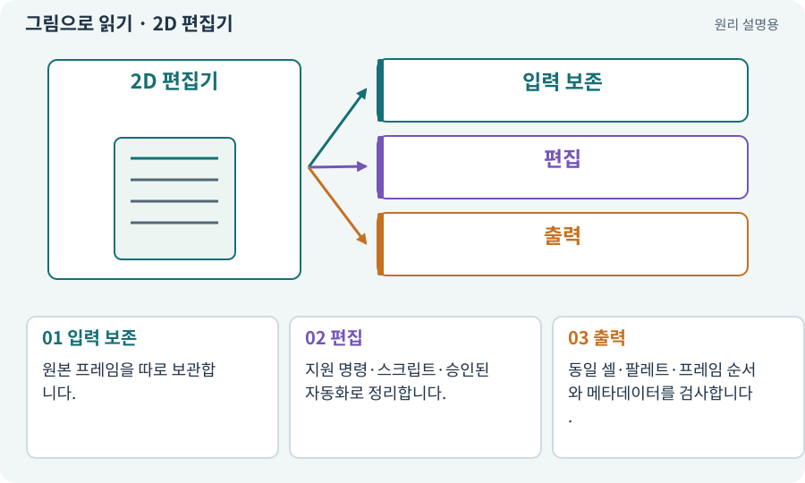

# 2D 편집기·Aseprite·부위 분리

**분야:** 자산 제작·렌더링 보충

2D 편집기는 프레임·레이어·팔레트·피벗을 정리하는 도구입니다. Aseprite·Pixelorama 같은 도구의 자동화·라이선스·지원 기능은 각각 확인해야 합니다. 여기서는 픽셀을 직접 찍는 대신 AI에게 편집 작업을 요청합니다.

**찾아오는 이름:** 2D 편집기·Aseprite·부위 분리, Aseprite, Pixelorama, 2D 편집, 부위 분리, 트레이싱, 리터칭

## 익숙한 것에 비유하면

완성 그림을 재단·정렬·색 보정하는 작업실입니다. 생성 그림이든 직접 만든 그림이든 납품 규격으로 정리하는 데 쓰입니다.



개념도입니다. 실제 Unity 화면이나 검사 결과가 아닙니다. 그림의 순서·색은 역할을 구분하며 실제 설정값은 프로젝트에서 확인합니다.

## 이렇게 작동합니다

### 1. 입력 보존

원본 프레임을 따로 보관합니다.

### 2. 편집

지원 명령·스크립트·승인된 자동화로 정리합니다.

### 3. 출력

동일 셀·팔레트·프레임 순서와 메타데이터를 검사합니다.

## 우리 RPG에서는 이렇게 만나요

캐릭터 몸통·팔·무기를 나눠 2D 뼈대에 연결할 수 있지만 가려진 부분 그림과 관절 회전 시 틈이 없는지 확인해야 합니다. 편집 프로그램이 없으면 승인된 대안 경로를 선택합니다.

## 이것과 혼동하지 마세요

Aseprite를 이름만 보고 무조건 무료 프로그램으로 안내하지 않습니다. 제품별 사용 조건을 확인합니다.

## 이해했는지 한 번 생각해 보기

원본을 직접 덮어쓰며 배경을 지우면 안전한가요?

<details><summary>답과 이유</summary>

원본과 출력 사본을 분리하고 필요한 알파·윤곽이 보존됐는지 확인해야 합니다.

</details>

## 내 프로젝트에서 확인하고 싶다면

아래 요청은 읽기 전용으로 실제 대상을 확인하는 선택 요청입니다. 코드나 설정을 직접 편집할 필요는 없습니다.

```text
현재 프로젝트에서 2D 편집기·Aseprite·부위 분리 관련 요소가 어떻게 사용되는지 읽기 전용으로 확인해 줘. 실제 대상과 설정을 찾아 쉬운 말과 작은 예로 설명해 줘. 특히 다음 혼동을 구분해 줘: Aseprite를 이름만 보고 무조건 무료 프로그램으로 안내하지 않습니다. 제품별 사용 조건을 확인합니다. 아직 코드·설정·파일은 바꾸지 말고, 확인할 수 없는 내용은 따로 알려 줘.
```

## 이어지는 개념

[리그·본·스키닝·Avatar](rig.md) · [알파·RGBA·투명 배경](alpha.md) · [슬라이싱·프레임 분리](slicing.md) · [라이선스·출처·사용 조건](license.md)

## 이 개념을 사용하는 실습

[65 · 스프라이트를 정리해 실제 캐릭터에 넣기](../index.html#lesson-065) · [67 · 내 게임의 아트 제작 경로 선택하기](../index.html#lesson-067)

## 참고와 설명의 범위

기본 도구 동작은 아래 공식 자료를 참고했습니다. 비유·그림·RPG의 예시 수치와 정책은 이해를 위한 자체 예제입니다. 실제 API·지원 기능은 설치 버전과 계정에서 확인합니다.

- [Aseprite · CLI와 자동화](https://www.aseprite.org/docs/cli/)

그림·계산 예제·조작 모형은 자체 제작한 설명입니다. 실제 Unity 화면, 서비스 생성 결과, 성능 실측 또는 게임 테스트 결과가 아닙니다. 자료 확인: 2026년 9월 26일.
