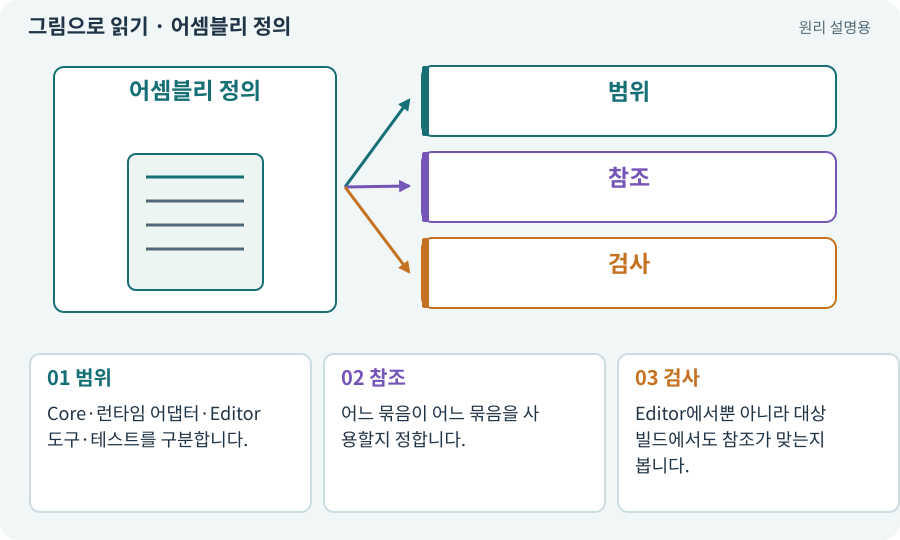

# 어셈블리 정의·asmdef·Editor 전용

**분야:** 설명을 읽기 위한 기초 언어

어셈블리는 컴파일된 코드 묶음입니다. Unity의 asmdef는 코드 묶음의 참조·플랫폼·컴파일 범위를 정하는 데 사용합니다. Editor 도구와 게임 실행 코드는 분리해야 합니다.

**찾아오는 이름:** 어셈블리 정의·asmdef·Editor 전용, asmdef, Assembly Definition, 어셈블리 정의, Editor 전용, 테스트 어셈블리, 어셈블리

## 익숙한 것에 비유하면

작업장 전용 공구와 손님에게 배포할 제품 부품을 다른 상자에 담는 것입니다.



개념도입니다. 실제 Unity 화면이나 검사 결과가 아닙니다. 그림의 순서·색은 역할을 구분하며 실제 설정값은 프로젝트에서 확인합니다.

## 이렇게 작동합니다

### 1. 범위

Core·런타임 어댑터·Editor 도구·테스트를 구분합니다.

### 2. 참조

어느 묶음이 어느 묶음을 사용할지 정합니다.

### 3. 검사

Editor에서뿐 아니라 대상 빌드에서도 참조가 맞는지 봅니다.

## 우리 RPG에서는 이렇게 만나요

씬을 자동으로 만드는 UnityEditor 코드가 Android 런타임 어셈블리에 섞이면 빌드가 깨질 수 있습니다. NUnit 검사도 테스트용 구성에 연결합니다.

## 이것과 혼동하지 마세요

폴더 이름을 바꿨다고 모든 참조 경계가 자동 수정되는 것은 아닙니다.

## 이해했는지 한 번 생각해 보기

Editor에서는 되는데 Android에서 UnityEditor 오류가 나면?

<details><summary>답과 이유</summary>

Editor 전용 코드와 런타임 코드의 분리·asmdef 설정을 확인합니다.

</details>

## 내 프로젝트에서 확인하고 싶다면

아래 요청은 읽기 전용으로 실제 대상을 확인하는 선택 요청입니다. 코드나 설정을 직접 편집할 필요는 없습니다.

```text
현재 프로젝트에서 어셈블리 정의·asmdef·Editor 전용 관련 요소가 어떻게 사용되는지 읽기 전용으로 확인해 줘. 실제 대상과 설정을 찾아 쉬운 말과 작은 예로 설명해 줘. 특히 다음 혼동을 구분해 줘: 폴더 이름을 바꿨다고 모든 참조 경계가 자동 수정되는 것은 아닙니다. 아직 코드·설정·파일은 바꾸지 말고, 확인할 수 없는 내용은 따로 알려 줘.
```

## 이어지는 개념

[컴파일·어셈블리·도메인 리로드](compile.md) · [의존성·DAG·위상 정렬](dependency.md) · [C#·Python·스크립트](csharp.md) · [단위·통합·회귀 테스트](test.md)

## 이 개념을 사용하는 실습

[06 · 시작 메뉴와 테스트 공간 연결하기](../index.html#lesson-006) · [125 · 하네스로 작은 전리품 화면 만들기](../index.html#lesson-125)

## 참고와 설명의 범위

기본 도구 동작은 아래 공식 자료를 참고했습니다. 비유·그림·RPG의 예시 수치와 정책은 이해를 위한 자체 예제입니다. 실제 API·지원 기능은 설치 버전과 계정에서 확인합니다.

- [Unity · 테스트 실행과 결과](https://docs.unity3d.com/Packages/com.unity.test-framework@1.4/manual/reference-command-line.html)

그림·계산 예제·조작 모형은 자체 제작한 설명입니다. 실제 Unity 화면, 서비스 생성 결과, 성능 실측 또는 게임 테스트 결과가 아닙니다. 자료 확인: 2026년 9월 26일.
