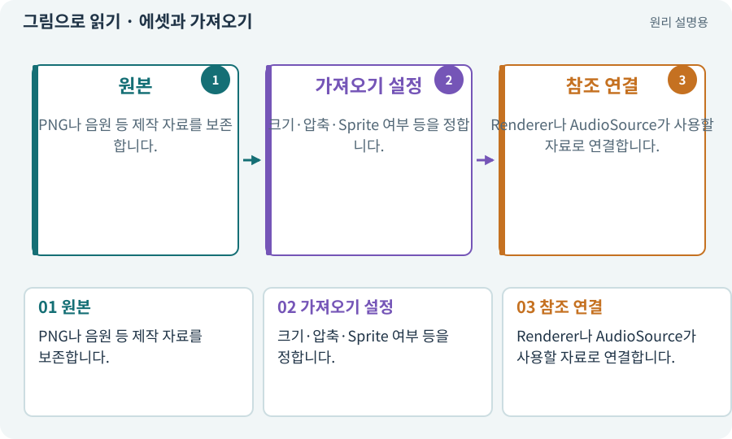

# 에셋과 가져오기

**분야:** 시작·도구·작업 공간

에셋은 그림·음원·모델·씬·스크립트 등 게임 제작에 사용하는 자료입니다. 임포트는 원본 파일을 Unity에서 쓸 수 있는 형태와 설정으로 가져오는 과정입니다.

**찾아오는 이름:** 에셋과 가져오기, 에셋, 자산, Asset, 임포트, Import, import

## 익숙한 것에 비유하면

사진 원본을 앨범 규격에 맞춰 넣는 과정입니다. 같은 원본도 자르는 방식과 크기 설정에 따라 다르게 보입니다.



개념도입니다. 실제 Unity 화면이나 검사 결과가 아닙니다. 그림의 순서·색은 역할을 구분하며 실제 설정값은 프로젝트에서 확인합니다.

## 이렇게 작동합니다

### 1. 원본

PNG나 음원 등 제작 자료를 보존합니다.

### 2. 가져오기 설정

크기·압축·Sprite 여부 등을 정합니다.

### 3. 참조 연결

Renderer나 AudioSource가 사용할 자료로 연결합니다.

## 우리 RPG에서는 이렇게 만나요

캐릭터 PNG가 Assets에 있어도 SpriteRenderer가 참조하지 않으면 게임에 나오지 않습니다. 잘못된 PPU나 알파 설정 때문에 크기와 가장자리가 달라질 수도 있습니다.

## 이것과 혼동하지 마세요

파일이 존재하는 것과 게임에서 실제로 사용되는 것은 다릅니다.

## 이해했는지 한 번 생각해 보기

PNG를 복사했는데 캐릭터가 안 바뀌는 이유는?

<details><summary>답과 이유</summary>

참조 대상·임포트 설정·실행 중인 프리팹을 확인해야 합니다.

</details>

## 내 프로젝트에서 확인하고 싶다면

아래 요청은 읽기 전용으로 실제 대상을 확인하는 선택 요청입니다. 코드나 설정을 직접 편집할 필요는 없습니다.

```text
현재 프로젝트에서 에셋과 가져오기 관련 요소가 어떻게 사용되는지 읽기 전용으로 확인해 줘. 실제 대상과 설정을 찾아 쉬운 말과 작은 예로 설명해 줘. 특히 다음 혼동을 구분해 줘: 파일이 존재하는 것과 게임에서 실제로 사용되는 것은 다릅니다. 아직 코드·설정·파일은 바꾸지 말고, 확인할 수 없는 내용은 따로 알려 줘.
```

## 이어지는 개념

[스프라이트와 SpriteRenderer](sprite.md) · [텍스처·픽셀·해상도](texture.md) · [참조·null·Missing Reference](reference.md) · [메타 파일과 GUID](meta.md)

## 이 개념을 사용하는 실습

[01 · 빈 2D 프로젝트 만들기](../index.html#lesson-001) · [04 · 되돌릴 수 있는 작업 습관 만들기](../index.html#lesson-004) · [05 · 말로 스프라이트 하나 만들기](../index.html#lesson-005) · [32 · 길 안내와 처음 하는 사람의 동선 만들기](../index.html#lesson-032) · [33 · 기본 캐릭터·몬스터·타일 아트 만들기](../index.html#lesson-033) · [37 · 느려지는 원인을 측정해 고치기](../index.html#lesson-037) · [56 · Unity AI로 캐릭터 움직임 만들기](../index.html#lesson-056) · [62 · OpenAI 이미지로 게임 자산 만들기](../index.html#lesson-062) · [63 · Grok 이미지로 같은 자산 시험하기](../index.html#lesson-063) · [67 · 내 게임의 아트 제작 경로 선택하기](../index.html#lesson-067) · [73 · 주소로 에셋 불러오기](../index.html#lesson-073) · [74 · 추가 외형을 서버에서 받게 준비하기](../index.html#lesson-074) · [75 · 다운로드 용량과 진행률 보여 주기](../index.html#lesson-075) · [76 · 연결이 끊겨도 게임 계속하기](../index.html#lesson-076) · [77 · 앱을 바꾸지 않고 외형 업데이트하기](../index.html#lesson-077) · [78 · 선택: Google Play 에셋 전달 사용하기](../index.html#lesson-078) · [79 · 추가 기능을 하나의 게임으로 합치기](../index.html#lesson-079) · [83 · 3D 카메라와 재질로 공간 보기](../index.html#lesson-083) · [87 · 같은 캐릭터를 실제 3D 모델로 만들기](../index.html#lesson-087) · [88 · 3D 모델에 걷기와 공격 연결하기](../index.html#lesson-088) · [98 · 3D 팩을 2D 팩과 따로 내려받기](../index.html#lesson-098) · [104 · 2D와 3D를 두 플랫폼에서 완주하기](../index.html#lesson-104) · [107 · 원본을 보호하고 허용 경로 정하기](../index.html#lesson-107) · [117 · Unity 작업을 한 창구로 모으기](../index.html#lesson-117) · [121 · 필요한 역할을 하나 추가하기](../index.html#lesson-121) · [132 · 필터를 실제 던전과 모바일에 연결하기](../index.html#lesson-132) · [148 · 아트 역할로 새 지역 외형 완성하기](../index.html#lesson-148) · [153 · 대장간 고해상도팩 선택 다운로드하기](../index.html#lesson-153)

## 참고와 설명의 범위

기본 도구 동작은 아래 공식 자료를 참고했습니다. 비유·그림·RPG의 예시 수치와 정책은 이해를 위한 자체 예제입니다. 실제 API·지원 기능은 설치 버전과 계정에서 확인합니다.

- [Unity · 2D 게임 제작 흐름](https://docs.unity3d.com/6000.3/Documentation/Manual/2d-game-creation-wokflow.html)

그림·계산 예제·조작 모형은 자체 제작한 설명입니다. 실제 Unity 화면, 서비스 생성 결과, 성능 실측 또는 게임 테스트 결과가 아닙니다. 자료 확인: 2026년 9월 26일.
