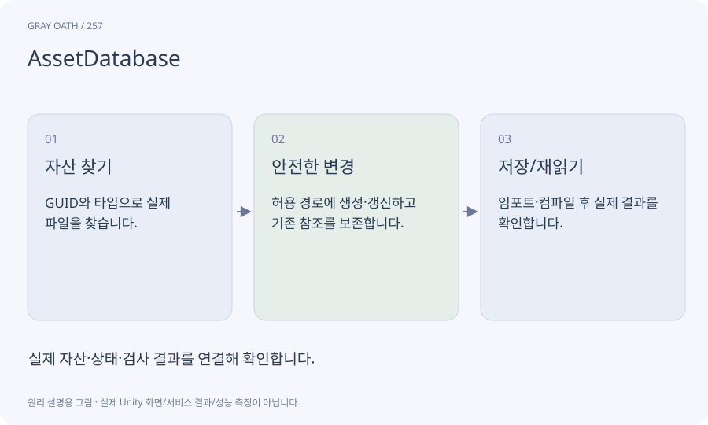

# AssetDatabase

Editor에서 자산을 만들고 찾고 가져오고 저장하는 기능입니다. 실행 중인 게임의 원격 다운로드 API와 구분합니다.

## 익숙한 비유

작업실 창고의 관리 시스템입니다. 실제 물건과 고유 번호를 등록하고 위치를 관리합니다.



## 작동 원리

### 1. 자산 찾기

GUID와 타입으로 실제 파일을 찾습니다.

### 2. 안전한 변경

허용 경로에 생성·갱신하고 기존 참조를 보존합니다.

### 3. 저장/재읽기

임포트·컴파일 후 실제 결과를 확인합니다.

## 게임 속 예

퀘스트의 표시 제목만 바꾸면 기존 .meta와 GUID를 보존합니다. 같은 이름으로 파일을 새로 만들면 이전 참조와 달라질 수 있습니다.

## 혼동하지 않기

AssetDatabase 작업을 임의의 네트워크 스레드나 배포 게임에서 실행하면 안 됩니다.

## 확인 질문

게임이 원격 팩을 받을 때도 이 기능을 쓰나요?

아닙니다. 게임 실행 중 로드는 Addressables 등 Runtime 경로를 사용합니다.

## 내 프로젝트에서 확인하기

```text
현재 GrayOathRPG3D에서 AssetDatabase을 사용하는 실제 대상과 동작을 읽기 전용으로 확인해 줘. 쉬운 말과 작은 사례로 설명하고 AssetDatabase 작업을 임의의 네트워크 스레드나 배포 게임에서 실행하면 안 됩니다. 이 문제를 어떻게 막는지 보여 줘. 코드·데이터·설정은 아직 수정하지 마.
```

## 관련 해설

[asset](asset.md) · [meta](meta.md) · [addressables](addressables.md) · [thread](thread.md)

## 공식 참고

- [Unity · AssetDatabase](https://docs.unity3d.com/6000.3/Documentation/ScriptReference/AssetDatabase.html)
