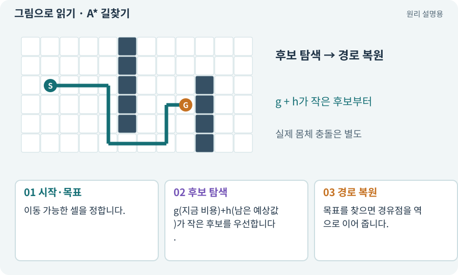

# A* 길찾기

**분야:** 지도·적 AI·전투 규칙

A*는 현재까지 든 이동 비용과 목표까지 남았을 것으로 추정한 비용을 합쳐 유망한 칸부터 탐색하는 길찾기 방법입니다. 캐릭터의 실제 이동과는 별도입니다.

**찾아오는 이름:** A* 길찾기, A*, A-star, A스타, 격자 길찾기

## 익숙한 것에 비유하면

길 안내 지도에서 지금까지 걸은 거리와 남은 예상 거리를 함께 보고 다음 길을 고르는 것입니다.



개념도입니다. 실제 Unity 화면이나 검사 결과가 아닙니다. 그림의 순서·색은 역할을 구분하며 실제 설정값은 프로젝트에서 확인합니다.

## 이렇게 작동합니다

### 1. 시작·목표

이동 가능한 셀을 정합니다.

### 2. 후보 탐색

g(지금 비용)+h(남은 예상값)가 작은 후보를 우선합니다.

### 3. 경로 복원

목표를 찾으면 경유점을 역으로 이어 줍니다.

## g와 h를 작은 숫자로 읽어 보세요

격자에서 상하좌우 이동 비용이 1이라고 합시다. 시작에서 세 칸 걸어온 후보의 g는 3입니다. 목표까지 가로 2칸, 세로 1칸 차이가 나면 맨해튼 추정 h는 3이고 f=g+h는 6입니다.

A*는 f가 작은 후보를 우선하지만 벽을 통과하지는 않습니다. 길을 찾은 뒤에는 각 칸의 이전 칸을 따라 경로를 복원합니다. 비용·휴리스틱·재방문 처리 조건이 맞아야 최단 경로 성질을 기대할 수 있습니다.

아래 모형은 상하좌우 동일 비용, 맨해튼 h, 대각선 없음, 점 크기의 캐릭터를 가정합니다. 벽을 눌러 바꾸고 다시 탐색하세요. 실제 게임은 이 경로 외에 몸체 반경과 충돌을 검사해야 합니다.

| 기호 | 뜻 | 예 |
| --- | --- | --- |
| g | 현재까지 실제 이동 비용 | 3 |
| h | 목표까지 남은 비용 추정 | 2+1=3 |
| f | 후보 우선순위 값 | 3+3=6 |

## 직접 값을 바꾸며 보기

[웹 해설의 조작 모형 열기](../index.html#tech-astar). 조작은 설명용 모형만 바꿉니다. 실제 프로젝트·AI·진행 체크·게임 테스트는 실행하거나 변경하지 않습니다.

## 우리 RPG에서는 이렇게 만나요

상하좌우 비용 1의 예에서 맨해튼 거리를 h로 사용할 수 있습니다. 대각선이 있으면 비용과 모서리 통과 규칙을 함께 바꿔야 합니다. 조건에 맞는 휴리스틱을 써야 최단성 보장을 기대할 수 있습니다.

## 이것과 혼동하지 마세요

A*의 선이 있다고 Collider가 통과하는 것은 아닙니다. 몸체 폭과 실제 충돌을 따로 검사합니다.

## 이해했는지 한 번 생각해 보기

A*가 길을 찾았는데 캐릭터가 끼는 이유는?

<details><summary>답과 이유</summary>

중앙점만 검사했거나 대각 모서리·반경 여유를 반영하지 않았을 수 있습니다.

</details>

## 내 프로젝트에서 확인하고 싶다면

아래 요청은 읽기 전용으로 실제 대상을 확인하는 선택 요청입니다. 코드나 설정을 직접 편집할 필요는 없습니다.

```text
현재 프로젝트에서 A* 길찾기 관련 요소가 어떻게 사용되는지 읽기 전용으로 확인해 줘. 실제 대상과 설정을 찾아 쉬운 말과 작은 예로 설명해 줘. 특히 다음 혼동을 구분해 줘: A*의 선이 있다고 Collider가 통과하는 것은 아닙니다. 몸체 폭과 실제 충돌을 따로 검사합니다. 아직 코드·설정·파일은 바꾸지 말고, 확인할 수 없는 내용은 따로 알려 줘.
```

## 이어지는 개념

[Grid·셀·격자 좌표](grid.md) · [휴리스틱·탐색 비용·예산](heuristic.md) · [몸체 여유·모서리 통과](clearance.md) · [경로와 경유점](navigation.md)

## 이 개념을 사용하는 실습

[09 · 클릭한 곳까지 벽을 돌아가기](../index.html#lesson-009) · [13 · 적을 클릭해 접근하고 공격하기](../index.html#lesson-013) · [28 · 여덟 구역의 첫 던전 만들기](../index.html#lesson-028) · [33 · 기본 캐릭터·몬스터·타일 아트 만들기](../index.html#lesson-033) · [37 · 느려지는 원인을 측정해 고치기](../index.html#lesson-037) · [38 · 테스트 결과와 실제 플레이 구분하기](../index.html#lesson-038) · [46 · 랜덤 지도 위를 실제로 걷기](../index.html#lesson-046) · [49 · 여러 근접 적의 공격 나누기](../index.html#lesson-049) · [55 · 어떤 그림도 맞춰 넣는 아트 규격 정하기](../index.html#lesson-055) · [57 · Unity AI로 바닥과 벽 타일 만들기](../index.html#lesson-057) · [66 · 타일 경계와 랜덤맵 외형 연결하기](../index.html#lesson-066) · [86 · 3D에서도 클릭한 곳까지 돌아가기](../index.html#lesson-086) · [143 · 새 랜덤 지역 봉인된 대장간 만들기](../index.html#lesson-143)

## 참고와 설명의 범위

기본 도구 동작은 아래 공식 자료를 참고했습니다. 비유·그림·RPG의 예시 수치와 정책은 이해를 위한 자체 예제입니다. 실제 API·지원 기능은 설치 버전과 계정에서 확인합니다.

- [Hart·Nilsson·Raphael · A* 원 논문(1968)](https://ieeexplore.ieee.org/document/4082128/)

그림·계산 예제·조작 모형은 자체 제작한 설명입니다. 실제 Unity 화면, 서비스 생성 결과, 성능 실측 또는 게임 테스트 결과가 아닙니다. 자료 확인: 2026년 9월 26일.
