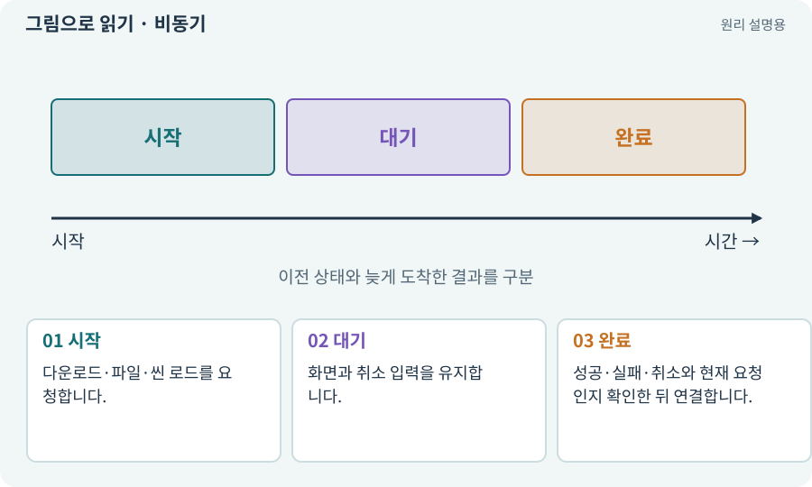

# 비동기·await·콜백

**분야:** 비동기·다운로드·빌드·버전 관리

비동기는 오래 걸리는 작업의 완료를 기다리는 동안 다른 처리를 진행할 수 있게 하는 방식입니다. 자동으로 다른 CPU 스레드에서 실행된다는 뜻은 아닙니다.

**찾아오는 이름:** 비동기·await·콜백, 비동기, async, await, callback, UniTask, Task

## 익숙한 것에 비유하면

음식을 주문하고 진동벨을 받은 뒤 자리에 앉는 상황입니다. 주문을 했다는 것과 음식이 준비됐다는 것은 다릅니다.



개념도입니다. 실제 Unity 화면이나 검사 결과가 아닙니다. 그림의 순서·색은 역할을 구분하며 실제 설정값은 프로젝트에서 확인합니다.

## 이렇게 작동합니다

### 1. 시작

다운로드·파일·씬 로드를 요청합니다.

### 2. 대기

화면과 취소 입력을 유지합니다.

### 3. 완료

성공·실패·취소와 현재 요청인지 확인한 뒤 연결합니다.

## 우리 RPG에서는 이렇게 만나요

던전 팩을 받는 동안 진행률을 보여 줍니다. 다운로드가 끝났어도 사용자가 이미 마을로 돌아갔다면 옛 완료 콜백으로 던전에 입장시키지 않습니다. Unity 오브젝트를 다루는 API는 실행 스레드 조건을 확인합니다.

## 이것과 혼동하지 마세요

async를 붙였다고 무거운 계산이 저절로 빨라지거나 메인 스레드 제약이 사라지지 않습니다.

## 이해했는지 한 번 생각해 보기

다운로드 요청이 접수됐으면 입장 버튼을 켜도 되나요?

<details><summary>답과 이유</summary>

실제 성공과 에셋 로드·검증까지 완료됐는지 확인해야 합니다.

</details>

## 내 프로젝트에서 확인하고 싶다면

아래 요청은 읽기 전용으로 실제 대상을 확인하는 선택 요청입니다. 코드나 설정을 직접 편집할 필요는 없습니다.

```text
현재 프로젝트에서 비동기·await·콜백 관련 요소가 어떻게 사용되는지 읽기 전용으로 확인해 줘. 실제 대상과 설정을 찾아 쉬운 말과 작은 예로 설명해 줘. 특히 다음 혼동을 구분해 줘: async를 붙였다고 무거운 계산이 저절로 빨라지거나 메인 스레드 제약이 사라지지 않습니다. 아직 코드·설정·파일은 바꾸지 말고, 확인할 수 없는 내용은 따로 알려 줘.
```

## 이어지는 개념

[요청 ID·세대 ID·오래된 응답](request-id.md) · [취소 신호·늦은 완료·정리](cancellation.md) · [핸들·참조 계수·Release](handle.md) · [프로세스·종료 코드·표준 출력](process.md)

## 이 개념을 사용하는 실습

[38 · 테스트 결과와 실제 플레이 구분하기](../index.html#lesson-038) · [73 · 주소로 에셋 불러오기](../index.html#lesson-073) · [94 · 같은 랜덤 던전을 3D로 생성하기](../index.html#lesson-094) · [133 · 첫 기능의 실패를 고쳐 다음 기준 만들기](../index.html#lesson-133) · [157 · 하네스가 실패해도 기록 지키기](../index.html#lesson-157)

## 참고와 설명의 범위

기본 도구 동작은 아래 공식 자료를 참고했습니다. 비유·그림·RPG의 예시 수치와 정책은 이해를 위한 자체 예제입니다. 실제 API·지원 기능은 설치 버전과 계정에서 확인합니다.

- [Unity · Addressables 개요](https://docs.unity3d.com/Packages/com.unity.addressables@2.7/manual/index.html)
- [Unity · 코루틴](https://docs.unity3d.com/6000.3/Documentation/Manual/Coroutines.html)

그림·계산 예제·조작 모형은 자체 제작한 설명입니다. 실제 Unity 화면, 서비스 생성 결과, 성능 실측 또는 게임 테스트 결과가 아닙니다. 자료 확인: 2026년 9월 26일.
