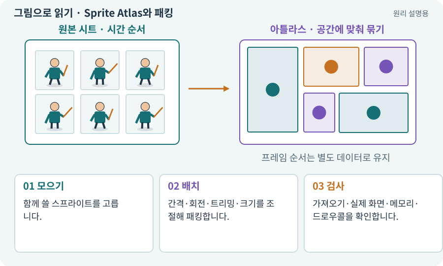

# Sprite Atlas와 패킹

**분야:** 그림·애니메이션·화면 만들기

아틀라스는 여러 스프라이트 텍스처를 큰 텍스처에 모아 관리하는 자료입니다. 텍스처 전환을 줄이는 데 도움이 될 수 있지만 드로우콜이 언제나 하나가 되는 것은 아닙니다.

**찾아오는 이름:** Sprite Atlas와 패킹, Sprite Atlas, 아틀라스, Atlas, 패킹, packing

## 익숙한 것에 비유하면

작은 사진 여러 장을 한 앨범 페이지에 배치해 한 번에 꺼내는 것입니다. 어떤 사진을 어느 순서로 보여 줄지는 별도입니다.



개념도입니다. 실제 Unity 화면이나 검사 결과가 아닙니다. 그림의 순서·색은 역할을 구분하며 실제 설정값은 프로젝트에서 확인합니다.

## 이렇게 작동합니다

### 1. 모으기

함께 쓸 스프라이트를 고릅니다.

### 2. 배치

간격·회전·트리밍·크기를 조절해 패킹합니다.

### 3. 검사

가져오기·실제 화면·메모리·드로우콜을 확인합니다.

## 시트와 아틀라스는 서로 다른 질문에 답해요

스프라이트 시트는 주로 “그림들이 어떤 동작·방향의 순서인가?”를 다룹니다. 아틀라스는 “어떤 작은 그림들을 같은 텍스처에 모아 렌더링할 것인가?”를 다룹니다. 하나의 캐릭터 시트에서 자른 그림들을 다시 아틀라스에 포함할 수도 있습니다.

패킹 도구는 공간을 아끼려고 그림을 회전하거나 잘라 배치할 수 있습니다. 프레임 순서를 아틀라스의 가로 순서로 다시 추측하면 안 됩니다. 논리 스프라이트와 패킹 메타데이터를 사용합니다.

아틀라스를 쓰면 항상 드로우콜 하나가 되는 것은 아닙니다. 재질·셰이더·정렬·렌더링 경로가 함께 맞아야 합니다. 실제 Frame Debugger나 Profiler 결과를 AI가 조사하도록 요청합니다.

| 비교 | 스프라이트 시트 | 아틀라스 |
| --- | --- | --- |
| 주목적 | 동작·방향의 원본 배열 | 렌더링용 그림 묶음 |
| 순서 | 시간·방향 규칙이 중요 | 패킹 위치는 바뀔 수 있음 |
| 빈 공간 | 고정 셀을 유지할 수 있음 | 공간 절약을 위해 줄일 수 있음 |

## 우리 RPG에서는 이렇게 만나요

작은 아이콘 하나 때문에 거대한 지역 아틀라스 전체가 메모리에 올라갈 수 있습니다. 같은 시점에 함께 쓰는 자산끼리 묶는 전략이 필요합니다.

## 이것과 혼동하지 마세요

아틀라스에 넣는 것과 애니메이션 순서를 만드는 것은 다릅니다. 재질·정렬·마스크도 배칭에 영향을 줍니다.

## 이해했는지 한 번 생각해 보기

아틀라스를 만들면 메모리가 항상 줄어드나요?

<details><summary>답과 이유</summary>

아닙니다. 빈 공간·포맷·로드 단위에 따라 늘 수도 있으므로 측정합니다.

</details>

## 내 프로젝트에서 확인하고 싶다면

아래 요청은 읽기 전용으로 실제 대상을 확인하는 선택 요청입니다. 코드나 설정을 직접 편집할 필요는 없습니다.

```text
현재 프로젝트에서 Sprite Atlas와 패킹 관련 요소가 어떻게 사용되는지 읽기 전용으로 확인해 줘. 실제 대상과 설정을 찾아 쉬운 말과 작은 예로 설명해 줘. 특히 다음 혼동을 구분해 줘: 아틀라스에 넣는 것과 애니메이션 순서를 만드는 것은 다릅니다. 재질·정렬·마스크도 배칭에 영향을 줍니다. 아직 코드·설정·파일은 바꾸지 말고, 확인할 수 없는 내용은 따로 알려 줘.
```

## 이어지는 개념

[스프라이트 시트](sprite-sheet.md) · [드로우콜·배칭·인스턴싱](batching.md) · [파일 용량과 실행 메모리](texture-compression.md) · [Addressables·주소로 에셋 불러오기](addressables.md)

## 이 개념을 사용하는 실습

[37 · 느려지는 원인을 측정해 고치기](../index.html#lesson-037) · [55 · 어떤 그림도 맞춰 넣는 아트 규격 정하기](../index.html#lesson-055) · [61 · Ludo.ai로 키 포즈를 지정해 움직임 만들기](../index.html#lesson-061) · [64 · 추가 결제 없이 AI로 2D 프레임 만들기](../index.html#lesson-064) · [65 · 스프라이트를 정리해 실제 캐릭터에 넣기](../index.html#lesson-065) · [69 · 베기와 폭발을 시트 애니메이션으로 만들기](../index.html#lesson-069) · [98 · 3D 팩을 2D 팩과 따로 내려받기](../index.html#lesson-098) · [153 · 대장간 고해상도팩 선택 다운로드하기](../index.html#lesson-153) · [154 · 확장 기능을 켠 휴대폰 성능 고치기](../index.html#lesson-154)

## 참고와 설명의 범위

기본 도구 동작은 아래 공식 자료를 참고했습니다. 비유·그림·RPG의 예시 수치와 정책은 이해를 위한 자체 예제입니다. 실제 API·지원 기능은 설치 버전과 계정에서 확인합니다.

- [Unity · Sprite](https://docs.unity3d.com/6000.3/Documentation/Manual/sprite/sprite-landing.html)

그림·계산 예제·조작 모형은 자체 제작한 설명입니다. 실제 Unity 화면, 서비스 생성 결과, 성능 실측 또는 게임 테스트 결과가 아닙니다. 자료 확인: 2026년 9월 26일.
