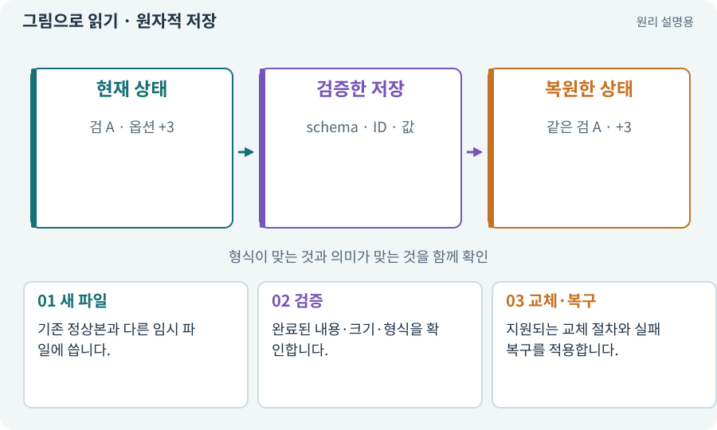

# 원자적 저장·임시 파일·교체

**분야:** 코드·데이터·저장·검사

원자적 저장은 중간에 실패해 반쯤 쓴 파일이 현재 정상본을 대체하지 않도록 설계하는 것입니다. 임시 파일·검증·교체와 백업 정책을 사용하며 보장 범위는 파일 시스템에 따라 확인합니다.

**찾아오는 이름:** 원자적 저장·임시 파일·교체, 원자적 저장, atomic write, 원자 저장, 임시 파일, 원자적 교체

## 익숙한 것에 비유하면

새 공책을 끝까지 작성한 뒤 기존 공책과 교체하는 것입니다. 쓰다 만 한 장을 정상 공책으로 덮어쓰지 않습니다.



개념도입니다. 실제 Unity 화면이나 검사 결과가 아닙니다. 그림의 순서·색은 역할을 구분하며 실제 설정값은 프로젝트에서 확인합니다.

## 이렇게 작동합니다

### 1. 새 파일

기존 정상본과 다른 임시 파일에 씁니다.

### 2. 검증

완료된 내용·크기·형식을 확인합니다.

### 3. 교체·복구

지원되는 교체 절차와 실패 복구를 적용합니다.

## 안전한 저장에도 범위와 한계가 있어요

임시 파일에 새 데이터를 쓰고, 읽어서 형식과 내용이 정상인지 확인한 뒤, 지원되는 방식으로 원본을 교체하는 흐름이 기본입니다. 이전 정상 백업은 검사된 경우에만 남깁니다.

파일 이름을 바꾸는 작업이 원자적이어도 두 개의 독립 파일을 항상 함께 갱신하는 것은 아닙니다. 재료와 인벤토리를 다른 파일에 저장하면 한쪽만 새 버전이 되는 상황을 별도로 설계해야 합니다.

운영체제·파일시스템·전원 장애 시 내구성 보장은 서로 다릅니다. “atomic”이라는 이름만 붙여 모든 손상을 막았다고 말하지 않고, 잘린 파일·잘못된 schema·중복 ID·이전 백업으로 실제 복구를 검사합니다.

| 보호하려는 것 | 방법 | 별도 검사 |
| --- | --- | --- |
| 쓰기 중 끊김 | 임시 파일·검증·교체 | 플랫폼 실제 동작 |
| 잘못된 데이터 | schema·ID·소유권 검사 | 형식은 맞지만 의미 오류 |
| 현재 저장 손상 | 이전 정상 백업 | 백업도 손상된 경우 |

## 우리 RPG에서는 이렇게 만나요

저장 도중 앱이 꺼져도 다음 실행에서 정상본이나 검증된 백업을 선택할 수 있게 합니다. 임시 파일이 있다고 무조건 최신 정상 데이터는 아닙니다.

## 이것과 혼동하지 마세요

원자 교체와 정전까지 견디는 내구성은 같은 보장이 아닙니다. 플랫폼·동기화·파일 시스템 조건을 검증합니다.

## 이해했는지 한 번 생각해 보기

임시 파일이 절반만 쓰인 상태에서 꺼지면?

<details><summary>답과 이유</summary>

검증되지 않은 임시본으로 기존 정상본을 덮어쓰면 안 됩니다.

</details>

## 내 프로젝트에서 확인하고 싶다면

아래 요청은 읽기 전용으로 실제 대상을 확인하는 선택 요청입니다. 코드나 설정을 직접 편집할 필요는 없습니다.

```text
현재 프로젝트에서 원자적 저장·임시 파일·교체 관련 요소가 어떻게 사용되는지 읽기 전용으로 확인해 줘. 실제 대상과 설정을 찾아 쉬운 말과 작은 예로 설명해 줘. 특히 다음 혼동을 구분해 줘: 원자 교체와 정전까지 견디는 내구성은 같은 보장이 아닙니다. 플랫폼·동기화·파일 시스템 조건을 검증합니다. 아직 코드·설정·파일은 바꾸지 말고, 확인할 수 없는 내용은 따로 알려 줘.
```

## 이어지는 개념

[파일 저장·게임 세이브·백업](save.md) · [트랜잭션·거래의 한 번 적용](transaction.md) · [해시·SHA-256·체크섬](hash.md) · [저장 이전·마이그레이션](migration.md)

## 이 개념을 사용하는 실습

[25 · 게임을 껐다 켜도 장비 유지하기](../index.html#lesson-025) · [42 · 트리에서 투자하고 저장하기](../index.html#lesson-042) · [75 · 다운로드 용량과 진행률 보여 주기](../index.html#lesson-075) · [99 · 2D와 3D 사이에 진행 가져오기](../index.html#lesson-099) · [106 · 도구가 상태를 기억하게 만들기](../index.html#lesson-106)

## 참고와 설명의 범위

기본 도구 동작은 아래 공식 자료를 참고했습니다. 비유·그림·RPG의 예시 수치와 정책은 이해를 위한 자체 예제입니다. 실제 API·지원 기능은 설치 버전과 계정에서 확인합니다.

- [Unity · persistentDataPath](https://docs.unity3d.com/6000.3/Documentation/ScriptReference/Application-persistentDataPath.html)
- [Python · 파일 경로](https://docs.python.org/3/library/pathlib.html)

그림·계산 예제·조작 모형은 자체 제작한 설명입니다. 실제 Unity 화면, 서비스 생성 결과, 성능 실측 또는 게임 테스트 결과가 아닙니다. 자료 확인: 2026년 9월 26일.
