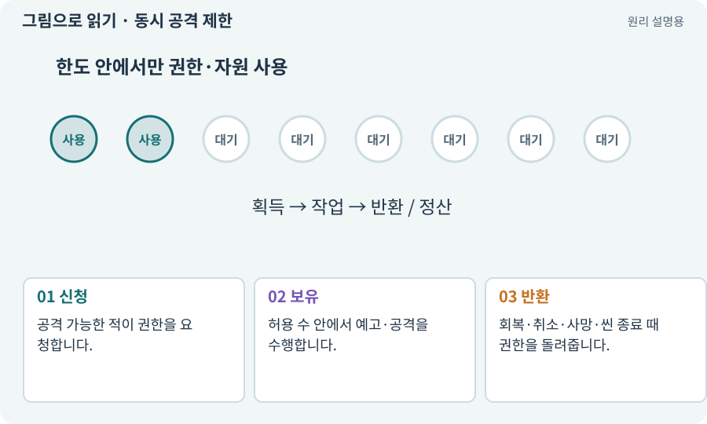

# 동시 공격 제한·공격 토큰

**분야:** 지도·적 AI·전투 규칙

공격 토큰은 여러 적 중 동시에 공격할 수 있는 수를 제한하는 게임 규칙입니다. 접근 슬롯은 한 지점에 적이 겹치지 않도록 접근 위치를 나누는 규칙입니다. 모델 입력의 토큰과는 다릅니다.

**찾아오는 이름:** 동시 공격 제한·공격 토큰, 공격 토큰, 동시 공격, 공격 권한, attack token, 접근 슬롯

## 익숙한 것에 비유하면

토론에서 마이크 두 개만 나눠 쓰는 것과 같습니다. 기다리는 사람도 움직이지만 동시에 모두 말하지는 않습니다.



개념도입니다. 실제 Unity 화면이나 검사 결과가 아닙니다. 그림의 순서·색은 역할을 구분하며 실제 설정값은 프로젝트에서 확인합니다.

## 이렇게 작동합니다

### 1. 신청

공격 가능한 적이 권한을 요청합니다.

### 2. 보유

허용 수 안에서 예고·공격을 수행합니다.

### 3. 반환

회복·취소·사망·씬 종료 때 권한을 돌려줍니다.

## 우리 RPG에서는 이렇게 만나요

적 6마리에 공격 권한을 설명용으로 2개 주면 두 마리만 예고에 들어가고 나머지는 접근·대기를 합니다. 숫자는 실제 전투로 조절할 초기값입니다.

## 이것과 혼동하지 마세요

토큰을 받았다는 이유만으로 벽·거리·플레이어 무적 검사까지 건너뛰지 않습니다.

## 이해했는지 한 번 생각해 보기

죽은 적이 토큰을 계속 보유하면?

<details><summary>답과 이유</summary>

남은 적의 공격이 영원히 막힐 수 있습니다. 모든 종료 경로에서 반환해야 합니다.

</details>

## 내 프로젝트에서 확인하고 싶다면

아래 요청은 읽기 전용으로 실제 대상을 확인하는 선택 요청입니다. 코드나 설정을 직접 편집할 필요는 없습니다.

```text
현재 프로젝트에서 동시 공격 제한·공격 토큰 관련 요소가 어떻게 사용되는지 읽기 전용으로 확인해 줘. 실제 대상과 설정을 찾아 쉬운 말과 작은 예로 설명해 줘. 특히 다음 혼동을 구분해 줘: 토큰을 받았다는 이유만으로 벽·거리·플레이어 무적 검사까지 건너뛰지 않습니다. 아직 코드·설정·파일은 바꾸지 말고, 확인할 수 없는 내용은 따로 알려 줘.
```

## 이어지는 개념

[상태 기계·FSM](state-machine.md) · [수명주기·초기화·정리](lifecycle.md) · [조우·전투 감독·페이즈](encounter.md) · [AI 토큰·입출력·비용](llm-token.md)

## 이 개념을 사용하는 실습

[14 · 나를 발견하고 공격하는 적 만들기](../index.html#lesson-014) · [90 · 적의 판단을 3D 공간에 연결하기](../index.html#lesson-090) · [136 · 방패병과 화염술사 정예 추가하기](../index.html#lesson-136) · [147 · 용광로 감시자와 3단계 전투 만들기](../index.html#lesson-147) · [154 · 확장 기능을 켠 휴대폰 성능 고치기](../index.html#lesson-154) · [156 · 기능 조합에서 숨은 오류 찾기](../index.html#lesson-156)

## 참고와 설명의 범위

이 항목의 비유·그림·RPG 수치·운영 규칙은 개념을 이해하기 위한 자체 설계 예제입니다. 특정 도구가 이 규칙을 자동으로 구현한다는 뜻은 아닙니다.


그림·계산 예제·조작 모형은 자체 제작한 설명입니다. 실제 Unity 화면, 서비스 생성 결과, 성능 실측 또는 게임 테스트 결과가 아닙니다. 자료 확인: 2026년 9월 26일.
