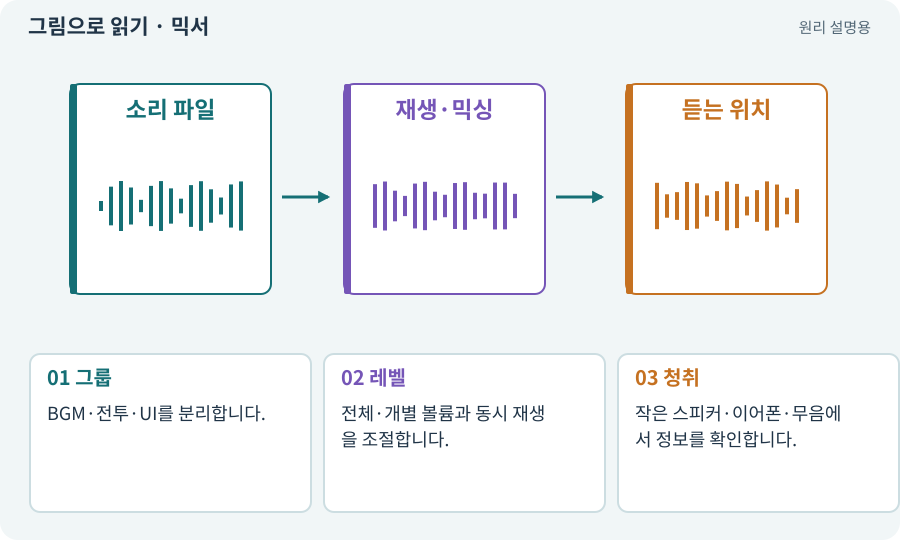

# 믹서·볼륨·dB·동시 재생

**분야:** 입력·UI·소리·성능

믹서는 음악·효과·UI 같은 소리를 그룹별로 조절하는 장치입니다. dB는 로그 비율 단위여서 선형 슬라이더 값과 같은 척도가 아닙니다. 피치는 소리 높이에 영향을 줍니다.

**찾아오는 이름:** 믹서·볼륨·dB·동시 재생, AudioMixer, 믹서, 믹싱, dB, 데시벨, 피치, Pitch, 음량, 동시 재생

## 익숙한 것에 비유하면

여러 마이크의 소리를 한 방송으로 합칠 때 그룹별 크기를 조절하는 콘솔입니다.



개념도입니다. 실제 Unity 화면이나 검사 결과가 아닙니다. 그림의 순서·색은 역할을 구분하며 실제 설정값은 프로젝트에서 확인합니다.

## 이렇게 작동합니다

### 1. 그룹

BGM·전투·UI를 분리합니다.

### 2. 레벨

전체·개별 볼륨과 동시 재생을 조절합니다.

### 3. 청취

작은 스피커·이어폰·무음에서 정보를 확인합니다.

## 우리 RPG에서는 이렇게 만나요

효과음을 조금씩 다른 피치로 재생해 반복감을 줄일 수 있지만, 위험 신호의 의미까지 달라지지 않게 합니다. 피치 변화가 길이에 미치는 영향도 확인합니다.

## 이것과 혼동하지 마세요

음량 슬라이더 0을 로그 계산에 그대로 넣으면 예외가 생길 수 있습니다. 음소거 경계를 별도로 다룹니다.

## 이해했는지 한 번 생각해 보기

동시에 20개 소리가 나면 각 볼륨만 낮추면 충분한가요?

<details><summary>답과 이유</summary>

중요 소리 우선순위와 동시 재생 제한도 필요합니다.

</details>

## 내 프로젝트에서 확인하고 싶다면

아래 요청은 읽기 전용으로 실제 대상을 확인하는 선택 요청입니다. 코드나 설정을 직접 편집할 필요는 없습니다.

```text
현재 프로젝트에서 믹서·볼륨·dB·동시 재생 관련 요소가 어떻게 사용되는지 읽기 전용으로 확인해 줘. 실제 대상과 설정을 찾아 쉬운 말과 작은 예로 설명해 줘. 특히 다음 혼동을 구분해 줘: 음량 슬라이더 0을 로그 계산에 그대로 넣으면 예외가 생길 수 있습니다. 음소거 경계를 별도로 다룹니다. 아직 코드·설정·파일은 바꾸지 말고, 확인할 수 없는 내용은 따로 알려 줘.
```

## 이어지는 개념

[AudioClip·AudioSource·AudioListener](audio.md) · [오브젝트 풀링](pool.md) · [접근성·가독성·피드백](accessibility.md) · [로컬 전투 기록·텔레메트리](telemetry.md)

## 이 개념을 사용하는 실습

[71 · 카메라·소리·피해 숫자 맞추기](../index.html#lesson-071) · [150 · 소리가 없어도 읽히는 전투 만들기](../index.html#lesson-150)

## 참고와 설명의 범위

기본 도구 동작은 아래 공식 자료를 참고했습니다. 비유·그림·RPG의 예시 수치와 정책은 이해를 위한 자체 예제입니다. 실제 API·지원 기능은 설치 버전과 계정에서 확인합니다.

- [Unity Input System · UI 지원](https://docs.unity3d.com/Packages/com.unity.inputsystem@1.17/manual/UISupport.html)

그림·계산 예제·조작 모형은 자체 제작한 설명입니다. 실제 Unity 화면, 서비스 생성 결과, 성능 실측 또는 게임 테스트 결과가 아닙니다. 자료 확인: 2026년 9월 26일.
