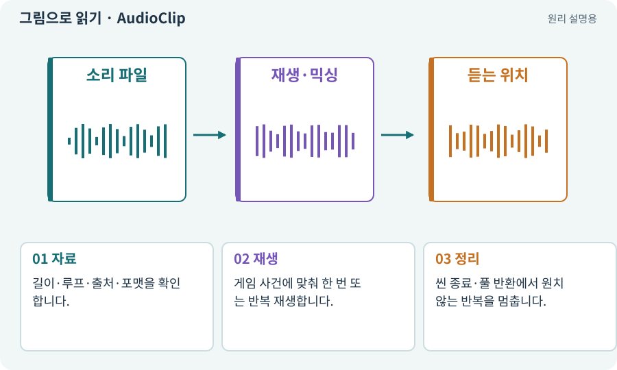

# AudioClip·AudioSource·AudioListener

**분야:** 입력·UI·소리·성능

AudioClip은 소리 자료, AudioSource는 재생 위치·볼륨 등을 가진 재생 주체, AudioListener는 소리를 듣는 기준입니다. 효과음과 배경음악은 목적에 따라 관리합니다.

**찾아오는 이름:** AudioClip·AudioSource·AudioListener, AudioClip, AudioSource, AudioListener, SFX, BGM, 효과음, 배경음악

## 익숙한 것에 비유하면

음원 파일·스피커·청취자의 귀를 구분합니다. 파일이 있어도 스피커가 연결되지 않으면 들리지 않습니다.



개념도입니다. 실제 Unity 화면이나 검사 결과가 아닙니다. 그림의 순서·색은 역할을 구분하며 실제 설정값은 프로젝트에서 확인합니다.

## 이렇게 작동합니다

### 1. 자료

길이·루프·출처·포맷을 확인합니다.

### 2. 재생

게임 사건에 맞춰 한 번 또는 반복 재생합니다.

### 3. 정리

씬 종료·풀 반환에서 원치 않는 반복을 멈춥니다.

## 우리 RPG에서는 이렇게 만나요

적을 여러 마리 잡을 때 사망음이 수십 개 겹치면 큰 소리로 찢어질 수 있습니다. 동시 재생 수와 우선순위를 제한합니다.

## 이것과 혼동하지 마세요

소리 파일이 존재한다는 사실은 타격 시점과 볼륨이 적절하다는 검증이 아닙니다.

## 이해했는지 한 번 생각해 보기

볼륨을 0으로 해도 보스 공격을 이해할 수 있어야 하나요?

<details><summary>답과 이유</summary>

중요 위험은 시각·형태로도 알려야 하므로 소리를 끈 상태를 검사합니다.

</details>

## 내 프로젝트에서 확인하고 싶다면

아래 요청은 읽기 전용으로 실제 대상을 확인하는 선택 요청입니다. 코드나 설정을 직접 편집할 필요는 없습니다.

```text
현재 프로젝트에서 AudioClip·AudioSource·AudioListener 관련 요소가 어떻게 사용되는지 읽기 전용으로 확인해 줘. 실제 대상과 설정을 찾아 쉬운 말과 작은 예로 설명해 줘. 특히 다음 혼동을 구분해 줘: 소리 파일이 존재한다는 사실은 타격 시점과 볼륨이 적절하다는 검증이 아닙니다. 아직 코드·설정·파일은 바꾸지 말고, 확인할 수 없는 내용은 따로 알려 줘.
```

## 이어지는 개념

[믹서·볼륨·dB·동시 재생](audio-mixer.md) · [접근성·가독성·피드백](accessibility.md) · [VFX·Particle System·플립북](vfx.md) · [공격 ID·사건 ID·중복 피해 방지](event-id.md)

## 이 개념을 사용하는 실습

[34 · 걷기·공격·피격·사망 움직임 연결하기](../index.html#lesson-034) · [71 · 카메라·소리·피해 숫자 맞추기](../index.html#lesson-071) · [150 · 소리가 없어도 읽히는 전투 만들기](../index.html#lesson-150)

## 참고와 설명의 범위

기본 도구 동작은 아래 공식 자료를 참고했습니다. 비유·그림·RPG의 예시 수치와 정책은 이해를 위한 자체 예제입니다. 실제 API·지원 기능은 설치 버전과 계정에서 확인합니다.

- [Unity Input System · UI 지원](https://docs.unity3d.com/Packages/com.unity.inputsystem@1.17/manual/UISupport.html)

그림·계산 예제·조작 모형은 자체 제작한 설명입니다. 실제 Unity 화면, 서비스 생성 결과, 성능 실측 또는 게임 테스트 결과가 아닙니다. 자료 확인: 2026년 9월 26일.
