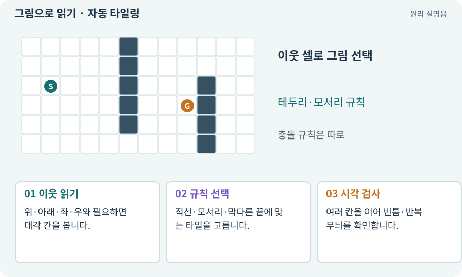

# 자동 타일링·Rule Tile·경계 마스크

**분야:** 지도·적 AI·전투 규칙

자동 타일링은 주변 칸이 바닥인지 벽인지에 따라 모서리·직선·끝 타일을 고르는 규칙입니다. 지형의 연결을 새로 만드는 알고리즘과는 다릅니다.

**찾아오는 이름:** 자동 타일링·Rule Tile·경계 마스크, Rule Tile, RuleTile, 자동 타일링, 오토타일, 경계 마스크, bitmask

## 익숙한 것에 비유하면

퍼즐 조각의 주변 모양을 보고 맞는 테두리 그림을 고르는 것입니다.



개념도입니다. 실제 Unity 화면이나 검사 결과가 아닙니다. 그림의 순서·색은 역할을 구분하며 실제 설정값은 프로젝트에서 확인합니다.

## 이렇게 작동합니다

### 1. 이웃 읽기

위·아래·좌·우와 필요하면 대각 칸을 봅니다.

### 2. 규칙 선택

직선·모서리·막다른 끝에 맞는 타일을 고릅니다.

### 3. 시각 검사

여러 칸을 이어 빈틈·반복 무늬를 확인합니다.

## 우리 RPG에서는 이렇게 만나요

벽 주변 그림을 고쳐도 논리 통로는 그대로여야 합니다. 타일이 예쁘게 이어진다는 이유로 통과 불가능한 문을 길로 인정하지 않습니다.

## 이것과 혼동하지 마세요

자연스러운 경계 그림과 실제 이동 가능성은 별개입니다.

## 이해했는지 한 번 생각해 보기

Rule Tile을 적용하면 방 연결도 자동 보장될까요?

<details><summary>답과 이유</summary>

아닙니다. 방·통로 생성과 도달 검사를 별도로 해야 합니다.

</details>

## 내 프로젝트에서 확인하고 싶다면

아래 요청은 읽기 전용으로 실제 대상을 확인하는 선택 요청입니다. 코드나 설정을 직접 편집할 필요는 없습니다.

```text
현재 프로젝트에서 자동 타일링·Rule Tile·경계 마스크 관련 요소가 어떻게 사용되는지 읽기 전용으로 확인해 줘. 실제 대상과 설정을 찾아 쉬운 말과 작은 예로 설명해 줘. 특히 다음 혼동을 구분해 줘: 자연스러운 경계 그림과 실제 이동 가능성은 별개입니다. 아직 코드·설정·파일은 바꾸지 말고, 확인할 수 없는 내용은 따로 알려 줘.
```

## 이어지는 개념

[Tilemap·Tile·타일 팔레트](tilemap.md) · [절차적·무작위 지형 생성](generation.md) · [심리스·타일 반복·스타일 일관성](seamless.md) · [논리 지도·DungeonLayout](layout.md)

## 이 개념을 사용하는 실습

[66 · 타일 경계와 랜덤맵 외형 연결하기](../index.html#lesson-066)

## 참고와 설명의 범위

기본 도구 동작은 아래 공식 자료를 참고했습니다. 비유·그림·RPG의 예시 수치와 정책은 이해를 위한 자체 예제입니다. 실제 API·지원 기능은 설치 버전과 계정에서 확인합니다.

- [Unity · Tilemap Collider 2D](https://docs.unity3d.com/6000.3/Documentation/Manual/tilemaps/work-with-tilemaps/tilemap-collider-2d.html)

그림·계산 예제·조작 모형은 자체 제작한 설명입니다. 실제 Unity 화면, 서비스 생성 결과, 성능 실측 또는 게임 테스트 결과가 아닙니다. 자료 확인: 2026년 9월 26일.
