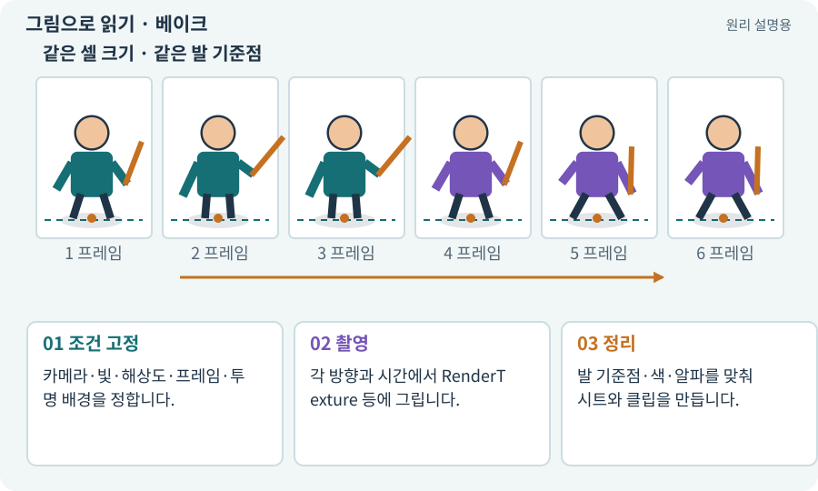

# 베이크·렌더 텍스처·오프라인 제작

**분야:** 그림·애니메이션·화면 만들기

베이크는 실행할 때 계산할 결과 일부를 미리 만들어 자료로 저장하는 과정입니다. 3D→2D 베이크에서는 모델을 정해진 카메라로 촬영해 스프라이트 프레임을 만듭니다.

**찾아오는 이름:** 베이크·렌더 텍스처·오프라인 제작, 베이크, Bake, RenderTexture, 렌더 텍스처, 오프스크린, 3D→2D

## 익숙한 것에 비유하면

요리 과정을 매번 반복하는 대신 필요한 단계의 결과를 미리 준비하는 것입니다. 모든 원본 정보가 결과물에 남는 것은 아닙니다.



개념도입니다. 실제 Unity 화면이나 검사 결과가 아닙니다. 그림의 순서·색은 역할을 구분하며 실제 설정값은 프로젝트에서 확인합니다.

## 이렇게 작동합니다

### 1. 조건 고정

카메라·빛·해상도·프레임·투명 배경을 정합니다.

### 2. 촬영

각 방향과 시간에서 RenderTexture 등에 그립니다.

### 3. 정리

발 기준점·색·알파를 맞춰 시트와 클립을 만듭니다.

## 우리 RPG에서는 이렇게 만나요

한 3D 캐릭터를 4방향으로 촬영해 2D에 쓸 수 있지만, 촬영하지 않은 뒷면이나 무기 동작이 저절로 생성되는 것은 아닙니다.

## 이것과 혼동하지 마세요

베이크라는 말은 라이트맵·NavMesh 등에도 쓰입니다. 무엇을 미리 계산하는지 문맥을 확인합니다.

## 이해했는지 한 번 생각해 보기

베이크 PNG만 있으면 3D 관절을 다시 수정할 수 있나요?

<details><summary>답과 이유</summary>

PNG에는 뼈대 정보가 없으므로 원본 모델·리그를 별도로 보존해야 합니다.

</details>

## 내 프로젝트에서 확인하고 싶다면

아래 요청은 읽기 전용으로 실제 대상을 확인하는 선택 요청입니다. 코드나 설정을 직접 편집할 필요는 없습니다.

```text
현재 프로젝트에서 베이크·렌더 텍스처·오프라인 제작 관련 요소가 어떻게 사용되는지 읽기 전용으로 확인해 줘. 실제 대상과 설정을 찾아 쉬운 말과 작은 예로 설명해 줘. 특히 다음 혼동을 구분해 줘: 베이크라는 말은 라이트맵·NavMesh 등에도 쓰입니다. 무엇을 미리 계산하는지 문맥을 확인합니다. 아직 코드·설정·파일은 바꾸지 말고, 확인할 수 없는 내용은 따로 알려 줘.
```

## 이어지는 개념

[리그·본·스키닝·Avatar](rig.md) · [스프라이트 시트](sprite-sheet.md) · [카메라·직교·원근](camera.md) · [알파·RGBA·투명 배경](alpha.md)

## 이 개념을 사용하는 실습

[67 · 내 게임의 아트 제작 경로 선택하기](../index.html#lesson-067) · [86 · 3D에서도 클릭한 곳까지 돌아가기](../index.html#lesson-086) · [99 · 2D와 3D 사이에 진행 가져오기](../index.html#lesson-099) · [103 · 같은 전투를 2D와 3D로 플레이하기](../index.html#lesson-103)

## 참고와 설명의 범위

기본 도구 동작은 아래 공식 자료를 참고했습니다. 비유·그림·RPG의 예시 수치와 정책은 이해를 위한 자체 예제입니다. 실제 API·지원 기능은 설치 버전과 계정에서 확인합니다.

- [Unity · 애니메이션 개요](https://docs.unity3d.com/6000.3/Documentation/Manual/AnimationOverview.html)
- [Unity · Sprite](https://docs.unity3d.com/6000.3/Documentation/Manual/sprite/sprite-landing.html)

그림·계산 예제·조작 모형은 자체 제작한 설명입니다. 실제 Unity 화면, 서비스 생성 결과, 성능 실측 또는 게임 테스트 결과가 아닙니다. 자료 확인: 2026년 9월 26일.
